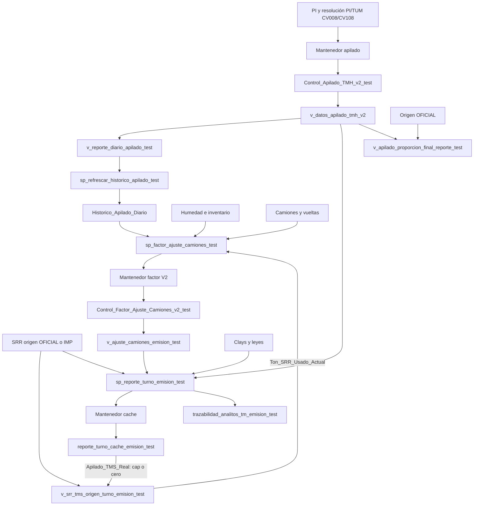

# Diagnóstico downstream PI/TUM — DEV, 19-09-2026

El defecto demostrado es la omisión de **Historico_Apilado_Diario entre el reproceso de apilado y el cálculo del factor**. Refrescar solamente factor/cache, incluso dos veces, no corrige esa fuente. Para el 10-09, Histórico actualizado cambia el factor de 1 a **0,9983502509529375** y ese factor se aplica efectivamente al reporte.

No se implementó la solución. No se alteraron objetos SQL ni datos persistentes; las pruebas de orden trabajaron sobre copias temporales. No se usaron tags SRR ni el procedimiento experimental de SRR por tag. Algunas definiciones experimentales aparecen en la captura amplia del catálogo, pero no alimentan las pruebas ni las conclusiones.

## A. Mapa de dependencias

Todos los objetos sin esquema explícito pertenecen a `inventar_SpcHidr`. Las definiciones exactas inspeccionadas están en [evidencia](evidencia/), junto con catálogo, dependencias, columnas y resultados JSON.

La vista antigua de proporciones **no es una fuente del SP vigente del reporte**. No existe la arista «porcentaje del cache → masa SRR del factor».

|Objeto / operación|Lecturas y columnas relevantes|Salida / writer|Momento y rango|
|---|---|---|---|
|`Control_Apilado_TMH_v2_test`|`tot_TM`, fronteras 08/20/08 siguiente y `v_contingencia_totalizador_resuelto_operacional_test`; resolución CV008/CV108|`sp_mantiene_apilado_tmh_v2_test` materializa totalizadores, `TMH_CV008_A/B`, `TMH_CV108_A/B`, `TMH_Apilado_Total_A/B/Dia`, flags y `Fecha_Calculo`|PI/TUM y preparación Reporte por Turno; fechas inclusivas; recalcula ventana final N días y fechas faltantes|
|`v_datos_apilado_tmh_v2`|Columnas anteriores, totalizadores, marcas y flags de Control|Proyección dinámica, sin refresco propio|Cada lectura; misma fotografía de Control|
|`v_reporte_diario_apilado_test`|Cadena de apilado, humedad y sal; TMH por turno, humedad y sal resueltas|`TMH_Bruto_A/B/Dia`, TMH neto, TMS recalculado, sal, humedad, checks; `Factor_Ajuste_Camiones=1`|Dinámica; no incorpora factor V2|
|`Historico_Apilado_Diario`|Todas las columnas homónimas de la vista diaria, incluidos bruto, neto, TMS, sal, humedad y checks|`sp_refrescar_historico_apilado_test`: DELETE + INSERT; `Fecha_Calculo=SYSDATETIME()`|Inclusivo desde `min(inicio, fin-DiasReproceso)` hasta fin. Con 0: exactamente inicio–fin|
|`sp_factor_ajuste_camiones_test`|Histórico: `TMH_Bruto_Dia`, `Apilado_TMH_promedio_dia`, `Sal_promedio_dia`; humedad/inventario; SRR usado; camiones/vueltas|Resultado calculado, tablas temporales; no persiste el factor|Días solicitados; inventario consulta antecedentes (ventana de 400 días)|
|`Control_Factor_Ajuste_Camiones_v2_test`|Resultado del calculador anterior|`sp_mantiene_factor_ajuste_camiones_v2_test`, MERGE: factor, inputs, resultados corregidos, estado/flags y fecha|Después de Histórico; inclusivo, expansión de inicio por DiasReproceso; usar 0 para rango explícito|
|`v_ajuste_camiones_emision_test`|`Factor_Ajuste`, flag de validez y diagnósticos del Control V2|`Factor_Ajuste_Calculado`, `Factor_Aplicacion_Reportes`, `Flag_Usa_Ajuste`|Dinámica|
|`v_apilado_base_mina_stock_srr`|`mov_cam_powerbi`: origen, fase, masa, fecha/turno|`Ton_Stock`, `Ton_Mina`, `Ton_SRR`, proporciones|Dinámica; origen OFICIAL|
|`v_apilado_proporcion_final_reporte_test`|Base OFICIAL y `v_apilado_tms_sin_sal_con_srr_reporte_test`|`TMS_SRR`, `Apilado_TMS_Con_SRR`, `Prop_Final_SRR`|Dinámica; sin fallback IMP ni cap equivalente al vigente|
|`v_srr_tms_origen_turno_emision_test`|Cache: `Fecha`, `Turno`, `Apilado_TMS_Real`; base OFICIAL; `v_conciliacion_chancado_v2.Fuente_Dato`; `DEV_SIIR.hidro.v_imp_chancado_normalizado`|Masa origen y `Ton_SRR_Usado_Actual`, origen efectivo, flag de cap|Dinámica, pero depende de filas y denominador materializados del cache|
|`sp_reporte_turno_emision_test`|Apilado vigente, `Factor_Aplicacion_Reportes`, humedad, sal, origen OFICIAL/IMP, leyes/Clays|Filas del reporte: apilado, STOCK/MINA/SRR, FeS, Malla y demás analitos; DELETE/INSERT en `trazabilidad_analitos_tm_emision_test`|Rango de reporte con fin exclusivo; **no es un SELECT puro**|
|`reporte_turno_cache_emision_test`|Salida completa del SP del reporte|`sp_actualizar_reporte_turno_cache_emision_test`: DELETE + INSERT EXEC, fecha de actualización|Después del factor final; `[inicio, fin)`; A/B de cada día|
|`sp_refrescar_clays_cufe`|Fuentes de Clays/leyes y destino vigente|Actualiza Clays_CuFe y registra trazabilidad de cambios|El wrapper Python lo ejecuta antes del cache; rango inclusivo, sujeto a corte Clays|

Los nombres y tipos completos, sin abreviaturas A/B, pueden verificarse en los SQL y `columnas_*.json` de evidencia. Los campos persistidos del factor y su comparación están en [INPUTS_FACTOR.md](INPUTS_FACTOR.md).

### Writers y callers de Histórico

En los módulos SQL visibles inspeccionados, el writer identificado es `sp_refrescar_historico_apilado_test`. El caller SQL identificado es `sp_refrescar_historico_apilado_diario`: selecciona ayer UTC y solicita 7 días de reproceso. Los matches de jobs inspeccionados en msdb fueron vacíos; esto no demuestra ausencia de schedulers externos, SQL dinámico externo o módulos no visibles por permisos. Evidencia: `menciones_historico.json`, `referencias_historico.json`, `callers_sql_historico.json`, `jobs_historico.json`, `triggers_y_columnas.json`.

|Ruta Python|Archivo, función y línea|Secuencia comprobada|
|---|---|---|
|Wrapper Histórico|`report_export/report_export.py:391,684,697`, `refrescar_historico_apilado_report`|Sí existe EXEC al refrescador; abre su propia transacción|
|Reporte por Turno común|`report_export/report_export.py:2081`, `refrescar_dependencias_reporte_turno_emision`; wrappers en 2140, 2170, 2196|Apilado → Factor → Clays → Cache. **Omite Histórico**|
|Preview / Excel / PDF Reporte por Turno|`report_export/callbacks/reportabilidad_cb.py:7468,7781,8206`|Los tres llaman al helper anterior|
|Datos Conciliados común|`report_export/callbacks/reportabilidad_cb.py:125,130`, `_refrescar_dependencias_datos_conciliados`|Histórico → Clays/Cache → mantenedor Datos Conciliados|
|Preview / Excel / PDF Datos Conciliados|Mismo archivo: 7538, 7882, 8276|Sí refrescan Histórico por el helper anterior|
|PI/TUM alta/cierre|`monitor_pi_tum/db.py:328,358`, `_registrar_y_reprocesar`|Registro → `reprocesar_apilado`; sin Histórico/factor/cache|
|PI/TUM rango cerrado|`monitor_pi_tum/db.py:159,187`, `registrar_contingencia_rango`|Mismo reproceso, dentro de la transacción del registro|
|Reproceso común PI/TUM|`monitor_pi_tum/db.py:302`, `reprocesar_apilado`|Solo mantenedor apilado; días de reproceso = longitud inclusiva del rango|
|TUM tardío|`monitor_pi_tum/postprocesar_tum_contingencia.py:127`|Reprocesa grupos de fechas afectadas CV008/CV108; sin downstream|

Además, `sp_mantiene_datos_conciliados_emision_test` llama al mantenedor de factor (línea 92 de su definición capturada). En esa ruta el factor puede cambiar **después** del cache, sin reconstrucción final del cache. Es un segundo riesgo de orden confirmado por código; no se atribuye a esta ruta la ejecución histórica concreta sin log de aquella ejecución.

## B–C. Causa raíz y objetos desactualizados

La ruta PI/TUM permite cambiar Control sin actualizar Histórico. La ruta Reporte por Turno recalcula luego el factor sobre ese Histórico anterior y materializa un cache que puede parecer reciente. La fecha de actualización del cache por sí sola no acredita coherencia de inputs.

Para 10-09, Control contiene 41.462 / 42.168 TMH (83.630 diarios), mientras Histórico y el input persistido del factor contienen 35.897 / 35.896 (71.793). Histórico es del 14-09 00:12:04 y factor del 14-09 10:20:18. El cache del 17-09 reproduce el apilado vigente **con factor viejo 1**. Esto prueba el eslabón desactualizado y su efecto, sin necesitar inferirlo por timestamps.

La [comparación completa de septiembre](COMPARACION_SEPTIEMBRE.md) incluye valores, fechas y reproducción aritmética del cache:

- **04-B y 06 A/B:** cache y SP directo coinciden. La diferencia respecto de la vista antigua es la aplicación de factor V2 (0,994147078… / 0,994804288…), ausente en el TMS de esa vista. No es evidencia de cache stale.
- **07-A:** cache y directo coinciden usando 0,676017935…; la vista no aplica ese factor. Sin embargo el factor diario conserva input 50.347 frente a 43.547 TMH actuales: la igualdad del turno A no certifica factor vigente.
- **07-B:** el cache reproduce exactamente TMH anterior 35.896 × factor × fracción seca − sal; el directo usa 29.096 TMH. Cache e Histórico están desactualizados y el factor conserva input diario anterior.
- **08 A/B:** cache reproduce TMH anteriores 35.897 / 35.896, frente a 27.389 / 37.460 actuales. También está desactualizado el input del factor diario (71.793 frente a 64.849).
- **09 A/B:** factor numérico 1, pero cache reproduce TMH anteriores 35.896 / 35.896 frente a 33.220 / 41.660 actuales. Input diario persistido 71.792 frente a 74.880; no se afirma que el nuevo factor necesariamente deje de ser 1.
- **10 A/B:** cache y directo coinciden porque ambos usan apilado vigente y factor anterior 1. Histórico/factor siguen desactualizados; el nuevo factor demostrado es 0,9983502509529375.

Las reproducciones numéricas del cache usan sal y humedad de las fuentes capturadas y coinciden dentro de su precisión decimal de almacenamiento. El SP directo de la comparación **todavía usa el factor persistido**, no un factor corregido para cada fecha. No se confunde ese directo con una corrección integral de septiembre.

## D. Factor y SRR: masa frente a porcentaje

El factor obtiene bruto/neto/sal de Histórico; humedad diaria de `v_humedad_inventario_test` vía `v_reporte_diario_humedad_test`; inventario y variación desde `v_inventario_chancado_test` / `v_inventario_chancado_archive_test` (datos de inventario, humedad y antecedente). Camiones/vueltas provienen de `mov_cam_powerbi`, `ton_descarga` y `n_break`, KOM/CAT, destino CH01, excluyendo fase SRR. SRR es la suma A/B de `Ton_SRR_Usado_Actual`.

Con h expresada como fracción, las operaciones relevantes son: `TMS_base=TMH_bruto*(1-h)`; mineral = TMS_base + variación de inventario; chancado TMS = mineral − sal − SRR; chancado TMH = chancado TMS/(1−h). Se distribuye por producción KOM/CAT y se aplican las cargas máximas vigentes 380/265. El factor es TMH corregido total / chancado TMH cuando el cálculo es válido.

Para 10-09 actualizado: h=3,3%; sal=1.239,06; variación inventario=0; SRR=24.053; chancado TMH=57.474,8190279214; producción KOM=53.907 y 151 vueltas; carga calculada=380,627940582261; KOM corregido=57.380. Resultado: **0,9983502509529375, OK_AJUSTE_KOM**, TMH bruto ajustado=83.492,03148719417.

`v_ajuste_camiones_emision_test` devuelve el factor si el flag de validez es 1 y `Factor_Ajuste` no es NULL; en otro caso devuelve 1. `Flag_Usa_Ajuste` incluye más comprobaciones, pero no es la condición que controla esa expresión. El SP multiplica TMH por `COALESCE(Factor_Aplicacion_Reportes,1.0)`. **No hay tolerancia que transforme 0,998350250952938 en 1**; la simulación confirma su aplicación.

La rama antigua toma masa OFICIAL `Ton_SRR` y divide por apilado sin factor V2; no tiene fallback IMP. El SP actual resuelve OFICIAL si existe masa positiva de stock/mina/SRR; si no, admite IMP bajo `Fuente_Dato='IMP'` y total IMP positivo. Resuelve masa no negativa y la limita al apilado del reporte. Calcula el porcentaje y lo convierte a decimal con dos decimales.

La vista SRR del factor resuelve el mismo origen, pero limita usando **Apilado_TMS_Real del cache**. Con mismo origen y sin cap, ambas ramas actuales usan igual masa; con cache incoherente y cap pueden diferir. La vista antigua coincide en masa cuando aplica OFICIAL y no hay recorte; puede diferir de las actuales por IMP o cap, además de sus distintos denominadores.

En 10-09, la vista antigua tiene SRR NULL; las ramas vigentes usan IMP 8.307 / 15.746. Reconstruir masa multiplicando el porcentaje redondeado del cache produce 24.050,9074142 en vez de 24.053. **Ese número reconstruido no es input del factor**. Las diferencias porcentuales grandes de 07–09 combinan denominador sin factor V2 y, según turno, cache con TMH anterior; no demuestran cambio de masa SRR.

## E–F. Ciclo y orden recomendado

|Caso|Dependencia efectiva|Orden y necesidad de repetición|
|---|---|---|
|Normal: origen ≤ apilado tanto inicial como final|Masa origen → factor. El porcentaje es derivado|A: Apilado → Histórico → Factor → Cache. No necesita segunda iteración|
|Cap: origen > apilado positivo|Cache apilado → masa usada → factor → nuevo apilado|B puede preparar mejor el input, pero debe comprobarse estabilidad después del cache final; una pasada no garantiza cierre|
|Apilado=0 con origen positivo|Masa usada=0; puede cambiar al reconstruir cache|Tratar como dependencia activa aunque el flag cap sea falso; verificar masa antes/después|
|Cache sin fila|La vista no tiene ese período materializado|Preparar cache preliminar y verificar completitud antes del factor|
|OFICIAL|Prioridad de origen vigente, mismo mecanismo de cap|A si masa estable; B/verificación si depende del denominador|
|IMP|Fallback vigente, mismo mecanismo de cap|Igual criterio; no exige una iteración por ser IMP|

**Para el 10-09 observado, recomendar A**, conservando Clays antes del cache: Apilado → Histórico → Factor → Clays → Cache final. Los 14 turnos reales inspeccionados del 04 al 10 no tienen cap activo. Para una operación general, comprobar también el estado resultante: un cap puede aparecer después de cambiar el factor.

**B no sustituye Histórico ni resuelve por sí sola todo ciclo.** Es apropiada para cache ausente o una fotografía que altera masa por cap/cero: Apilado → Histórico → Clays si corresponde → Cache preliminar → Factor → Cache final → comprobar masa efectiva. El preliminar usa el factor disponible; no es resultado publicable. Si cambia la masa efectiva, existe una nueva entrada del factor y se necesita otra evaluación controlada. No repetir Clays cuando sus inputs permanecen constantes.

Los experimentos [SECUENCIAS.md](SECUENCIAS.md) prueban:

|Secuencia, con Control ya actualizado|Factor final|Resultado|
|---|---|---|
|Factor → Cache, sin Histórico|1|No corrige el defecto|
|Cache → Factor → Cache, sin Histórico|1|Tampoco lo corrige|
|Histórico → Factor → Cache|0,9983502509529375|TMS A=39.408,079368; B=40.089,655081|
|Histórico → Cache → Factor → Cache|0,9983502509529375|Mismo resultado; preliminar innecesario para este caso|

STOCK/SRR resultantes: A 78,92/21,08%; B 60,72/39,28%; MINA=0. FeS y Malla no cambiaron en el experimento de orden. Clays se mantuvo constante para aislar la dependencia, sin ejecutar su refrescador.

### Convergencia condicional demostrada

La [prueba sintética de cap](CAP_CONVERGENCIA.md) conserva los inputs reales del 10-09 y cambia únicamente el cache temporal inicial a 1.000 TMS por turno. Primer factor=0,7147447899457886 con SRR usado 1.000/1.000; su cache resulta 28.037,271781/28.525,229478, liberando el cap y devolviendo SRR a 8.307/15.746. El siguiente factor=0,9983502509529375 y cache=39.408,079368/40.089,655081. Una evaluación adicional mantiene ambos.

Esto prueba el ciclo condicional y convergencia de **esa semilla**, no convergencia universal. Criterio propuesto: mismas filas/orígenes y masa SRR efectiva antes/después; factor y campos del reporte iguales a precisión de sus tipos de destino, excluyendo timestamps. No usar porcentajes redondeados como criterio. Una futura implementación deberá detenerse sin publicar si no estabiliza, con límite operativo explícito; ese límite no se implementó ni se presenta como regla de negocio existente.

### Rango mínimo

Reprocesar días completos afectados y ambos turnos en factor/cache porque el factor es diario. Para un cambio exclusivo de apilado en D, Histórico requiere D. Hay que revisar también humedad diaria ponderada: si cambia h(D), puede cambiar inventario seco I(D), y su diferencia afecta D y el siguiente día/registro de inventario según continuidad. Se lee el antecedente D−1; no necesita reescritura por ese solo motivo.

Para 10-09, humedad uniforme 3,3% mantiene esa entrada y el experimento necesita solo 10-09. Para un rango 07–11, el mínimo base es 07–11 y debe incluir 12 si la variación de inventario de ese día cambia por I(11). No es correcto declarar universalmente suficiente una ventana fija de siete días.

- Activación: fechas efectivamente afectadas desde inicio hasta último día operacional cerrado/materializable; los días futuros se procesan al cerrar.
- Cierre: días cuyos turnos cambian por la frontera de cierre hasta el último materializable; los anteriores sin cambio no exigen recálculo salvo reparación de stale. El helper actual conservador abarca desde activación.
- TUM tardío: fechas realmente cambiadas CV008/CV108, agrupadas; no inventar reproceso apilado para SRR/CV025.
- Histórico/factor: inicio y fin inclusivos, `DiasReproceso=0` para no ampliar tácitamente. Apilado: dimensionar su ventana para cubrir todos los días cambiados, incluidos antiguos ya existentes. Cache: convertir fin inclusivo a fin+1 exclusivo. Clays: fin inclusivo y corte vigente.

## G. Transacciones y riesgos

|Mantenedor / SP|BEGIN / COMMIT / ROLLBACK propios|XACT_ABORT explícito|Consecuencia|
|---|---|---|---|
|`sp_mantiene_apilado_tmh_v2_test`|No / No / No|ON|Participa en transacción externa; por sí solo no hace atómica toda la cadena|
|`sp_refrescar_historico_apilado_test`|No / No / No|ON|DELETE e INSERT pueden quedar separados bajo autocommit; requiere transacción externa|
|`sp_refrescar_historico_apilado_diario`|No / No / No|No|Delega en refrescador, sin envolver el conjunto|
|`sp_factor_ajuste_camiones_test`|No / No / No|ON|Cálculo temporal, participa en contexto externo|
|`sp_mantiene_factor_ajuste_camiones_v2_test`|No / No / No|ON|MERGE con HOLDLOCK; no hace atómica la cadena completa|
|`sp_reporte_turno_emision_test`|No / No / No|No|Escribe trazabilidad con DELETE/INSERT: ejecutarlo directo puede dejar efectos persistentes|
|`sp_actualizar_reporte_turno_cache_emision_test`|Sí / Sí / Sí en CATCH|ON|Transacción propia; anida en externa, pero su ROLLBACK de error revierte toda la externa|
|`sp_refrescar_clays_cufe`|Sí / Sí / Sí en CATCH|ON|Usa applock con propietario Transaction; anidado conserva lock hasta fin externo, error revierte toda la externa|

Límite seguro propuesto: una conexión y transacción para la unidad afectada, desde actualización de apilado hasta Histórico, factor, Clays/cache y validación final; si es una operación PI/TUM, conservar también la atomicidad del registro que origina el cambio. No publicar un cache preliminar. Los wrappers actuales abren transacciones independientes, por lo que no bastaría envolver llamadas Python sin compartir conexión.

En error de un SP con ROLLBACK global, el coordinador debe asumir transacción abortada y terminar; no continuar ni intentar recuperar con un savepoint inexistente. Una transacción común por sí sola no garantiza una fotografía estable de fuentes externas bajo READ COMMITTED: la implementación futura necesita serializar la unidad afectada y validar versiones/estabilidad de entradas o definir aislamiento compatible. Evaluar duración, bloqueos, deadlocks y reintentos antes de desplegar.

Otros riesgos: ausencia de filas cache, cap activado después del cálculo, cero con flag cap falso, fuentes que cambian durante el refresco, distinto corte de apilado/factor/cache, y humedad/inventario que amplían el impacto temporal. No se demostró convergencia universal ni se ejecutó un refresco integral real de Clays/exportación en esta fase.

## H–J. Cambio mínimo propuesto, validación y archivos

La corrección normal no requiere cambiar fórmulas SQL: insertar Histórico después de Apilado y antes de Factor en el coordinador común, compartir conexión/transacción y verificar coherencia de inputs. La rama condicional de cap/cero/cache ausente necesita especificación y pruebas antes de incorporar repetición. Esta propuesta **no está implementada**.

|Archivo que requeriría cambio posterior|Cambio propuesto|
|---|---|
|`report_export/report_export.py`|Corregir orden en `refrescar_dependencias_reporte_turno_emision`; permitir conexión compartida en wrappers; validar Histórico/input factor/masa SRR, no solo timestamps|
|`report_export/callbacks/reportabilidad_cb.py`|Alinear `_refrescar_dependencias_datos_conciliados` para no dejar cache anterior al factor; mantener preview/Excel/PDF sobre coordinador común|
|`monitor_pi_tum/db.py`|Integrar el downstream autorizado en el punto común de reproceso CV008/CV108, conservando transacción del evento y rango afectado; únicamente en una fase posterior autorizada|
|`monitor_pi_tum/postprocesar_tum_contingencia.py`|No requiere cambio si delega por el helper común anterior; cambiar solo si la integración elegida necesita pasar contexto de fechas/conexión|
|Pruebas del coordinador y de PI/TUM|Agregar cobertura del orden, rango, fallo atómico y casos cap/cero; actualizar expectativas de llamadas cuando se implemente|

**Objetos SQL cuya definición haya que modificar: ninguno demostrado necesario.** Los objetos que una solución futura tendría que refrescar son Control de apilado, Histórico, Control de factor, cache y sus efectos existentes de Clays/trazabilidad, usando los SP listados. No alterar objetos oficiales ni reglas de selección de origen. Invocar un mantenedor con efectos sobre objetos compartidos requerirá delimitar el alcance antes de esa futura ejecución; aquí no se invocaron para persistir resultados.

Plan DEV posterior:

1. Conservar snapshots de fuentes/destinos y definir corte operacional común. Validar rangos, conexión compartida y ausencia de destinos PROD.
2. Repetir 10-09: input factor=83.630; factor=0,998350250952938; TMS finales y porcentajes de este informe; comparación de analitos completa.
3. Recalcular 04-B, 06, 07, 08, 09, 10 desde fuentes coherentes; comprobar que controles sin cambio conservan resultado y separar cambios legítimos de factor del stale de cache.
4. Probar OFICIAL e IMP sin cap, con cap, cero y fila cache ausente; comprobar masa efectiva y estabilidad sin iteración normal innecesaria. Incluir un caso que no estabilice para evitar publicación parcial.
5. Probar activación, cierre y TUM tardío antiguo fuera de siete días; ambos turnos y propagación por humedad/inventario.
6. Inyectar fallos tras DELETE de Histórico, durante factor y dentro de cache/Clays: ninguna fotografía parcial publicada; comprobar comportamiento del ROLLBACK global.
7. Comparar preview, Excel y PDF sobre igual fotografía, también Datos Conciliados; ejecutar regresiones existentes, Reclamo NORMAL y caso CV025 08–09 B: RO=NULL, PENDIENTE_TUM, sin fallback PI ni cero fabricado. Conservar tipos oficiales, tratamiento visual 51025 y reglas vigentes.

## Evidencias y alcance de lo ejecutado

Se agregaron únicamente scripts de diagnóstico y documentos en esta carpeta: `inspeccionar.py`, `inputs.py`, `comparar.py`, `simular.py`, `documentar.py`, este informe, cuatro tablas Markdown y capturas en `evidencia/`. No hubo cambios funcionales de aplicación en esta fase.

Las cuatro secuencias reales y la prueba sintética terminaron correctamente. Se compararon filas persistentes de Histórico, factor, cache y trazabilidad antes/después: **idénticas** en cada simulación, con rollback final. Los cuerpos SQL utilizados y las sustituciones por `#hist/#factor/#cache/#traza/#srr/#ajuste` quedan disponibles para revisión. El SP directo del reporte se ejecutó con trazabilidad redirigida a temporal; no se lo trató como lectura inocua.

No se repitió la suite funcional porque no se cambió funcionalidad; estas pruebas son experimentos de diagnóstico, no una certificación de una implementación nueva. El diagnóstico cierra la causa y el orden normal. Permanecen pendientes de una fase de implementación la coordinación transaccional, política operativa ante no convergencia y validación integral de exportaciones/Clays. No se ejecutó rollback de objetos ni se modificó PROD.
