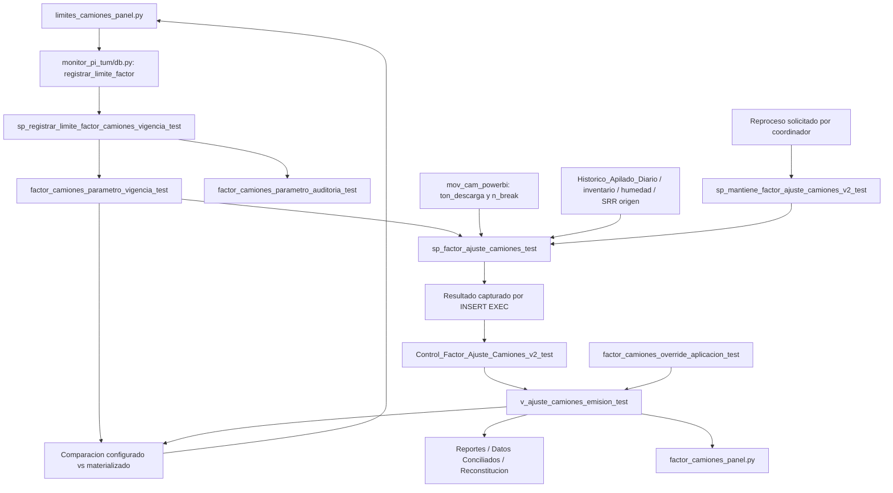

# Auditoría de parametrización de camiones — DEV

Fecha: 30-09-2026. Lectura efectiva de `inventar_SpcHidr`, verificada con `_assert_dev_connection`; observación inicial SQL: 2026-09-30 11:19:51 (reloj del servidor). Se revisó el repositorio actual, no solamente las migraciones antiguas. No se ejecutaron mantenedores, registros, migraciones, reprocesos ni pruebas con escrituras. Único archivo generado: este informe. No commit/push.

## Conclusión y decisión propuesta

**Sí conviene reutilizar la infraestructura temporal existente**, ampliándola de manera controlada a dos categorías. La estructura de claves, índices y trigger ya separa `flota + parametro`, pero el CHECK actual **solo admite `LIMITE_CARGA_AJUSTE`** y el procedimiento/API/UI están especializados en límites. Agregar `CARGA_NOMINAL_TMH_VIAJE` requiere una migración del CHECK, administración genérica compatible y extensión de la trazabilidad materializada; no basta un INSERT.

**La carga nominal no participa actualmente en el cálculo V2 vigente.** Este lee producción húmeda desde `mov_cam_powerbi.ton_descarga` y vueltas desde `n_break`. Los nominales 357/236 pertenecen al mantenedor histórico `sp_mantiene_factor_ajuste_camiones_test`, que escribe otra tabla. Almacenar nuevos nominales no autoriza reemplazar la producción vigente por `vueltas × nominal`: eso sería un cambio metodológico explícito. La propuesta de esta auditoría conserva esta distinción.

Datos confirmados:

| Categoría existente | Flota | Valor TMH/viaje | Desde inclusivo | Hasta exclusivo | Activo |
|---|---|---:|---|---|---|
| LIMITE_CARGA_AJUSTE | KOM | 380,000000 | 2026-07-01 | NULL | 1 |
| LIMITE_CARGA_AJUSTE | CAT | 265,000000 | 2026-07-01 | NULL | 1 |

La consulta sin filtro de categoría devolvió exactamente estas dos filas; no existen otras categorías, filas inactivas ni cambios futuros. Ambos registros tienen usuario `MIGRACION_FASE2A`, fecha de registro 2026-09-28 10:24:51.656208 y motivo `Seed: limites originales cadena V2; MIN(Fecha)=01-07-2026`. IDs: KOM=1, CAT=2. La tabla de auditoría de cambios está vacía: los seeds no fueron altas a través del administrador. Hay 89 fechas materializadas, desde 01-07 hasta 27-09-2026, todas con límites 380/265. La consulta actual de pendientes devuelve cero filas.

## 1. Mapa de objetos y datos



No existe flecha de registro hacia reproceso. El registro escribe configuración e historial, no la tabla V2. La vista muestra parámetros materializados, no vuelve a resolver la configuración vigente.

## 2. Tabla, restricciones y extensibilidad

Objeto: `inventar_SpcHidr.factor_camiones_parametro_vigencia_test`.

| Columna | Tipo | Nulabilidad / función |
|---|---|---|
| id | bigint IDENTITY(1,1) | NOT NULL; PK clustered |
| flota | varchar(3) | NOT NULL; KOM/CAT |
| parametro | varchar(40) | NOT NULL; CHECK exclusivo de LIMITE_CARGA_AJUSTE |
| valor | decimal(18,6) | NOT NULL; >0 |
| vigencia_desde | date | NOT NULL; inclusive |
| vigencia_hasta | date | NULL; exclusive; NULL significa abierta |
| motivo | nvarchar(1000) | NOT NULL; texto no vacío tras trim |
| usuario_registro | nvarchar(128) | NOT NULL; texto no vacío tras trim |
| fecha_registro | datetime2(7) | NOT NULL; DEFAULT SYSDATETIME() |
| activo | bit | NOT NULL; DEFAULT 1 |

PK actual `PK__factor_c__3213E83F0178330D(id)`. Unique constraint `UQ_factor_vigencia_inicio(flota,parametro,vigencia_desde)` incluye también filas inactivas. Índice único filtrado `UX_factor_vigencia_abierta(flota,parametro) WHERE activo=1 AND vigencia_hasta IS NULL` permite como máximo una vigencia abierta por par. `CK_factor_vigencia_intervalo` exige fin posterior al inicio. CHECK de categoría vigente: `CK__factor_ca__param__41EF6173`, expresión `([parametro]='LIMITE_CARGA_AJUSTE')`. No hay FK entrantes/salientes para esta tabla.

El trigger `tr_factor_camiones_vigencia_solapamiento_test` compara todos los pares activos de la misma flota **y categoría**, con intersección de intervalos semiabiertos; toma `TABLOCKX,HOLDLOCK` y lanza 51001 ante solapamiento. Permite que el fin de un intervalo coincida con el inicio del siguiente. No impone continuidad ni cobertura inicial: eso lo hace el SP administrador. No detecta huecos por sí solo.

Los permisos actuales niegan INSERT/UPDATE/DELETE a `public` tanto sobre vigencias como sobre auditoría. No se encontraron permisos explícitos a nivel de objeto para el SP en la consulta realizada; eso no determina los permisos efectivos heredados de roles/esquemas. La cuenta utilizada es privilegiada y no demuestra las autorizaciones de usuarios ordinarios.

El anexo **DDL lógico completo reconstruido desde DEV** incluye nombres reales, collation, identity, defaults, PK, UNIQUE, CHECK e índice filtrado. El trigger se incluye íntegro en otro anexo. No se ejecutó ese DDL.

## 3. Administración de vigencias

Definición completa actual del SP en el anexo `sp_registrar_limite_factor_camiones_vigencia_test`.

Contrato: `@Flota varchar(20), @Valor decimal(18,6), @VigenciaDesde date, @Motivo nvarchar(1000), @Usuario nvarchar(128)`. No recibe `@Parametro`: escribe y consulta literalmente `LIMITE_CARGA_AJUSTE`.

Secuencia efectiva:

1. Valida DEV, flota, valor positivo, fecha y usuario/motivo no vacíos. `XACT_ABORT ON`.
2. Inicia una transacción solo si no existe una del llamador; obtiene `sp_getapplock` exclusivo `SIIR_FACTOR_CAMIONES_PARAMETROS_DEV`, propietario Transaction, timeout 15000 ms. Después bloquea la tabla con `TABLOCKX,HOLDLOCK`.
3. Rechaza cualquier inicio ya existente para la misma flota/categoría, incluso inactivo (51015). No edita una vigencia que empieza ese mismo día.
4. Exige exactamente una vigencia activa que cubra la nueva fecha (51016). No puede crear el primer registro de una categoría ni anteponer historia anterior al primer seed.
5. Obtiene siguiente inicio activo; exige que el fin anterior sea exactamente ese inicio o que ambos sean NULL (51017).
6. Cierra el intervalo anterior poniendo `vigencia_hasta=@VigenciaDesde`. Inserta el nuevo hasta el siguiente inicio existente; conserva intactos los cambios posteriores programados.
7. Verifica continuidad de toda la historia activa de esa flota/categoría con `LEAD`. Registra `NUEVA_VIGENCIA`, valores anterior/nuevo, fecha efectiva, usuario, motivo, fecha de registro y `es_retroactivo` en `factor_camiones_parametro_auditoria_test`.
8. Consulta MAX(Fecha) de V2. Confirma solo su propia transacción; si participa en una externa, deja commit/rollback al llamador. En error hace rollback propio cuando corresponde y relanza.

Histórico, vigente y futuro usan el mismo algoritmo: se parte un intervalo; no se cambian filas materializadas. Retroactividad se clasifica contra la fecha del servidor. No hay validación SQL de confirmación de retroactividad: es una protección UI.

Resultado al cliente: una fila con `Es_Retroactivo`, `Fecha_Inicio_Afectada`, `Fecha_Fin_Afectada`, `Valor_Anterior`, `Valor_Nuevo`. No devuelve ID de la nueva vigencia ni categoría. **El fin devuelto es MAX(Fecha) global de V2, sin recortar por el siguiente cambio programado y sin comprobar si el valor realmente cambió.** Es un rango potencial conservador, no una lista exacta de resultados pendientes.

Concurrencia: serialización transaccional SQL fuerte para registrar e impedir solapamientos. La UI también revalida el valor mostrado, pero lo hace en una lectura separada anterior a la transacción de registro; no es compare-and-swap atómico y no detecta cambios ABA ni cambios de intervalo con igual valor. La exclusión SQL protege la integridad temporal, no garantiza por sí sola que la confirmación visual siga describiendo la misma versión.

## 4. Cálculo vigente y resolución exacta de límites

Las líneas citadas de SQL corresponden a la definición actual anexada, contando desde su primera línea, incluidos comentarios.

`sp_factor_ajuste_camiones_test` consulta **directamente la tabla**: líneas 83–104, `SELECT ... INTO #ParametrosFactorV2 ... WITH(HOLDLOCK)` filtrado por activo y LIMITE_CARGA_AJUSTE. Genera calendario inclusivo completo del rango, cruza KOM/CAT y resuelve `desde<=Fecha AND (hasta IS NULL OR Fecha<hasta)`. Agrupa por fecha/flota, cuenta coincidencias y convierte MIN(valor) a float. MIN no resuelve ambigüedades silenciosamente: cualquier cantidad distinta de 1 provoca THROW 51020 con fecha/flota. Tampoco hay fallback 380/265.

`#LimitesFactorV2` es una fotografía consistente de los parámetros. En una transacción externa HOLDLOCK se conserva hasta finalizarla; fuera de ella no equivale a un bloqueo global para toda la cadena. La copia temporal evita mezclar lecturas posteriores de parámetros.

Sección 7, líneas 519–544: joins KOM y CAT por fecha; aliases `Limite_KOM_TMH_Viaje` y `Limite_CAT_TMH_Viaje`. Si producción=0, corregido=0; si faltan vueltas/carga, NULL; si carga<=límite, conserva el chancado distribuido; si excede, corrige a `vueltas × límite`. El estado final usa esos mismos límites (654–660); ambos salen al final del result set (672–673).

Producción y vueltas actuales:

- Fuente: `mov_cam_powerbi`, destino normalizado CH01, fase distinta de SRR, flota KOM/CAT, fechas inclusivas. `ton_descarga` se mapea a `Tonelaje_Hum_CIO`; `n_break` a `N_BREAK`.
- La suma por flota de COALESCE(Tonelaje_Hum_CIO,0) produce `Produccion_KOM_TMH` / `Produccion_CAT_TMH`. La suma de N_BREAK produce vueltas. No usa carga nominal ni multiplica vueltas por 357/236.
- No hay deduplicación ROW_NUMBER: rn=1 para todas las filas. El índice único vigente `ux_mov_cam_powerbi_clave` tiene las nueve columnas que documenta el SP; se verificó en catálogo.
- La participación se deriva de producción de cada flota / producción total; distribuye el chancado sin ajuste y divide por vueltas para carga por viaje. El factor es suma de toneladas corregidas / chancado TMH sin ajuste, con validaciones existentes.

El mantenedor `sp_mantiene_factor_ajuste_camiones_v2_test` **no consulta parámetros**: recibe los límites como columnas de `INSERT INTO #CalculoFactorV2 EXEC sp_factor_ajuste_camiones_test`. Su tabla temporal declara ambos float NOT NULL (107–108), los propaga a `#FuenteFactorV2` (266–267) y al MERGE tanto UPDATE (393–397) como INSERT/VALUES (551–552, 626–627).

## 5. Persistencia y vista de emisión

V2 tiene PK clustered por Fecha. Materializa los dos límites usados, producción, vueltas, participaciones, carga sin ajuste, toneladas corregidas, balance, flags, factor, método/fuente y fecha de cálculo. El factor calculado se guarda como `Factor_Ajuste` y la vista lo renombra a `Factor_Ajuste_Calculado`. **No se persisten IDs de las vigencias de límites**, motivo ni usuario del parámetro en cada fila V2: se conservan en la historia temporal y auditoría.

No existen columnas nominales en V2. Para una ampliación futura se requieren `Carga_Nominal_KOM_TMH_Viaje` y `Carga_Nominal_CAT_TMH_Viaje`. Recomendación: decimal(18,6) nullable al agregarlas para representar honestamente el histórico aún no calculado con esa configuración; validación >0 cuando haya valor. Mantener la misma precisión en toda la nueva cadena. Solo convertir a float al operar con la aritmética vigente si finalmente se aprueba su uso. No backfill ciego con 357/236 como si se hubieran usado históricamente. Si el parámetro solo se captura sin intervenir en fórmulas, describirlo como configuración capturada, no como valor utilizado.

`v_ajuste_camiones_emision_test` expone `f.Limite_KOM_TMH_Viaje` y `f.Limite_CAT_TMH_Viaje` de V2. Sus dos dependencias directas son V2 y `factor_camiones_override_aplicacion_test`. No consulta vigencias. Conserva el factor calculado y la aplicación automática; el override resuelve la aplicación efectiva. Los límites no son sustituidos por el override. Definición íntegra en anexo.

Consumidores SQL directos de la vista según catálogo:

| Consumidor | Papel |
|---|---|
| sp_reporte_turno_emision_test | Resultados efectivos para RTO |
| sp_mantiene_datos_conciliados_emision_test | Materialización de Datos Conciliados |
| fn_reconstitucion_srr_emision_test | Reconstitución diaria |
| fn_reconstitucion_srr_turno_emision_test | Reconstitución por turno |

Indirecto por llamadas: `sp_actualizar_reporte_turno_cache_emision_test` llama al reporte. Además existe dependencia **por datos materializados** que no aparece como cadena de llamadas: cache -> `fn_generador_reporte_diario_emision_test` y mantenedor DC; DC -> vistas/reportes y procedimientos de balance. Se examinó el catálogo completo; el anexo conserva las dependencias de las cadenas auditadas para distinguir lectores y escritores, y un grafo inverso de referencias directas/indirectas.

El alcance de completitud es módulos visibles en la base DEV consultada y archivos del repositorio enumerados por rg. SQL dinámico construido fuera del repositorio, jobs externos y consumidores en otras bases/servicios no quedan descartados por ausencia en `sys.sql_expression_dependencies`; no se inspeccionó PROD ni se afirma inventario global del servidor.

## 6. Backend Python y posibilidad de generalización

Archivo `monitor_pi_tum/db.py`:

| Símbolo / línea | Conducta actual | Generalización propuesta |
|---|---|---|
| validar_limite_factor / 505 | KOM/CAT; Decimal finito >0, menos de 10^12 y máximo seis decimales; fecha ISO; motivo 1–1000 y usuario 1–128 tras validación | Núcleo validar_parametro_factor(parametro,...), whitelist de categorías; wrapper actual compatible |
| obtener_historial_limites_factor / 528 | Todas las vigencias de LIMITE_CARGA_AJUSTE, también inactivas; orden descendente | Historial genérico con categoría explícita en filtro y resultado |
| obtener_limites_factor_vigentes / 537 | Fecha operacional, intervalos semiabiertos activos; exige exactamente KOM y CAT | Resolver por categoría y fecha; exigir dos filas por categoría, no dos globales |
| obtener_pendientes_limites_factor / 550 | Compara configuración por fecha con límites de la vista a decimal(18,6), incluyendo usado NULL | Mapeo cerrado categoría -> columnas materializadas; salida con categoría, flota, configurado y usado |
| registrar_limite_factor / 565 | Valida; transacción DEV; EXEC del SP; devuelve mappings.one() | Un administrador genérico, con wrapper para límites; nunca llamar al reproceso |
| FACTOR_CAMIONES_SQL / 633 | SELECT explícito de vista con límites, producción, vueltas, factores y control | Extensión aditiva de nominales únicamente si se aprueba el contrato; no recalcular en Python |
| obtener_factor_camiones / 653 | Valida rango, consulta DEV, valida fechas no nulas/duplicadas y ordena | Mantener autoridad SQL; no duplicar función por categoría |

No interpolar nombres de columnas enviados por usuario: utilizar whitelist interna y parámetros SQL vinculados para categoría/valores. Preservar los wrappers existentes permite mantener callbacks/tests sin una migración abrupta. `_engine_dev` y `_assert_dev_connection` protegen el destino; no confundirlos con autorización funcional por rol.

## 7. UI y estados operacionales

`limites_camiones_panel.py` integra consulta, administración e historial; `factor_camiones_panel.py:60` inserta su layout en el diagnóstico.

- `refrescar_configuracion`: consulta fecha seleccionada, historial y pendientes. Tarjetas vigentes por flota. Próximos cambios se calculan contra **hoy**, no contra la fecha de consulta. Historial muestra INACTIVO/FUTURO/HISTÓRICO/VIGENTE; transforma fin exclusivo a último día visible inclusivo.
- `mostrar_anterior`: muestra el valor del día anterior a la fecha efectiva. `preparar_confirmacion` muestra el valor vigente **en la fecha efectiva**, valida y guarda payload/token UUID en sesión. Motivo obligatorio y usuario tomado de `session['user']`, no de un input editable.
- Modal distingue retroactivo/hoy/programado. `confirmar_registro` exige mismo token/usuario, aceptación expresa si retroactivo y relectura del valor a seis decimales. Consume token después del éxito. Cancelación/error elimina confirmación.
- El éxito rotula PENDIENTE DE REPROCESO si inicio<=MAX(Fecha) devuelto por SQL; si no, PROGRAMADO. PROGRAMADO aquí significa sin fechas materializadas afectadas, incluso si la fecha es hoy/pasada; no equivale estrictamente a fecha futura.
- La alerta permanente de pendientes se basa en la comparación real de valores. No es una cola persistente, ni consulta timestamps: registrar igual valor puede mostrar advertencia inicial y ningún pendiente real. Fechas aún no materializadas no aparecen; configuraciones faltantes tampoco, por INNER JOIN. El cálculo posterior sí falla ante falta/multiplicidad de configuración.
- `factor_camiones_panel.py:detalle_dia` muestra producción, vueltas, carga, **límite utilizado**, corregido y estado respecto de ese límite materializado. La sección técnica repite los límites y fecha de cálculo. `actualizar_detalle` agrega alerta por día con configurado/usado desde `pitum-limites-pendientes-datos` sin sustituir la fila calculada.
- `actualizar_factor` es solo lectura aunque su nombre diga actualizar. `preparar_datos` deriva únicamente magnitudes para presentación; no resuelve ni sustituye el factor SQL.

No se usó el navegador para registrar ni se probaron mutaciones. Estas conclusiones provienen de código y SELECT sobre DEV.

## 8. Cadena de reproceso

Ruta principal actual en `report_export/report_export.py`:

1. `refrescar_dependencias_reporte_turno_emision` (2147): transacción y applock `SIIR_CONTINGENCIA_PI_APILADO`; calcula corte operacional, mantiene apilado, refresca histórico de fechas materializadas, llama al factor.
2. `actualizar_factor_ajuste_camiones_v2_report` (2661): EXEC del mantenedor V2, normalmente `dias_reproceso=0`; misma conexión/transacción cuando se proporciona.
3. Mantenedor -> cálculo -> fotografía de parámetros -> validación de cobertura diaria -> cálculo -> MERGE V2, con los valores usados en esa ejecución.
4. Coordinador continúa Clays/CuFe y cache de emisión; después valida frescura/turnos.
5. `refrescar_dependencias_datos_conciliados_emision` (2405) usa esa cadena y luego mantiene DC con `refrescar_factor=False` para no calcular factor dos veces. `preparar_paquete_datos_conciliados_emision` (2493) recoge DC/Factor/Balance en la misma transacción.

Otra entrada: `monitor_pi_tum/db.py:reprocesar_apilado` (306) por cambios de contingencia, mantiene Apilado -> Histórico -> Factor -> Clays -> Cache; factor con días=0. **No es llamada por registrar límites.**

Otra entrada: `reclamo/db.py:publicar` llama directamente al mantenedor DC; su parámetro SQL `@RefrescarFactor` tiene default 1 y puede ejecutar V2. No se ejecutó esta ruta. La documentación antigua de ese método contiene la palabra PRODUCCION: no se tomó como prueba de destino y no se conectó a PROD.

El mantenedor V2 calcula inicio efectivo como `MIN(@FechaInicio, DATEADD(day,-@DiasReproceso,@FechaFin))`; default SQL=7, no resta días simplemente a FechaInicio. Puede ampliar rangos cortos. El wrapper principal usa 0; cualquier prueba futura debe explicitar el rango y días. Registrar configuración no reconstruye ni factor ni reportes; un reproceso de factor aislado tampoco garantiza cache/DC actualizados: para reportes coherentes debe usarse la orquestación existente.

## 9. Constantes y consumidores por magnitud

En los cuatro objetos principales actuales (administrador, cálculo, mantenedor V2 y vista) no hay constantes operativas 380/265/357/236 en sus fórmulas. Los 380/265 efectivos vienen de registros temporales.

Constantes SQL actuales localizadas en el catálogo completo:

| Objeto | Valores / líneas | Clasificación |
|---|---|---|
| sp_mantiene_factor_ajuste_camiones_test | 357/236 declarados 65–66; 380/265 en 67–68; comentarios 29–30 | Histórico, escribe Control_Factor_Ajuste_Camiones sin sufijo V2; usa viajes × nominal en 173–176 |
| sp_factor_ajuste_camiones_srr_origen_test | 380/265: 136–141, 170–172 | Cálculo alternativo/simulación; no es el cálculo invocado por V2 vigente |
| sp_factor_ajuste_camiones_srr_tag_test | 380/265: 862–874, 1004–1009 | Alternativo; conserva constantes |
| sp_mantiene_datos_conciliados_of_v2_ajustado_test | 380/265 línea 20 | Comentario, no evidencia de cálculo literal en esa línea |

El anexo enumera cada ocurrencia y texto. En repositorio se buscaron 599 archivos .py/.sql visibles a rg: 265 coincidencias numéricas, incluidas migraciones, snapshots, tests y comentarios. No se confunden constantes de pruebas o tamaños gráficos con fórmulas productivas. Entre archivos relevantes: `01_parametros.sql` contiene seeds 380/265; `scripts/factor_camiones_fase2a.py` contiene sustituciones de constantes y escenarios de prueba; tests de límites esperan 380/265. Ninguno de esos seeds es fallback de cálculo vigente. Las definiciones antiguas en docs/diagnósticos no deben redeplegarse encima de la versión actual con PowerBI.

Mapa por dato, además del inventario exhaustivo de archivos/líneas y módulos del anexo:

| Dato | Productor / persistencia | Consumidores actuales |
|---|---|---|
| Tabla de vigencias | SP administrador; seed histórico | Cálculo vigente y standalone; trigger; backend consultas historial/vigentes/pendientes |
| Limite_KOM/CAT_TMH_Viaje | Cálculo -> V2 -> vista | Mantenedores vigente/standalone, monitor db.py, detalle UI y comparación de pendientes; exporter actual no los selecciona |
| Produccion_KOM/CAT_TMH | Suma ton_descarga por flota -> V2 -> vista | Distribución/participación, estados, panel movimiento mina y detalle, fetch_factor_ajuste_camiones_report |
| Vueltas_KOM/CAT | Suma n_break por flota -> V2 -> vista | Carga/viaje, corrección por límite, panel, fetch del reporte y hoja Excel Factor |
| Factor_Ajuste_Calculado | Resultado cálculo; V2.Factor_Ajuste -> alias vista | Reglas automáticas/efectivas, sp_reporte_turno_emision_test, fn_reconstitucion_srr_emision_test, monitor y report_export |

Las variantes SRR origen/tag/simulación también contienen esos nombres; se listan en anexo por cada magnitud. Presencia textual no demuestra una llamada desde la UI actual. `report_export/report_export.py:fetch_factor_ajuste_camiones_report` (905) selecciona producción, vueltas y factor, deriva cargas corregidas, pero **no selecciona límites**. `export_to_excel.py:_agregar_hoja_factor_ajuste_camiones` (1756) consume factor/vueltas y magnitudes de diagnóstico. Cambiar parámetros de cálculo puede cambiar resultados de esos consumidores aun si sus archivos no cambian.

## 10. Riesgos y dependencias para una futura implementación

1. **Restricción de categoría:** fallaría insertar CARGA_NOMINAL_TMH_VIAJE con el CHECK actual. Ampliación explícita y reversible; no quitar sin reemplazar la whitelist.
2. **Primer seed:** el SP exige cobertura previa. La nueva categoría necesita bootstrap controlado, fecha inicial de negocio aprobada y motivo/usuario; no puede estrenarse mediante el SP actual. No asumir automáticamente 01-07-2026 como vigencia de nominales.
3. **Metodología no definida:** los nominales no sustituyen hoy producción. Debe decidirse posteriormente si son solo diagnóstico o cuál fórmula los consume. No proponer `producción=vueltas×nominal` como cambio neutral.
4. **Contrato INSERT EXEC ordinal:** añadir columnas al cálculo exige coordinar #CalculoFactorV2, propagación, MERGE y consumidores que capturan ese result set. Mantener existentes y extender de manera consistente.
5. **Escritor alternativo real:** `sp_mantiene_factor_ajuste_camiones_v2_standalone_test` también hace MERGE sobre **la misma tabla V2** y llama a `sp_factor_ajuste_camiones_standalone_test`. No basta modificar solo la ruta principal: evaluar alineación de sus columnas nominales o impedir uso incompatible. No se alteró ninguno.
6. **Divergencia repositorio/DEV:** snapshots de migraciones anteriores no representan la fuente actual mov_cam_powerbi; migrar desde definición viva y revisar diff, no reponer una versión vieja.
7. **Confirmación optimista:** lectura del valor no es atómica con registro. Al generalizar conviene validar ID/version esperado dentro del lock SQL y categorizar tokens de sesión. Separar esa mejora funcional y sus pruebas de una mera renombrada de UI.
8. **Pendientes:** ampliar comparación por categoría y materializado NULL sin inventar valores históricos. Recortar rango potencial por próxima vigencia si se decide corregir el contrato; hoy es conservador. No agregar reproceso automático.
9. **Trazabilidad nominal:** parámetros nuevos persistidos pero no utilizados no deben mostrarse como utilizados. Recomendable agregar IDs de vigencia por flota/categoría si se requiere auditoría inequívoca de versión, sin borrar valores efectivos.
10. **Escritores/lectores concurrentes:** preservar recurso global de parámetros y locks existentes; el coordinador RTO usa otro applock. No suponer que uno sustituye al otro. Probar consistencia entre copia de parámetros y MERGE.
11. **Despliegue:** columna nullable primero y código compatible; no dejar una ventana donde el cálculo devuelve más columnas que el INSERT EXEC espera. No usar defaults nominales para ocultar falta de configuración.
12. **Valor positivo no es validación operacional completa:** hoy no hay relación nominal<=límite ni máximos de negocio (más allá del decimal); no añadir esa regla sin especificación.

## 11. Propuesta mínima, SIN implementar

Mantener la misma tabla con:

| parametro | KOM | CAT |
|---|---:|---:|
| LIMITE_CARGA_AJUSTE | 380 | 265 |
| CARGA_NOMINAL_TMH_VIAJE | 357 | 236 |

Valores nominales propuestos, **no presentes en DEV**. La fecha inicial de la nueva categoría y su uso matemático quedan por definir antes de implementar.

Secuencia futura recomendada:

1. Migración aditiva/versionada y rollback: ampliar CHECK a ambas categorías; conservar PK/unique/trigger. Reutilizar tabla de auditoría (ya tiene parametro). Crear seeds de nominales solo con fecha/motivo/usuario aprobados; verificar continuidad por categoría.
2. Un SP genérico `sp_registrar_parametro_factor_camiones_vigencia_test(@Parametro,...)`, con whitelist, mismo algoritmo temporal y locks; mantener `sp_registrar_limite_factor_camiones_vigencia_test` como wrapper de compatibilidad. Incluir categoría en respuesta y, preferentemente, ID/version para confirmación. Evitar dos implementaciones independientes del cierre de vigencias.
3. Generalizar helpers de validación/historial/vigentes/pendientes/registro en db.py y mantener wrappers actuales. UI compartida configurable por categoría; misma sesión, usuario/motivo, confirmación retroactiva e indicadores. Evitar copiar un segundo panel completo.
4. Una vez definido el uso, resolver ambas categorías por fecha con cobertura única y sin defaults silenciosos. Capturar nominales de forma aditiva en cálculo -> temporal -> V2 -> vista; mantener vigente la ruta standalone que escribe V2. No reinterpretar límites como nominales.
5. Mantener registro sin reproceso. Mostrar configurado versus efectivamente capturado/usado; usar reproceso explícito de la cadena actual cuando corresponda. Reprocesar solo rango autorizado.
6. No tocar override, RTO, Balance, layouts Excel ni publicación por incorporar administración. Si la futura fórmula cambia producción, sus efectos downstream deben validarse expresamente, no ocultarse bajo una tarea de parámetros.

Inventario de cambios potenciales (ninguno realizado):

| Objeto/archivo | Acción futura mínima |
|---|---|
| Tabla factor_camiones_parametro_vigencia_test | Ampliar CHECK; seed nominal controlado |
| Tabla factor_camiones_parametro_auditoria_test | Reutilizar categoría; sin duplicación de tabla |
| SP administrador actual + nuevo genérico | Wrapper compatible + implementación temporal única |
| Trigger de solapamiento | Mantener lógica ya genérica; eventualmente texto de error |
| sp_factor_ajuste_camiones_test | Resolver y exponer nominales si se aprueba su captura/uso |
| sp_mantiene_factor_ajuste_camiones_v2_test | Extender contrato temporal y MERGE |
| Control_Factor_Ajuste_Camiones_v2_test | Dos columnas nominales aditivas; IDs opcionales |
| v_ajuste_camiones_emision_test | Exponer materializado, no configuración dinámica |
| sp_factor_ajuste_camiones_standalone_test y mantenedor standalone | Compatibilidad con la misma tabla V2 |
| monitor_pi_tum/db.py | Helpers genéricos y select aditivo |
| monitor_pi_tum/limites_camiones_panel.py | UI parametrizable reutilizada |
| monitor_pi_tum/factor_camiones_panel.py | Mostrar configuración capturada/usada y pendiente de nueva categoría |
| monitor_pi_tum/test_limites_camiones.py; test_factor_camiones.py | Regresión y cobertura por categoría |
| scripts/test_factor_camiones_fase2a.py | Contrato de SQL/columnas y ausencia de hardcodes |
| scripts/validate_factor_camiones_fase2a_concurrency.py; validate_limites_camiones_ui_dev.py; test_factor_limites_dev_reversible.py | Adaptación de pruebas DEV solo bajo autorización futura de escritura |
| Nueva migración y rollback en docs/migrations | Basados en definiciones actuales; no sobrescribir snapshots históricos |

Archivos relevantes existentes de referencia: `docs/migrations/factor_camiones_fase2a/{01_parametros.sql,02_registro.sql,03_sp_factor_ajuste_camiones_test.sql,04_sp_mantiene_factor_ajuste_camiones_v2_test.sql,05_v_ajuste_camiones_emision_test.sql,rollback_dev.sql}` y `scripts/factor_camiones_fase2a.py`. Son antecedentes, no una autorización para ejecutarlos. Consumidores a validar sin necesidad de editarlos: `report_export/report_export.py`, `export_to_excel.py`, `callbacks/reportabilidad_cb.py`, `reclamo/db.py`, coordinadores PI/TUM y tests de rutas Factor/Balance/orquestación.

## 12. Consultas de validación de solo lectura

Estas consultas no registran ni reprocesan. Para ejecutarlas usar la conexión DEV validada. Las consultas sobre nominales se podrán agregar cuando existan columnas; aquí se evita referenciar columnas inexistentes.

```sql
-- Todas las categorías y filas, incluidas inactivas.
SELECT parametro,flota,valor,vigencia_desde,vigencia_hasta,activo,
       motivo,usuario_registro,fecha_registro,id
FROM inventar_SpcHidr.factor_camiones_parametro_vigencia_test
ORDER BY parametro,flota,vigencia_desde;

-- Vigente por categoría/flota en una fecha de consulta.
SELECT parametro,flota,COUNT(*) cantidad,MIN(valor) valor
FROM inventar_SpcHidr.factor_camiones_parametro_vigencia_test
WHERE activo=1 AND vigencia_desde<=CONVERT(date,'20260930',112)
  AND (vigencia_hasta IS NULL OR CONVERT(date,'20260930',112)<vigencia_hasta)
GROUP BY parametro,flota;

-- Solapamientos: debe devolver cero filas.
SELECT a.id,b.id,a.parametro,a.flota
FROM inventar_SpcHidr.factor_camiones_parametro_vigencia_test a
JOIN inventar_SpcHidr.factor_camiones_parametro_vigencia_test b
  ON a.id<b.id AND a.flota=b.flota AND a.parametro=b.parametro
WHERE a.activo=1 AND b.activo=1
  AND (b.vigencia_hasta IS NULL OR a.vigencia_desde<b.vigencia_hasta)
  AND (a.vigencia_hasta IS NULL OR b.vigencia_desde<a.vigencia_hasta);

-- Continuidad; no confundir con solapamientos.
WITH h AS (
 SELECT *,LEAD(vigencia_desde) OVER
   (PARTITION BY parametro,flota ORDER BY vigencia_desde) siguiente
 FROM inventar_SpcHidr.factor_camiones_parametro_vigencia_test WHERE activo=1
)
SELECT * FROM h WHERE vigencia_hasta<>siguiente
 OR (vigencia_hasta IS NULL AND siguiente IS NOT NULL)
 OR (vigencia_hasta IS NOT NULL AND siguiente IS NULL);

-- Cobertura exacta en cada fecha ya materializada (detecta también faltantes).
WITH pares AS (SELECT flota FROM (VALUES ('KOM'),('CAT')) x(flota))
SELECT v.Fecha,f.flota,COUNT(p.id) cantidad
FROM inventar_SpcHidr.Control_Factor_Ajuste_Camiones_v2_test v
CROSS JOIN pares f
LEFT JOIN inventar_SpcHidr.factor_camiones_parametro_vigencia_test p
 ON p.parametro='LIMITE_CARGA_AJUSTE' AND p.activo=1 AND p.flota=f.flota
 AND p.vigencia_desde<=v.Fecha AND (p.vigencia_hasta IS NULL OR v.Fecha<p.vigencia_hasta)
GROUP BY v.Fecha,f.flota HAVING COUNT(p.id)<>1;

-- Configurado vs utilizado; misma semántica del pendiente actual.
SELECT v.Fecha,p.flota,p.valor configurado,u.usado
FROM inventar_SpcHidr.v_ajuste_camiones_emision_test v
JOIN inventar_SpcHidr.factor_camiones_parametro_vigencia_test p
 ON p.vigencia_desde<=v.Fecha AND (p.vigencia_hasta IS NULL OR v.Fecha<p.vigencia_hasta)
CROSS APPLY (VALUES (CASE p.flota WHEN 'KOM' THEN v.Limite_KOM_TMH_Viaje
 ELSE v.Limite_CAT_TMH_Viaje END)) u(usado)
WHERE p.activo=1 AND p.parametro='LIMITE_CARGA_AJUSTE'
 AND (u.usado IS NULL OR CAST(u.usado AS decimal(18,6))<>p.valor);

-- Parámetros efectivamente materializados.
SELECT Fecha,Limite_KOM_TMH_Viaje,Limite_CAT_TMH_Viaje,
 Produccion_KOM_TMH,Produccion_CAT_TMH,Vueltas_KOM,Vueltas_CAT,
 Factor_Ajuste,Fecha_Calculo
FROM inventar_SpcHidr.Control_Factor_Ajuste_Camiones_v2_test
ORDER BY Fecha;

-- Dependencias inmediatas; complementar con búsqueda textual y Python.
SELECT OBJECT_SCHEMA_NAME(referencing_id) esquema,
 OBJECT_NAME(referencing_id) consumidor,referenced_database_name,
 referenced_schema_name,referenced_entity_name
FROM sys.sql_expression_dependencies
WHERE referenced_entity_name IN
 ('factor_camiones_parametro_vigencia_test','Control_Factor_Ajuste_Camiones_v2_test',
  'v_ajuste_camiones_emision_test','sp_factor_ajuste_camiones_test');
```

Pruebas futuras mínimas propuestas: independencia entre categorías y flotas; semillas y cobertura; vigencias contiguas, retroactivas y futuras; igual inicio rechazado; solapamientos; concurrencia de dos usuarios; valor con seis decimales; confirmar categoría/versión; registro sin cambiar V2/cache/DC; pendiente antes de reproceso y desaparición después; copia materializada correcta; contrato INSERT EXEC; rutas principal/standalone; no alterar fórmulas hasta decisión explícita. **No se ejecutaron pruebas reversibles con transacciones/ROLLBACK, pues también escribirían durante su ejecución.**

## Anexos de evidencia

Se conservan a continuación metadatos DEV, definiciones completas solicitadas, datos actuales, referencias SQL, DDL reconstruido y el inventario local con líneas. Las búsquedas exhaustivas incluyen antecedentes y pruebas para permitir distinguirlos del código vigente. No se creó ningún script de implementación.

## Evidencia actual del catálogo SQL

```json
{
  "db": [
    {
      "db": "inventar_SpcHidr",
      "observado": "2026-09-30 11:19:51.007601"
    }
  ],
  "columns": [
    {
      "tabla": "Control_Factor_Ajuste_Camiones_v2_test",
      "name": "Fecha",
      "column_id": 1,
      "tipo": "date",
      "max_length": 3,
      "precision": 10,
      "scale": 0,
      "is_nullable": false,
      "is_identity": false,
      "is_computed": false,
      "collation_name": null,
      "defecto": null
    },
    {
      "tabla": "Control_Factor_Ajuste_Camiones_v2_test",
      "name": "Limite_KOM_TMH_Viaje",
      "column_id": 2,
      "tipo": "float",
      "max_length": 8,
      "precision": 53,
      "scale": 0,
      "is_nullable": false,
      "is_identity": false,
      "is_computed": false,
      "collation_name": null,
      "defecto": "((380.0))"
    },
    {
      "tabla": "Control_Factor_Ajuste_Camiones_v2_test",
      "name": "Limite_CAT_TMH_Viaje",
      "column_id": 3,
      "tipo": "float",
      "max_length": 8,
      "precision": 53,
      "scale": 0,
      "is_nullable": false,
      "is_identity": false,
      "is_computed": false,
      "collation_name": null,
      "defecto": "((265.0))"
    },
    {
      "tabla": "Control_Factor_Ajuste_Camiones_v2_test",
      "name": "Apilado_TMH_Bruto_Original",
      "column_id": 4,
      "tipo": "float",
      "max_length": 8,
      "precision": 53,
      "scale": 0,
      "is_nullable": true,
      "is_identity": false,
      "is_computed": false,
      "collation_name": null,
      "defecto": null
    },
    {
      "tabla": "Control_Factor_Ajuste_Camiones_v2_test",
      "name": "Apilado_TMH_Neto_Original",
      "column_id": 5,
      "tipo": "float",
      "max_length": 8,
      "precision": 53,
      "scale": 0,
      "is_nullable": true,
      "is_identity": false,
      "is_computed": false,
      "collation_name": null,
      "defecto": null
    },
    {
      "tabla": "Control_Factor_Ajuste_Camiones_v2_test",
      "name": "Sal_TMH_Dia",
      "column_id": 6,
      "tipo": "float",
      "max_length": 8,
      "precision": 53,
      "scale": 0,
      "is_nullable": true,
      "is_identity": false,
      "is_computed": false,
      "collation_name": null,
      "defecto": null
    },
    {
      "tabla": "Control_Factor_Ajuste_Camiones_v2_test",
      "name": "Humedad_Pct",
      "column_id": 7,
      "tipo": "float",
      "max_length": 8,
      "precision": 53,
      "scale": 0,
      "is_nullable": true,
      "is_identity": false,
      "is_computed": false,
      "collation_name": null,
      "defecto": null
    },
    {
      "tabla": "Control_Factor_Ajuste_Camiones_v2_test",
      "name": "Apilado_TMS_Bruto_Sin_Ajuste",
      "column_id": 8,
      "tipo": "float",
      "max_length": 8,
      "precision": 53,
      "scale": 0,
      "is_nullable": true,
      "is_identity": false,
      "is_computed": false,
      "collation_name": null,
      "defecto": null
    },
    {
      "tabla": "Control_Factor_Ajuste_Camiones_v2_test",
      "name": "Apilado_TMS_Neto_Sin_Ajuste",
      "column_id": 9,
      "tipo": "float",
      "max_length": 8,
      "precision": 53,
      "scale": 0,
      "is_nullable": true,
      "is_identity": false,
      "is_computed": false,
      "collation_name": null,
      "defecto": null
    },
    {
      "tabla": "Control_Factor_Ajuste_Camiones_v2_test",
      "name": "Inventario_Chancado_TMS_Actual",
      "column_id": 10,
      "tipo": "float",
      "max_length": 8,
      "precision": 53,
      "scale": 0,
      "is_nullable": true,
      "is_identity": false,
      "is_computed": false,
      "collation_name": null,
      "defecto": null
    },
    {
      "tabla": "Control_Factor_Ajuste_Camiones_v2_test",
      "name": "Inventario_Chancado_TMS_Anterior",
      "column_id": 11,
      "tipo": "float",
      "max_length": 8,
      "precision": 53,
      "scale": 0,
      "is_nullable": true,
      "is_identity": false,
      "is_computed": false,
      "collation_name": null,
      "defecto": null
    },
    {
      "tabla": "Control_Factor_Ajuste_Camiones_v2_test",
      "name": "Delta_Inventario_Chancado_TMS",
      "column_id": 12,
      "tipo": "float",
      "max_length": 8,
      "precision": 53,
      "scale": 0,
      "is_nullable": true,
      "is_identity": false,
      "is_computed": false,
      "collation_name": null,
      "defecto": null
    },
    {
      "tabla": "Control_Factor_Ajuste_Camiones_v2_test",
      "name": "Flag_Continuidad_Diaria",
      "column_id": 13,
      "tipo": "bit",
      "max_length": 1,
      "precision": 1,
      "scale": 0,
      "is_nullable": true,
      "is_identity": false,
      "is_computed": false,
      "collation_name": null,
      "defecto": null
    },
    {
      "tabla": "Control_Factor_Ajuste_Camiones_v2_test",
      "name": "Flag_Inventario_Valido",
      "column_id": 14,
      "tipo": "bit",
      "max_length": 1,
      "precision": 1,
      "scale": 0,
      "is_nullable": true,
      "is_identity": false,
      "is_computed": false,
      "collation_name": null,
      "defecto": null
    },
    {
      "tabla": "Control_Factor_Ajuste_Camiones_v2_test",
      "name": "Flag_Humedad_Valida",
      "column_id": 15,
      "tipo": "bit",
      "max_length": 1,
      "precision": 1,
      "scale": 0,
      "is_nullable": true,
      "is_identity": false,
      "is_computed": false,
      "collation_name": null,
      "defecto": null
    },
    {
      "tabla": "Control_Factor_Ajuste_Camiones_v2_test",
      "name": "SRR_TMS_Turno_A",
      "column_id": 16,
      "tipo": "float",
      "max_length": 8,
      "precision": 53,
      "scale": 0,
      "is_nullable": true,
      "is_identity": false,
      "is_computed": false,
      "collation_name": null,
      "defecto": null
    },
    {
      "tabla": "Control_Factor_Ajuste_Camiones_v2_test",
      "name": "SRR_TMS_Turno_B",
      "column_id": 17,
      "tipo": "float",
      "max_length": 8,
      "precision": 53,
      "scale": 0,
      "is_nullable": true,
      "is_identity": false,
      "is_computed": false,
      "collation_name": null,
      "defecto": null
    },
    {
      "tabla": "Control_Factor_Ajuste_Camiones_v2_test",
      "name": "SRR_TMS_Dia",
      "column_id": 18,
      "tipo": "float",
      "max_length": 8,
      "precision": 53,
      "scale": 0,
      "is_nullable": true,
      "is_identity": false,
      "is_computed": false,
      "collation_name": null,
      "defecto": null
    },
    {
      "tabla": "Control_Factor_Ajuste_Camiones_v2_test",
      "name": "Mineral_Chancado_TMS_Sin_Ajuste",
      "column_id": 19,
      "tipo": "float",
      "max_length": 8,
      "precision": 53,
      "scale": 0,
      "is_nullable": true,
      "is_identity": false,
      "is_computed": false,
      "collation_name": null,
      "defecto": null
    },
    {
      "tabla": "Control_Factor_Ajuste_Camiones_v2_test",
      "name": "Chancado_TMS_Sin_Ajuste",
      "column_id": 20,
      "tipo": "float",
      "max_length": 8,
      "precision": 53,
      "scale": 0,
      "is_nullable": true,
      "is_identity": false,
      "is_computed": false,
      "collation_name": null,
      "defecto": null
    },
    {
      "tabla": "Control_Factor_Ajuste_Camiones_v2_test",
      "name": "Chancado_TMH_Sin_Ajuste",
      "column_id": 21,
      "tipo": "float",
      "max_length": 8,
      "precision": 53,
      "scale": 0,
      "is_nullable": true,
      "is_identity": false,
      "is_computed": false,
      "collation_name": null,
      "defecto": null
    },
    {
      "tabla": "Control_Factor_Ajuste_Camiones_v2_test",
      "name": "Produccion_KOM_TMH",
      "column_id": 22,
      "tipo": "float",
      "max_length": 8,
      "precision": 53,
      "scale": 0,
      "is_nullable": true,
      "is_identity": false,
      "is_computed": false,
      "collation_name": null,
      "defecto": null
    },
    {
      "tabla": "Control_Factor_Ajuste_Camiones_v2_test",
      "name": "Produccion_CAT_TMH",
      "column_id": 23,
      "tipo": "float",
      "max_length": 8,
      "precision": 53,
      "scale": 0,
      "is_nullable": true,
      "is_identity": false,
      "is_computed": false,
      "collation_name": null,
      "defecto": null
    },
    {
      "tabla": "Control_Factor_Ajuste_Camiones_v2_test",
      "name": "Dato_Mina_TMH",
      "column_id": 24,
      "tipo": "float",
      "max_length": 8,
      "precision": 53,
      "scale": 0,
      "is_nullable": true,
      "is_identity": false,
      "is_computed": false,
      "collation_name": null,
      "defecto": null
    },
    {
      "tabla": "Control_Factor_Ajuste_Camiones_v2_test",
      "name": "Vueltas_KOM",
      "column_id": 25,
      "tipo": "float",
      "max_length": 8,
      "precision": 53,
      "scale": 0,
      "is_nullable": true,
      "is_identity": false,
      "is_computed": false,
      "collation_name": null,
      "defecto": null
    },
    {
      "tabla": "Control_Factor_Ajuste_Camiones_v2_test",
      "name": "Vueltas_CAT",
      "column_id": 26,
      "tipo": "float",
      "max_length": 8,
      "precision": 53,
      "scale": 0,
      "is_nullable": true,
      "is_identity": false,
      "is_computed": false,
      "collation_name": null,
      "defecto": null
    },
    {
      "tabla": "Control_Factor_Ajuste_Camiones_v2_test",
      "name": "Participacion_KOM",
      "column_id": 27,
      "tipo": "float",
      "max_length": 8,
      "precision": 53,
      "scale": 0,
      "is_nullable": true,
      "is_identity": false,
      "is_computed": false,
      "collation_name": null,
      "defecto": null
    },
    {
      "tabla": "Control_Factor_Ajuste_Camiones_v2_test",
      "name": "Participacion_CAT",
      "column_id": 28,
      "tipo": "float",
      "max_length": 8,
      "precision": 53,
      "scale": 0,
      "is_nullable": true,
      "is_identity": false,
      "is_computed": false,
      "collation_name": null,
      "defecto": null
    },
    {
      "tabla": "Control_Factor_Ajuste_Camiones_v2_test",
      "name": "Chancado_KOM_TMH_Sin_Ajuste",
      "column_id": 29,
      "tipo": "float",
      "max_length": 8,
      "precision": 53,
      "scale": 0,
      "is_nullable": true,
      "is_identity": false,
      "is_computed": false,
      "collation_name": null,
      "defecto": null
    },
    {
      "tabla": "Control_Factor_Ajuste_Camiones_v2_test",
      "name": "Chancado_CAT_TMH_Sin_Ajuste",
      "column_id": 30,
      "tipo": "float",
      "max_length": 8,
      "precision": 53,
      "scale": 0,
      "is_nullable": true,
      "is_identity": false,
      "is_computed": false,
      "collation_name": null,
      "defecto": null
    },
    {
      "tabla": "Control_Factor_Ajuste_Camiones_v2_test",
      "name": "Carga_KOM_TMH_Viaje_Sin_Ajuste",
      "column_id": 31,
      "tipo": "float",
      "max_length": 8,
      "precision": 53,
      "scale": 0,
      "is_nullable": true,
      "is_identity": false,
      "is_computed": false,
      "collation_name": null,
      "defecto": null
    },
    {
      "tabla": "Control_Factor_Ajuste_Camiones_v2_test",
      "name": "Carga_CAT_TMH_Viaje_Sin_Ajuste",
      "column_id": 32,
      "tipo": "float",
      "max_length": 8,
      "precision": 53,
      "scale": 0,
      "is_nullable": true,
      "is_identity": false,
      "is_computed": false,
      "collation_name": null,
      "defecto": null
    },
    {
      "tabla": "Control_Factor_Ajuste_Camiones_v2_test",
      "name": "KOM_TMH_Corregido",
      "column_id": 33,
      "tipo": "float",
      "max_length": 8,
      "precision": 53,
      "scale": 0,
      "is_nullable": true,
      "is_identity": false,
      "is_computed": false,
      "collation_name": null,
      "defecto": null
    },
    {
      "tabla": "Control_Factor_Ajuste_Camiones_v2_test",
      "name": "CAT_TMH_Corregido",
      "column_id": 34,
      "tipo": "float",
      "max_length": 8,
      "precision": 53,
      "scale": 0,
      "is_nullable": true,
      "is_identity": false,
      "is_computed": false,
      "collation_name": null,
      "defecto": null
    },
    {
      "tabla": "Control_Factor_Ajuste_Camiones_v2_test",
      "name": "Chancado_TMH_Corregido_Total",
      "column_id": 35,
      "tipo": "float",
      "max_length": 8,
      "precision": 53,
      "scale": 0,
      "is_nullable": true,
      "is_identity": false,
      "is_computed": false,
      "collation_name": null,
      "defecto": null
    },
    {
      "tabla": "Control_Factor_Ajuste_Camiones_v2_test",
      "name": "Factor_Ajuste",
      "column_id": 36,
      "tipo": "float",
      "max_length": 8,
      "precision": 53,
      "scale": 0,
      "is_nullable": true,
      "is_identity": false,
      "is_computed": false,
      "collation_name": null,
      "defecto": null
    },
    {
      "tabla": "Control_Factor_Ajuste_Camiones_v2_test",
      "name": "Flag_Factor_Ajuste_Valido",
      "column_id": 37,
      "tipo": "bit",
      "max_length": 1,
      "precision": 1,
      "scale": 0,
      "is_nullable": true,
      "is_identity": false,
      "is_computed": false,
      "collation_name": null,
      "defecto": null
    },
    {
      "tabla": "Control_Factor_Ajuste_Camiones_v2_test",
      "name": "Estado_Calculo",
      "column_id": 38,
      "tipo": "varchar",
      "max_length": 40,
      "precision": 0,
      "scale": 0,
      "is_nullable": true,
      "is_identity": false,
      "is_computed": false,
      "collation_name": "Modern_Spanish_CI_AS",
      "defecto": null
    },
    {
      "tabla": "Control_Factor_Ajuste_Camiones_v2_test",
      "name": "Apilado_TMH_Bruto_Ajustado",
      "column_id": 39,
      "tipo": "float",
      "max_length": 8,
      "precision": 53,
      "scale": 0,
      "is_nullable": true,
      "is_identity": false,
      "is_computed": false,
      "collation_name": null,
      "defecto": null
    },
    {
      "tabla": "Control_Factor_Ajuste_Camiones_v2_test",
      "name": "Apilado_TMS_Bruto_Ajustado",
      "column_id": 40,
      "tipo": "float",
      "max_length": 8,
      "precision": 53,
      "scale": 0,
      "is_nullable": true,
      "is_identity": false,
      "is_computed": false,
      "collation_name": null,
      "defecto": null
    },
    {
      "tabla": "Control_Factor_Ajuste_Camiones_v2_test",
      "name": "Mineral_Chancado_TMS_Ajustado",
      "column_id": 41,
      "tipo": "float",
      "max_length": 8,
      "precision": 53,
      "scale": 0,
      "is_nullable": true,
      "is_identity": false,
      "is_computed": false,
      "collation_name": null,
      "defecto": null
    },
    {
      "tabla": "Control_Factor_Ajuste_Camiones_v2_test",
      "name": "Chancado_TMS_Ajustado",
      "column_id": 42,
      "tipo": "float",
      "max_length": 8,
      "precision": 53,
      "scale": 0,
      "is_nullable": true,
      "is_identity": false,
      "is_computed": false,
      "collation_name": null,
      "defecto": null
    },
    {
      "tabla": "Control_Factor_Ajuste_Camiones_v2_test",
      "name": "Apilado_TMH_Neto_Ajustado",
      "column_id": 43,
      "tipo": "float",
      "max_length": 8,
      "precision": 53,
      "scale": 0,
      "is_nullable": true,
      "is_identity": false,
      "is_computed": false,
      "collation_name": null,
      "defecto": null
    },
    {
      "tabla": "Control_Factor_Ajuste_Camiones_v2_test",
      "name": "Apilado_TMS_Neto_Ajustado",
      "column_id": 44,
      "tipo": "float",
      "max_length": 8,
      "precision": 53,
      "scale": 0,
      "is_nullable": true,
      "is_identity": false,
      "is_computed": false,
      "collation_name": null,
      "defecto": null
    },
    {
      "tabla": "Control_Factor_Ajuste_Camiones_v2_test",
      "name": "Cantidad_Registros_Originales",
      "column_id": 45,
      "tipo": "int",
      "max_length": 4,
      "precision": 10,
      "scale": 0,
      "is_nullable": true,
      "is_identity": false,
      "is_computed": false,
      "collation_name": null,
      "defecto": null
    },
    {
      "tabla": "Control_Factor_Ajuste_Camiones_v2_test",
      "name": "Cantidad_Registros_Validos",
      "column_id": 46,
      "tipo": "int",
      "max_length": 4,
      "precision": 10,
      "scale": 0,
      "is_nullable": true,
      "is_identity": false,
      "is_computed": false,
      "collation_name": null,
      "defecto": null
    },
    {
      "tabla": "Control_Factor_Ajuste_Camiones_v2_test",
      "name": "Cantidad_Duplicados_Eliminados",
      "column_id": 47,
      "tipo": "int",
      "max_length": 4,
      "precision": 10,
      "scale": 0,
      "is_nullable": true,
      "is_identity": false,
      "is_computed": false,
      "collation_name": null,
      "defecto": null
    },
    {
      "tabla": "Control_Factor_Ajuste_Camiones_v2_test",
      "name": "Check_TMH_Bruto",
      "column_id": 48,
      "tipo": "float",
      "max_length": 8,
      "precision": 53,
      "scale": 0,
      "is_nullable": true,
      "is_identity": false,
      "is_computed": false,
      "collation_name": null,
      "defecto": null
    },
    {
      "tabla": "Control_Factor_Ajuste_Camiones_v2_test",
      "name": "Check_Produccion_Flotas",
      "column_id": 49,
      "tipo": "float",
      "max_length": 8,
      "precision": 53,
      "scale": 0,
      "is_nullable": true,
      "is_identity": false,
      "is_computed": false,
      "collation_name": null,
      "defecto": null
    },
    {
      "tabla": "Control_Factor_Ajuste_Camiones_v2_test",
      "name": "Metodo",
      "column_id": 50,
      "tipo": "varchar",
      "max_length": 100,
      "precision": 0,
      "scale": 0,
      "is_nullable": false,
      "is_identity": false,
      "is_computed": false,
      "collation_name": "Modern_Spanish_CI_AS",
      "defecto": "('BALANCE_INVENTARIO_CAMIONES_V2')"
    },
    {
      "tabla": "Control_Factor_Ajuste_Camiones_v2_test",
      "name": "Fuente_Camiones",
      "column_id": 51,
      "tipo": "varchar",
      "max_length": 100,
      "precision": 0,
      "scale": 0,
      "is_nullable": false,
      "is_identity": false,
      "is_computed": false,
      "collation_name": "Modern_Spanish_CI_AS",
      "defecto": "('MOV_CAM_DEDUP_OPERACIONAL')"
    },
    {
      "tabla": "Control_Factor_Ajuste_Camiones_v2_test",
      "name": "Fecha_Calculo",
      "column_id": 52,
      "tipo": "datetime2",
      "max_length": 8,
      "precision": 27,
      "scale": 7,
      "is_nullable": false,
      "is_identity": false,
      "is_computed": false,
      "collation_name": null,
      "defecto": "(sysdatetime())"
    },
    {
      "tabla": "factor_camiones_parametro_vigencia_test",
      "name": "id",
      "column_id": 1,
      "tipo": "bigint",
      "max_length": 8,
      "precision": 19,
      "scale": 0,
      "is_nullable": false,
      "is_identity": true,
      "is_computed": false,
      "collation_name": null,
      "defecto": null
    },
    {
      "tabla": "factor_camiones_parametro_vigencia_test",
      "name": "flota",
      "column_id": 2,
      "tipo": "varchar",
      "max_length": 3,
      "precision": 0,
      "scale": 0,
      "is_nullable": false,
      "is_identity": false,
      "is_computed": false,
      "collation_name": "Modern_Spanish_CI_AS",
      "defecto": null
    },
    {
      "tabla": "factor_camiones_parametro_vigencia_test",
      "name": "parametro",
      "column_id": 3,
      "tipo": "varchar",
      "max_length": 40,
      "precision": 0,
      "scale": 0,
      "is_nullable": false,
      "is_identity": false,
      "is_computed": false,
      "collation_name": "Modern_Spanish_CI_AS",
      "defecto": null
    },
    {
      "tabla": "factor_camiones_parametro_vigencia_test",
      "name": "valor",
      "column_id": 4,
      "tipo": "decimal",
      "max_length": 9,
      "precision": 18,
      "scale": 6,
      "is_nullable": false,
      "is_identity": false,
      "is_computed": false,
      "collation_name": null,
      "defecto": null
    },
    {
      "tabla": "factor_camiones_parametro_vigencia_test",
      "name": "vigencia_desde",
      "column_id": 5,
      "tipo": "date",
      "max_length": 3,
      "precision": 10,
      "scale": 0,
      "is_nullable": false,
      "is_identity": false,
      "is_computed": false,
      "collation_name": null,
      "defecto": null
    },
    {
      "tabla": "factor_camiones_parametro_vigencia_test",
      "name": "vigencia_hasta",
      "column_id": 6,
      "tipo": "date",
      "max_length": 3,
      "precision": 10,
      "scale": 0,
      "is_nullable": true,
      "is_identity": false,
      "is_computed": false,
      "collation_name": null,
      "defecto": null
    },
    {
      "tabla": "factor_camiones_parametro_vigencia_test",
      "name": "motivo",
      "column_id": 7,
      "tipo": "nvarchar",
      "max_length": 2000,
      "precision": 0,
      "scale": 0,
      "is_nullable": false,
      "is_identity": false,
      "is_computed": false,
      "collation_name": "Modern_Spanish_CI_AS",
      "defecto": null
    },
    {
      "tabla": "factor_camiones_parametro_vigencia_test",
      "name": "usuario_registro",
      "column_id": 8,
      "tipo": "nvarchar",
      "max_length": 256,
      "precision": 0,
      "scale": 0,
      "is_nullable": false,
      "is_identity": false,
      "is_computed": false,
      "collation_name": "Modern_Spanish_CI_AS",
      "defecto": null
    },
    {
      "tabla": "factor_camiones_parametro_vigencia_test",
      "name": "fecha_registro",
      "column_id": 9,
      "tipo": "datetime2",
      "max_length": 8,
      "precision": 27,
      "scale": 7,
      "is_nullable": false,
      "is_identity": false,
      "is_computed": false,
      "collation_name": null,
      "defecto": "(sysdatetime())"
    },
    {
      "tabla": "factor_camiones_parametro_vigencia_test",
      "name": "activo",
      "column_id": 10,
      "tipo": "bit",
      "max_length": 1,
      "precision": 1,
      "scale": 0,
      "is_nullable": false,
      "is_identity": false,
      "is_computed": false,
      "collation_name": null,
      "defecto": "((1))"
    }
  ],
  "indexes": [
    {
      "tabla": "Control_Factor_Ajuste_Camiones_v2_test",
      "name": "PK_Control_Factor_Ajuste_Camiones_v2_test",
      "type_desc": "CLUSTERED",
      "is_unique": true,
      "is_primary_key": true,
      "filter_definition": null,
      "key_ordinal": 1,
      "is_included_column": false,
      "columna": "Fecha"
    },
    {
      "tabla": "factor_camiones_parametro_vigencia_test",
      "name": "PK__factor_c__3213E83F0178330D",
      "type_desc": "CLUSTERED",
      "is_unique": true,
      "is_primary_key": true,
      "filter_definition": null,
      "key_ordinal": 1,
      "is_included_column": false,
      "columna": "id"
    },
    {
      "tabla": "factor_camiones_parametro_vigencia_test",
      "name": "UQ_factor_vigencia_inicio",
      "type_desc": "NONCLUSTERED",
      "is_unique": true,
      "is_primary_key": false,
      "filter_definition": null,
      "key_ordinal": 1,
      "is_included_column": false,
      "columna": "flota"
    },
    {
      "tabla": "factor_camiones_parametro_vigencia_test",
      "name": "UQ_factor_vigencia_inicio",
      "type_desc": "NONCLUSTERED",
      "is_unique": true,
      "is_primary_key": false,
      "filter_definition": null,
      "key_ordinal": 2,
      "is_included_column": false,
      "columna": "parametro"
    },
    {
      "tabla": "factor_camiones_parametro_vigencia_test",
      "name": "UQ_factor_vigencia_inicio",
      "type_desc": "NONCLUSTERED",
      "is_unique": true,
      "is_primary_key": false,
      "filter_definition": null,
      "key_ordinal": 3,
      "is_included_column": false,
      "columna": "vigencia_desde"
    },
    {
      "tabla": "factor_camiones_parametro_vigencia_test",
      "name": "UX_factor_vigencia_abierta",
      "type_desc": "NONCLUSTERED",
      "is_unique": true,
      "is_primary_key": false,
      "filter_definition": "([activo]=(1) AND [vigencia_hasta] IS NULL)",
      "key_ordinal": 1,
      "is_included_column": false,
      "columna": "flota"
    },
    {
      "tabla": "factor_camiones_parametro_vigencia_test",
      "name": "UX_factor_vigencia_abierta",
      "type_desc": "NONCLUSTERED",
      "is_unique": true,
      "is_primary_key": false,
      "filter_definition": "([activo]=(1) AND [vigencia_hasta] IS NULL)",
      "key_ordinal": 2,
      "is_included_column": false,
      "columna": "parametro"
    }
  ],
  "checks": [
    {
      "name": "CK__factor_ca__flota__40FB3D3A",
      "definition": "([flota]='CAT' OR [flota]='KOM')"
    },
    {
      "name": "CK__factor_ca__param__41EF6173",
      "definition": "([parametro]='LIMITE_CARGA_AJUSTE')"
    },
    {
      "name": "CK__factor_ca__valor__42E385AC",
      "definition": "([valor]>(0))"
    },
    {
      "name": "CK__factor_ca__motiv__43D7A9E5",
      "definition": "(len(ltrim(rtrim([motivo])))>(0))"
    },
    {
      "name": "CK__factor_ca__usuar__44CBCE1E",
      "definition": "(len(ltrim(rtrim([usuario_registro])))>(0))"
    },
    {
      "name": "CK_factor_vigencia_intervalo",
      "definition": "([vigencia_hasta] IS NULL OR [vigencia_hasta]>[vigencia_desde])"
    }
  ],
  "identity": [
    {
      "name": "id",
      "seed_value": 1,
      "increment_value": 1
    }
  ],
  "foreignkeys": [],
  "dependencies": [
    {
      "esquema": "inventar_SpcHidr",
      "consumidor": "vw_datos_conciliados_reporte",
      "referenced_server_name": null,
      "referenced_database_name": null,
      "referenced_schema_name": "inventar_SpcHidr",
      "referenced_entity_name": "Datos_conciliados_of"
    },
    {
      "esquema": "inventar_SpcHidr",
      "consumidor": "vw_datos_conciliados_reporte",
      "referenced_server_name": null,
      "referenced_database_name": null,
      "referenced_schema_name": "inventar_SpcHidr",
      "referenced_entity_name": "Datos_conciliados_of_ver"
    },
    {
      "esquema": "inventar_SpcHidr",
      "consumidor": "sp_factor_ajuste_camiones_test",
      "referenced_server_name": null,
      "referenced_database_name": null,
      "referenced_schema_name": "inventar_SpcHidr",
      "referenced_entity_name": "factor_camiones_parametro_vigencia_test"
    },
    {
      "esquema": "inventar_SpcHidr",
      "consumidor": "sp_factor_ajuste_camiones_test",
      "referenced_server_name": null,
      "referenced_database_name": null,
      "referenced_schema_name": "inventar_SpcHidr",
      "referenced_entity_name": "Historico_Apilado_Diario"
    },
    {
      "esquema": "inventar_SpcHidr",
      "consumidor": "sp_factor_ajuste_camiones_test",
      "referenced_server_name": null,
      "referenced_database_name": null,
      "referenced_schema_name": "inventar_SpcHidr",
      "referenced_entity_name": "mov_cam_powerbi"
    },
    {
      "esquema": "inventar_SpcHidr",
      "consumidor": "sp_factor_ajuste_camiones_test",
      "referenced_server_name": null,
      "referenced_database_name": null,
      "referenced_schema_name": "inventar_SpcHidr",
      "referenced_entity_name": "v_humedad_inventario_test"
    },
    {
      "esquema": "inventar_SpcHidr",
      "consumidor": "sp_factor_ajuste_camiones_test",
      "referenced_server_name": null,
      "referenced_database_name": null,
      "referenced_schema_name": "inventar_SpcHidr",
      "referenced_entity_name": "v_inventario_chancado_test"
    },
    {
      "esquema": "inventar_SpcHidr",
      "consumidor": "sp_factor_ajuste_camiones_test",
      "referenced_server_name": null,
      "referenced_database_name": null,
      "referenced_schema_name": "inventar_SpcHidr",
      "referenced_entity_name": "v_srr_tms_origen_turno_emision_test"
    },
    {
      "esquema": "inventar_SpcHidr",
      "consumidor": "sp_mantiene_factor_ajuste_camiones_v2_test",
      "referenced_server_name": null,
      "referenced_database_name": null,
      "referenced_schema_name": "inventar_SpcHidr",
      "referenced_entity_name": "Control_Factor_Ajuste_Camiones_v2_test"
    },
    {
      "esquema": "inventar_SpcHidr",
      "consumidor": "sp_mantiene_factor_ajuste_camiones_v2_test",
      "referenced_server_name": null,
      "referenced_database_name": null,
      "referenced_schema_name": "inventar_SpcHidr",
      "referenced_entity_name": "sp_factor_ajuste_camiones_test"
    },
    {
      "esquema": "inventar_SpcHidr",
      "consumidor": "sp_mantiene_factor_ajuste_camiones_v2_test",
      "referenced_server_name": null,
      "referenced_database_name": null,
      "referenced_schema_name": "inventar_SpcHidr",
      "referenced_entity_name": "v_srr_tms_origen_turno_emision_test"
    },
    {
      "esquema": "inventar_SpcHidr",
      "consumidor": "v_ajuste_camiones_emision_test",
      "referenced_server_name": null,
      "referenced_database_name": null,
      "referenced_schema_name": "inventar_SpcHidr",
      "referenced_entity_name": "Control_Factor_Ajuste_Camiones_v2_test"
    },
    {
      "esquema": "inventar_SpcHidr",
      "consumidor": "v_ajuste_camiones_emision_test",
      "referenced_server_name": null,
      "referenced_database_name": null,
      "referenced_schema_name": "inventar_SpcHidr",
      "referenced_entity_name": "factor_camiones_override_aplicacion_test"
    },
    {
      "esquema": "inventar_SpcHidr",
      "consumidor": "sp_calcular_balance_flujos_base_m6",
      "referenced_server_name": null,
      "referenced_database_name": null,
      "referenced_schema_name": "inventar_SpcHidr",
      "referenced_entity_name": "balance_dump_leach_flujos"
    },
    {
      "esquema": "inventar_SpcHidr",
      "consumidor": "sp_calcular_balance_flujos_base_m6",
      "referenced_server_name": null,
      "referenced_database_name": null,
      "referenced_schema_name": "inventar_SpcHidr",
      "referenced_entity_name": "campaña"
    },
    {
      "esquema": "inventar_SpcHidr",
      "consumidor": "sp_calcular_balance_flujos_base_m6",
      "referenced_server_name": null,
      "referenced_database_name": null,
      "referenced_schema_name": "inventar_SpcHidr",
      "referenced_entity_name": "conc_cu"
    },
    {
      "esquema": "inventar_SpcHidr",
      "consumidor": "sp_calcular_balance_flujos_base_m6",
      "referenced_server_name": null,
      "referenced_database_name": null,
      "referenced_schema_name": "inventar_SpcHidr",
      "referenced_entity_name": "control_apilado_diario"
    },
    {
      "esquema": "inventar_SpcHidr",
      "consumidor": "sp_calcular_balance_flujos_base_m6",
      "referenced_server_name": null,
      "referenced_database_name": null,
      "referenced_schema_name": "inventar_SpcHidr",
      "referenced_entity_name": "control_ley_ripio"
    },
    {
      "esquema": "inventar_SpcHidr",
      "consumidor": "sp_calcular_balance_flujos_base_m6",
      "referenced_server_name": null,
      "referenced_database_name": null,
      "referenced_schema_name": "inventar_SpcHidr",
      "referenced_entity_name": "control_reclamo_diario"
    },
    {
      "esquema": "inventar_SpcHidr",
      "consumidor": "sp_calcular_balance_flujos_base_m6",
      "referenced_server_name": null,
      "referenced_database_name": null,
      "referenced_schema_name": "inventar_SpcHidr",
      "referenced_entity_name": "Datos_conciliados_of"
    },
    {
      "esquema": "inventar_SpcHidr",
      "consumidor": "sp_calcular_balance_flujos_base_m6",
      "referenced_server_name": null,
      "referenced_database_name": null,
      "referenced_schema_name": "inventar_SpcHidr",
      "referenced_entity_name": "datos_filtrados"
    },
    {
      "esquema": "inventar_SpcHidr",
      "consumidor": "sp_calcular_balance_flujos_base_m6",
      "referenced_server_name": null,
      "referenced_database_name": null,
      "referenced_schema_name": "inventar_SpcHidr",
      "referenced_entity_name": "flujos_reales_oxido"
    },
    {
      "esquema": "inventar_SpcHidr",
      "consumidor": "sp_calcular_balance_flujos_base_m6",
      "referenced_server_name": null,
      "referenced_database_name": null,
      "referenced_schema_name": "inventar_SpcHidr",
      "referenced_entity_name": "fn_humedad_resuelta_tm_turno_test"
    },
    {
      "esquema": "inventar_SpcHidr",
      "consumidor": "sp_calcular_balance_flujos_base_m6",
      "referenced_server_name": null,
      "referenced_database_name": null,
      "referenced_schema_name": "BM_manual",
      "referenced_entity_name": "fujos_Manuales"
    },
    {
      "esquema": "inventar_SpcHidr",
      "consumidor": "sp_calcular_balance_flujos_base_m6",
      "referenced_server_name": null,
      "referenced_database_name": null,
      "referenced_schema_name": "inventar_SpcHidr",
      "referenced_entity_name": "insumos_area_humeda_flujos"
    },
    {
      "esquema": "inventar_SpcHidr",
      "consumidor": "sp_calcular_balance_flujos_base_m6",
      "referenced_server_name": null,
      "referenced_database_name": null,
      "referenced_schema_name": "inventar_SpcHidr",
      "referenced_entity_name": "inv_sol_oxidos"
    },
    {
      "esquema": "inventar_SpcHidr",
      "consumidor": "sp_calcular_balance_flujos_base_m6",
      "referenced_server_name": null,
      "referenced_database_name": null,
      "referenced_schema_name": "inventar_SpcHidr",
      "referenced_entity_name": "inv_sol_sulfuros"
    },
    {
      "esquema": "inventar_SpcHidr",
      "consumidor": "sp_calcular_balance_flujos_base_m6",
      "referenced_server_name": null,
      "referenced_database_name": null,
      "referenced_schema_name": "inventar_SpcHidr",
      "referenced_entity_name": "inventario_cobre_colgado_diario"
    },
    {
      "esquema": "inventar_SpcHidr",
      "consumidor": "sp_calcular_balance_flujos_base_m6",
      "referenced_server_name": null,
      "referenced_database_name": null,
      "referenced_schema_name": null,
      "referenced_entity_name": "m"
    },
    {
      "esquema": "inventar_SpcHidr",
      "consumidor": "sp_calcular_balance_flujos_base_m6",
      "referenced_server_name": null,
      "referenced_database_name": null,
      "referenced_schema_name": "inventar_SpcHidr",
      "referenced_entity_name": "modulo"
    },
    {
      "esquema": "inventar_SpcHidr",
      "consumidor": "sp_calcular_balance_flujos_base_m6",
      "referenced_server_name": null,
      "referenced_database_name": null,
      "referenced_schema_name": "inventar_SpcHidr",
      "referenced_entity_name": "modulos_turnos"
    },
    {
      "esquema": "inventar_SpcHidr",
      "consumidor": "sp_calcular_balance_flujos_base_m6",
      "referenced_server_name": null,
      "referenced_database_name": null,
      "referenced_schema_name": "inventar_SpcHidr",
      "referenced_entity_name": "mov_cam"
    },
    {
      "esquema": "inventar_SpcHidr",
      "consumidor": "sp_calcular_balance_flujos_base_m6",
      "referenced_server_name": null,
      "referenced_database_name": null,
      "referenced_schema_name": "inventar_SpcHidr",
      "referenced_entity_name": "mov_cam_powerbi"
    },
    {
      "esquema": "inventar_SpcHidr",
      "consumidor": "sp_calcular_balance_flujos_base_m6",
      "referenced_server_name": null,
      "referenced_database_name": null,
      "referenced_schema_name": "inventar_SpcHidr",
      "referenced_entity_name": "pad"
    },
    {
      "esquema": "inventar_SpcHidr",
      "consumidor": "sp_calcular_balance_flujos_base_m6",
      "referenced_server_name": null,
      "referenced_database_name": null,
      "referenced_schema_name": "inventar_SpcHidr",
      "referenced_entity_name": "parcela"
    },
    {
      "esquema": "inventar_SpcHidr",
      "consumidor": "sp_calcular_balance_flujos_base_m6",
      "referenced_server_name": null,
      "referenced_database_name": null,
      "referenced_schema_name": "inventar_SpcHidr",
      "referenced_entity_name": "produccion_catodica"
    },
    {
      "esquema": "inventar_SpcHidr",
      "consumidor": "sp_calcular_balance_flujos_base_m6",
      "referenced_server_name": null,
      "referenced_database_name": null,
      "referenced_schema_name": null,
      "referenced_entity_name": "r"
    },
    {
      "esquema": "inventar_SpcHidr",
      "consumidor": "sp_calcular_balance_flujos_base_m6",
      "referenced_server_name": null,
      "referenced_database_name": null,
      "referenced_schema_name": "inventar_SpcHidr",
      "referenced_entity_name": "riego_bleed"
    },
    {
      "esquema": "inventar_SpcHidr",
      "consumidor": "sp_calcular_balance_flujos_base_m6",
      "referenced_server_name": null,
      "referenced_database_name": null,
      "referenced_schema_name": "inventar_SpcHidr",
      "referenced_entity_name": "riego_concentrados_oxido"
    },
    {
      "esquema": "inventar_SpcHidr",
      "consumidor": "sp_calcular_balance_flujos_base_m6",
      "referenced_server_name": null,
      "referenced_database_name": null,
      "referenced_schema_name": "inventar_SpcHidr",
      "referenced_entity_name": "riego_concentrados_sulfuro"
    },
    {
      "esquema": "inventar_SpcHidr",
      "consumidor": "sp_calcular_balance_flujos_base_m6",
      "referenced_server_name": null,
      "referenced_database_name": null,
      "referenced_schema_name": "inventar_SpcHidr",
      "referenced_entity_name": "sx_ep_flujos_niveles"
    },
    {
      "esquema": "inventar_SpcHidr",
      "consumidor": "sp_calcular_balance_flujos_base_m6",
      "referenced_server_name": null,
      "referenced_database_name": null,
      "referenced_schema_name": "inventar_SpcHidr",
      "referenced_entity_name": "sx_pls_ep"
    },
    {
      "esquema": "inventar_SpcHidr",
      "consumidor": "sp_calcular_balance_flujos_base_m6",
      "referenced_server_name": null,
      "referenced_database_name": null,
      "referenced_schema_name": "inventar_SpcHidr",
      "referenced_entity_name": "tasa_evaporacion"
    },
    {
      "esquema": "inventar_SpcHidr",
      "consumidor": "sp_calcular_balance_flujos_base_m6",
      "referenced_server_name": null,
      "referenced_database_name": null,
      "referenced_schema_name": "inventar_SpcHidr",
      "referenced_entity_name": "tot_tm"
    },
    {
      "esquema": "inventar_SpcHidr",
      "consumidor": "sp_calcular_balance_flujos_base_m6",
      "referenced_server_name": null,
      "referenced_database_name": null,
      "referenced_schema_name": "inventar_SpcHidr",
      "referenced_entity_name": "v_contingencia_totalizador_resuelto_turno"
    },
    {
      "esquema": "inventar_SpcHidr",
      "consumidor": "sp_calcular_balance_flujos_base_m6",
      "referenced_server_name": null,
      "referenced_database_name": null,
      "referenced_schema_name": "inventar_SpcHidr",
      "referenced_entity_name": "v_datos_apilado_tmh_v2"
    },
    {
      "esquema": "inventar_SpcHidr",
      "consumidor": "sp_calcular_balance_flujos_base_m6",
      "referenced_server_name": null,
      "referenced_database_name": "DEV_SIIR",
      "referenced_schema_name": "hidro",
      "referenced_entity_name": "v_imp_chancado_normalizado"
    },
    {
      "esquema": "inventar_SpcHidr",
      "consumidor": "sp_calcular_balance_flujos_base_m6",
      "referenced_server_name": null,
      "referenced_database_name": null,
      "referenced_schema_name": "inventar_SpcHidr",
      "referenced_entity_name": "v_inventario_chancado_test"
    },
    {
      "esquema": "inventar_SpcHidr",
      "consumidor": "sp_calcular_balance_flujos_base_m6",
      "referenced_server_name": null,
      "referenced_database_name": null,
      "referenced_schema_name": "inventar_SpcHidr",
      "referenced_entity_name": "v_leyes_resueltas_data_tm_reporte_test"
    },
    {
      "esquema": "inventar_SpcHidr",
      "consumidor": "sp_calcular_balance_flujos_base_m6",
      "referenced_server_name": null,
      "referenced_database_name": null,
      "referenced_schema_name": "inventar_SpcHidr",
      "referenced_entity_name": "v_riego_parcelas_origen"
    },
    {
      "esquema": "inventar_SpcHidr",
      "consumidor": "sp_calcular_balance_flujos_base_m6",
      "referenced_server_name": null,
      "referenced_database_name": null,
      "referenced_schema_name": "inventar_SpcHidr",
      "referenced_entity_name": "v_sal_distribuida_correa_test"
    },
    {
      "esquema": "inventar_SpcHidr",
      "consumidor": "sp_calcular_balance_flujos_base_m6",
      "referenced_server_name": null,
      "referenced_database_name": null,
      "referenced_schema_name": "inventar_SpcHidr",
      "referenced_entity_name": "vista_resumen_datos_filtrados"
    },
    {
      "esquema": "inventar_SpcHidr",
      "consumidor": "sp_calcular_balance_flujos_modelo6",
      "referenced_server_name": null,
      "referenced_database_name": null,
      "referenced_schema_name": "inventar_SpcHidr",
      "referenced_entity_name": "balance_dump_leach_flujos"
    },
    {
      "esquema": "inventar_SpcHidr",
      "consumidor": "sp_calcular_balance_flujos_modelo6",
      "referenced_server_name": null,
      "referenced_database_name": null,
      "referenced_schema_name": "inventar_SpcHidr",
      "referenced_entity_name": "campaña"
    },
    {
      "esquema": "inventar_SpcHidr",
      "consumidor": "sp_calcular_balance_flujos_modelo6",
      "referenced_server_name": null,
      "referenced_database_name": null,
      "referenced_schema_name": "inventar_SpcHidr",
      "referenced_entity_name": "casos_balance"
    },
    {
      "esquema": "inventar_SpcHidr",
      "consumidor": "sp_calcular_balance_flujos_modelo6",
      "referenced_server_name": null,
      "referenced_database_name": null,
      "referenced_schema_name": "inventar_SpcHidr",
      "referenced_entity_name": "conc_cu"
    },
    {
      "esquema": "inventar_SpcHidr",
      "consumidor": "sp_calcular_balance_flujos_modelo6",
      "referenced_server_name": null,
      "referenced_database_name": null,
      "referenced_schema_name": "inventar_SpcHidr",
      "referenced_entity_name": "control_apilado_diario"
    },
    {
      "esquema": "inventar_SpcHidr",
      "consumidor": "sp_calcular_balance_flujos_modelo6",
      "referenced_server_name": null,
      "referenced_database_name": null,
      "referenced_schema_name": "inventar_SpcHidr",
      "referenced_entity_name": "control_ley_ripio"
    },
    {
      "esquema": "inventar_SpcHidr",
      "consumidor": "sp_calcular_balance_flujos_modelo6",
      "referenced_server_name": null,
      "referenced_database_name": null,
      "referenced_schema_name": "inventar_SpcHidr",
      "referenced_entity_name": "control_reclamo_diario"
    },
    {
      "esquema": "inventar_SpcHidr",
      "consumidor": "sp_calcular_balance_flujos_modelo6",
      "referenced_server_name": null,
      "referenced_database_name": null,
      "referenced_schema_name": "inventar_SpcHidr",
      "referenced_entity_name": "Datos_conciliados_of"
    },
    {
      "esquema": "inventar_SpcHidr",
      "consumidor": "sp_calcular_balance_flujos_modelo6",
      "referenced_server_name": null,
      "referenced_database_name": null,
      "referenced_schema_name": "inventar_SpcHidr",
      "referenced_entity_name": "datos_filtrados"
    },
    {
      "esquema": "inventar_SpcHidr",
      "consumidor": "sp_calcular_balance_flujos_modelo6",
      "referenced_server_name": null,
      "referenced_database_name": null,
      "referenced_schema_name": "inventar_SpcHidr",
      "referenced_entity_name": "flujo_modelos"
    },
    {
      "esquema": "inventar_SpcHidr",
      "consumidor": "sp_calcular_balance_flujos_modelo6",
      "referenced_server_name": null,
      "referenced_database_name": null,
      "referenced_schema_name": "inventar_SpcHidr",
      "referenced_entity_name": "flujos_reales_oxido"
    },
    {
      "esquema": "inventar_SpcHidr",
      "consumidor": "sp_calcular_balance_flujos_modelo6",
      "referenced_server_name": null,
      "referenced_database_name": null,
      "referenced_schema_name": "inventar_SpcHidr",
      "referenced_entity_name": "fn_humedad_resuelta_tm_turno_test"
    },
    {
      "esquema": "inventar_SpcHidr",
      "consumidor": "sp_calcular_balance_flujos_modelo6",
      "referenced_server_name": null,
      "referenced_database_name": null,
      "referenced_schema_name": "BM_manual",
      "referenced_entity_name": "fujos_Manuales"
    },
    {
      "esquema": "inventar_SpcHidr",
      "consumidor": "sp_calcular_balance_flujos_modelo6",
      "referenced_server_name": null,
      "referenced_database_name": null,
      "referenced_schema_name": "inventar_SpcHidr",
      "referenced_entity_name": "insumos_area_humeda_flujos"
    },
    {
      "esquema": "inventar_SpcHidr",
      "consumidor": "sp_calcular_balance_flujos_modelo6",
      "referenced_server_name": null,
      "referenced_database_name": null,
      "referenced_schema_name": "inventar_SpcHidr",
      "referenced_entity_name": "inv_sol_oxidos"
    },
    {
      "esquema": "inventar_SpcHidr",
      "consumidor": "sp_calcular_balance_flujos_modelo6",
      "referenced_server_name": null,
      "referenced_database_name": null,
      "referenced_schema_name": "inventar_SpcHidr",
      "referenced_entity_name": "inv_sol_sulfuros"
    },
    {
      "esquema": "inventar_SpcHidr",
      "consumidor": "sp_calcular_balance_flujos_modelo6",
      "referenced_server_name": null,
      "referenced_database_name": null,
      "referenced_schema_name": "inventar_SpcHidr",
      "referenced_entity_name": "inventario_cobre_colgado_diario"
    },
    {
      "esquema": "inventar_SpcHidr",
      "consumidor": "sp_calcular_balance_flujos_modelo6",
      "referenced_server_name": null,
      "referenced_database_name": null,
      "referenced_schema_name": "inventar_SpcHidr",
      "referenced_entity_name": "modulo"
    },
    {
      "esquema": "inventar_SpcHidr",
      "consumidor": "sp_calcular_balance_flujos_modelo6",
      "referenced_server_name": null,
      "referenced_database_name": null,
      "referenced_schema_name": "inventar_SpcHidr",
      "referenced_entity_name": "modulos_turnos"
    },
    {
      "esquema": "inventar_SpcHidr",
      "consumidor": "sp_calcular_balance_flujos_modelo6",
      "referenced_server_name": null,
      "referenced_database_name": null,
      "referenced_schema_name": "inventar_SpcHidr",
      "referenced_entity_name": "mov_cam"
    },
    {
      "esquema": "inventar_SpcHidr",
      "consumidor": "sp_calcular_balance_flujos_modelo6",
      "referenced_server_name": null,
      "referenced_database_name": null,
      "referenced_schema_name": "inventar_SpcHidr",
      "referenced_entity_name": "mov_cam_powerbi"
    },
    {
      "esquema": "inventar_SpcHidr",
      "consumidor": "sp_calcular_balance_flujos_modelo6",
      "referenced_server_name": null,
      "referenced_database_name": null,
      "referenced_schema_name": "inventar_SpcHidr",
      "referenced_entity_name": "pad"
    },
    {
      "esquema": "inventar_SpcHidr",
      "consumidor": "sp_calcular_balance_flujos_modelo6",
      "referenced_server_name": null,
      "referenced_database_name": null,
      "referenced_schema_name": "inventar_SpcHidr",
      "referenced_entity_name": "parcela"
    },
    {
      "esquema": "inventar_SpcHidr",
      "consumidor": "sp_calcular_balance_flujos_modelo6",
      "referenced_server_name": null,
      "referenced_database_name": null,
      "referenced_schema_name": "inventar_SpcHidr",
      "referenced_entity_name": "produccion_catodica"
    },
    {
      "esquema": "inventar_SpcHidr",
      "consumidor": "sp_calcular_balance_flujos_modelo6",
      "referenced_server_name": null,
      "referenced_database_name": null,
      "referenced_schema_name": null,
      "referenced_entity_name": "r"
    },
    {
      "esquema": "inventar_SpcHidr",
      "consumidor": "sp_calcular_balance_flujos_modelo6",
      "referenced_server_name": null,
      "referenced_database_name": null,
      "referenced_schema_name": "inventar_SpcHidr",
      "referenced_entity_name": "riego_bleed"
    },
    {
      "esquema": "inventar_SpcHidr",
      "consumidor": "sp_calcular_balance_flujos_modelo6",
      "referenced_server_name": null,
      "referenced_database_name": null,
      "referenced_schema_name": "inventar_SpcHidr",
      "referenced_entity_name": "riego_concentrados_oxido"
    },
    {
      "esquema": "inventar_SpcHidr",
      "consumidor": "sp_calcular_balance_flujos_modelo6",
      "referenced_server_name": null,
      "referenced_database_name": null,
      "referenced_schema_name": "inventar_SpcHidr",
      "referenced_entity_name": "riego_concentrados_sulfuro"
    },
    {
      "esquema": "inventar_SpcHidr",
      "consumidor": "sp_calcular_balance_flujos_modelo6",
      "referenced_server_name": null,
      "referenced_database_name": null,
      "referenced_schema_name": null,
      "referenced_entity_name": "s"
    },
    {
      "esquema": "inventar_SpcHidr",
      "consumidor": "sp_calcular_balance_flujos_modelo6",
      "referenced_server_name": null,
      "referenced_database_name": null,
      "referenced_schema_name": "inventar_SpcHidr",
      "referenced_entity_name": "sp_m6_aplicar_aportes"
    },
    {
      "esquema": "inventar_SpcHidr",
      "consumidor": "sp_calcular_balance_flujos_modelo6",
      "referenced_server_name": null,
      "referenced_database_name": null,
      "referenced_schema_name": "inventar_SpcHidr",
      "referenced_entity_name": "sx_ep_flujos_niveles"
    },
    {
      "esquema": "inventar_SpcHidr",
      "consumidor": "sp_calcular_balance_flujos_modelo6",
      "referenced_server_name": null,
      "referenced_database_name": null,
      "referenced_schema_name": "inventar_SpcHidr",
      "referenced_entity_name": "sx_pls_ep"
    },
    {
      "esquema": "inventar_SpcHidr",
      "consumidor": "sp_calcular_balance_flujos_modelo6",
      "referenced_server_name": null,
      "referenced_database_name": null,
      "referenced_schema_name": "inventar_SpcHidr",
      "referenced_entity_name": "tasa_evaporacion"
    },
    {
      "esquema": "inventar_SpcHidr",
      "consumidor": "sp_calcular_balance_flujos_modelo6",
      "referenced_server_name": null,
      "referenced_database_name": null,
      "referenced_schema_name": "inventar_SpcHidr",
      "referenced_entity_name": "tot_tm"
    },
    {
      "esquema": "inventar_SpcHidr",
      "consumidor": "sp_calcular_balance_flujos_modelo6",
      "referenced_server_name": null,
      "referenced_database_name": null,
      "referenced_schema_name": "inventar_SpcHidr",
      "referenced_entity_name": "v_contingencia_totalizador_resuelto_turno"
    },
    {
      "esquema": "inventar_SpcHidr",
      "consumidor": "sp_calcular_balance_flujos_modelo6",
      "referenced_server_name": null,
      "referenced_database_name": null,
      "referenced_schema_name": "inventar_SpcHidr",
      "referenced_entity_name": "v_datos_apilado_tmh_v2"
    },
    {
      "esquema": "inventar_SpcHidr",
      "consumidor": "sp_calcular_balance_flujos_modelo6",
      "referenced_server_name": null,
      "referenced_database_name": "DEV_SIIR",
      "referenced_schema_name": "hidro",
      "referenced_entity_name": "v_imp_chancado_normalizado"
    },
    {
      "esquema": "inventar_SpcHidr",
      "consumidor": "sp_calcular_balance_flujos_modelo6",
      "referenced_server_name": null,
      "referenced_database_name": null,
      "referenced_schema_name": "inventar_SpcHidr",
      "referenced_entity_name": "v_inventario_chancado_test"
    },
    {
      "esquema": "inventar_SpcHidr",
      "consumidor": "sp_calcular_balance_flujos_modelo6",
      "referenced_server_name": null,
      "referenced_database_name": null,
      "referenced_schema_name": "inventar_SpcHidr",
      "referenced_entity_name": "v_leyes_resueltas_data_tm_reporte_test"
    },
    {
      "esquema": "inventar_SpcHidr",
      "consumidor": "sp_calcular_balance_flujos_modelo6",
      "referenced_server_name": null,
      "referenced_database_name": null,
      "referenced_schema_name": "inventar_SpcHidr",
      "referenced_entity_name": "v_riego_parcelas_origen"
    },
    {
      "esquema": "inventar_SpcHidr",
      "consumidor": "sp_calcular_balance_flujos_modelo6",
      "referenced_server_name": null,
      "referenced_database_name": null,
      "referenced_schema_name": "inventar_SpcHidr",
      "referenced_entity_name": "v_sal_distribuida_correa_test"
    },
    {
      "esquema": "inventar_SpcHidr",
      "consumidor": "sp_calcular_balance_flujos_modelo6",
      "referenced_server_name": null,
      "referenced_database_name": null,
      "referenced_schema_name": "inventar_SpcHidr",
      "referenced_entity_name": "vista_resumen_datos_filtrados"
    },
    {
      "esquema": "inventar_SpcHidr",
      "consumidor": "sp_calcular_balance_flujos_copy1",
      "referenced_server_name": null,
      "referenced_database_name": null,
      "referenced_schema_name": "inventar_SpcHidr",
      "referenced_entity_name": "balance_dump_leach_flujos"
    },
    {
      "esquema": "inventar_SpcHidr",
      "consumidor": "sp_calcular_balance_flujos_copy1",
      "referenced_server_name": null,
      "referenced_database_name": null,
      "referenced_schema_name": "inventar_SpcHidr",
      "referenced_entity_name": "campaña"
    },
    {
      "esquema": "inventar_SpcHidr",
      "consumidor": "sp_calcular_balance_flujos_copy1",
      "referenced_server_name": null,
      "referenced_database_name": null,
      "referenced_schema_name": "inventar_SpcHidr",
      "referenced_entity_name": "conc_cu"
    },
    {
      "esquema": "inventar_SpcHidr",
      "consumidor": "sp_calcular_balance_flujos_copy1",
      "referenced_server_name": null,
      "referenced_database_name": null,
      "referenced_schema_name": "inventar_SpcHidr",
      "referenced_entity_name": "control_apilado_diario"
    },
    {
      "esquema": "inventar_SpcHidr",
      "consumidor": "sp_calcular_balance_flujos_copy1",
      "referenced_server_name": null,
      "referenced_database_name": null,
      "referenced_schema_name": "inventar_SpcHidr",
      "referenced_entity_name": "control_ley_ripio"
    },
    {
      "esquema": "inventar_SpcHidr",
      "consumidor": "sp_calcular_balance_flujos_copy1",
      "referenced_server_name": null,
      "referenced_database_name": null,
      "referenced_schema_name": "inventar_SpcHidr",
      "referenced_entity_name": "control_reclamo_diario"
    },
    {
      "esquema": "inventar_SpcHidr",
      "consumidor": "sp_calcular_balance_flujos_copy1",
      "referenced_server_name": null,
      "referenced_database_name": null,
      "referenced_schema_name": "inventar_SpcHidr",
      "referenced_entity_name": "Datos_conciliados_of"
    },
    {
      "esquema": "inventar_SpcHidr",
      "consumidor": "sp_calcular_balance_flujos_copy1",
      "referenced_server_name": null,
      "referenced_database_name": null,
      "referenced_schema_name": "inventar_SpcHidr",
      "referenced_entity_name": "datos_filtrados"
    },
    {
      "esquema": "inventar_SpcHidr",
      "consumidor": "sp_calcular_balance_flujos_copy1",
      "referenced_server_name": null,
      "referenced_database_name": null,
      "referenced_schema_name": "inventar_SpcHidr",
      "referenced_entity_name": "flujos_reales_oxido"
    },
    {
      "esquema": "inventar_SpcHidr",
      "consumidor": "sp_calcular_balance_flujos_copy1",
      "referenced_server_name": null,
      "referenced_database_name": null,
      "referenced_schema_name": "inventar_SpcHidr",
      "referenced_entity_name": "fn_humedad_resuelta_tm_turno_test"
    },
    {
      "esquema": "inventar_SpcHidr",
      "consumidor": "sp_calcular_balance_flujos_copy1",
      "referenced_server_name": null,
      "referenced_database_name": null,
      "referenced_schema_name": "inventar_SpcHidr",
      "referenced_entity_name": "insumos_area_humeda_flujos"
    },
    {
      "esquema": "inventar_SpcHidr",
      "consumidor": "sp_calcular_balance_flujos_copy1",
      "referenced_server_name": null,
      "referenced_database_name": null,
      "referenced_schema_name": "inventar_SpcHidr",
      "referenced_entity_name": "inv_sol_oxidos"
    },
    {
      "esquema": "inventar_SpcHidr",
      "consumidor": "sp_calcular_balance_flujos_copy1",
      "referenced_server_name": null,
      "referenced_database_name": null,
      "referenced_schema_name": "inventar_SpcHidr",
      "referenced_entity_name": "inv_sol_sulfuros"
    },
    {
      "esquema": "inventar_SpcHidr",
      "consumidor": "sp_calcular_balance_flujos_copy1",
      "referenced_server_name": null,
      "referenced_database_name": null,
      "referenced_schema_name": "inventar_SpcHidr",
      "referenced_entity_name": "inventario_cobre_colgado_diario"
    },
    {
      "esquema": "inventar_SpcHidr",
      "consumidor": "sp_calcular_balance_flujos_copy1",
      "referenced_server_name": null,
      "referenced_database_name": null,
      "referenced_schema_name": "inventar_SpcHidr",
      "referenced_entity_name": "modulo"
    },
    {
      "esquema": "inventar_SpcHidr",
      "consumidor": "sp_calcular_balance_flujos_copy1",
      "referenced_server_name": null,
      "referenced_database_name": null,
      "referenced_schema_name": "inventar_SpcHidr",
      "referenced_entity_name": "modulos_turnos"
    },
    {
      "esquema": "inventar_SpcHidr",
      "consumidor": "sp_calcular_balance_flujos_copy1",
      "referenced_server_name": null,
      "referenced_database_name": null,
      "referenced_schema_name": "inventar_SpcHidr",
      "referenced_entity_name": "mov_cam"
    },
    {
      "esquema": "inventar_SpcHidr",
      "consumidor": "sp_calcular_balance_flujos_copy1",
      "referenced_server_name": null,
      "referenced_database_name": null,
      "referenced_schema_name": "inventar_SpcHidr",
      "referenced_entity_name": "mov_cam_powerbi"
    },
    {
      "esquema": "inventar_SpcHidr",
      "consumidor": "sp_calcular_balance_flujos_copy1",
      "referenced_server_name": null,
      "referenced_database_name": null,
      "referenced_schema_name": "inventar_SpcHidr",
      "referenced_entity_name": "pad"
    },
    {
      "esquema": "inventar_SpcHidr",
      "consumidor": "sp_calcular_balance_flujos_copy1",
      "referenced_server_name": null,
      "referenced_database_name": null,
      "referenced_schema_name": "inventar_SpcHidr",
      "referenced_entity_name": "parcela"
    },
    {
      "esquema": "inventar_SpcHidr",
      "consumidor": "sp_calcular_balance_flujos_copy1",
      "referenced_server_name": null,
      "referenced_database_name": null,
      "referenced_schema_name": "inventar_SpcHidr",
      "referenced_entity_name": "produccion_catodica"
    },
    {
      "esquema": "inventar_SpcHidr",
      "consumidor": "sp_calcular_balance_flujos_copy1",
      "referenced_server_name": null,
      "referenced_database_name": null,
      "referenced_schema_name": "inventar_SpcHidr",
      "referenced_entity_name": "riego_bleed"
    },
    {
      "esquema": "inventar_SpcHidr",
      "consumidor": "sp_calcular_balance_flujos_copy1",
      "referenced_server_name": null,
      "referenced_database_name": null,
      "referenced_schema_name": "inventar_SpcHidr",
      "referenced_entity_name": "riego_concentrados_oxido"
    },
    {
      "esquema": "inventar_SpcHidr",
      "consumidor": "sp_calcular_balance_flujos_copy1",
      "referenced_server_name": null,
      "referenced_database_name": null,
      "referenced_schema_name": "inventar_SpcHidr",
      "referenced_entity_name": "riego_concentrados_sulfuro"
    },
    {
      "esquema": "inventar_SpcHidr",
      "consumidor": "sp_calcular_balance_flujos_copy1",
      "referenced_server_name": null,
      "referenced_database_name": null,
      "referenced_schema_name": "inventar_SpcHidr",
      "referenced_entity_name": "sx_ep_flujos_niveles"
    },
    {
      "esquema": "inventar_SpcHidr",
      "consumidor": "sp_calcular_balance_flujos_copy1",
      "referenced_server_name": null,
      "referenced_database_name": null,
      "referenced_schema_name": "inventar_SpcHidr",
      "referenced_entity_name": "sx_pls_ep"
    },
    {
      "esquema": "inventar_SpcHidr",
      "consumidor": "sp_calcular_balance_flujos_copy1",
      "referenced_server_name": null,
      "referenced_database_name": null,
      "referenced_schema_name": "inventar_SpcHidr",
      "referenced_entity_name": "tasa_evaporacion"
    },
    {
      "esquema": "inventar_SpcHidr",
      "consumidor": "sp_calcular_balance_flujos_copy1",
      "referenced_server_name": null,
      "referenced_database_name": null,
      "referenced_schema_name": "inventar_SpcHidr",
      "referenced_entity_name": "tot_tm"
    },
    {
      "esquema": "inventar_SpcHidr",
      "consumidor": "sp_calcular_balance_flujos_copy1",
      "referenced_server_name": null,
      "referenced_database_name": null,
      "referenced_schema_name": "inventar_SpcHidr",
      "referenced_entity_name": "v_datos_apilado_tmh_v2"
    },
    {
      "esquema": "inventar_SpcHidr",
      "consumidor": "sp_calcular_balance_flujos_copy1",
      "referenced_server_name": null,
      "referenced_database_name": "DEV_SIIR",
      "referenced_schema_name": "hidro",
      "referenced_entity_name": "v_imp_chancado_normalizado"
    },
    {
      "esquema": "inventar_SpcHidr",
      "consumidor": "sp_calcular_balance_flujos_copy1",
      "referenced_server_name": null,
      "referenced_database_name": null,
      "referenced_schema_name": "inventar_SpcHidr",
      "referenced_entity_name": "v_inventario_chancado_test"
    },
    {
      "esquema": "inventar_SpcHidr",
      "consumidor": "sp_calcular_balance_flujos_copy1",
      "referenced_server_name": null,
      "referenced_database_name": null,
      "referenced_schema_name": "inventar_SpcHidr",
      "referenced_entity_name": "v_leyes_resueltas_data_tm_reporte_test"
    },
    {
      "esquema": "inventar_SpcHidr",
      "consumidor": "sp_calcular_balance_flujos_copy1",
      "referenced_server_name": null,
      "referenced_database_name": null,
      "referenced_schema_name": "inventar_SpcHidr",
      "referenced_entity_name": "v_riego_parcelas_origen"
    },
    {
      "esquema": "inventar_SpcHidr",
      "consumidor": "sp_calcular_balance_flujos_copy1",
      "referenced_server_name": null,
      "referenced_database_name": null,
      "referenced_schema_name": "inventar_SpcHidr",
      "referenced_entity_name": "v_sal_distribuida_correa_test"
    },
    {
      "esquema": "inventar_SpcHidr",
      "consumidor": "sp_calcular_balance_flujos_copy1",
      "referenced_server_name": null,
      "referenced_database_name": null,
      "referenced_schema_name": "inventar_SpcHidr",
      "referenced_entity_name": "vista_resumen_datos_filtrados"
    },
    {
      "esquema": "inventar_SpcHidr",
      "consumidor": "sp_reporte_turno_emision_test",
      "referenced_server_name": null,
      "referenced_database_name": null,
      "referenced_schema_name": "inventar_SpcHidr",
      "referenced_entity_name": "Clays_CuFe"
    },
    {
      "esquema": "inventar_SpcHidr",
      "consumidor": "sp_reporte_turno_emision_test",
      "referenced_server_name": null,
      "referenced_database_name": null,
      "referenced_schema_name": "inventar_SpcHidr",
      "referenced_entity_name": "humedad_inicial_tm_periodo"
    },
    {
      "esquema": "inventar_SpcHidr",
      "consumidor": "sp_reporte_turno_emision_test",
      "referenced_server_name": null,
      "referenced_database_name": null,
      "referenced_schema_name": "inventar_SpcHidr",
      "referenced_entity_name": "Informe_TM_lab"
    },
    {
      "esquema": "inventar_SpcHidr",
      "consumidor": "sp_reporte_turno_emision_test",
      "referenced_server_name": null,
      "referenced_database_name": null,
      "referenced_schema_name": null,
      "referenced_entity_name": "l"
    },
    {
      "esquema": "inventar_SpcHidr",
      "consumidor": "sp_reporte_turno_emision_test",
      "referenced_server_name": null,
      "referenced_database_name": null,
      "referenced_schema_name": "inventar_SpcHidr",
      "referenced_entity_name": "plan_mensual_reporte_turno"
    },
    {
      "esquema": "inventar_SpcHidr",
      "consumidor": "sp_reporte_turno_emision_test",
      "referenced_server_name": null,
      "referenced_database_name": null,
      "referenced_schema_name": "inventar_SpcHidr",
      "referenced_entity_name": "plan_semanal_reporte_turno"
    },
    {
      "esquema": "inventar_SpcHidr",
      "consumidor": "sp_reporte_turno_emision_test",
      "referenced_server_name": null,
      "referenced_database_name": null,
      "referenced_schema_name": "inventar_SpcHidr",
      "referenced_entity_name": "representatividad_torres_resultado"
    },
    {
      "esquema": "inventar_SpcHidr",
      "consumidor": "sp_reporte_turno_emision_test",
      "referenced_server_name": null,
      "referenced_database_name": null,
      "referenced_schema_name": null,
      "referenced_entity_name": "t"
    },
    {
      "esquema": "inventar_SpcHidr",
      "consumidor": "sp_reporte_turno_emision_test",
      "referenced_server_name": null,
      "referenced_database_name": null,
      "referenced_schema_name": null,
      "referenced_entity_name": "tm1"
    },
    {
      "esquema": "inventar_SpcHidr",
      "consumidor": "sp_reporte_turno_emision_test",
      "referenced_server_name": null,
      "referenced_database_name": null,
      "referenced_schema_name": null,
      "referenced_entity_name": "tr"
    },
    {
      "esquema": "inventar_SpcHidr",
      "consumidor": "sp_reporte_turno_emision_test",
      "referenced_server_name": null,
      "referenced_database_name": null,
      "referenced_schema_name": "inventar_SpcHidr",
      "referenced_entity_name": "trazabilidad_analitos_tm_emision_test"
    },
    {
      "esquema": "inventar_SpcHidr",
      "consumidor": "sp_reporte_turno_emision_test",
      "referenced_server_name": null,
      "referenced_database_name": null,
      "referenced_schema_name": "inventar_SpcHidr",
      "referenced_entity_name": "v_ajuste_camiones_emision_test"
    },
    {
      "esquema": "inventar_SpcHidr",
      "consumidor": "sp_reporte_turno_emision_test",
      "referenced_server_name": null,
      "referenced_database_name": null,
      "referenced_schema_name": "inventar_SpcHidr",
      "referenced_entity_name": "v_apilado_base_mina_stock_srr"
    },
    {
      "esquema": "inventar_SpcHidr",
      "consumidor": "sp_reporte_turno_emision_test",
      "referenced_server_name": null,
      "referenced_database_name": null,
      "referenced_schema_name": "inventar_SpcHidr",
      "referenced_entity_name": "v_clays_cufe_calculado_v2_test"
    },
    {
      "esquema": "inventar_SpcHidr",
      "consumidor": "sp_reporte_turno_emision_test",
      "referenced_server_name": null,
      "referenced_database_name": null,
      "referenced_schema_name": "inventar_SpcHidr",
      "referenced_entity_name": "v_conciliacion_chancado_v2"
    },
    {
      "esquema": "inventar_SpcHidr",
      "consumidor": "sp_reporte_turno_emision_test",
      "referenced_server_name": null,
      "referenced_database_name": null,
      "referenced_schema_name": "inventar_SpcHidr",
      "referenced_entity_name": "v_datos_apilado_tmh_v2"
    },
    {
      "esquema": "inventar_SpcHidr",
      "consumidor": "sp_reporte_turno_emision_test",
      "referenced_server_name": null,
      "referenced_database_name": "DEV_SIIR",
      "referenced_schema_name": "hidro",
      "referenced_entity_name": "v_imp_chancado_normalizado"
    },
    {
      "esquema": "inventar_SpcHidr",
      "consumidor": "sp_reporte_turno_emision_test",
      "referenced_server_name": null,
      "referenced_database_name": null,
      "referenced_schema_name": "inventar_SpcHidr",
      "referenced_entity_name": "v_leyes_resueltas_data_tm_reporte_test"
    },
    {
      "esquema": "inventar_SpcHidr",
      "consumidor": "sp_reporte_turno_emision_test",
      "referenced_server_name": null,
      "referenced_database_name": null,
      "referenced_schema_name": "inventar_SpcHidr",
      "referenced_entity_name": "v_reporte_turno_campania_modulo_test"
    },
    {
      "esquema": "inventar_SpcHidr",
      "consumidor": "sp_reporte_turno_emision_test",
      "referenced_server_name": null,
      "referenced_database_name": null,
      "referenced_schema_name": "inventar_SpcHidr",
      "referenced_entity_name": "v_reporte_turno_fuentes_info_test"
    },
    {
      "esquema": "inventar_SpcHidr",
      "consumidor": "sp_reporte_turno_emision_test",
      "referenced_server_name": null,
      "referenced_database_name": null,
      "referenced_schema_name": "inventar_SpcHidr",
      "referenced_entity_name": "v_sal_ajustada"
    },
    {
      "esquema": "inventar_SpcHidr",
      "consumidor": "sp_actualizar_reporte_turno_cache_emision_test",
      "referenced_server_name": null,
      "referenced_database_name": null,
      "referenced_schema_name": "inventar_SpcHidr",
      "referenced_entity_name": "reporte_turno_cache_emision_test"
    },
    {
      "esquema": "inventar_SpcHidr",
      "consumidor": "sp_actualizar_reporte_turno_cache_emision_test",
      "referenced_server_name": null,
      "referenced_database_name": null,
      "referenced_schema_name": "inventar_SpcHidr",
      "referenced_entity_name": "sp_reporte_turno_emision_test"
    },
    {
      "esquema": "inventar_SpcHidr",
      "consumidor": "fn_generador_reporte_diario_emision_test",
      "referenced_server_name": null,
      "referenced_database_name": null,
      "referenced_schema_name": "inventar_SpcHidr",
      "referenced_entity_name": "plan_mensual_reporte_turno"
    },
    {
      "esquema": "inventar_SpcHidr",
      "consumidor": "fn_generador_reporte_diario_emision_test",
      "referenced_server_name": null,
      "referenced_database_name": null,
      "referenced_schema_name": "inventar_SpcHidr",
      "referenced_entity_name": "plan_semanal_reporte_turno"
    },
    {
      "esquema": "inventar_SpcHidr",
      "consumidor": "fn_generador_reporte_diario_emision_test",
      "referenced_server_name": null,
      "referenced_database_name": null,
      "referenced_schema_name": "inventar_SpcHidr",
      "referenced_entity_name": "reporte_turno_cache_emision_test"
    },
    {
      "esquema": "inventar_SpcHidr",
      "consumidor": "sp_generador_reporte_diario_emision_test",
      "referenced_server_name": null,
      "referenced_database_name": null,
      "referenced_schema_name": "inventar_SpcHidr",
      "referenced_entity_name": "fn_generador_reporte_diario_emision_test"
    },
    {
      "esquema": "inventar_SpcHidr",
      "consumidor": "sp_mantiene_datos_conciliados_emision_test",
      "referenced_server_name": null,
      "referenced_database_name": null,
      "referenced_schema_name": "inventar_SpcHidr",
      "referenced_entity_name": "campaña"
    },
    {
      "esquema": "inventar_SpcHidr",
      "consumidor": "sp_mantiene_datos_conciliados_emision_test",
      "referenced_server_name": null,
      "referenced_database_name": null,
      "referenced_schema_name": "inventar_SpcHidr",
      "referenced_entity_name": "configuracion_reclamo_rotopala_periodo"
    },
    {
      "esquema": "inventar_SpcHidr",
      "consumidor": "sp_mantiene_datos_conciliados_emision_test",
      "referenced_server_name": null,
      "referenced_database_name": null,
      "referenced_schema_name": "inventar_SpcHidr",
      "referenced_entity_name": "control_reclamo_sulfuro_camiones_thm_diario"
    },
    {
      "esquema": "inventar_SpcHidr",
      "consumidor": "sp_mantiene_datos_conciliados_emision_test",
      "referenced_server_name": null,
      "referenced_database_name": null,
      "referenced_schema_name": "inventar_SpcHidr",
      "referenced_entity_name": "Datos_conciliados_of"
    },
    {
      "esquema": "inventar_SpcHidr",
      "consumidor": "sp_mantiene_datos_conciliados_emision_test",
      "referenced_server_name": null,
      "referenced_database_name": null,
      "referenced_schema_name": "inventar_SpcHidr",
      "referenced_entity_name": "fn_generador_reporte_diario_emision_test"
    },
    {
      "esquema": "inventar_SpcHidr",
      "consumidor": "sp_mantiene_datos_conciliados_emision_test",
      "referenced_server_name": null,
      "referenced_database_name": null,
      "referenced_schema_name": "inventar_SpcHidr",
      "referenced_entity_name": "Historico_Apilado_Diario"
    },
    {
      "esquema": "inventar_SpcHidr",
      "consumidor": "sp_mantiene_datos_conciliados_emision_test",
      "referenced_server_name": null,
      "referenced_database_name": "DEV_SIIR",
      "referenced_schema_name": "hidro",
      "referenced_entity_name": "imp_csv"
    },
    {
      "esquema": "inventar_SpcHidr",
      "consumidor": "sp_mantiene_datos_conciliados_emision_test",
      "referenced_server_name": null,
      "referenced_database_name": null,
      "referenced_schema_name": "inventar_SpcHidr",
      "referenced_entity_name": "mov_cam"
    },
    {
      "esquema": "inventar_SpcHidr",
      "consumidor": "sp_mantiene_datos_conciliados_emision_test",
      "referenced_server_name": null,
      "referenced_database_name": null,
      "referenced_schema_name": "inventar_SpcHidr",
      "referenced_entity_name": "reporte_turno_cache_emision_test"
    },
    {
      "esquema": "inventar_SpcHidr",
      "consumidor": "sp_mantiene_datos_conciliados_emision_test",
      "referenced_server_name": null,
      "referenced_database_name": null,
      "referenced_schema_name": "inventar_SpcHidr",
      "referenced_entity_name": "sp_mantiene_factor_ajuste_camiones_v2_test"
    },
    {
      "esquema": "inventar_SpcHidr",
      "consumidor": "sp_mantiene_datos_conciliados_emision_test",
      "referenced_server_name": null,
      "referenced_database_name": null,
      "referenced_schema_name": "inventar_SpcHidr",
      "referenced_entity_name": "v_ajuste_camiones_emision_test"
    },
    {
      "esquema": "inventar_SpcHidr",
      "consumidor": "sp_mantiene_datos_conciliados_emision_test",
      "referenced_server_name": null,
      "referenced_database_name": null,
      "referenced_schema_name": "inventar_SpcHidr",
      "referenced_entity_name": "v_planes_mensuales_diarios_test"
    },
    {
      "esquema": "inventar_SpcHidr",
      "consumidor": "sp_mantiene_datos_conciliados_emision_test",
      "referenced_server_name": null,
      "referenced_database_name": null,
      "referenced_schema_name": "inventar_SpcHidr",
      "referenced_entity_name": "v_produccion_catodica_diaria_test"
    },
    {
      "esquema": "inventar_SpcHidr",
      "consumidor": "sp_mantiene_datos_conciliados_emision_test",
      "referenced_server_name": null,
      "referenced_database_name": null,
      "referenced_schema_name": "reclamo",
      "referenced_entity_name": "v_reclamo_para_conciliados"
    },
    {
      "esquema": "inventar_SpcHidr",
      "consumidor": "sp_calcular_datos_conciliados",
      "referenced_server_name": null,
      "referenced_database_name": null,
      "referenced_schema_name": "inventar_SpcHidr",
      "referenced_entity_name": "campaña"
    },
    {
      "esquema": "inventar_SpcHidr",
      "consumidor": "sp_calcular_datos_conciliados",
      "referenced_server_name": null,
      "referenced_database_name": null,
      "referenced_schema_name": "inventar_SpcHidr",
      "referenced_entity_name": "conc_cu"
    },
    {
      "esquema": "inventar_SpcHidr",
      "consumidor": "sp_calcular_datos_conciliados",
      "referenced_server_name": null,
      "referenced_database_name": null,
      "referenced_schema_name": "inventar_SpcHidr",
      "referenced_entity_name": "control_apilado_diario"
    },
    {
      "esquema": "inventar_SpcHidr",
      "consumidor": "sp_calcular_datos_conciliados",
      "referenced_server_name": null,
      "referenced_database_name": null,
      "referenced_schema_name": "inventar_SpcHidr",
      "referenced_entity_name": "control_ley_ripio"
    },
    {
      "esquema": "inventar_SpcHidr",
      "consumidor": "sp_calcular_datos_conciliados",
      "referenced_server_name": null,
      "referenced_database_name": null,
      "referenced_schema_name": "inventar_SpcHidr",
      "referenced_entity_name": "control_ley_ripio_diario"
    },
    {
      "esquema": "inventar_SpcHidr",
      "consumidor": "sp_calcular_datos_conciliados",
      "referenced_server_name": null,
      "referenced_database_name": null,
      "referenced_schema_name": "inventar_SpcHidr",
      "referenced_entity_name": "control_reclamo_diario"
    },
    {
      "esquema": "inventar_SpcHidr",
      "consumidor": "sp_calcular_datos_conciliados",
      "referenced_server_name": null,
      "referenced_database_name": null,
      "referenced_schema_name": "inventar_SpcHidr",
      "referenced_entity_name": "Datos_conciliados_of"
    },
    {
      "esquema": "inventar_SpcHidr",
      "consumidor": "sp_calcular_datos_conciliados",
      "referenced_server_name": null,
      "referenced_database_name": null,
      "referenced_schema_name": "inventar_SpcHidr",
      "referenced_entity_name": "flujos_reales_oxido"
    },
    {
      "esquema": "inventar_SpcHidr",
      "consumidor": "sp_calcular_datos_conciliados",
      "referenced_server_name": null,
      "referenced_database_name": null,
      "referenced_schema_name": "inventar_SpcHidr",
      "referenced_entity_name": "flujos_reales_sulfuro"
    },
    {
      "esquema": "inventar_SpcHidr",
      "consumidor": "sp_calcular_datos_conciliados",
      "referenced_server_name": null,
      "referenced_database_name": null,
      "referenced_schema_name": "inventar_SpcHidr",
      "referenced_entity_name": "import_leyes_torres"
    },
    {
      "esquema": "inventar_SpcHidr",
      "consumidor": "sp_calcular_datos_conciliados",
      "referenced_server_name": null,
      "referenced_database_name": null,
      "referenced_schema_name": "inventar_SpcHidr",
      "referenced_entity_name": "inv_sol_oxidos"
    },
    {
      "esquema": "inventar_SpcHidr",
      "consumidor": "sp_calcular_datos_conciliados",
      "referenced_server_name": null,
      "referenced_database_name": null,
      "referenced_schema_name": "inventar_SpcHidr",
      "referenced_entity_name": "inv_sol_sulfuros"
    },
    {
      "esquema": "inventar_SpcHidr",
      "consumidor": "sp_calcular_datos_conciliados",
      "referenced_server_name": null,
      "referenced_database_name": null,
      "referenced_schema_name": "inventar_SpcHidr",
      "referenced_entity_name": "inv_solucion_ew"
    },
    {
      "esquema": "inventar_SpcHidr",
      "consumidor": "sp_calcular_datos_conciliados",
      "referenced_server_name": null,
      "referenced_database_name": null,
      "referenced_schema_name": "inventar_SpcHidr",
      "referenced_entity_name": "inventario_cobre_colgado"
    },
    {
      "esquema": "inventar_SpcHidr",
      "consumidor": "sp_calcular_datos_conciliados",
      "referenced_server_name": null,
      "referenced_database_name": null,
      "referenced_schema_name": "inventar_SpcHidr",
      "referenced_entity_name": "modulo"
    },
    {
      "esquema": "inventar_SpcHidr",
      "consumidor": "sp_calcular_datos_conciliados",
      "referenced_server_name": null,
      "referenced_database_name": null,
      "referenced_schema_name": "inventar_SpcHidr",
      "referenced_entity_name": "modulos_turnos"
    },
    {
      "esquema": "inventar_SpcHidr",
      "consumidor": "sp_calcular_datos_conciliados",
      "referenced_server_name": null,
      "referenced_database_name": null,
      "referenced_schema_name": "inventar_SpcHidr",
      "referenced_entity_name": "mov_cam"
    },
    {
      "esquema": "inventar_SpcHidr",
      "consumidor": "sp_calcular_datos_conciliados",
      "referenced_server_name": null,
      "referenced_database_name": null,
      "referenced_schema_name": "inventar_SpcHidr",
      "referenced_entity_name": "pad"
    },
    {
      "esquema": "inventar_SpcHidr",
      "consumidor": "sp_calcular_datos_conciliados",
      "referenced_server_name": null,
      "referenced_database_name": null,
      "referenced_schema_name": "inventar_SpcHidr",
      "referenced_entity_name": "parcela"
    },
    {
      "esquema": "inventar_SpcHidr",
      "consumidor": "sp_calcular_datos_conciliados",
      "referenced_server_name": null,
      "referenced_database_name": null,
      "referenced_schema_name": "inventar_SpcHidr",
      "referenced_entity_name": "produccion_catodica"
    },
    {
      "esquema": "inventar_SpcHidr",
      "consumidor": "sp_calcular_datos_conciliados",
      "referenced_server_name": null,
      "referenced_database_name": null,
      "referenced_schema_name": "inventar_SpcHidr",
      "referenced_entity_name": "reclamos_tonelaje"
    },
    {
      "esquema": "inventar_SpcHidr",
      "consumidor": "sp_calcular_datos_conciliados",
      "referenced_server_name": null,
      "referenced_database_name": null,
      "referenced_schema_name": "inventar_SpcHidr",
      "referenced_entity_name": "riego_bleed"
    },
    {
      "esquema": "inventar_SpcHidr",
      "consumidor": "sp_calcular_datos_conciliados",
      "referenced_server_name": null,
      "referenced_database_name": null,
      "referenced_schema_name": "inventar_SpcHidr",
      "referenced_entity_name": "riego_concentrados_oxido"
    },
    {
      "esquema": "inventar_SpcHidr",
      "consumidor": "sp_calcular_datos_conciliados",
      "referenced_server_name": null,
      "referenced_database_name": null,
      "referenced_schema_name": "inventar_SpcHidr",
      "referenced_entity_name": "sx_ep_flujos_niveles"
    },
    {
      "esquema": "inventar_SpcHidr",
      "consumidor": "sp_calcular_datos_conciliados",
      "referenced_server_name": null,
      "referenced_database_name": null,
      "referenced_schema_name": "inventar_SpcHidr",
      "referenced_entity_name": "sx_pls_ep"
    },
    {
      "esquema": "inventar_SpcHidr",
      "consumidor": "sp_calcular_datos_conciliados",
      "referenced_server_name": null,
      "referenced_database_name": null,
      "referenced_schema_name": "inventar_SpcHidr",
      "referenced_entity_name": "tags_sx_ew"
    },
    {
      "esquema": "inventar_SpcHidr",
      "consumidor": "sp_calcular_datos_conciliados",
      "referenced_server_name": null,
      "referenced_database_name": null,
      "referenced_schema_name": "inventar_SpcHidr",
      "referenced_entity_name": "vista_resumen_datos_filtrados"
    },
    {
      "esquema": "inventar_SpcHidr",
      "consumidor": "sp_calcular_balance_flujos_modelo6_v2",
      "referenced_server_name": null,
      "referenced_database_name": null,
      "referenced_schema_name": null,
      "referenced_entity_name": "a"
    },
    {
      "esquema": "inventar_SpcHidr",
      "consumidor": "sp_calcular_balance_flujos_modelo6_v2",
      "referenced_server_name": null,
      "referenced_database_name": null,
      "referenced_schema_name": "inventar_SpcHidr",
      "referenced_entity_name": "balance_dump_leach_flujos"
    },
    {
      "esquema": "inventar_SpcHidr",
      "consumidor": "sp_calcular_balance_flujos_modelo6_v2",
      "referenced_server_name": null,
      "referenced_database_name": null,
      "referenced_schema_name": "inventar_SpcHidr",
      "referenced_entity_name": "campana_parcela_control"
    },
    {
      "esquema": "inventar_SpcHidr",
      "consumidor": "sp_calcular_balance_flujos_modelo6_v2",
      "referenced_server_name": null,
      "referenced_database_name": null,
      "referenced_schema_name": "inventar_SpcHidr",
      "referenced_entity_name": "campaña"
    },
    {
      "esquema": "inventar_SpcHidr",
      "consumidor": "sp_calcular_balance_flujos_modelo6_v2",
      "referenced_server_name": null,
      "referenced_database_name": null,
      "referenced_schema_name": "inventar_SpcHidr",
      "referenced_entity_name": "casos_balance"
    },
    {
      "esquema": "inventar_SpcHidr",
      "consumidor": "sp_calcular_balance_flujos_modelo6_v2",
      "referenced_server_name": null,
      "referenced_database_name": null,
      "referenced_schema_name": "inventar_SpcHidr",
      "referenced_entity_name": "conc_cu"
    },
    {
      "esquema": "inventar_SpcHidr",
      "consumidor": "sp_calcular_balance_flujos_modelo6_v2",
      "referenced_server_name": null,
      "referenced_database_name": null,
      "referenced_schema_name": "inventar_SpcHidr",
      "referenced_entity_name": "control_apilado_diario"
    },
    {
      "esquema": "inventar_SpcHidr",
      "consumidor": "sp_calcular_balance_flujos_modelo6_v2",
      "referenced_server_name": null,
      "referenced_database_name": null,
      "referenced_schema_name": "inventar_SpcHidr",
      "referenced_entity_name": "control_ley_ripio"
    },
    {
      "esquema": "inventar_SpcHidr",
      "consumidor": "sp_calcular_balance_flujos_modelo6_v2",
      "referenced_server_name": null,
      "referenced_database_name": null,
      "referenced_schema_name": "inventar_SpcHidr",
      "referenced_entity_name": "control_reclamo_diario"
    },
    {
      "esquema": "inventar_SpcHidr",
      "consumidor": "sp_calcular_balance_flujos_modelo6_v2",
      "referenced_server_name": null,
      "referenced_database_name": null,
      "referenced_schema_name": "inventar_SpcHidr",
      "referenced_entity_name": "Datos_conciliados_of"
    },
    {
      "esquema": "inventar_SpcHidr",
      "consumidor": "sp_calcular_balance_flujos_modelo6_v2",
      "referenced_server_name": null,
      "referenced_database_name": null,
      "referenced_schema_name": "inventar_SpcHidr",
      "referenced_entity_name": "datos_filtrados"
    },
    {
      "esquema": "inventar_SpcHidr",
      "consumidor": "sp_calcular_balance_flujos_modelo6_v2",
      "referenced_server_name": null,
      "referenced_database_name": null,
      "referenced_schema_name": "inventar_SpcHidr",
      "referenced_entity_name": "flujo_modelos"
    },
    {
      "esquema": "inventar_SpcHidr",
      "consumidor": "sp_calcular_balance_flujos_modelo6_v2",
      "referenced_server_name": null,
      "referenced_database_name": null,
      "referenced_schema_name": "inventar_SpcHidr",
      "referenced_entity_name": "flujos_reales_oxido"
    },
    {
      "esquema": "inventar_SpcHidr",
      "consumidor": "sp_calcular_balance_flujos_modelo6_v2",
      "referenced_server_name": null,
      "referenced_database_name": null,
      "referenced_schema_name": "inventar_SpcHidr",
      "referenced_entity_name": "fn_humedad_resuelta_tm_turno_test"
    },
    {
      "esquema": "inventar_SpcHidr",
      "consumidor": "sp_calcular_balance_flujos_modelo6_v2",
      "referenced_server_name": null,
      "referenced_database_name": null,
      "referenced_schema_name": "BM_manual",
      "referenced_entity_name": "fujos_Manuales"
    },
    {
      "esquema": "inventar_SpcHidr",
      "consumidor": "sp_calcular_balance_flujos_modelo6_v2",
      "referenced_server_name": null,
      "referenced_database_name": null,
      "referenced_schema_name": "inventar_SpcHidr",
      "referenced_entity_name": "insumos_area_humeda_flujos"
    },
    {
      "esquema": "inventar_SpcHidr",
      "consumidor": "sp_calcular_balance_flujos_modelo6_v2",
      "referenced_server_name": null,
      "referenced_database_name": null,
      "referenced_schema_name": "inventar_SpcHidr",
      "referenced_entity_name": "inv_sol_oxidos"
    },
    {
      "esquema": "inventar_SpcHidr",
      "consumidor": "sp_calcular_balance_flujos_modelo6_v2",
      "referenced_server_name": null,
      "referenced_database_name": null,
      "referenced_schema_name": "inventar_SpcHidr",
      "referenced_entity_name": "inv_sol_sulfuros"
    },
    {
      "esquema": "inventar_SpcHidr",
      "consumidor": "sp_calcular_balance_flujos_modelo6_v2",
      "referenced_server_name": null,
      "referenced_database_name": null,
      "referenced_schema_name": "inventar_SpcHidr",
      "referenced_entity_name": "inventario_cobre_colgado_diario"
    },
    {
      "esquema": "inventar_SpcHidr",
      "consumidor": "sp_calcular_balance_flujos_modelo6_v2",
      "referenced_server_name": null,
      "referenced_database_name": null,
      "referenced_schema_name": "inventar_SpcHidr",
      "referenced_entity_name": "modulo"
    },
    {
      "esquema": "inventar_SpcHidr",
      "consumidor": "sp_calcular_balance_flujos_modelo6_v2",
      "referenced_server_name": null,
      "referenced_database_name": null,
      "referenced_schema_name": "inventar_SpcHidr",
      "referenced_entity_name": "modulos_turnos"
    },
    {
      "esquema": "inventar_SpcHidr",
      "consumidor": "sp_calcular_balance_flujos_modelo6_v2",
      "referenced_server_name": null,
      "referenced_database_name": null,
      "referenced_schema_name": "inventar_SpcHidr",
      "referenced_entity_name": "mov_cam"
    },
    {
      "esquema": "inventar_SpcHidr",
      "consumidor": "sp_calcular_balance_flujos_modelo6_v2",
      "referenced_server_name": null,
      "referenced_database_name": null,
      "referenced_schema_name": "inventar_SpcHidr",
      "referenced_entity_name": "mov_cam_powerbi"
    },
    {
      "esquema": "inventar_SpcHidr",
      "consumidor": "sp_calcular_balance_flujos_modelo6_v2",
      "referenced_server_name": null,
      "referenced_database_name": null,
      "referenced_schema_name": "inventar_SpcHidr",
      "referenced_entity_name": "pad"
    },
    {
      "esquema": "inventar_SpcHidr",
      "consumidor": "sp_calcular_balance_flujos_modelo6_v2",
      "referenced_server_name": null,
      "referenced_database_name": null,
      "referenced_schema_name": "inventar_SpcHidr",
      "referenced_entity_name": "parcela"
    },
    {
      "esquema": "inventar_SpcHidr",
      "consumidor": "sp_calcular_balance_flujos_modelo6_v2",
      "referenced_server_name": null,
      "referenced_database_name": null,
      "referenced_schema_name": "inventar_SpcHidr",
      "referenced_entity_name": "produccion_catodica"
    },
    {
      "esquema": "inventar_SpcHidr",
      "consumidor": "sp_calcular_balance_flujos_modelo6_v2",
      "referenced_server_name": null,
      "referenced_database_name": null,
      "referenced_schema_name": null,
      "referenced_entity_name": "r"
    },
    {
      "esquema": "inventar_SpcHidr",
      "consumidor": "sp_calcular_balance_flujos_modelo6_v2",
      "referenced_server_name": null,
      "referenced_database_name": null,
      "referenced_schema_name": "inventar_SpcHidr",
      "referenced_entity_name": "Recuperaciones_pad"
    },
    {
      "esquema": "inventar_SpcHidr",
      "consumidor": "sp_calcular_balance_flujos_modelo6_v2",
      "referenced_server_name": null,
      "referenced_database_name": null,
      "referenced_schema_name": "inventar_SpcHidr",
      "referenced_entity_name": "riego_bleed"
    },
    {
      "esquema": "inventar_SpcHidr",
      "consumidor": "sp_calcular_balance_flujos_modelo6_v2",
      "referenced_server_name": null,
      "referenced_database_name": null,
      "referenced_schema_name": "inventar_SpcHidr",
      "referenced_entity_name": "riego_concentrados_oxido"
    },
    {
      "esquema": "inventar_SpcHidr",
      "consumidor": "sp_calcular_balance_flujos_modelo6_v2",
      "referenced_server_name": null,
      "referenced_database_name": null,
      "referenced_schema_name": "inventar_SpcHidr",
      "referenced_entity_name": "riego_concentrados_sulfuro"
    },
    {
      "esquema": "inventar_SpcHidr",
      "consumidor": "sp_calcular_balance_flujos_modelo6_v2",
      "referenced_server_name": null,
      "referenced_database_name": null,
      "referenced_schema_name": null,
      "referenced_entity_name": "s"
    },
    {
      "esquema": "inventar_SpcHidr",
      "consumidor": "sp_calcular_balance_flujos_modelo6_v2",
      "referenced_server_name": null,
      "referenced_database_name": null,
      "referenced_schema_name": "inventar_SpcHidr",
      "referenced_entity_name": "sx_ep_flujos_niveles"
    },
    {
      "esquema": "inventar_SpcHidr",
      "consumidor": "sp_calcular_balance_flujos_modelo6_v2",
      "referenced_server_name": null,
      "referenced_database_name": null,
      "referenced_schema_name": "inventar_SpcHidr",
      "referenced_entity_name": "sx_pls_ep"
    },
    {
      "esquema": "inventar_SpcHidr",
      "consumidor": "sp_calcular_balance_flujos_modelo6_v2",
      "referenced_server_name": null,
      "referenced_database_name": null,
      "referenced_schema_name": "inventar_SpcHidr",
      "referenced_entity_name": "tasa_evaporacion"
    },
    {
      "esquema": "inventar_SpcHidr",
      "consumidor": "sp_calcular_balance_flujos_modelo6_v2",
      "referenced_server_name": null,
      "referenced_database_name": null,
      "referenced_schema_name": "inventar_SpcHidr",
      "referenced_entity_name": "tot_tm"
    },
    {
      "esquema": "inventar_SpcHidr",
      "consumidor": "sp_calcular_balance_flujos_modelo6_v2",
      "referenced_server_name": null,
      "referenced_database_name": null,
      "referenced_schema_name": "inventar_SpcHidr",
      "referenced_entity_name": "v_contingencia_totalizador_resuelto_turno"
    },
    {
      "esquema": "inventar_SpcHidr",
      "consumidor": "sp_calcular_balance_flujos_modelo6_v2",
      "referenced_server_name": null,
      "referenced_database_name": null,
      "referenced_schema_name": "inventar_SpcHidr",
      "referenced_entity_name": "v_datos_apilado_tmh_v2"
    },
    {
      "esquema": "inventar_SpcHidr",
      "consumidor": "sp_calcular_balance_flujos_modelo6_v2",
      "referenced_server_name": null,
      "referenced_database_name": "DEV_SIIR",
      "referenced_schema_name": "hidro",
      "referenced_entity_name": "v_imp_chancado_normalizado"
    },
    {
      "esquema": "inventar_SpcHidr",
      "consumidor": "sp_calcular_balance_flujos_modelo6_v2",
      "referenced_server_name": null,
      "referenced_database_name": null,
      "referenced_schema_name": "inventar_SpcHidr",
      "referenced_entity_name": "v_inventario_chancado_test"
    },
    {
      "esquema": "inventar_SpcHidr",
      "consumidor": "sp_calcular_balance_flujos_modelo6_v2",
      "referenced_server_name": null,
      "referenced_database_name": null,
      "referenced_schema_name": "inventar_SpcHidr",
      "referenced_entity_name": "v_leyes_resueltas_data_tm_reporte_test"
    },
    {
      "esquema": "inventar_SpcHidr",
      "consumidor": "sp_calcular_balance_flujos_modelo6_v2",
      "referenced_server_name": null,
      "referenced_database_name": null,
      "referenced_schema_name": "inventar_SpcHidr",
      "referenced_entity_name": "v_riego_parcelas_origen"
    },
    {
      "esquema": "inventar_SpcHidr",
      "consumidor": "sp_calcular_balance_flujos_modelo6_v2",
      "referenced_server_name": null,
      "referenced_database_name": null,
      "referenced_schema_name": "inventar_SpcHidr",
      "referenced_entity_name": "v_sal_distribuida_correa_test"
    },
    {
      "esquema": "inventar_SpcHidr",
      "consumidor": "sp_calcular_balance_flujos_modelo6_v2",
      "referenced_server_name": null,
      "referenced_database_name": null,
      "referenced_schema_name": "inventar_SpcHidr",
      "referenced_entity_name": "vista_resumen_datos_filtrados"
    },
    {
      "esquema": "inventar_SpcHidr",
      "consumidor": "sp_validar_balance_modelo6_v2",
      "referenced_server_name": null,
      "referenced_database_name": null,
      "referenced_schema_name": "inventar_SpcHidr",
      "referenced_entity_name": "casos_balance"
    },
    {
      "esquema": "inventar_SpcHidr",
      "consumidor": "sp_validar_balance_modelo6_v2",
      "referenced_server_name": null,
      "referenced_database_name": null,
      "referenced_schema_name": "inventar_SpcHidr",
      "referenced_entity_name": "sp_calcular_balance_flujos_modelo6"
    },
    {
      "esquema": "inventar_SpcHidr",
      "consumidor": "sp_validar_balance_modelo6_v2",
      "referenced_server_name": null,
      "referenced_database_name": null,
      "referenced_schema_name": "inventar_SpcHidr",
      "referenced_entity_name": "sp_calcular_balance_flujos_modelo6_v2"
    },
    {
      "esquema": "inventar_SpcHidr",
      "consumidor": "sp_reporte_datos_conciliados_test",
      "referenced_server_name": null,
      "referenced_database_name": null,
      "referenced_schema_name": "inventar_SpcHidr",
      "referenced_entity_name": "Datos_conciliados_of"
    },
    {
      "esquema": "inventar_SpcHidr",
      "consumidor": "sp_reporte_datos_conciliados_test",
      "referenced_server_name": null,
      "referenced_database_name": null,
      "referenced_schema_name": "inventar_SpcHidr",
      "referenced_entity_name": "fn_generador_reporte_diario"
    },
    {
      "esquema": "inventar_SpcHidr",
      "consumidor": "sp_reporte_datos_conciliados_test",
      "referenced_server_name": null,
      "referenced_database_name": null,
      "referenced_schema_name": "inventar_SpcHidr",
      "referenced_entity_name": "v_planes_mensuales_diarios_test"
    },
    {
      "esquema": "inventar_SpcHidr",
      "consumidor": "sp_reporte_datos_conciliados_test",
      "referenced_server_name": null,
      "referenced_database_name": null,
      "referenced_schema_name": "inventar_SpcHidr",
      "referenced_entity_name": "v_produccion_catodica_diaria_test"
    },
    {
      "esquema": "inventar_SpcHidr",
      "consumidor": "sp_reporte_datos_conciliados_test",
      "referenced_server_name": null,
      "referenced_database_name": null,
      "referenced_schema_name": "inventar_SpcHidr",
      "referenced_entity_name": "v_reporte_diario_apilado_test"
    },
    {
      "esquema": "inventar_SpcHidr",
      "consumidor": "sp_reporte_datos_conciliados_test",
      "referenced_server_name": null,
      "referenced_database_name": null,
      "referenced_schema_name": "inventar_SpcHidr",
      "referenced_entity_name": "v_srr_tms_diario_test"
    },
    {
      "esquema": "inventar_SpcHidr",
      "consumidor": "sp_calcular_balance_flujos_v2",
      "referenced_server_name": null,
      "referenced_database_name": null,
      "referenced_schema_name": "inventar_SpcHidr",
      "referenced_entity_name": "campana_parcela_control"
    },
    {
      "esquema": "inventar_SpcHidr",
      "consumidor": "sp_calcular_balance_flujos_v2",
      "referenced_server_name": null,
      "referenced_database_name": null,
      "referenced_schema_name": "inventar_SpcHidr",
      "referenced_entity_name": "campaña"
    },
    {
      "esquema": "inventar_SpcHidr",
      "consumidor": "sp_calcular_balance_flujos_v2",
      "referenced_server_name": null,
      "referenced_database_name": null,
      "referenced_schema_name": "inventar_SpcHidr",
      "referenced_entity_name": "conc_cu"
    },
    {
      "esquema": "inventar_SpcHidr",
      "consumidor": "sp_calcular_balance_flujos_v2",
      "referenced_server_name": null,
      "referenced_database_name": null,
      "referenced_schema_name": "inventar_SpcHidr",
      "referenced_entity_name": "control_apilado_diario"
    },
    {
      "esquema": "inventar_SpcHidr",
      "consumidor": "sp_calcular_balance_flujos_v2",
      "referenced_server_name": null,
      "referenced_database_name": null,
      "referenced_schema_name": "inventar_SpcHidr",
      "referenced_entity_name": "control_ley_ripio"
    },
    {
      "esquema": "inventar_SpcHidr",
      "consumidor": "sp_calcular_balance_flujos_v2",
      "referenced_server_name": null,
      "referenced_database_name": null,
      "referenced_schema_name": "inventar_SpcHidr",
      "referenced_entity_name": "control_ley_ripio_diario"
    },
    {
      "esquema": "inventar_SpcHidr",
      "consumidor": "sp_calcular_balance_flujos_v2",
      "referenced_server_name": null,
      "referenced_database_name": null,
      "referenced_schema_name": "inventar_SpcHidr",
      "referenced_entity_name": "control_reclamo_diario"
    },
    {
      "esquema": "inventar_SpcHidr",
      "consumidor": "sp_calcular_balance_flujos_v2",
      "referenced_server_name": null,
      "referenced_database_name": null,
      "referenced_schema_name": "inventar_SpcHidr",
      "referenced_entity_name": "Datos_conciliados_of"
    },
    {
      "esquema": "inventar_SpcHidr",
      "consumidor": "sp_calcular_balance_flujos_v2",
      "referenced_server_name": null,
      "referenced_database_name": null,
      "referenced_schema_name": "inventar_SpcHidr",
      "referenced_entity_name": "flujos_reales_oxido"
    },
    {
      "esquema": "inventar_SpcHidr",
      "consumidor": "sp_calcular_balance_flujos_v2",
      "referenced_server_name": null,
      "referenced_database_name": null,
      "referenced_schema_name": "inventar_SpcHidr",
      "referenced_entity_name": "flujos_reales_sulfuro"
    },
    {
      "esquema": "inventar_SpcHidr",
      "consumidor": "sp_calcular_balance_flujos_v2",
      "referenced_server_name": null,
      "referenced_database_name": null,
      "referenced_schema_name": "inventar_SpcHidr",
      "referenced_entity_name": "import_leyes_torres"
    },
    {
      "esquema": "inventar_SpcHidr",
      "consumidor": "sp_calcular_balance_flujos_v2",
      "referenced_server_name": null,
      "referenced_database_name": null,
      "referenced_schema_name": "inventar_SpcHidr",
      "referenced_entity_name": "inv_sol_oxidos"
    },
    {
      "esquema": "inventar_SpcHidr",
      "consumidor": "sp_calcular_balance_flujos_v2",
      "referenced_server_name": null,
      "referenced_database_name": null,
      "referenced_schema_name": "inventar_SpcHidr",
      "referenced_entity_name": "inv_sol_sulfuros"
    },
    {
      "esquema": "inventar_SpcHidr",
      "consumidor": "sp_calcular_balance_flujos_v2",
      "referenced_server_name": null,
      "referenced_database_name": null,
      "referenced_schema_name": "inventar_SpcHidr",
      "referenced_entity_name": "inv_solucion_ew"
    },
    {
      "esquema": "inventar_SpcHidr",
      "consumidor": "sp_calcular_balance_flujos_v2",
      "referenced_server_name": null,
      "referenced_database_name": null,
      "referenced_schema_name": "inventar_SpcHidr",
      "referenced_entity_name": "inventario_cobre_colgado"
    },
    {
      "esquema": "inventar_SpcHidr",
      "consumidor": "sp_calcular_balance_flujos_v2",
      "referenced_server_name": null,
      "referenced_database_name": null,
      "referenced_schema_name": "inventar_SpcHidr",
      "referenced_entity_name": "modulo"
    },
    {
      "esquema": "inventar_SpcHidr",
      "consumidor": "sp_calcular_balance_flujos_v2",
      "referenced_server_name": null,
      "referenced_database_name": null,
      "referenced_schema_name": "inventar_SpcHidr",
      "referenced_entity_name": "modulos_turnos"
    },
    {
      "esquema": "inventar_SpcHidr",
      "consumidor": "sp_calcular_balance_flujos_v2",
      "referenced_server_name": null,
      "referenced_database_name": null,
      "referenced_schema_name": "inventar_SpcHidr",
      "referenced_entity_name": "mov_cam"
    },
    {
      "esquema": "inventar_SpcHidr",
      "consumidor": "sp_calcular_balance_flujos_v2",
      "referenced_server_name": null,
      "referenced_database_name": null,
      "referenced_schema_name": "inventar_SpcHidr",
      "referenced_entity_name": "pad"
    },
    {
      "esquema": "inventar_SpcHidr",
      "consumidor": "sp_calcular_balance_flujos_v2",
      "referenced_server_name": null,
      "referenced_database_name": null,
      "referenced_schema_name": "inventar_SpcHidr",
      "referenced_entity_name": "parcela"
    },
    {
      "esquema": "inventar_SpcHidr",
      "consumidor": "sp_calcular_balance_flujos_v2",
      "referenced_server_name": null,
      "referenced_database_name": null,
      "referenced_schema_name": "inventar_SpcHidr",
      "referenced_entity_name": "produccion_catodica"
    },
    {
      "esquema": "inventar_SpcHidr",
      "consumidor": "sp_calcular_balance_flujos_v2",
      "referenced_server_name": null,
      "referenced_database_name": null,
      "referenced_schema_name": "inventar_SpcHidr",
      "referenced_entity_name": "reclamos_tonelaje"
    },
    {
      "esquema": "inventar_SpcHidr",
      "consumidor": "sp_calcular_balance_flujos_v2",
      "referenced_server_name": null,
      "referenced_database_name": null,
      "referenced_schema_name": "inventar_SpcHidr",
      "referenced_entity_name": "Recuperaciones_pad"
    },
    {
      "esquema": "inventar_SpcHidr",
      "consumidor": "sp_calcular_balance_flujos_v2",
      "referenced_server_name": null,
      "referenced_database_name": null,
      "referenced_schema_name": "inventar_SpcHidr",
      "referenced_entity_name": "riego_bleed"
    },
    {
      "esquema": "inventar_SpcHidr",
      "consumidor": "sp_calcular_balance_flujos_v2",
      "referenced_server_name": null,
      "referenced_database_name": null,
      "referenced_schema_name": "inventar_SpcHidr",
      "referenced_entity_name": "riego_concentrados_oxido"
    },
    {
      "esquema": "inventar_SpcHidr",
      "consumidor": "sp_calcular_balance_flujos_v2",
      "referenced_server_name": null,
      "referenced_database_name": null,
      "referenced_schema_name": "inventar_SpcHidr",
      "referenced_entity_name": "sx_ep_flujos_niveles"
    },
    {
      "esquema": "inventar_SpcHidr",
      "consumidor": "sp_calcular_balance_flujos_v2",
      "referenced_server_name": null,
      "referenced_database_name": null,
      "referenced_schema_name": "inventar_SpcHidr",
      "referenced_entity_name": "sx_pls_ep"
    },
    {
      "esquema": "inventar_SpcHidr",
      "consumidor": "sp_calcular_balance_flujos_v2",
      "referenced_server_name": null,
      "referenced_database_name": null,
      "referenced_schema_name": "inventar_SpcHidr",
      "referenced_entity_name": "tags_sx_ew"
    },
    {
      "esquema": "inventar_SpcHidr",
      "consumidor": "sp_calcular_balance_flujos_v2",
      "referenced_server_name": null,
      "referenced_database_name": null,
      "referenced_schema_name": "inventar_SpcHidr",
      "referenced_entity_name": "vista_resumen_datos_filtrados"
    },
    {
      "esquema": "inventar_SpcHidr",
      "consumidor": "tr_factor_camiones_vigencia_solapamiento_test",
      "referenced_server_name": null,
      "referenced_database_name": null,
      "referenced_schema_name": "inventar_SpcHidr",
      "referenced_entity_name": "factor_camiones_parametro_vigencia_test"
    },
    {
      "esquema": "inventar_SpcHidr",
      "consumidor": "sp_registrar_limite_factor_camiones_vigencia_test",
      "referenced_server_name": null,
      "referenced_database_name": null,
      "referenced_schema_name": "inventar_SpcHidr",
      "referenced_entity_name": "Control_Factor_Ajuste_Camiones_v2_test"
    },
    {
      "esquema": "inventar_SpcHidr",
      "consumidor": "sp_registrar_limite_factor_camiones_vigencia_test",
      "referenced_server_name": null,
      "referenced_database_name": null,
      "referenced_schema_name": "inventar_SpcHidr",
      "referenced_entity_name": "factor_camiones_parametro_auditoria_test"
    },
    {
      "esquema": "inventar_SpcHidr",
      "consumidor": "sp_registrar_limite_factor_camiones_vigencia_test",
      "referenced_server_name": null,
      "referenced_database_name": null,
      "referenced_schema_name": "inventar_SpcHidr",
      "referenced_entity_name": "factor_camiones_parametro_vigencia_test"
    },
    {
      "esquema": "inventar_SpcHidr",
      "consumidor": "sp_mantiene_datos_conciliados_of",
      "referenced_server_name": null,
      "referenced_database_name": null,
      "referenced_schema_name": "inventar_SpcHidr",
      "referenced_entity_name": "campaña"
    },
    {
      "esquema": "inventar_SpcHidr",
      "consumidor": "sp_mantiene_datos_conciliados_of",
      "referenced_server_name": null,
      "referenced_database_name": null,
      "referenced_schema_name": "inventar_SpcHidr",
      "referenced_entity_name": "configuracion_reclamo_rotopala_periodo"
    },
    {
      "esquema": "inventar_SpcHidr",
      "consumidor": "sp_mantiene_datos_conciliados_of",
      "referenced_server_name": null,
      "referenced_database_name": null,
      "referenced_schema_name": "inventar_SpcHidr",
      "referenced_entity_name": "control_reclamo_sulfuro_camiones_thm_diario"
    },
    {
      "esquema": "inventar_SpcHidr",
      "consumidor": "sp_mantiene_datos_conciliados_of",
      "referenced_server_name": null,
      "referenced_database_name": null,
      "referenced_schema_name": "inventar_SpcHidr",
      "referenced_entity_name": "Datos_conciliados_of"
    },
    {
      "esquema": "inventar_SpcHidr",
      "consumidor": "sp_mantiene_datos_conciliados_of",
      "referenced_server_name": null,
      "referenced_database_name": null,
      "referenced_schema_name": "inventar_SpcHidr",
      "referenced_entity_name": "fn_generador_reporte_diario"
    },
    {
      "esquema": "inventar_SpcHidr",
      "consumidor": "sp_mantiene_datos_conciliados_of",
      "referenced_server_name": null,
      "referenced_database_name": null,
      "referenced_schema_name": "inventar_SpcHidr",
      "referenced_entity_name": "Historico_Apilado_Diario"
    },
    {
      "esquema": "inventar_SpcHidr",
      "consumidor": "sp_mantiene_datos_conciliados_of",
      "referenced_server_name": null,
      "referenced_database_name": "DEV_SIIR",
      "referenced_schema_name": "hidro",
      "referenced_entity_name": "imp_csv"
    },
    {
      "esquema": "inventar_SpcHidr",
      "consumidor": "sp_mantiene_datos_conciliados_of",
      "referenced_server_name": null,
      "referenced_database_name": null,
      "referenced_schema_name": "inventar_SpcHidr",
      "referenced_entity_name": "mov_cam"
    },
    {
      "esquema": "inventar_SpcHidr",
      "consumidor": "sp_mantiene_datos_conciliados_of",
      "referenced_server_name": null,
      "referenced_database_name": null,
      "referenced_schema_name": "inventar_SpcHidr",
      "referenced_entity_name": "reporte_turno_cache"
    },
    {
      "esquema": "inventar_SpcHidr",
      "consumidor": "sp_mantiene_datos_conciliados_of",
      "referenced_server_name": null,
      "referenced_database_name": null,
      "referenced_schema_name": "inventar_SpcHidr",
      "referenced_entity_name": "v_planes_mensuales_diarios_test"
    },
    {
      "esquema": "inventar_SpcHidr",
      "consumidor": "sp_mantiene_datos_conciliados_of",
      "referenced_server_name": null,
      "referenced_database_name": null,
      "referenced_schema_name": "inventar_SpcHidr",
      "referenced_entity_name": "v_produccion_catodica_diaria_test"
    },
    {
      "esquema": "inventar_SpcHidr",
      "consumidor": "sp_mantiene_datos_conciliados_of",
      "referenced_server_name": null,
      "referenced_database_name": null,
      "referenced_schema_name": "reclamo",
      "referenced_entity_name": "v_reclamo_para_conciliados"
    },
    {
      "esquema": "inventar_SpcHidr",
      "consumidor": "sp_registrar_override_factor_camiones_test",
      "referenced_server_name": null,
      "referenced_database_name": null,
      "referenced_schema_name": "inventar_SpcHidr",
      "referenced_entity_name": "Control_Factor_Ajuste_Camiones_v2_test"
    },
    {
      "esquema": "inventar_SpcHidr",
      "consumidor": "sp_registrar_override_factor_camiones_test",
      "referenced_server_name": null,
      "referenced_database_name": null,
      "referenced_schema_name": "inventar_SpcHidr",
      "referenced_entity_name": "factor_camiones_override_aplicacion_test"
    },
    {
      "esquema": "inventar_SpcHidr",
      "consumidor": "vw_Datos_conciliados_of_activo",
      "referenced_server_name": null,
      "referenced_database_name": null,
      "referenced_schema_name": "inventar_SpcHidr",
      "referenced_entity_name": "Datos_conciliados_of"
    },
    {
      "esquema": "inventar_SpcHidr",
      "consumidor": "vw_Datos_conciliados_of_activo",
      "referenced_server_name": null,
      "referenced_database_name": null,
      "referenced_schema_name": "inventar_SpcHidr",
      "referenced_entity_name": "Datos_conciliados_of_active_run"
    },
    {
      "esquema": "inventar_SpcHidr",
      "consumidor": "vw_Datos_conciliados_of_activo",
      "referenced_server_name": null,
      "referenced_database_name": null,
      "referenced_schema_name": "inventar_SpcHidr",
      "referenced_entity_name": "Datos_conciliados_of_ver"
    },
    {
      "esquema": "inventar_SpcHidr",
      "consumidor": "sp_factor_ajuste_camiones_standalone_test",
      "referenced_server_name": null,
      "referenced_database_name": null,
      "referenced_schema_name": "inventar_SpcHidr",
      "referenced_entity_name": "factor_camiones_parametro_vigencia_test"
    },
    {
      "esquema": "inventar_SpcHidr",
      "consumidor": "sp_factor_ajuste_camiones_standalone_test",
      "referenced_server_name": null,
      "referenced_database_name": null,
      "referenced_schema_name": "inventar_SpcHidr",
      "referenced_entity_name": "Historico_Apilado_Diario"
    },
    {
      "esquema": "inventar_SpcHidr",
      "consumidor": "sp_factor_ajuste_camiones_standalone_test",
      "referenced_server_name": null,
      "referenced_database_name": null,
      "referenced_schema_name": "inventar_SpcHidr",
      "referenced_entity_name": "mov_cam_powerbi"
    },
    {
      "esquema": "inventar_SpcHidr",
      "consumidor": "sp_factor_ajuste_camiones_standalone_test",
      "referenced_server_name": null,
      "referenced_database_name": null,
      "referenced_schema_name": "inventar_SpcHidr",
      "referenced_entity_name": "v_humedad_inventario_test"
    },
    {
      "esquema": "inventar_SpcHidr",
      "consumidor": "sp_factor_ajuste_camiones_standalone_test",
      "referenced_server_name": null,
      "referenced_database_name": null,
      "referenced_schema_name": "inventar_SpcHidr",
      "referenced_entity_name": "v_inventario_chancado_test"
    },
    {
      "esquema": "inventar_SpcHidr",
      "consumidor": "sp_factor_ajuste_camiones_standalone_test",
      "referenced_server_name": null,
      "referenced_database_name": null,
      "referenced_schema_name": "inventar_SpcHidr",
      "referenced_entity_name": "v_srr_tms_origen_turno_standalone_test"
    },
    {
      "esquema": "inventar_SpcHidr",
      "consumidor": "sp_mantiene_factor_ajuste_camiones_v2_standalone_test",
      "referenced_server_name": null,
      "referenced_database_name": null,
      "referenced_schema_name": "inventar_SpcHidr",
      "referenced_entity_name": "Control_Factor_Ajuste_Camiones_v2_test"
    },
    {
      "esquema": "inventar_SpcHidr",
      "consumidor": "sp_mantiene_factor_ajuste_camiones_v2_standalone_test",
      "referenced_server_name": null,
      "referenced_database_name": null,
      "referenced_schema_name": "inventar_SpcHidr",
      "referenced_entity_name": "sp_factor_ajuste_camiones_standalone_test"
    },
    {
      "esquema": "inventar_SpcHidr",
      "consumidor": "sp_mantiene_factor_ajuste_camiones_v2_standalone_test",
      "referenced_server_name": null,
      "referenced_database_name": null,
      "referenced_schema_name": "inventar_SpcHidr",
      "referenced_entity_name": "v_srr_tms_origen_turno_standalone_test"
    },
    {
      "esquema": "inventar_SpcHidr",
      "consumidor": "v_ley_cu_srr_resuelta_emision_test",
      "referenced_server_name": null,
      "referenced_database_name": null,
      "referenced_schema_name": "inventar_SpcHidr",
      "referenced_entity_name": "Datos_conciliados_of"
    },
    {
      "esquema": "inventar_SpcHidr",
      "consumidor": "v_ley_cu_srr_resuelta_emision_test",
      "referenced_server_name": null,
      "referenced_database_name": null,
      "referenced_schema_name": "inventar_SpcHidr",
      "referenced_entity_name": "mov_cam"
    },
    {
      "esquema": "inventar_SpcHidr",
      "consumidor": "v_ley_cu_srr_resuelta_emision_test",
      "referenced_server_name": null,
      "referenced_database_name": "DEV_SIIR",
      "referenced_schema_name": "hidro",
      "referenced_entity_name": "v_imp_chancado_normalizado"
    },
    {
      "esquema": "inventar_SpcHidr",
      "consumidor": "sp_calcular_balance_flujos_contingencia_test",
      "referenced_server_name": null,
      "referenced_database_name": null,
      "referenced_schema_name": "inventar_SpcHidr",
      "referenced_entity_name": "balance_dump_leach_flujos"
    },
    {
      "esquema": "inventar_SpcHidr",
      "consumidor": "sp_calcular_balance_flujos_contingencia_test",
      "referenced_server_name": null,
      "referenced_database_name": null,
      "referenced_schema_name": "inventar_SpcHidr",
      "referenced_entity_name": "campaña"
    },
    {
      "esquema": "inventar_SpcHidr",
      "consumidor": "sp_calcular_balance_flujos_contingencia_test",
      "referenced_server_name": null,
      "referenced_database_name": null,
      "referenced_schema_name": "inventar_SpcHidr",
      "referenced_entity_name": "conc_cu"
    },
    {
      "esquema": "inventar_SpcHidr",
      "consumidor": "sp_calcular_balance_flujos_contingencia_test",
      "referenced_server_name": null,
      "referenced_database_name": null,
      "referenced_schema_name": "inventar_SpcHidr",
      "referenced_entity_name": "control_apilado_diario"
    },
    {
      "esquema": "inventar_SpcHidr",
      "consumidor": "sp_calcular_balance_flujos_contingencia_test",
      "referenced_server_name": null,
      "referenced_database_name": null,
      "referenced_schema_name": "inventar_SpcHidr",
      "referenced_entity_name": "control_ley_ripio"
    },
    {
      "esquema": "inventar_SpcHidr",
      "consumidor": "sp_calcular_balance_flujos_contingencia_test",
      "referenced_server_name": null,
      "referenced_database_name": null,
      "referenced_schema_name": "inventar_SpcHidr",
      "referenced_entity_name": "control_reclamo_diario"
    },
    {
      "esquema": "inventar_SpcHidr",
      "consumidor": "sp_calcular_balance_flujos_contingencia_test",
      "referenced_server_name": null,
      "referenced_database_name": null,
      "referenced_schema_name": "inventar_SpcHidr",
      "referenced_entity_name": "Datos_conciliados_of"
    },
    {
      "esquema": "inventar_SpcHidr",
      "consumidor": "sp_calcular_balance_flujos_contingencia_test",
      "referenced_server_name": null,
      "referenced_database_name": null,
      "referenced_schema_name": "inventar_SpcHidr",
      "referenced_entity_name": "datos_filtrados"
    },
    {
      "esquema": "inventar_SpcHidr",
      "consumidor": "sp_calcular_balance_flujos_contingencia_test",
      "referenced_server_name": null,
      "referenced_database_name": null,
      "referenced_schema_name": "inventar_SpcHidr",
      "referenced_entity_name": "flujos_reales_oxido"
    },
    {
      "esquema": "inventar_SpcHidr",
      "consumidor": "sp_calcular_balance_flujos_contingencia_test",
      "referenced_server_name": null,
      "referenced_database_name": null,
      "referenced_schema_name": "inventar_SpcHidr",
      "referenced_entity_name": "fn_humedad_resuelta_tm_turno_test"
    },
    {
      "esquema": "inventar_SpcHidr",
      "consumidor": "sp_calcular_balance_flujos_contingencia_test",
      "referenced_server_name": null,
      "referenced_database_name": null,
      "referenced_schema_name": "BM_manual",
      "referenced_entity_name": "fujos_Manuales"
    },
    {
      "esquema": "inventar_SpcHidr",
      "consumidor": "sp_calcular_balance_flujos_contingencia_test",
      "referenced_server_name": null,
      "referenced_database_name": null,
      "referenced_schema_name": "inventar_SpcHidr",
      "referenced_entity_name": "insumos_area_humeda_flujos"
    },
    {
      "esquema": "inventar_SpcHidr",
      "consumidor": "sp_calcular_balance_flujos_contingencia_test",
      "referenced_server_name": null,
      "referenced_database_name": null,
      "referenced_schema_name": "inventar_SpcHidr",
      "referenced_entity_name": "inv_sol_oxidos"
    },
    {
      "esquema": "inventar_SpcHidr",
      "consumidor": "sp_calcular_balance_flujos_contingencia_test",
      "referenced_server_name": null,
      "referenced_database_name": null,
      "referenced_schema_name": "inventar_SpcHidr",
      "referenced_entity_name": "inv_sol_sulfuros"
    },
    {
      "esquema": "inventar_SpcHidr",
      "consumidor": "sp_calcular_balance_flujos_contingencia_test",
      "referenced_server_name": null,
      "referenced_database_name": null,
      "referenced_schema_name": "inventar_SpcHidr",
      "referenced_entity_name": "inventario_cobre_colgado_diario"
    },
    {
      "esquema": "inventar_SpcHidr",
      "consumidor": "sp_calcular_balance_flujos_contingencia_test",
      "referenced_server_name": null,
      "referenced_database_name": null,
      "referenced_schema_name": null,
      "referenced_entity_name": "m"
    },
    {
      "esquema": "inventar_SpcHidr",
      "consumidor": "sp_calcular_balance_flujos_contingencia_test",
      "referenced_server_name": null,
      "referenced_database_name": null,
      "referenced_schema_name": "inventar_SpcHidr",
      "referenced_entity_name": "modulo"
    },
    {
      "esquema": "inventar_SpcHidr",
      "consumidor": "sp_calcular_balance_flujos_contingencia_test",
      "referenced_server_name": null,
      "referenced_database_name": null,
      "referenced_schema_name": "inventar_SpcHidr",
      "referenced_entity_name": "modulos_turnos"
    },
    {
      "esquema": "inventar_SpcHidr",
      "consumidor": "sp_calcular_balance_flujos_contingencia_test",
      "referenced_server_name": null,
      "referenced_database_name": null,
      "referenced_schema_name": "inventar_SpcHidr",
      "referenced_entity_name": "mov_cam"
    },
    {
      "esquema": "inventar_SpcHidr",
      "consumidor": "sp_calcular_balance_flujos_contingencia_test",
      "referenced_server_name": null,
      "referenced_database_name": null,
      "referenced_schema_name": "inventar_SpcHidr",
      "referenced_entity_name": "mov_cam_powerbi"
    },
    {
      "esquema": "inventar_SpcHidr",
      "consumidor": "sp_calcular_balance_flujos_contingencia_test",
      "referenced_server_name": null,
      "referenced_database_name": null,
      "referenced_schema_name": "inventar_SpcHidr",
      "referenced_entity_name": "pad"
    },
    {
      "esquema": "inventar_SpcHidr",
      "consumidor": "sp_calcular_balance_flujos_contingencia_test",
      "referenced_server_name": null,
      "referenced_database_name": null,
      "referenced_schema_name": "inventar_SpcHidr",
      "referenced_entity_name": "parcela"
    },
    {
      "esquema": "inventar_SpcHidr",
      "consumidor": "sp_calcular_balance_flujos_contingencia_test",
      "referenced_server_name": null,
      "referenced_database_name": null,
      "referenced_schema_name": "inventar_SpcHidr",
      "referenced_entity_name": "produccion_catodica"
    },
    {
      "esquema": "inventar_SpcHidr",
      "consumidor": "sp_calcular_balance_flujos_contingencia_test",
      "referenced_server_name": null,
      "referenced_database_name": null,
      "referenced_schema_name": null,
      "referenced_entity_name": "r"
    },
    {
      "esquema": "inventar_SpcHidr",
      "consumidor": "sp_calcular_balance_flujos_contingencia_test",
      "referenced_server_name": null,
      "referenced_database_name": null,
      "referenced_schema_name": "inventar_SpcHidr",
      "referenced_entity_name": "riego_bleed"
    },
    {
      "esquema": "inventar_SpcHidr",
      "consumidor": "sp_calcular_balance_flujos_contingencia_test",
      "referenced_server_name": null,
      "referenced_database_name": null,
      "referenced_schema_name": "inventar_SpcHidr",
      "referenced_entity_name": "riego_concentrados_oxido"
    },
    {
      "esquema": "inventar_SpcHidr",
      "consumidor": "sp_calcular_balance_flujos_contingencia_test",
      "referenced_server_name": null,
      "referenced_database_name": null,
      "referenced_schema_name": "inventar_SpcHidr",
      "referenced_entity_name": "riego_concentrados_sulfuro"
    },
    {
      "esquema": "inventar_SpcHidr",
      "consumidor": "sp_calcular_balance_flujos_contingencia_test",
      "referenced_server_name": null,
      "referenced_database_name": null,
      "referenced_schema_name": "inventar_SpcHidr",
      "referenced_entity_name": "sx_ep_flujos_niveles"
    },
    {
      "esquema": "inventar_SpcHidr",
      "consumidor": "sp_calcular_balance_flujos_contingencia_test",
      "referenced_server_name": null,
      "referenced_database_name": null,
      "referenced_schema_name": "inventar_SpcHidr",
      "referenced_entity_name": "sx_pls_ep"
    },
    {
      "esquema": "inventar_SpcHidr",
      "consumidor": "sp_calcular_balance_flujos_contingencia_test",
      "referenced_server_name": null,
      "referenced_database_name": null,
      "referenced_schema_name": "inventar_SpcHidr",
      "referenced_entity_name": "tasa_evaporacion"
    },
    {
      "esquema": "inventar_SpcHidr",
      "consumidor": "sp_calcular_balance_flujos_contingencia_test",
      "referenced_server_name": null,
      "referenced_database_name": null,
      "referenced_schema_name": "inventar_SpcHidr",
      "referenced_entity_name": "tot_tm"
    },
    {
      "esquema": "inventar_SpcHidr",
      "consumidor": "sp_calcular_balance_flujos_contingencia_test",
      "referenced_server_name": null,
      "referenced_database_name": null,
      "referenced_schema_name": "inventar_SpcHidr",
      "referenced_entity_name": "v_contingencia_totalizador_resuelto_operacional_test"
    },
    {
      "esquema": "inventar_SpcHidr",
      "consumidor": "sp_calcular_balance_flujos_contingencia_test",
      "referenced_server_name": null,
      "referenced_database_name": null,
      "referenced_schema_name": "inventar_SpcHidr",
      "referenced_entity_name": "v_datos_apilado_tmh_v2"
    },
    {
      "esquema": "inventar_SpcHidr",
      "consumidor": "sp_calcular_balance_flujos_contingencia_test",
      "referenced_server_name": null,
      "referenced_database_name": "DEV_SIIR",
      "referenced_schema_name": "hidro",
      "referenced_entity_name": "v_imp_chancado_normalizado"
    },
    {
      "esquema": "inventar_SpcHidr",
      "consumidor": "sp_calcular_balance_flujos_contingencia_test",
      "referenced_server_name": null,
      "referenced_database_name": null,
      "referenced_schema_name": "inventar_SpcHidr",
      "referenced_entity_name": "v_inventario_chancado_test"
    },
    {
      "esquema": "inventar_SpcHidr",
      "consumidor": "sp_calcular_balance_flujos_contingencia_test",
      "referenced_server_name": null,
      "referenced_database_name": null,
      "referenced_schema_name": "inventar_SpcHidr",
      "referenced_entity_name": "v_leyes_resueltas_data_tm_reporte_test"
    },
    {
      "esquema": "inventar_SpcHidr",
      "consumidor": "sp_calcular_balance_flujos_contingencia_test",
      "referenced_server_name": null,
      "referenced_database_name": null,
      "referenced_schema_name": "inventar_SpcHidr",
      "referenced_entity_name": "v_riego_parcelas_origen"
    },
    {
      "esquema": "inventar_SpcHidr",
      "consumidor": "sp_calcular_balance_flujos_contingencia_test",
      "referenced_server_name": null,
      "referenced_database_name": null,
      "referenced_schema_name": "inventar_SpcHidr",
      "referenced_entity_name": "v_sal_distribuida_correa_test"
    },
    {
      "esquema": "inventar_SpcHidr",
      "consumidor": "sp_calcular_balance_flujos_contingencia_test",
      "referenced_server_name": null,
      "referenced_database_name": null,
      "referenced_schema_name": "inventar_SpcHidr",
      "referenced_entity_name": "vista_resumen_datos_filtrados"
    },
    {
      "esquema": "inventar_SpcHidr",
      "consumidor": "sp_calcular_balance_flujos",
      "referenced_server_name": null,
      "referenced_database_name": null,
      "referenced_schema_name": "inventar_SpcHidr",
      "referenced_entity_name": "balance_dump_leach_flujos"
    },
    {
      "esquema": "inventar_SpcHidr",
      "consumidor": "sp_calcular_balance_flujos",
      "referenced_server_name": null,
      "referenced_database_name": null,
      "referenced_schema_name": "inventar_SpcHidr",
      "referenced_entity_name": "campaña"
    },
    {
      "esquema": "inventar_SpcHidr",
      "consumidor": "sp_calcular_balance_flujos",
      "referenced_server_name": null,
      "referenced_database_name": null,
      "referenced_schema_name": "inventar_SpcHidr",
      "referenced_entity_name": "conc_cu"
    },
    {
      "esquema": "inventar_SpcHidr",
      "consumidor": "sp_calcular_balance_flujos",
      "referenced_server_name": null,
      "referenced_database_name": null,
      "referenced_schema_name": "inventar_SpcHidr",
      "referenced_entity_name": "control_apilado_diario"
    },
    {
      "esquema": "inventar_SpcHidr",
      "consumidor": "sp_calcular_balance_flujos",
      "referenced_server_name": null,
      "referenced_database_name": null,
      "referenced_schema_name": "inventar_SpcHidr",
      "referenced_entity_name": "control_ley_ripio"
    },
    {
      "esquema": "inventar_SpcHidr",
      "consumidor": "sp_calcular_balance_flujos",
      "referenced_server_name": null,
      "referenced_database_name": null,
      "referenced_schema_name": "inventar_SpcHidr",
      "referenced_entity_name": "control_reclamo_diario"
    },
    {
      "esquema": "inventar_SpcHidr",
      "consumidor": "sp_calcular_balance_flujos",
      "referenced_server_name": null,
      "referenced_database_name": null,
      "referenced_schema_name": "inventar_SpcHidr",
      "referenced_entity_name": "Datos_conciliados_of"
    },
    {
      "esquema": "inventar_SpcHidr",
      "consumidor": "sp_calcular_balance_flujos",
      "referenced_server_name": null,
      "referenced_database_name": null,
      "referenced_schema_name": "inventar_SpcHidr",
      "referenced_entity_name": "datos_filtrados"
    },
    {
      "esquema": "inventar_SpcHidr",
      "consumidor": "sp_calcular_balance_flujos",
      "referenced_server_name": null,
      "referenced_database_name": null,
      "referenced_schema_name": "inventar_SpcHidr",
      "referenced_entity_name": "flujos_reales_oxido"
    },
    {
      "esquema": "inventar_SpcHidr",
      "consumidor": "sp_calcular_balance_flujos",
      "referenced_server_name": null,
      "referenced_database_name": null,
      "referenced_schema_name": "inventar_SpcHidr",
      "referenced_entity_name": "fn_humedad_resuelta_tm_turno_test"
    },
    {
      "esquema": "inventar_SpcHidr",
      "consumidor": "sp_calcular_balance_flujos",
      "referenced_server_name": null,
      "referenced_database_name": null,
      "referenced_schema_name": "BM_manual",
      "referenced_entity_name": "fujos_Manuales"
    },
    {
      "esquema": "inventar_SpcHidr",
      "consumidor": "sp_calcular_balance_flujos",
      "referenced_server_name": null,
      "referenced_database_name": null,
      "referenced_schema_name": "inventar_SpcHidr",
      "referenced_entity_name": "insumos_area_humeda_flujos"
    },
    {
      "esquema": "inventar_SpcHidr",
      "consumidor": "sp_calcular_balance_flujos",
      "referenced_server_name": null,
      "referenced_database_name": null,
      "referenced_schema_name": "inventar_SpcHidr",
      "referenced_entity_name": "inv_sol_oxidos"
    },
    {
      "esquema": "inventar_SpcHidr",
      "consumidor": "sp_calcular_balance_flujos",
      "referenced_server_name": null,
      "referenced_database_name": null,
      "referenced_schema_name": "inventar_SpcHidr",
      "referenced_entity_name": "inv_sol_sulfuros"
    },
    {
      "esquema": "inventar_SpcHidr",
      "consumidor": "sp_calcular_balance_flujos",
      "referenced_server_name": null,
      "referenced_database_name": null,
      "referenced_schema_name": "inventar_SpcHidr",
      "referenced_entity_name": "inventario_cobre_colgado_diario"
    },
    {
      "esquema": "inventar_SpcHidr",
      "consumidor": "sp_calcular_balance_flujos",
      "referenced_server_name": null,
      "referenced_database_name": null,
      "referenced_schema_name": null,
      "referenced_entity_name": "m"
    },
    {
      "esquema": "inventar_SpcHidr",
      "consumidor": "sp_calcular_balance_flujos",
      "referenced_server_name": null,
      "referenced_database_name": null,
      "referenced_schema_name": "inventar_SpcHidr",
      "referenced_entity_name": "modulo"
    },
    {
      "esquema": "inventar_SpcHidr",
      "consumidor": "sp_calcular_balance_flujos",
      "referenced_server_name": null,
      "referenced_database_name": null,
      "referenced_schema_name": "inventar_SpcHidr",
      "referenced_entity_name": "modulos_turnos"
    },
    {
      "esquema": "inventar_SpcHidr",
      "consumidor": "sp_calcular_balance_flujos",
      "referenced_server_name": null,
      "referenced_database_name": null,
      "referenced_schema_name": "inventar_SpcHidr",
      "referenced_entity_name": "mov_cam"
    },
    {
      "esquema": "inventar_SpcHidr",
      "consumidor": "sp_calcular_balance_flujos",
      "referenced_server_name": null,
      "referenced_database_name": null,
      "referenced_schema_name": "inventar_SpcHidr",
      "referenced_entity_name": "mov_cam_powerbi"
    },
    {
      "esquema": "inventar_SpcHidr",
      "consumidor": "sp_calcular_balance_flujos",
      "referenced_server_name": null,
      "referenced_database_name": null,
      "referenced_schema_name": "inventar_SpcHidr",
      "referenced_entity_name": "pad"
    },
    {
      "esquema": "inventar_SpcHidr",
      "consumidor": "sp_calcular_balance_flujos",
      "referenced_server_name": null,
      "referenced_database_name": null,
      "referenced_schema_name": "inventar_SpcHidr",
      "referenced_entity_name": "parcela"
    },
    {
      "esquema": "inventar_SpcHidr",
      "consumidor": "sp_calcular_balance_flujos",
      "referenced_server_name": null,
      "referenced_database_name": null,
      "referenced_schema_name": "inventar_SpcHidr",
      "referenced_entity_name": "produccion_catodica"
    },
    {
      "esquema": "inventar_SpcHidr",
      "consumidor": "sp_calcular_balance_flujos",
      "referenced_server_name": null,
      "referenced_database_name": null,
      "referenced_schema_name": null,
      "referenced_entity_name": "r"
    },
    {
      "esquema": "inventar_SpcHidr",
      "consumidor": "sp_calcular_balance_flujos",
      "referenced_server_name": null,
      "referenced_database_name": null,
      "referenced_schema_name": "inventar_SpcHidr",
      "referenced_entity_name": "riego_bleed"
    },
    {
      "esquema": "inventar_SpcHidr",
      "consumidor": "sp_calcular_balance_flujos",
      "referenced_server_name": null,
      "referenced_database_name": null,
      "referenced_schema_name": "inventar_SpcHidr",
      "referenced_entity_name": "riego_concentrados_oxido"
    },
    {
      "esquema": "inventar_SpcHidr",
      "consumidor": "sp_calcular_balance_flujos",
      "referenced_server_name": null,
      "referenced_database_name": null,
      "referenced_schema_name": "inventar_SpcHidr",
      "referenced_entity_name": "riego_concentrados_sulfuro"
    },
    {
      "esquema": "inventar_SpcHidr",
      "consumidor": "sp_calcular_balance_flujos",
      "referenced_server_name": null,
      "referenced_database_name": null,
      "referenced_schema_name": "inventar_SpcHidr",
      "referenced_entity_name": "sx_ep_flujos_niveles"
    },
    {
      "esquema": "inventar_SpcHidr",
      "consumidor": "sp_calcular_balance_flujos",
      "referenced_server_name": null,
      "referenced_database_name": null,
      "referenced_schema_name": "inventar_SpcHidr",
      "referenced_entity_name": "sx_pls_ep"
    },
    {
      "esquema": "inventar_SpcHidr",
      "consumidor": "sp_calcular_balance_flujos",
      "referenced_server_name": null,
      "referenced_database_name": null,
      "referenced_schema_name": "inventar_SpcHidr",
      "referenced_entity_name": "tasa_evaporacion"
    },
    {
      "esquema": "inventar_SpcHidr",
      "consumidor": "sp_calcular_balance_flujos",
      "referenced_server_name": null,
      "referenced_database_name": null,
      "referenced_schema_name": "inventar_SpcHidr",
      "referenced_entity_name": "tot_tm"
    },
    {
      "esquema": "inventar_SpcHidr",
      "consumidor": "sp_calcular_balance_flujos",
      "referenced_server_name": null,
      "referenced_database_name": null,
      "referenced_schema_name": "inventar_SpcHidr",
      "referenced_entity_name": "v_contingencia_totalizador_resuelto_turno"
    },
    {
      "esquema": "inventar_SpcHidr",
      "consumidor": "sp_calcular_balance_flujos",
      "referenced_server_name": null,
      "referenced_database_name": null,
      "referenced_schema_name": "inventar_SpcHidr",
      "referenced_entity_name": "v_datos_apilado_tmh_v2"
    },
    {
      "esquema": "inventar_SpcHidr",
      "consumidor": "sp_calcular_balance_flujos",
      "referenced_server_name": null,
      "referenced_database_name": "DEV_SIIR",
      "referenced_schema_name": "hidro",
      "referenced_entity_name": "v_imp_chancado_normalizado"
    },
    {
      "esquema": "inventar_SpcHidr",
      "consumidor": "sp_calcular_balance_flujos",
      "referenced_server_name": null,
      "referenced_database_name": null,
      "referenced_schema_name": "inventar_SpcHidr",
      "referenced_entity_name": "v_inventario_chancado_test"
    },
    {
      "esquema": "inventar_SpcHidr",
      "consumidor": "sp_calcular_balance_flujos",
      "referenced_server_name": null,
      "referenced_database_name": null,
      "referenced_schema_name": "inventar_SpcHidr",
      "referenced_entity_name": "v_leyes_resueltas_data_tm_reporte_test"
    },
    {
      "esquema": "inventar_SpcHidr",
      "consumidor": "sp_calcular_balance_flujos",
      "referenced_server_name": null,
      "referenced_database_name": null,
      "referenced_schema_name": "inventar_SpcHidr",
      "referenced_entity_name": "v_riego_parcelas_origen"
    },
    {
      "esquema": "inventar_SpcHidr",
      "consumidor": "sp_calcular_balance_flujos",
      "referenced_server_name": null,
      "referenced_database_name": null,
      "referenced_schema_name": "inventar_SpcHidr",
      "referenced_entity_name": "v_sal_distribuida_correa_test"
    },
    {
      "esquema": "inventar_SpcHidr",
      "consumidor": "sp_calcular_balance_flujos",
      "referenced_server_name": null,
      "referenced_database_name": null,
      "referenced_schema_name": "inventar_SpcHidr",
      "referenced_entity_name": "vista_resumen_datos_filtrados"
    },
    {
      "esquema": "inventar_SpcHidr",
      "consumidor": "fn_reconstitucion_srr_emision_test",
      "referenced_server_name": null,
      "referenced_database_name": null,
      "referenced_schema_name": "inventar_SpcHidr",
      "referenced_entity_name": "fn_generador_reporte_diario_emision_test"
    },
    {
      "esquema": "inventar_SpcHidr",
      "consumidor": "fn_reconstitucion_srr_emision_test",
      "referenced_server_name": null,
      "referenced_database_name": null,
      "referenced_schema_name": "inventar_SpcHidr",
      "referenced_entity_name": "resumen_mina"
    },
    {
      "esquema": "inventar_SpcHidr",
      "consumidor": "fn_reconstitucion_srr_emision_test",
      "referenced_server_name": null,
      "referenced_database_name": null,
      "referenced_schema_name": "inventar_SpcHidr",
      "referenced_entity_name": "v_ajuste_camiones_emision_test"
    },
    {
      "esquema": "inventar_SpcHidr",
      "consumidor": "fn_reconstitucion_srr_turno_emision_test",
      "referenced_server_name": null,
      "referenced_database_name": null,
      "referenced_schema_name": "inventar_SpcHidr",
      "referenced_entity_name": "fn_reconstitucion_srr_emision_test"
    },
    {
      "esquema": "inventar_SpcHidr",
      "consumidor": "fn_reconstitucion_srr_turno_emision_test",
      "referenced_server_name": null,
      "referenced_database_name": null,
      "referenced_schema_name": "inventar_SpcHidr",
      "referenced_entity_name": "v_ajuste_camiones_emision_test"
    },
    {
      "esquema": "inventar_SpcHidr",
      "consumidor": "factor_camiones_parametro_vigencia_test",
      "referenced_server_name": null,
      "referenced_database_name": null,
      "referenced_schema_name": "inventar_SpcHidr",
      "referenced_entity_name": "factor_camiones_parametro_vigencia_test"
    },
    {
      "esquema": "inventar_SpcHidr",
      "consumidor": "CK_factor_vigencia_intervalo",
      "referenced_server_name": null,
      "referenced_database_name": null,
      "referenced_schema_name": "inventar_SpcHidr",
      "referenced_entity_name": "factor_camiones_parametro_vigencia_test"
    },
    {
      "esquema": "inventar_SpcHidr",
      "consumidor": "CK_factor_vigencia_intervalo",
      "referenced_server_name": null,
      "referenced_database_name": null,
      "referenced_schema_name": "inventar_SpcHidr",
      "referenced_entity_name": "factor_camiones_parametro_vigencia_test"
    },
    {
      "esquema": "inventar_SpcHidr",
      "consumidor": "factor_camiones_parametro_vigencia_test",
      "referenced_server_name": null,
      "referenced_database_name": null,
      "referenced_schema_name": "inventar_SpcHidr",
      "referenced_entity_name": "factor_camiones_parametro_vigencia_test"
    },
    {
      "esquema": "inventar_SpcHidr",
      "consumidor": "CK__factor_ca__flota__40FB3D3A",
      "referenced_server_name": null,
      "referenced_database_name": null,
      "referenced_schema_name": "inventar_SpcHidr",
      "referenced_entity_name": "factor_camiones_parametro_vigencia_test"
    },
    {
      "esquema": "inventar_SpcHidr",
      "consumidor": "CK__factor_ca__param__41EF6173",
      "referenced_server_name": null,
      "referenced_database_name": null,
      "referenced_schema_name": "inventar_SpcHidr",
      "referenced_entity_name": "factor_camiones_parametro_vigencia_test"
    },
    {
      "esquema": "inventar_SpcHidr",
      "consumidor": "CK__factor_ca__valor__42E385AC",
      "referenced_server_name": null,
      "referenced_database_name": null,
      "referenced_schema_name": "inventar_SpcHidr",
      "referenced_entity_name": "factor_camiones_parametro_vigencia_test"
    },
    {
      "esquema": "inventar_SpcHidr",
      "consumidor": "CK__factor_ca__motiv__43D7A9E5",
      "referenced_server_name": null,
      "referenced_database_name": null,
      "referenced_schema_name": "inventar_SpcHidr",
      "referenced_entity_name": "factor_camiones_parametro_vigencia_test"
    },
    {
      "esquema": "inventar_SpcHidr",
      "consumidor": "CK__factor_ca__usuar__44CBCE1E",
      "referenced_server_name": null,
      "referenced_database_name": null,
      "referenced_schema_name": "inventar_SpcHidr",
      "referenced_entity_name": "factor_camiones_parametro_vigencia_test"
    }
  ],
  "data": [
    {
      "id": 2,
      "flota": "CAT",
      "parametro": "LIMITE_CARGA_AJUSTE",
      "valor": "265.000000",
      "vigencia_desde": "2026-07-01",
      "vigencia_hasta": null,
      "motivo": "Seed: limites originales cadena V2; MIN(Fecha)=01-07-2026",
      "usuario_registro": "MIGRACION_FASE2A",
      "fecha_registro": "2026-09-28 10:24:51.656208",
      "activo": true
    },
    {
      "id": 1,
      "flota": "KOM",
      "parametro": "LIMITE_CARGA_AJUSTE",
      "valor": "380.000000",
      "vigencia_desde": "2026-07-01",
      "vigencia_hasta": null,
      "motivo": "Seed: limites originales cadena V2; MIN(Fecha)=01-07-2026",
      "usuario_registro": "MIGRACION_FASE2A",
      "fecha_registro": "2026-09-28 10:24:51.656208",
      "activo": true
    }
  ],
  "materializado": [
    {
      "inicio": "2026-07-01",
      "fin": "2026-09-27",
      "filas": 89,
      "Limite_KOM_TMH_Viaje": 380.0,
      "Limite_CAT_TMH_Viaje": 265.0
    }
  ]
}
```

## Consumidores por b?squeda textual SQL

```json
{
  "factor_camiones_parametro_vigencia_test": [
    "inventar_SpcHidr.sp_factor_ajuste_camiones_test",
    "inventar_SpcHidr.tr_factor_camiones_vigencia_solapamiento_test",
    "inventar_SpcHidr.sp_registrar_limite_factor_camiones_vigencia_test",
    "inventar_SpcHidr.sp_factor_ajuste_camiones_standalone_test"
  ],
  "Limite_KOM_TMH_Viaje": [
    "inventar_SpcHidr.sp_factor_ajuste_camiones_test",
    "inventar_SpcHidr.sp_mantiene_factor_ajuste_camiones_v2_test",
    "inventar_SpcHidr.v_ajuste_camiones_emision_test",
    "inventar_SpcHidr.sp_factor_ajuste_camiones_standalone_test",
    "inventar_SpcHidr.sp_mantiene_factor_ajuste_camiones_v2_standalone_test"
  ],
  "Limite_CAT_TMH_Viaje": [
    "inventar_SpcHidr.sp_factor_ajuste_camiones_test",
    "inventar_SpcHidr.sp_mantiene_factor_ajuste_camiones_v2_test",
    "inventar_SpcHidr.v_ajuste_camiones_emision_test",
    "inventar_SpcHidr.sp_factor_ajuste_camiones_standalone_test",
    "inventar_SpcHidr.sp_mantiene_factor_ajuste_camiones_v2_standalone_test"
  ],
  "Produccion_KOM_TMH": [
    "inventar_SpcHidr.sp_factor_ajuste_camiones_srr_origen_test",
    "inventar_SpcHidr.sp_factor_ajuste_camiones_test",
    "inventar_SpcHidr.sp_reporte_turno_emision_srr_origen_sim_test",
    "inventar_SpcHidr.sp_mantiene_factor_ajuste_camiones_v2_test",
    "inventar_SpcHidr.v_ajuste_camiones_emision_test",
    "inventar_SpcHidr.sp_factor_ajuste_camiones_srr_tag_test",
    "inventar_SpcHidr.sp_factor_ajuste_camiones_standalone_test",
    "inventar_SpcHidr.sp_mantiene_factor_ajuste_camiones_v2_standalone_test"
  ],
  "Produccion_CAT_TMH": [
    "inventar_SpcHidr.sp_factor_ajuste_camiones_srr_origen_test",
    "inventar_SpcHidr.sp_factor_ajuste_camiones_test",
    "inventar_SpcHidr.sp_reporte_turno_emision_srr_origen_sim_test",
    "inventar_SpcHidr.sp_mantiene_factor_ajuste_camiones_v2_test",
    "inventar_SpcHidr.v_ajuste_camiones_emision_test",
    "inventar_SpcHidr.sp_factor_ajuste_camiones_srr_tag_test",
    "inventar_SpcHidr.sp_factor_ajuste_camiones_standalone_test",
    "inventar_SpcHidr.sp_mantiene_factor_ajuste_camiones_v2_standalone_test"
  ],
  "Vueltas_KOM": [
    "inventar_SpcHidr.sp_factor_ajuste_camiones_srr_origen_test",
    "inventar_SpcHidr.sp_factor_ajuste_camiones_test",
    "inventar_SpcHidr.sp_reporte_turno_emision_srr_origen_sim_test",
    "inventar_SpcHidr.sp_mantiene_factor_ajuste_camiones_v2_test",
    "inventar_SpcHidr.v_ajuste_camiones_emision_test",
    "inventar_SpcHidr.sp_factor_ajuste_camiones_srr_tag_test",
    "inventar_SpcHidr.sp_factor_ajuste_camiones_standalone_test",
    "inventar_SpcHidr.sp_mantiene_factor_ajuste_camiones_v2_standalone_test"
  ],
  "Vueltas_CAT": [
    "inventar_SpcHidr.sp_factor_ajuste_camiones_srr_origen_test",
    "inventar_SpcHidr.sp_factor_ajuste_camiones_test",
    "inventar_SpcHidr.sp_reporte_turno_emision_srr_origen_sim_test",
    "inventar_SpcHidr.sp_mantiene_factor_ajuste_camiones_v2_test",
    "inventar_SpcHidr.v_ajuste_camiones_emision_test",
    "inventar_SpcHidr.sp_factor_ajuste_camiones_srr_tag_test",
    "inventar_SpcHidr.sp_factor_ajuste_camiones_standalone_test",
    "inventar_SpcHidr.sp_mantiene_factor_ajuste_camiones_v2_standalone_test"
  ],
  "Factor_Ajuste_Calculado": [
    "inventar_SpcHidr.sp_factor_ajuste_camiones_srr_origen_test",
    "inventar_SpcHidr.sp_factor_ajuste_camiones_test",
    "inventar_SpcHidr.sp_reporte_turno_emision_srr_origen_sim_test",
    "inventar_SpcHidr.sp_mantiene_factor_ajuste_camiones_v2_test",
    "inventar_SpcHidr.v_ajuste_camiones_emision_test",
    "inventar_SpcHidr.sp_reporte_turno_emision_test",
    "inventar_SpcHidr.sp_factor_ajuste_camiones_srr_tag_test",
    "inventar_SpcHidr.sp_factor_ajuste_camiones_standalone_test",
    "inventar_SpcHidr.sp_mantiene_factor_ajuste_camiones_v2_standalone_test",
    "inventar_SpcHidr.fn_reconstitucion_srr_emision_test"
  ]
}
```

## Constantes en m?dulos SQL actuales

```json
[
  {
    "objeto": "inventar_SpcHidr.sp_factor_ajuste_camiones_srr_origen_test",
    "linea": 136,
    "texto": "WHEN c.Carga_KOM_Sin_Ajuste<=380 THEN c.Chancado_KOM_TMH_Sin_Ajuste"
  },
  {
    "objeto": "inventar_SpcHidr.sp_factor_ajuste_camiones_srr_origen_test",
    "linea": 137,
    "texto": "ELSE c.Vueltas_KOM*380.0 END AS KOM_TMH_Corregido,"
  },
  {
    "objeto": "inventar_SpcHidr.sp_factor_ajuste_camiones_srr_origen_test",
    "linea": 140,
    "texto": "WHEN c.Carga_CAT_Sin_Ajuste<=265 THEN c.Chancado_CAT_TMH_Sin_Ajuste"
  },
  {
    "objeto": "inventar_SpcHidr.sp_factor_ajuste_camiones_srr_origen_test",
    "linea": 141,
    "texto": "ELSE c.Vueltas_CAT*265.0 END AS CAT_TMH_Corregido"
  },
  {
    "objeto": "inventar_SpcHidr.sp_factor_ajuste_camiones_srr_origen_test",
    "linea": 170,
    "texto": "WHEN c.Carga_KOM_Sin_Ajuste>380 AND c.Carga_CAT_Sin_Ajuste>265 THEN 'OK_AJUSTE_AMBAS_FLOTAS'"
  },
  {
    "objeto": "inventar_SpcHidr.sp_factor_ajuste_camiones_srr_origen_test",
    "linea": 171,
    "texto": "WHEN c.Carga_KOM_Sin_Ajuste>380 THEN 'OK_AJUSTE_KOM'"
  },
  {
    "objeto": "inventar_SpcHidr.sp_factor_ajuste_camiones_srr_origen_test",
    "linea": 172,
    "texto": "WHEN c.Carga_CAT_Sin_Ajuste>265 THEN 'OK_AJUSTE_CAT'"
  },
  {
    "objeto": "inventar_SpcHidr.sp_factor_ajuste_camiones_srr_tag_test",
    "linea": 862,
    "texto": "WHEN c.Carga_KOM_Sin_Ajuste <= 380.0"
  },
  {
    "objeto": "inventar_SpcHidr.sp_factor_ajuste_camiones_srr_tag_test",
    "linea": 864,
    "texto": "ELSE c.Vueltas_KOM * 380.0"
  },
  {
    "objeto": "inventar_SpcHidr.sp_factor_ajuste_camiones_srr_tag_test",
    "linea": 872,
    "texto": "WHEN c.Carga_CAT_Sin_Ajuste <= 265.0"
  },
  {
    "objeto": "inventar_SpcHidr.sp_factor_ajuste_camiones_srr_tag_test",
    "linea": 874,
    "texto": "ELSE c.Vueltas_CAT * 265.0"
  },
  {
    "objeto": "inventar_SpcHidr.sp_factor_ajuste_camiones_srr_tag_test",
    "linea": 1004,
    "texto": "WHEN c.Carga_KOM_Sin_Ajuste > 380.0"
  },
  {
    "objeto": "inventar_SpcHidr.sp_factor_ajuste_camiones_srr_tag_test",
    "linea": 1005,
    "texto": "AND c.Carga_CAT_Sin_Ajuste > 265.0"
  },
  {
    "objeto": "inventar_SpcHidr.sp_factor_ajuste_camiones_srr_tag_test",
    "linea": 1007,
    "texto": "WHEN c.Carga_KOM_Sin_Ajuste > 380.0"
  },
  {
    "objeto": "inventar_SpcHidr.sp_factor_ajuste_camiones_srr_tag_test",
    "linea": 1009,
    "texto": "WHEN c.Carga_CAT_Sin_Ajuste > 265.0"
  },
  {
    "objeto": "inventar_SpcHidr.sp_mantiene_factor_ajuste_camiones_test",
    "linea": 29,
    "texto": "357 TMH/viaje KOM , 236 TMH/viaje CAT"
  },
  {
    "objeto": "inventar_SpcHidr.sp_mantiene_factor_ajuste_camiones_test",
    "linea": 30,
    "texto": "Limite factor de carga: 380 KOM , 265 CAT"
  },
  {
    "objeto": "inventar_SpcHidr.sp_mantiene_factor_ajuste_camiones_test",
    "linea": 65,
    "texto": "DECLARE @ConstKOM  float = 357.0;"
  },
  {
    "objeto": "inventar_SpcHidr.sp_mantiene_factor_ajuste_camiones_test",
    "linea": 66,
    "texto": "DECLARE @ConstCAT  float = 236.0;"
  },
  {
    "objeto": "inventar_SpcHidr.sp_mantiene_factor_ajuste_camiones_test",
    "linea": 67,
    "texto": "DECLARE @LimiteKOM float = 380.0;"
  },
  {
    "objeto": "inventar_SpcHidr.sp_mantiene_factor_ajuste_camiones_test",
    "linea": 68,
    "texto": "DECLARE @LimiteCAT float = 265.0;"
  },
  {
    "objeto": "inventar_SpcHidr.sp_mantiene_datos_conciliados_of_v2_ajustado_test",
    "linea": 20,
    "texto": "(Factor_Carga_KOM/CAT_TMH_Viaje vs limites 380/265)."
  }
]
```

## Definición vigente: inventar_SpcHidr.sp_factor_ajuste_camiones_test

```sql
/* ================================================================
   ALTER inventar_SpcHidr.sp_factor_ajuste_camiones_test -- v2
   Redireccion de la fuente de camiones: mov_cam -> mov_cam_powerbi
   ----------------------------------------------------------------
   Cambia UNICAMENTE las secciones 2 y 3 del procedimiento. Las
   secciones 1, 4, 5, 6, 7 y 8 quedan identicas a la version anterior
   (que usaba inventar_SpcHidr.mov_cam).

   Validado antes de este cambio con comparar_mov_cam_vs_powerbi_23jul.sql
   contra el 2026-07-22 (mismo dia usado por el usuario para revisar):
     A_MOV_CAM_ACTUAL:                20346.14 KOM / 1651.999 CAT / 57-7 vueltas
     B_MOV_CAM_POWERBI (ton_descarga):20349.00 KOM / 1652.000 CAT / 57-7 vueltas
   Diferencia 0.013%, explicada por redondeo (ton_descarga en el
   Export de PowerBI viene sin decimales; mov_cam.Tonelaje_Hum_CIO
   trae mas precision). 0 duplicados en ambos lados ese dia, 7 de 7
   registros calzan fila a fila.

   MAPEO DE COLUMNAS confirmado con datos reales (no es el que sugiere
   el nombre a primera vista):
       mov_cam.Tonelaje_Hum_CIO (tonelada humeda, la que usa el SP
       para Produccion_KOM_TMH / Produccion_CAT_TMH)
           <- mov_cam_powerbi.ton_descarga
       mov_cam.Ton / mov_cam.Tonelaje_Seco_CIO (tonelada seca)
           <- mov_cam_powerbi.tonelaje_descarga_tms
       mov_cam.Turno ('A'/'B')       <- mov_cam_powerbi.turno ('TA'/'TB')
           (no se normaliza: Turno no se usa en la agregacion diaria
           de la seccion 4, solo pasa como trazabilidad)
       mov_cam.Fase                  <- mov_cam_powerbi.fase
       mov_cam.Banco                 <- mov_cam_powerbi.banco
           OJO: en mov_cam_powerbi, Banco viene igual a Fase en los
           datos revisados (ej. Fase=STRA, Banco=STRA) mientras en
           mov_cam eran distintos (Fase=STRA, Banco=DESC). Banco NO
           se usa en los totales de la seccion 4 (Produccion/Vueltas),
           solo pasa como trazabilidad -- no afecta este calculo, pero
           queda documentado por si se usa Banco en otro lado despues.
       mov_cam.Pala                  <- mov_cam_powerbi.excavadora
       mov_cam.Destino               <- mov_cam_powerbi.destino_descarga
       mov_cam.Flota_CEX             <- mov_cam_powerbi.flota_cex_tc
       mov_cam.N_BREAK               <- mov_cam_powerbi.n_break
       mov_cam.Origen, Solido, Poligono_CIO, Ton_Hum_Diseno_CAEX,
       PONDHumedad                   <- SIN EQUIVALENTE, quedan NULL.
           Ninguna de estas se usa en la agregacion final de la
           seccion 4 (Produccion/Vueltas/Estado_Calculo); solo
           formaban parte de la llave de deduplicacion de la
           seccion 3 anterior, que ya no aplica (ver mas abajo).

   DEDUPLICACION (seccion 3): mov_cam_powerbi ya tiene un indice
   unico de 9 columnas (fecha+turno+tipo_movimiento+fase+banco+
   excavadora+destino_descarga+flota_cex_tc+grade) que impide filas
   operacionales repetidas por diseno de la tabla. Por eso la
   deduplicacion por ROW_NUMBER() de la version anterior (necesaria
   porque mov_cam SI puede traer duplicados) se reemplaza por un
   passthrough: todas las filas de #MovCamNormalizado ya son unicas,
   entonces todas quedan con rn = 1. Se mantiene el nombre de la
   tabla temporal #MovCamClasificado y la columna rn para no romper
   la seccion 4, que sigue igual.

   Si en algun momento se necesita volver a comparar contra mov_cam,
   usar comparar_mov_cam_vs_powerbi_23jul.sql (parametrizable a
   cualquier fecha cambiando @FechaTest).
================================================================ */

CREATE PROCEDURE [inventar_SpcHidr].[sp_factor_ajuste_camiones_test]
    @FechaInicio date,
    @FechaFin    date
AS
BEGIN
    SET NOCOUNT ON;
    SET XACT_ABORT ON;
    IF @FechaInicio IS NULL OR @FechaFin IS NULL
    BEGIN
        THROW 50001, 'FechaInicio y FechaFin son obligatorias.', 1;
    END;
    IF @FechaInicio > @FechaFin
    BEGIN
        THROW 50002, 'FechaInicio no puede ser mayor que FechaFin.', 1;
    END;
    /* ============================================================
       1. SRR diario desde el reporte por turno
       ============================================================ */

    -- FASE 2A: una copia consistente de las vigencias, nunca valores de respaldo.
    -- HOLDLOCK protege la lectura completa frente al registro transaccional.
    SELECT flota,parametro,valor,vigencia_desde,vigencia_hasta
    INTO #ParametrosFactorV2
    FROM inventar_SpcHidr.factor_camiones_parametro_vigencia_test WITH (HOLDLOCK)
    WHERE activo=1 AND parametro='LIMITE_CARGA_AJUSTE';
    ;WITH Dias AS (
        SELECT @FechaInicio AS Fecha
        UNION ALL SELECT DATEADD(day,1,Fecha) FROM Dias WHERE Fecha<@FechaFin
    )
    SELECT d.Fecha,f.flota,COUNT(p.flota) AS cantidad,CAST(MIN(p.valor) AS float) AS limite
    INTO #LimitesFactorV2
    FROM Dias d CROSS JOIN (VALUES ('KOM'),('CAT')) f(flota)
    LEFT JOIN #ParametrosFactorV2 p ON p.flota=f.flota AND p.vigencia_desde<=d.Fecha
        AND (p.vigencia_hasta IS NULL OR d.Fecha<p.vigencia_hasta)
    GROUP BY d.Fecha,f.flota OPTION (MAXRECURSION 0);
    DECLARE @ErrorLimite nvarchar(2048);
    SELECT TOP(1) @ErrorLimite=CONCAT(
        CASE WHEN cantidad=0 THEN 'No existe limite vigente ' ELSE 'Existen multiples limites vigentes ' END,
        flota,' para ',CONVERT(varchar(10),Fecha,23),'.')
    FROM #LimitesFactorV2 WHERE cantidad<>1 ORDER BY Fecha,flota;
    IF @ErrorLimite IS NOT NULL THROW 51020,@ErrorLimite,1;
    CREATE UNIQUE CLUSTERED INDEX IX_LimitesFactorV2 ON #LimitesFactorV2(Fecha,flota);

    ;WITH SRR_Diario AS
    (
        SELECT
            s.Fecha,
            SUM(CASE WHEN UPPER(LTRIM(RTRIM(s.Turno))) = 'A' THEN COALESCE(TRY_CONVERT(float, s.Ton_SRR_Usado_Actual), 0.0) ELSE 0.0 END) AS SRR_TMS_Turno_A,
            SUM(CASE WHEN UPPER(LTRIM(RTRIM(s.Turno))) = 'B' THEN COALESCE(TRY_CONVERT(float, s.Ton_SRR_Usado_Actual), 0.0) ELSE 0.0 END) AS SRR_TMS_Turno_B,
            SUM(COALESCE(TRY_CONVERT(float, s.Ton_SRR_Usado_Actual), 0.0)) AS SRR_TMS_Dia,
            COUNT(*) AS Cantidad_Registros_SRR
        FROM [inventar_SpcHidr].[v_srr_tms_origen_turno_emision_test] AS s
        WHERE s.Fecha BETWEEN @FechaInicio AND @FechaFin
        GROUP BY s.Fecha
    ),
    Base AS
    (
        SELECT
            i.Fecha,
            TRY_CONVERT(float, a.Apilado_TMH_promedio_dia)
                AS Apilado_TMH_Neto,
            TRY_CONVERT(float, a.Sal_promedio_dia)
                AS Sal_Dia,
            TRY_CONVERT(float, a.TMH_Bruto_Dia)
                AS Apilado_TMH_Bruto,
            TRY_CONVERT(float, a.Apilado_TMH_promedio_dia)
            + TRY_CONVERT(float, a.Sal_promedio_dia)
                AS Apilado_TMH_Bruto_Reconstruido,
            TRY_CONVERT(float, a.TMH_Bruto_Dia)
            -
            (
                TRY_CONVERT(float, a.Apilado_TMH_promedio_dia)
                + TRY_CONVERT(float, a.Sal_promedio_dia)
            ) AS Check_TMH_Bruto,
            h.Humedad_Inventario,
            h.Regla_Humedad_Inventario,
            h.Flag_Humedad_Inventario_Valida,
            i.Total_Inventario_Chancado_TMS,
            i.Inventario_Chancado_TMS_Anterior,
            i.Delta_Inventario_Chancado_TMS,
            i.Flag_Continuidad_Diaria,
            i.Flag_Inventario_Valido,
            COALESCE(s.SRR_TMS_Turno_A, 0.0)
                AS SRR_TMS_Turno_A,
            COALESCE(s.SRR_TMS_Turno_B, 0.0)
                AS SRR_TMS_Turno_B,
            COALESCE(s.SRR_TMS_Dia, 0.0)
                AS SRR_TMS_Dia,
            COALESCE(s.Cantidad_Registros_SRR, 0)
                AS Cantidad_Registros_SRR
        FROM [inventar_SpcHidr].[v_inventario_chancado_test] AS i
        LEFT JOIN [inventar_SpcHidr].[Historico_Apilado_Diario] AS a
            ON CAST(a.Fecha AS date) = i.Fecha
        LEFT JOIN [inventar_SpcHidr].[v_humedad_inventario_test] AS h
            ON h.Fecha = i.Fecha
        LEFT JOIN SRR_Diario AS s
            ON s.Fecha = i.Fecha
        WHERE i.Fecha BETWEEN @FechaInicio AND @FechaFin
    ),
    CalculoSinAjuste AS
    (
        SELECT
            b.*,
            CASE
                WHEN b.Apilado_TMH_Bruto IS NOT NULL
                 AND b.Flag_Humedad_Inventario_Valida = 1
                THEN
                    b.Apilado_TMH_Bruto
                    *
                    (
                        1.0
                        - b.Humedad_Inventario / 100.0
                    )
                ELSE NULL
            END AS Apilado_TMS_Sin_Ajuste
        FROM Base AS b
    ),
    MineralSinAjuste AS
    (
        SELECT
            c.*,
            CASE
                WHEN c.Apilado_TMS_Sin_Ajuste IS NOT NULL
                 AND c.Flag_Inventario_Valido = 1
                 AND c.Delta_Inventario_Chancado_TMS IS NOT NULL
                THEN
                    c.Apilado_TMS_Sin_Ajuste
                    + c.Delta_Inventario_Chancado_TMS
                ELSE NULL
            END AS Mineral_Chancado_TMS_Sin_Ajuste
        FROM CalculoSinAjuste AS c
    ),
    ChancadoSinAjuste AS
    (
        SELECT
            m.*,
            CASE
                WHEN m.Mineral_Chancado_TMS_Sin_Ajuste IS NOT NULL
                 AND m.Sal_Dia IS NOT NULL
                 AND m.SRR_TMS_Dia IS NOT NULL
                THEN
                    m.Mineral_Chancado_TMS_Sin_Ajuste
                    - m.Sal_Dia
                    - m.SRR_TMS_Dia
                ELSE NULL
            END AS Chancado_TMS_Sin_Ajuste
        FROM MineralSinAjuste AS m
    )
    SELECT
        Fecha,
        Apilado_TMH_Neto,
        Sal_Dia,
        Apilado_TMH_Bruto,
        Apilado_TMH_Bruto_Reconstruido,
        Check_TMH_Bruto,
        Humedad_Inventario,
        Regla_Humedad_Inventario,
        Flag_Humedad_Inventario_Valida,
        Total_Inventario_Chancado_TMS,
        Inventario_Chancado_TMS_Anterior,
        Delta_Inventario_Chancado_TMS,
        Flag_Continuidad_Diaria,
        Flag_Inventario_Valido,
        SRR_TMS_Turno_A,
        SRR_TMS_Turno_B,
        SRR_TMS_Dia,
        Cantidad_Registros_SRR,
        Apilado_TMS_Sin_Ajuste,
        Mineral_Chancado_TMS_Sin_Ajuste,
        Chancado_TMS_Sin_Ajuste
    INTO #BaseBalance
    FROM ChancadoSinAjuste;
    CREATE UNIQUE CLUSTERED INDEX IX_BaseBalance_Fecha
        ON #BaseBalance(Fecha);
    /* ============================================================
       2. Normalizacion de movimientos de camiones -- FUENTE NUEVA:
          inventar_SpcHidr.mov_cam_powerbi (antes mov_cam). Ver mapeo
          de columnas en el encabezado de este script.
       ============================================================ */
    SELECT
        m.fecha AS Fecha,
        UPPER(
            LTRIM(RTRIM(
                CONVERT(nvarchar(50), m.turno)
            ))
        ) AS Turno,
        CAST(NULL AS nvarchar(255)) AS Origen,          -- sin equivalente en mov_cam_powerbi
        CAST(NULL AS nvarchar(500)) AS Solido,          -- sin equivalente en mov_cam_powerbi
        UPPER(
            LTRIM(RTRIM(
                CONVERT(nvarchar(100), m.fase)
            ))
        ) AS Fase,
        LTRIM(RTRIM(
            CONVERT(nvarchar(100), m.banco)
        )) AS Banco,
        LTRIM(RTRIM(
            CONVERT(nvarchar(100), m.excavadora)
        )) AS Pala,
        UPPER(
            LTRIM(RTRIM(
                CONVERT(nvarchar(100), m.destino_descarga)
            ))
        ) AS Destino,
        CAST(NULL AS nvarchar(500)) AS Poligono_CIO,    -- sin equivalente en mov_cam_powerbi
        UPPER(
            LTRIM(RTRIM(
                CONVERT(nvarchar(100), m.flota_cex_tc)
            ))
        ) AS Flota_CEX,
        TRY_CONVERT(float, m.tonelaje_descarga_tms)
            AS Ton,
        TRY_CONVERT(float, m.n_break)
            AS N_BREAK,
        CAST(NULL AS float) AS Ton_Hum_Diseno_CAEX,     -- sin equivalente en mov_cam_powerbi
        TRY_CONVERT(float, m.ton_descarga)
            AS Tonelaje_Hum_CIO,                        -- validado: ton_descarga = tonelada humeda
        TRY_CONVERT(float, m.tonelaje_descarga_tms)
            AS Tonelaje_Seco_CIO,
        CAST(NULL AS float) AS PONDHumedad,             -- sin equivalente en mov_cam_powerbi
        CAST(NULL AS int) AS mov_id,                    -- mov_cam_powerbi no tiene este concepto
        m.id AS ID
    INTO #MovCamNormalizado
    FROM [inventar_SpcHidr].[mov_cam_powerbi] AS m
    WHERE m.fecha BETWEEN @FechaInicio AND @FechaFin
      AND UPPER(
              LTRIM(RTRIM(
                  CONVERT(nvarchar(100), m.destino_descarga)
              ))
          ) = 'CH01'
      AND UPPER(
              LTRIM(RTRIM(
                  CONVERT(nvarchar(100), m.fase)
              ))
          ) <> 'SRR'
      AND UPPER(
              LTRIM(RTRIM(
                  CONVERT(nvarchar(100), m.flota_cex_tc)
              ))
          ) IN ('KOM', 'CAT');
    CREATE INDEX IX_MovCamNormalizado_Fecha
        ON #MovCamNormalizado(Fecha);
    /* ============================================================
       3. Deduplicacion -- YA NO APLICA con mov_cam_powerbi.
          La tabla tiene un indice unico de 9 columnas
          (fecha+turno+tipo_movimiento+fase+banco+excavadora+
          destino_descarga+flota_cex_tc+grade) que impide filas
          operacionales repetidas por diseno. Se mantiene la
          estructura #MovCamClasificado / columna rn para no romper
          la seccion 4, pero todas las filas quedan rn = 1 (ninguna
          se descarta).
       ============================================================ */
    SELECT
        n.*,
        CAST(1 AS bigint) AS rn
    INTO #MovCamClasificado
    FROM #MovCamNormalizado AS n;
    CREATE INDEX IX_MovCamClasificado_Fecha_RN
        ON #MovCamClasificado(Fecha, rn);
    /* ============================================================
       4. Consolidacion diaria de camiones
       ============================================================ */
    ;WITH ConteoOriginal AS
    (
        SELECT
            Fecha,
            COUNT(*) AS Cantidad_Registros_Originales
        FROM #MovCamNormalizado
        GROUP BY Fecha
    ),
    CamionesValidos AS
    (
        SELECT
            Fecha,
            SUM
            (
                CASE
                    WHEN Flota_CEX = 'KOM'
                    THEN COALESCE(Tonelaje_Hum_CIO, 0.0)
                    ELSE 0.0
                END
            ) AS Produccion_KOM_TMH,
            SUM
            (
                CASE
                    WHEN Flota_CEX = 'CAT'
                    THEN COALESCE(Tonelaje_Hum_CIO, 0.0)
                    ELSE 0.0
                END
            ) AS Produccion_CAT_TMH,
            SUM
            (
                COALESCE(Tonelaje_Hum_CIO, 0.0)
            ) AS Produccion_Total_MovCam,
            SUM
            (
                CASE
                    WHEN Flota_CEX = 'KOM'
                    THEN COALESCE(N_BREAK, 0.0)
                    ELSE 0.0
                END
            ) AS Vueltas_KOM,
            SUM
            (
                CASE
                    WHEN Flota_CEX = 'CAT'
                    THEN COALESCE(N_BREAK, 0.0)
                    ELSE 0.0
                END
            ) AS Vueltas_CAT,
            COUNT(*) AS Cantidad_Registros_Validos
        FROM #MovCamClasificado
        WHERE rn = 1
        GROUP BY Fecha
    )
    SELECT
        c.Fecha,
        c.Produccion_KOM_TMH,
        c.Produccion_CAT_TMH,
        c.Produccion_Total_MovCam,
        c.Vueltas_KOM,
        c.Vueltas_CAT,
        o.Cantidad_Registros_Originales,
        c.Cantidad_Registros_Validos,
        o.Cantidad_Registros_Originales
        - c.Cantidad_Registros_Validos
            AS Cantidad_Duplicados_Eliminados
    INTO #CamionesDiario
    FROM CamionesValidos AS c
    INNER JOIN ConteoOriginal AS o
        ON o.Fecha = c.Fecha;
    CREATE UNIQUE CLUSTERED INDEX IX_CamionesDiario_Fecha
        ON #CamionesDiario(Fecha);
    /* ============================================================
       5. Base del factor
       ============================================================ */
    SELECT
        b.*,
        COALESCE(c.Produccion_KOM_TMH, 0.0)
            AS Produccion_KOM_TMH,
        COALESCE(c.Produccion_CAT_TMH, 0.0)
            AS Produccion_CAT_TMH,
        COALESCE(c.Vueltas_KOM, 0.0)
            AS Vueltas_KOM,
        COALESCE(c.Vueltas_CAT, 0.0)
            AS Vueltas_CAT,
        COALESCE(c.Produccion_Total_MovCam, 0.0)
            AS Produccion_Total_MovCam,
        COALESCE(c.Cantidad_Registros_Originales, 0)
            AS Cantidad_Registros_Originales,
        COALESCE(c.Cantidad_Registros_Validos, 0)
            AS Cantidad_Registros_Validos,
        COALESCE(c.Cantidad_Duplicados_Eliminados, 0)
            AS Cantidad_Duplicados_Eliminados,
        COALESCE(c.Produccion_KOM_TMH, 0.0)
        + COALESCE(c.Produccion_CAT_TMH, 0.0)
            AS Dato_Mina_TMH,
        COALESCE(c.Produccion_Total_MovCam, 0.0)
        -
        (
            COALESCE(c.Produccion_KOM_TMH, 0.0)
            + COALESCE(c.Produccion_CAT_TMH, 0.0)
        ) AS Check_Produccion_Flotas,
        CASE
            WHEN b.Chancado_TMS_Sin_Ajuste IS NOT NULL
             AND b.Humedad_Inventario >= 0
             AND b.Humedad_Inventario < 100
            THEN
                b.Chancado_TMS_Sin_Ajuste
                /
                NULLIF(
                    1.0 - b.Humedad_Inventario / 100.0,
                    0.0
                )
            ELSE NULL
        END AS Chancado_TMH_Sin_Ajuste
    INTO #FactorBase
    FROM #BaseBalance AS b
    LEFT JOIN #CamionesDiario AS c
        ON c.Fecha = b.Fecha;
    CREATE UNIQUE CLUSTERED INDEX IX_FactorBase_Fecha
        ON #FactorBase(Fecha);
    /* ============================================================
       6. Distribucion del chancado por flota y cargas por vuelta
       ============================================================ */
    SELECT
        f.*,
        CASE
            WHEN f.Dato_Mina_TMH > 0
            THEN
                f.Produccion_KOM_TMH
                / f.Dato_Mina_TMH
            ELSE NULL
        END AS Participacion_KOM,
        CASE
            WHEN f.Dato_Mina_TMH > 0
            THEN
                f.Produccion_CAT_TMH
                / f.Dato_Mina_TMH
            ELSE NULL
        END AS Participacion_CAT,
        CASE
            WHEN f.Chancado_TMH_Sin_Ajuste IS NOT NULL
             AND f.Dato_Mina_TMH > 0
            THEN
                f.Chancado_TMH_Sin_Ajuste
                * f.Produccion_KOM_TMH
                / f.Dato_Mina_TMH
            ELSE NULL
        END AS Chancado_KOM_TMH_Sin_Ajuste,
        CASE
            WHEN f.Chancado_TMH_Sin_Ajuste IS NOT NULL
             AND f.Dato_Mina_TMH > 0
            THEN
                f.Chancado_TMH_Sin_Ajuste
                * f.Produccion_CAT_TMH
                / f.Dato_Mina_TMH
            ELSE NULL
        END AS Chancado_CAT_TMH_Sin_Ajuste,
        CASE
            WHEN f.Chancado_TMH_Sin_Ajuste IS NOT NULL
             AND f.Dato_Mina_TMH > 0
             AND f.Produccion_KOM_TMH > 0
             AND f.Vueltas_KOM > 0
            THEN
                (
                    f.Chancado_TMH_Sin_Ajuste
                    * f.Produccion_KOM_TMH
                    / f.Dato_Mina_TMH
                )
                / f.Vueltas_KOM
            ELSE NULL
        END AS Carga_KOM_Sin_Ajuste,
        CASE
            WHEN f.Chancado_TMH_Sin_Ajuste IS NOT NULL
             AND f.Dato_Mina_TMH > 0
             AND f.Produccion_CAT_TMH > 0
             AND f.Vueltas_CAT > 0
            THEN
                (
                    f.Chancado_TMH_Sin_Ajuste
                    * f.Produccion_CAT_TMH
                    / f.Dato_Mina_TMH
                )
                / f.Vueltas_CAT
            ELSE NULL
        END AS Carga_CAT_Sin_Ajuste
    INTO #FactorCargas
    FROM #FactorBase AS f;
    CREATE UNIQUE CLUSTERED INDEX IX_FactorCargas_Fecha
        ON #FactorCargas(Fecha);
    /* ============================================================
       7. Aplicacion de limites operacionales
       ============================================================ */
    SELECT
        c.*,
        lk.limite AS Limite_KOM_TMH_Viaje,
        lc.limite AS Limite_CAT_TMH_Viaje,
        CASE
            WHEN c.Produccion_KOM_TMH = 0
            THEN 0.0
            WHEN c.Vueltas_KOM <= 0
              OR c.Carga_KOM_Sin_Ajuste IS NULL
            THEN NULL
            WHEN c.Carga_KOM_Sin_Ajuste <= lk.limite
            THEN c.Chancado_KOM_TMH_Sin_Ajuste
            ELSE c.Vueltas_KOM * lk.limite
        END AS KOM_TMH_Corregido,
        CASE
            WHEN c.Produccion_CAT_TMH = 0
            THEN 0.0
            WHEN c.Vueltas_CAT <= 0
              OR c.Carga_CAT_Sin_Ajuste IS NULL
            THEN NULL
            WHEN c.Carga_CAT_Sin_Ajuste <= lc.limite
            THEN c.Chancado_CAT_TMH_Sin_Ajuste
            ELSE c.Vueltas_CAT * lc.limite
        END AS CAT_TMH_Corregido
    INTO #FactorCorregido
    FROM #FactorCargas AS c
    JOIN #LimitesFactorV2 lk ON lk.Fecha=c.Fecha AND lk.flota='KOM'
    JOIN #LimitesFactorV2 lc ON lc.Fecha=c.Fecha AND lc.flota='CAT';
    CREATE UNIQUE CLUSTERED INDEX IX_FactorCorregido_Fecha
        ON #FactorCorregido(Fecha);
    /* ============================================================
       8. Resultado final y estado de evaluacion
       ============================================================ */
    SELECT
        c.Fecha,
        /* Trazabilidad del balance */
        c.Apilado_TMH_Bruto,
        c.Apilado_TMH_Neto,
        c.Sal_Dia,
        c.Humedad_Inventario,
        c.Apilado_TMS_Sin_Ajuste,
        c.Total_Inventario_Chancado_TMS,
        c.Inventario_Chancado_TMS_Anterior,
        c.Delta_Inventario_Chancado_TMS,
        c.SRR_TMS_Dia,
        c.Mineral_Chancado_TMS_Sin_Ajuste,
        c.Chancado_TMS_Sin_Ajuste,
        c.Chancado_TMH_Sin_Ajuste,
        /* Trazabilidad de camiones */
        c.Produccion_KOM_TMH,
        c.Produccion_CAT_TMH,
        c.Dato_Mina_TMH,
        c.Vueltas_KOM,
        c.Vueltas_CAT,
        c.Participacion_KOM,
        c.Participacion_CAT,
        c.Chancado_KOM_TMH_Sin_Ajuste,
        c.Chancado_CAT_TMH_Sin_Ajuste,
        c.Carga_KOM_Sin_Ajuste,
        c.Carga_CAT_Sin_Ajuste,
        c.KOM_TMH_Corregido,
        c.CAT_TMH_Corregido,
        CASE
            WHEN c.KOM_TMH_Corregido IS NOT NULL
             AND c.CAT_TMH_Corregido IS NOT NULL
            THEN
                c.KOM_TMH_Corregido
                + c.CAT_TMH_Corregido
            ELSE NULL
        END AS Chancado_TMH_Corregido_Total,
        CASE
            WHEN c.Chancado_TMH_Sin_Ajuste > 0
             AND c.Dato_Mina_TMH > 0
             AND c.KOM_TMH_Corregido IS NOT NULL
             AND c.CAT_TMH_Corregido IS NOT NULL
             AND
             (
                 c.Produccion_KOM_TMH = 0
                 OR c.Vueltas_KOM > 0
             )
             AND
             (
                 c.Produccion_CAT_TMH = 0
                 OR c.Vueltas_CAT > 0
             )
             AND ABS(c.Check_Produccion_Flotas) <= 0.001
            THEN
                (
                    c.KOM_TMH_Corregido
                    + c.CAT_TMH_Corregido
                )
                / c.Chancado_TMH_Sin_Ajuste
            ELSE NULL
        END AS Factor_Ajuste_Calculado,
        CASE
            WHEN c.Chancado_TMH_Sin_Ajuste > 0
             AND c.Dato_Mina_TMH > 0
             AND c.KOM_TMH_Corregido IS NOT NULL
             AND c.CAT_TMH_Corregido IS NOT NULL
             AND
             (
                 c.Produccion_KOM_TMH = 0
                 OR c.Vueltas_KOM > 0
             )
             AND
             (
                 c.Produccion_CAT_TMH = 0
                 OR c.Vueltas_CAT > 0
             )
             AND ABS(c.Check_Produccion_Flotas) <= 0.001
            THEN 1
            ELSE 0
        END AS Flag_Factor_Ajuste_Valido,
        CASE
            WHEN c.Flag_Humedad_Inventario_Valida <> 1
              OR c.Humedad_Inventario IS NULL
            THEN 'SIN_HUMEDAD'
            WHEN c.Flag_Inventario_Valido <> 1
              OR c.Delta_Inventario_Chancado_TMS IS NULL
            THEN 'SIN_INVENTARIO'
            WHEN c.Chancado_TMH_Sin_Ajuste IS NULL
            THEN 'SIN_BALANCE_CHANCADO'
            WHEN c.Dato_Mina_TMH <= 0
            THEN 'SIN_DATOS_CAMIONES'
            WHEN
            (
                c.Produccion_KOM_TMH > 0
                AND c.Vueltas_KOM <= 0
            )
            OR
            (
                c.Produccion_CAT_TMH > 0
                AND c.Vueltas_CAT <= 0
            )
            THEN 'SIN_VUELTAS'
            WHEN ABS(c.Check_Produccion_Flotas) > 0.001
            THEN 'ERROR_DISTRIBUCION_FLOTAS'
            WHEN c.Carga_KOM_Sin_Ajuste > c.Limite_KOM_TMH_Viaje
             AND c.Carga_CAT_Sin_Ajuste > c.Limite_CAT_TMH_Viaje
            THEN 'OK_AJUSTE_AMBAS_FLOTAS'
            WHEN c.Carga_KOM_Sin_Ajuste > c.Limite_KOM_TMH_Viaje
            THEN 'OK_AJUSTE_KOM'
            WHEN c.Carga_CAT_Sin_Ajuste > c.Limite_CAT_TMH_Viaje
            THEN 'OK_AJUSTE_CAT'
            ELSE 'OK_SIN_AJUSTE'
        END AS Estado_Calculo,
        /* Control de duplicados */
        c.Cantidad_Registros_Originales,
        c.Cantidad_Registros_Validos,
        c.Cantidad_Duplicados_Eliminados,
        c.Check_TMH_Bruto,
        c.Check_Produccion_Flotas,
        c.Flag_Continuidad_Diaria,
        c.Flag_Inventario_Valido,
        c.Flag_Humedad_Inventario_Valida,
        c.Limite_KOM_TMH_Viaje,
        c.Limite_CAT_TMH_Viaje
    FROM #FactorCorregido AS c
    ORDER BY c.Fecha;
END;
```

## Definición vigente: inventar_SpcHidr.sp_mantiene_factor_ajuste_camiones_v2_test

```sql

CREATE PROCEDURE [inventar_SpcHidr].[sp_mantiene_factor_ajuste_camiones_v2_test]
(
    @FechaInicio   date,
    @FechaFin      date,
    @DiasReproceso int = 7
)
AS
BEGIN
    SET NOCOUNT ON;
    SET XACT_ABORT ON;

    /* ============================================================
       0. Validaciones
       ============================================================ */

    IF @FechaInicio IS NULL OR @FechaFin IS NULL
        THROW 50001, 'Debe informar @FechaInicio y @FechaFin.', 1;

    IF @FechaInicio > @FechaFin
        THROW 50002, 'La fecha inicial no puede ser mayor que la fecha final.', 1;

    IF @DiasReproceso IS NULL OR @DiasReproceso < 0
        THROW 50003, '@DiasReproceso debe ser mayor o igual que cero.', 1;

    IF OBJECT_ID
    (
        '[inventar_SpcHidr].[Control_Factor_Ajuste_Camiones_v2_test]',
        'U'
    ) IS NULL
        THROW 50004,
              'No existe la tabla Control_Factor_Ajuste_Camiones_v2_test.',
              1;

    DECLARE @FechaInicioProceso date =
        CASE
            WHEN DATEADD(DAY, -@DiasReproceso, @FechaFin) < @FechaInicio
                THEN DATEADD(DAY, -@DiasReproceso, @FechaFin)
            ELSE @FechaInicio
        END;

    DECLARE @FechaCalculo datetime2(7) = SYSDATETIME();


    /* ============================================================
       1. Capturar la salida del cálculo validado
       ============================================================ */

    IF OBJECT_ID('tempdb..#CalculoFactorV2') IS NOT NULL
        DROP TABLE #CalculoFactorV2;

    CREATE TABLE #CalculoFactorV2
    (
        Fecha date NOT NULL,

        Apilado_TMH_Bruto float NULL,
        Apilado_TMH_Neto float NULL,
        Sal_Dia float NULL,
        Humedad_Inventario float NULL,

        Apilado_TMS_Sin_Ajuste float NULL,

        Total_Inventario_Chancado_TMS float NULL,
        Inventario_Chancado_TMS_Anterior float NULL,
        Delta_Inventario_Chancado_TMS float NULL,

        SRR_TMS_Dia float NULL,

        Mineral_Chancado_TMS_Sin_Ajuste float NULL,
        Chancado_TMS_Sin_Ajuste float NULL,
        Chancado_TMH_Sin_Ajuste float NULL,

        Produccion_KOM_TMH float NULL,
        Produccion_CAT_TMH float NULL,
        Dato_Mina_TMH float NULL,

        Vueltas_KOM float NULL,
        Vueltas_CAT float NULL,

        Participacion_KOM float NULL,
        Participacion_CAT float NULL,

        Chancado_KOM_TMH_Sin_Ajuste float NULL,
        Chancado_CAT_TMH_Sin_Ajuste float NULL,

        Carga_KOM_Sin_Ajuste float NULL,
        Carga_CAT_Sin_Ajuste float NULL,

        KOM_TMH_Corregido float NULL,
        CAT_TMH_Corregido float NULL,
        Chancado_TMH_Corregido_Total float NULL,

        Factor_Ajuste_Calculado float NULL,
        Flag_Factor_Ajuste_Valido bit NULL,
        Estado_Calculo varchar(40) NULL,

        Cantidad_Registros_Originales int NULL,
        Cantidad_Registros_Validos int NULL,
        Cantidad_Duplicados_Eliminados int NULL,

        Check_TMH_Bruto float NULL,
        Check_Produccion_Flotas float NULL,

        Flag_Continuidad_Diaria bit NULL,
        Flag_Inventario_Valido bit NULL,
        Flag_Humedad_Inventario_Valida bit NULL,
        Limite_KOM_TMH_Viaje float NOT NULL,
        Limite_CAT_TMH_Viaje float NOT NULL
    );

    INSERT INTO #CalculoFactorV2
    EXEC [inventar_SpcHidr].[sp_factor_ajuste_camiones_test]
        @FechaInicio = @FechaInicioProceso,
        @FechaFin    = @FechaFin;

    CREATE UNIQUE CLUSTERED INDEX IX_CalculoFactorV2_Fecha
        ON #CalculoFactorV2(Fecha);


    /* ============================================================
       2. Recuperar SRR por turno para trazabilidad
       ============================================================ */

    IF OBJECT_ID('tempdb..#SRRTurnos') IS NOT NULL
        DROP TABLE #SRRTurnos;

    SELECT
        s.Fecha,
        SUM(CASE WHEN UPPER(LTRIM(RTRIM(s.Turno))) = 'A' THEN COALESCE(TRY_CONVERT(float, s.Ton_SRR_Usado_Actual), 0.0) ELSE 0.0 END) AS SRR_TMS_Turno_A,
        SUM(CASE WHEN UPPER(LTRIM(RTRIM(s.Turno))) = 'B' THEN COALESCE(TRY_CONVERT(float, s.Ton_SRR_Usado_Actual), 0.0) ELSE 0.0 END) AS SRR_TMS_Turno_B
    INTO #SRRTurnos
    FROM [inventar_SpcHidr].[v_srr_tms_origen_turno_emision_test] AS s
    WHERE s.Fecha BETWEEN @FechaInicioProceso AND @FechaFin
    GROUP BY s.Fecha;

    CREATE UNIQUE CLUSTERED INDEX IX_SRRTurnos_Fecha
        ON #SRRTurnos(Fecha);


    /* ============================================================
       3. Construir fuente persistible

       Si el factor no es válido:
       - Factor_Ajuste queda NULL.
       - Los valores ajustados quedan NULL.
       - Los reportes decidirán posteriormente si aplican fallback
         hacia el valor basal.
       ============================================================ */

    IF OBJECT_ID('tempdb..#FuenteFactorV2') IS NOT NULL
        DROP TABLE #FuenteFactorV2;

    ;WITH Base AS
    (
        SELECT
            c.*,

            COALESCE(s.SRR_TMS_Turno_A, 0.0)
                AS SRR_TMS_Turno_A,

            COALESCE(s.SRR_TMS_Turno_B, 0.0)
                AS SRR_TMS_Turno_B,

            CASE
                WHEN c.Humedad_Inventario >= 0
                 AND c.Humedad_Inventario < 100
                    THEN 1.0 - c.Humedad_Inventario / 100.0
                ELSE NULL
            END AS Factor_Seco

        FROM #CalculoFactorV2 AS c

        LEFT JOIN #SRRTurnos AS s
            ON s.Fecha = c.Fecha
    ),

    AjusteTMH AS
    (
        SELECT
            b.*,

            CASE
                WHEN b.Flag_Factor_Ajuste_Valido = 1
                 AND b.Factor_Ajuste_Calculado IS NOT NULL
                THEN
                    b.Apilado_TMH_Bruto
                    * b.Factor_Ajuste_Calculado
                ELSE NULL
            END AS Apilado_TMH_Bruto_Ajustado,

            CASE
                WHEN b.Flag_Factor_Ajuste_Valido = 1
                 AND b.Factor_Ajuste_Calculado IS NOT NULL
                 AND b.Sal_Dia IS NOT NULL
                THEN
                    (
                        b.Apilado_TMH_Bruto
                        * b.Factor_Ajuste_Calculado
                    )
                    - b.Sal_Dia
                ELSE NULL
            END AS Apilado_TMH_Neto_Ajustado,

            CASE
    WHEN b.Apilado_TMS_Sin_Ajuste IS NOT NULL
     AND b.Sal_Dia IS NOT NULL
    THEN
        b.Apilado_TMS_Sin_Ajuste
        - b.Sal_Dia
    ELSE NULL
END AS Apilado_TMS_Neto_Sin_Ajuste

        FROM Base AS b
    ),

    AjusteTMS AS
    (
        SELECT
            a.*,

            CASE
                WHEN a.Apilado_TMH_Bruto_Ajustado IS NOT NULL
                 AND a.Factor_Seco IS NOT NULL
                THEN
                    a.Apilado_TMH_Bruto_Ajustado
                    * a.Factor_Seco
                ELSE NULL
            END AS Apilado_TMS_Bruto_Ajustado,

           CASE
    WHEN a.Apilado_TMH_Bruto_Ajustado IS NOT NULL
     AND a.Factor_Seco IS NOT NULL
     AND a.Sal_Dia IS NOT NULL
    THEN
        (
            a.Apilado_TMH_Bruto_Ajustado
            * a.Factor_Seco
        )
        - a.Sal_Dia
    ELSE NULL
END AS Apilado_TMS_Neto_Ajustado

        FROM AjusteTMH AS a
    ),

    BalanceAjustado AS
    (
        SELECT
            a.*,

            CASE
                WHEN a.Apilado_TMS_Bruto_Ajustado IS NOT NULL
                 AND a.Delta_Inventario_Chancado_TMS IS NOT NULL
                THEN
                    a.Apilado_TMS_Bruto_Ajustado
                    + a.Delta_Inventario_Chancado_TMS
                ELSE NULL
            END AS Mineral_Chancado_TMS_Ajustado

        FROM AjusteTMS AS a
    )

    SELECT
        b.Fecha,

        b.Limite_KOM_TMH_Viaje,
        b.Limite_CAT_TMH_Viaje,

        b.Apilado_TMH_Bruto
            AS Apilado_TMH_Bruto_Original,

        b.Apilado_TMH_Neto
            AS Apilado_TMH_Neto_Original,

        b.Sal_Dia
            AS Sal_TMH_Dia,

        b.Humedad_Inventario
            AS Humedad_Pct,

        b.Apilado_TMS_Sin_Ajuste
            AS Apilado_TMS_Bruto_Sin_Ajuste,

        b.Apilado_TMS_Neto_Sin_Ajuste,

        b.Total_Inventario_Chancado_TMS
            AS Inventario_Chancado_TMS_Actual,

        b.Inventario_Chancado_TMS_Anterior,
        b.Delta_Inventario_Chancado_TMS,

        b.Flag_Continuidad_Diaria,
        b.Flag_Inventario_Valido,

        b.Flag_Humedad_Inventario_Valida
            AS Flag_Humedad_Valida,

        b.SRR_TMS_Turno_A,
        b.SRR_TMS_Turno_B,
        b.SRR_TMS_Dia,

        b.Mineral_Chancado_TMS_Sin_Ajuste,
        b.Chancado_TMS_Sin_Ajuste,
        b.Chancado_TMH_Sin_Ajuste,

        b.Produccion_KOM_TMH,
        b.Produccion_CAT_TMH,
        b.Dato_Mina_TMH,

        b.Vueltas_KOM,
        b.Vueltas_CAT,

        b.Participacion_KOM,
        b.Participacion_CAT,

        b.Chancado_KOM_TMH_Sin_Ajuste,
        b.Chancado_CAT_TMH_Sin_Ajuste,

        b.Carga_KOM_Sin_Ajuste
            AS Carga_KOM_TMH_Viaje_Sin_Ajuste,

        b.Carga_CAT_Sin_Ajuste
            AS Carga_CAT_TMH_Viaje_Sin_Ajuste,

        b.KOM_TMH_Corregido,
        b.CAT_TMH_Corregido,
        b.Chancado_TMH_Corregido_Total,

        CASE
            WHEN b.Flag_Factor_Ajuste_Valido = 1
                THEN b.Factor_Ajuste_Calculado
            ELSE NULL
        END AS Factor_Ajuste,

        b.Flag_Factor_Ajuste_Valido,
        b.Estado_Calculo,

        b.Apilado_TMH_Bruto_Ajustado,
        b.Apilado_TMS_Bruto_Ajustado,

        b.Mineral_Chancado_TMS_Ajustado,

        CASE
            WHEN b.Mineral_Chancado_TMS_Ajustado IS NOT NULL
             AND b.Sal_Dia IS NOT NULL
             AND b.SRR_TMS_Dia IS NOT NULL
            THEN
                b.Mineral_Chancado_TMS_Ajustado
                - b.Sal_Dia
                - b.SRR_TMS_Dia
            ELSE NULL
        END AS Chancado_TMS_Ajustado,

        b.Apilado_TMH_Neto_Ajustado,
        b.Apilado_TMS_Neto_Ajustado,

        b.Cantidad_Registros_Originales,
        b.Cantidad_Registros_Validos,
        b.Cantidad_Duplicados_Eliminados,

        b.Check_TMH_Bruto,
        b.Check_Produccion_Flotas,

        CAST('BALANCE_INVENTARIO_CAMIONES_V2' AS varchar(100))
            AS Metodo,

        CAST('MOV_CAM_DEDUP_OPERACIONAL' AS varchar(100))
            AS Fuente_Camiones,

        @FechaCalculo AS Fecha_Calculo

    INTO #FuenteFactorV2

    FROM BalanceAjustado AS b;

    CREATE UNIQUE CLUSTERED INDEX IX_FuenteFactorV2_Fecha
        ON #FuenteFactorV2(Fecha);


    /* ============================================================
       4. Persistencia en tabla V2
       ============================================================ */

    MERGE
        [inventar_SpcHidr].[Control_Factor_Ajuste_Camiones_v2_test]
        WITH (HOLDLOCK) AS tgt

    USING #FuenteFactorV2 AS src
        ON tgt.Fecha = src.Fecha

    WHEN MATCHED THEN
        UPDATE SET
            Limite_KOM_TMH_Viaje =
                src.Limite_KOM_TMH_Viaje,

            Limite_CAT_TMH_Viaje =
                src.Limite_CAT_TMH_Viaje,

            Apilado_TMH_Bruto_Original =
                src.Apilado_TMH_Bruto_Original,

            Apilado_TMH_Neto_Original =
                src.Apilado_TMH_Neto_Original,

            Sal_TMH_Dia =
                src.Sal_TMH_Dia,

            Humedad_Pct =
                src.Humedad_Pct,

            Apilado_TMS_Bruto_Sin_Ajuste =
                src.Apilado_TMS_Bruto_Sin_Ajuste,

            Apilado_TMS_Neto_Sin_Ajuste =
                src.Apilado_TMS_Neto_Sin_Ajuste,

            Inventario_Chancado_TMS_Actual =
                src.Inventario_Chancado_TMS_Actual,

            Inventario_Chancado_TMS_Anterior =
                src.Inventario_Chancado_TMS_Anterior,

            Delta_Inventario_Chancado_TMS =
                src.Delta_Inventario_Chancado_TMS,

            Flag_Continuidad_Diaria =
                src.Flag_Continuidad_Diaria,

            Flag_Inventario_Valido =
                src.Flag_Inventario_Valido,

            Flag_Humedad_Valida =
                src.Flag_Humedad_Valida,

            SRR_TMS_Turno_A =
                src.SRR_TMS_Turno_A,

            SRR_TMS_Turno_B =
                src.SRR_TMS_Turno_B,

            SRR_TMS_Dia =
                src.SRR_TMS_Dia,

            Mineral_Chancado_TMS_Sin_Ajuste =
                src.Mineral_Chancado_TMS_Sin_Ajuste,

            Chancado_TMS_Sin_Ajuste =
                src.Chancado_TMS_Sin_Ajuste,

            Chancado_TMH_Sin_Ajuste =
                src.Chancado_TMH_Sin_Ajuste,

            Produccion_KOM_TMH =
                src.Produccion_KOM_TMH,

            Produccion_CAT_TMH =
                src.Produccion_CAT_TMH,

            Dato_Mina_TMH =
                src.Dato_Mina_TMH,

            Vueltas_KOM =
                src.Vueltas_KOM,

            Vueltas_CAT =
                src.Vueltas_CAT,

            Participacion_KOM =
                src.Participacion_KOM,

            Participacion_CAT =
                src.Participacion_CAT,

            Chancado_KOM_TMH_Sin_Ajuste =
                src.Chancado_KOM_TMH_Sin_Ajuste,

            Chancado_CAT_TMH_Sin_Ajuste =
                src.Chancado_CAT_TMH_Sin_Ajuste,

            Carga_KOM_TMH_Viaje_Sin_Ajuste =
                src.Carga_KOM_TMH_Viaje_Sin_Ajuste,

            Carga_CAT_TMH_Viaje_Sin_Ajuste =
                src.Carga_CAT_TMH_Viaje_Sin_Ajuste,

            KOM_TMH_Corregido =
                src.KOM_TMH_Corregido,

            CAT_TMH_Corregido =
                src.CAT_TMH_Corregido,

            Chancado_TMH_Corregido_Total =
                src.Chancado_TMH_Corregido_Total,

            Factor_Ajuste =
                src.Factor_Ajuste,

            Flag_Factor_Ajuste_Valido =
                src.Flag_Factor_Ajuste_Valido,

            Estado_Calculo =
                src.Estado_Calculo,

            Apilado_TMH_Bruto_Ajustado =
                src.Apilado_TMH_Bruto_Ajustado,

            Apilado_TMS_Bruto_Ajustado =
                src.Apilado_TMS_Bruto_Ajustado,

            Mineral_Chancado_TMS_Ajustado =
                src.Mineral_Chancado_TMS_Ajustado,

            Chancado_TMS_Ajustado =
                src.Chancado_TMS_Ajustado,

            Apilado_TMH_Neto_Ajustado =
                src.Apilado_TMH_Neto_Ajustado,

            Apilado_TMS_Neto_Ajustado =
                src.Apilado_TMS_Neto_Ajustado,

            Cantidad_Registros_Originales =
                src.Cantidad_Registros_Originales,

            Cantidad_Registros_Validos =
                src.Cantidad_Registros_Validos,

            Cantidad_Duplicados_Eliminados =
                src.Cantidad_Duplicados_Eliminados,

            Check_TMH_Bruto =
                src.Check_TMH_Bruto,

            Check_Produccion_Flotas =
                src.Check_Produccion_Flotas,

            Metodo =
                src.Metodo,

            Fuente_Camiones =
                src.Fuente_Camiones,

            Fecha_Calculo =
                src.Fecha_Calculo

    WHEN NOT MATCHED BY TARGET THEN
        INSERT
        (
            Fecha,

            Limite_KOM_TMH_Viaje,
            Limite_CAT_TMH_Viaje,

            Apilado_TMH_Bruto_Original,
            Apilado_TMH_Neto_Original,
            Sal_TMH_Dia,
            Humedad_Pct,

            Apilado_TMS_Bruto_Sin_Ajuste,
            Apilado_TMS_Neto_Sin_Ajuste,

            Inventario_Chancado_TMS_Actual,
            Inventario_Chancado_TMS_Anterior,
            Delta_Inventario_Chancado_TMS,

            Flag_Continuidad_Diaria,
            Flag_Inventario_Valido,
            Flag_Humedad_Valida,

            SRR_TMS_Turno_A,
            SRR_TMS_Turno_B,
            SRR_TMS_Dia,

            Mineral_Chancado_TMS_Sin_Ajuste,
            Chancado_TMS_Sin_Ajuste,
            Chancado_TMH_Sin_Ajuste,

            Produccion_KOM_TMH,
            Produccion_CAT_TMH,
            Dato_Mina_TMH,

            Vueltas_KOM,
            Vueltas_CAT,

            Participacion_KOM,
            Participacion_CAT,

            Chancado_KOM_TMH_Sin_Ajuste,
            Chancado_CAT_TMH_Sin_Ajuste,

            Carga_KOM_TMH_Viaje_Sin_Ajuste,
            Carga_CAT_TMH_Viaje_Sin_Ajuste,

            KOM_TMH_Corregido,
            CAT_TMH_Corregido,
            Chancado_TMH_Corregido_Total,

            Factor_Ajuste,
            Flag_Factor_Ajuste_Valido,
            Estado_Calculo,

            Apilado_TMH_Bruto_Ajustado,
            Apilado_TMS_Bruto_Ajustado,

            Mineral_Chancado_TMS_Ajustado,
            Chancado_TMS_Ajustado,

            Apilado_TMH_Neto_Ajustado,
            Apilado_TMS_Neto_Ajustado,

            Cantidad_Registros_Originales,
            Cantidad_Registros_Validos,
            Cantidad_Duplicados_Eliminados,

            Check_TMH_Bruto,
            Check_Produccion_Flotas,

            Metodo,
            Fuente_Camiones,
            Fecha_Calculo
        )
        VALUES
        (
            src.Fecha,

            src.Limite_KOM_TMH_Viaje,
            src.Limite_CAT_TMH_Viaje,

            src.Apilado_TMH_Bruto_Original,
            src.Apilado_TMH_Neto_Original,
            src.Sal_TMH_Dia,
            src.Humedad_Pct,

            src.Apilado_TMS_Bruto_Sin_Ajuste,
            src.Apilado_TMS_Neto_Sin_Ajuste,

            src.Inventario_Chancado_TMS_Actual,
            src.Inventario_Chancado_TMS_Anterior,
            src.Delta_Inventario_Chancado_TMS,

            src.Flag_Continuidad_Diaria,
            src.Flag_Inventario_Valido,
            src.Flag_Humedad_Valida,

            src.SRR_TMS_Turno_A,
            src.SRR_TMS_Turno_B,
            src.SRR_TMS_Dia,

            src.Mineral_Chancado_TMS_Sin_Ajuste,
            src.Chancado_TMS_Sin_Ajuste,
            src.Chancado_TMH_Sin_Ajuste,

            src.Produccion_KOM_TMH,
            src.Produccion_CAT_TMH,
            src.Dato_Mina_TMH,

            src.Vueltas_KOM,
            src.Vueltas_CAT,

            src.Participacion_KOM,
            src.Participacion_CAT,

            src.Chancado_KOM_TMH_Sin_Ajuste,
            src.Chancado_CAT_TMH_Sin_Ajuste,

            src.Carga_KOM_TMH_Viaje_Sin_Ajuste,
            src.Carga_CAT_TMH_Viaje_Sin_Ajuste,

            src.KOM_TMH_Corregido,
            src.CAT_TMH_Corregido,
            src.Chancado_TMH_Corregido_Total,

            src.Factor_Ajuste,
            src.Flag_Factor_Ajuste_Valido,
            src.Estado_Calculo,

            src.Apilado_TMH_Bruto_Ajustado,
            src.Apilado_TMS_Bruto_Ajustado,

            src.Mineral_Chancado_TMS_Ajustado,
            src.Chancado_TMS_Ajustado,

            src.Apilado_TMH_Neto_Ajustado,
            src.Apilado_TMS_Neto_Ajustado,

            src.Cantidad_Registros_Originales,
            src.Cantidad_Registros_Validos,
            src.Cantidad_Duplicados_Eliminados,

            src.Check_TMH_Bruto,
            src.Check_Produccion_Flotas,

            src.Metodo,
            src.Fuente_Camiones,
            src.Fecha_Calculo
        );

    DECLARE @FilasAfectadas int = @@ROWCOUNT;

    PRINT 'Proceso V2 finalizado.';
    PRINT 'Rango procesado: '
        + CONVERT(varchar(10), @FechaInicioProceso, 120)
        + ' a '
        + CONVERT(varchar(10), @FechaFin, 120);

    PRINT 'Filas insertadas/actualizadas: '
        + CONVERT(varchar(20), @FilasAfectadas);
END;

```

## Definición vigente: inventar_SpcHidr.v_ajuste_camiones_emision_test

```sql


    CREATE VIEW

        [inventar_SpcHidr].[v_ajuste_camiones_emision_test]

    AS


    SELECT

        f.Fecha,


        /* --------------------------------------------------------

           FACTOR REAL CALCULADO

           -------------------------------------------------------- */


        f.Factor_Ajuste

            AS Factor_Ajuste_Calculado,


        f.Flag_Factor_Ajuste_Valido,

        f.Estado_Calculo,


        /* --------------------------------------------------------

           APLICACIÓN EFECTIVA

           -------------------------------------------------------- */


        CAST

        (

            CASE

                WHEN ov.modo = 'FORZADO_1'

                    THEN 0

                ELSE auto.Flag_Usa_Ajuste_Automatico

            END

            AS bit

        ) AS Flag_Usa_Ajuste,


        CASE

            WHEN ov.modo = 'FORZADO_1'

                THEN 1.0

            ELSE auto.Factor_Aplicacion_Automatica

        END AS Factor_Aplicacion_Reportes,


        /* --------------------------------------------------------

           VALORES ORIGINALES

           -------------------------------------------------------- */


        f.Apilado_TMH_Bruto_Original,

        f.Apilado_TMH_Neto_Original,


        f.Apilado_TMS_Bruto_Sin_Ajuste,

        f.Apilado_TMS_Neto_Sin_Ajuste,


        f.Chancado_TMS_Sin_Ajuste,

        f.Chancado_TMH_Sin_Ajuste,


        /* --------------------------------------------------------

           VALORES AJUSTADOS CALCULADOS

           NO se alteran por override.

           -------------------------------------------------------- */


        f.Apilado_TMH_Bruto_Ajustado,

        f.Apilado_TMH_Neto_Ajustado,


        f.Apilado_TMS_Bruto_Ajustado,

        f.Apilado_TMS_Neto_Ajustado,


        f.Chancado_TMS_Ajustado,


        /* --------------------------------------------------------

           VALORES EFECTIVOS PARA REPORTE

           -------------------------------------------------------- */


        CASE

            WHEN ov.modo = 'FORZADO_1'

                THEN f.Apilado_TMH_Neto_Original

            ELSE auto.Apilado_TMH_Reporte_Automatico

        END AS Apilado_TMH_Reporte,


        CASE

            WHEN ov.modo = 'FORZADO_1'

                THEN f.Apilado_TMS_Neto_Sin_Ajuste

            ELSE auto.Apilado_TMS_Reporte_Automatico

        END AS Apilado_TMS_Reporte,


        CASE

            WHEN ov.modo = 'FORZADO_1'

                THEN f.Chancado_TMS_Sin_Ajuste

            ELSE auto.Chancado_TMS_Reporte_Automatico

        END AS Chancado_TMS_Reporte,


        /* --------------------------------------------------------

           DIFERENCIAS EFECTIVAMENTE APLICADAS

           -------------------------------------------------------- */


        CASE

            WHEN ov.modo = 'FORZADO_1'

                THEN 0.0

            ELSE auto.Diferencia_Apilado_TMH_Automatica

        END AS Diferencia_Apilado_TMH_Ajuste,


        CASE

            WHEN ov.modo = 'FORZADO_1'

                THEN 0.0

            ELSE auto.Diferencia_Apilado_TMS_Automatica

        END AS Diferencia_Apilado_TMS_Ajuste,


        CASE

            WHEN ov.modo = 'FORZADO_1'

                THEN 0.0

            ELSE auto.Diferencia_Chancado_TMS_Automatica

        END AS Diferencia_Chancado_TMS_Ajuste,


        CAST

        (

            CASE

                WHEN ov.modo = 'FORZADO_1'

                    THEN 'FORZADO_1_USUARIO'

                ELSE auto.Regla_Aplicacion_Automatica

            END

            AS varchar(80)

        ) AS Regla_Aplicacion,


        /* --------------------------------------------------------

           TRAZABILIDAD EXISTENTE

           -------------------------------------------------------- */


        f.Sal_TMH_Dia,

        f.Humedad_Pct,


        f.Inventario_Chancado_TMS_Actual,

        f.Inventario_Chancado_TMS_Anterior,

        f.Delta_Inventario_Chancado_TMS,


        f.SRR_TMS_Turno_A,

        f.SRR_TMS_Turno_B,

        f.SRR_TMS_Dia,


        f.Produccion_KOM_TMH,

        f.Produccion_CAT_TMH,


        f.Vueltas_KOM,

        f.Vueltas_CAT,


        f.Carga_KOM_TMH_Viaje_Sin_Ajuste,

        f.Carga_CAT_TMH_Viaje_Sin_Ajuste,


        f.KOM_TMH_Corregido,

        f.CAT_TMH_Corregido,


        f.Cantidad_Registros_Originales,

        f.Cantidad_Registros_Validos,

        f.Cantidad_Duplicados_Eliminados,


        f.Metodo,

        f.Fuente_Camiones,

        f.Fecha_Calculo,


        f.Limite_KOM_TMH_Viaje,

        f.Limite_CAT_TMH_Viaje,


        /* --------------------------------------------------------

           NUEVA TRAZABILIDAD 2B

           -------------------------------------------------------- */


        auto.Factor_Aplicacion_Automatica,


        auto.Flag_Usa_Ajuste_Automatico,


        auto.Regla_Aplicacion_Automatica,


        CAST

        (

            CASE

                WHEN ov.modo = 'FORZADO_1'

                    THEN 'FORZADO_1'

                ELSE 'AUTOMATICO'

            END

            AS varchar(20)

        ) AS Modo_Aplicacion,


        CAST

        (

            CASE

                WHEN ov.modo = 'FORZADO_1'

                    THEN 1

                ELSE 0

            END

            AS bit

        ) AS Flag_Override_1,


        ov.id_override

            AS Id_Control_Aplicacion,


        ov.motivo

            AS Control_Aplicacion_Motivo,


        ov.usuario

            AS Control_Aplicacion_Usuario,


        ov.fecha_registro

            AS Control_Aplicacion_Fecha_Registro


    FROM

        inventar_SpcHidr.Control_Factor_Ajuste_Camiones_v2_test AS f


    OUTER APPLY

    (

        SELECT TOP (1)

            o.id_override,

            o.modo,

            o.motivo,

            o.usuario,

            o.fecha_registro


        FROM

            inventar_SpcHidr.factor_camiones_override_aplicacion_test AS o


        WHERE

            f.Fecha >= o.fecha_desde

            AND f.Fecha <= o.fecha_hasta


        ORDER BY

            o.fecha_registro DESC,

            o.id_override DESC


    ) AS ov


    CROSS APPLY

    (

        SELECT


            CAST

            (

                CASE

                    WHEN f.Flag_Factor_Ajuste_Valido = 1

                     AND f.Factor_Ajuste IS NOT NULL

                     AND f.Apilado_TMH_Neto_Ajustado IS NOT NULL

                     AND f.Apilado_TMS_Neto_Ajustado IS NOT NULL

                     AND f.Chancado_TMS_Ajustado IS NOT NULL

                        THEN 1

                    ELSE 0

                END

                AS bit

            ) AS Flag_Usa_Ajuste_Automatico,


            CASE

                WHEN f.Flag_Factor_Ajuste_Valido = 1

                 AND f.Factor_Ajuste IS NOT NULL

                    THEN f.Factor_Ajuste

                ELSE 1.0

            END AS Factor_Aplicacion_Automatica,


            CASE

                WHEN f.Flag_Factor_Ajuste_Valido = 1

                 AND f.Apilado_TMH_Neto_Ajustado IS NOT NULL

                    THEN f.Apilado_TMH_Neto_Ajustado

                ELSE f.Apilado_TMH_Neto_Original

            END AS Apilado_TMH_Reporte_Automatico,


            CASE

                WHEN f.Flag_Factor_Ajuste_Valido = 1

                 AND f.Apilado_TMS_Neto_Ajustado IS NOT NULL

                    THEN f.Apilado_TMS_Neto_Ajustado

                ELSE f.Apilado_TMS_Neto_Sin_Ajuste

            END AS Apilado_TMS_Reporte_Automatico,


            CASE

                WHEN f.Flag_Factor_Ajuste_Valido = 1

                 AND f.Chancado_TMS_Ajustado IS NOT NULL

                    THEN f.Chancado_TMS_Ajustado

                ELSE f.Chancado_TMS_Sin_Ajuste

            END AS Chancado_TMS_Reporte_Automatico,


            CASE

                WHEN f.Flag_Factor_Ajuste_Valido = 1

                 AND f.Apilado_TMH_Neto_Ajustado IS NOT NULL

                    THEN

                        f.Apilado_TMH_Neto_Ajustado

                        - f.Apilado_TMH_Neto_Original

                ELSE 0.0

            END AS Diferencia_Apilado_TMH_Automatica,


            CASE

                WHEN f.Flag_Factor_Ajuste_Valido = 1

                 AND f.Apilado_TMS_Neto_Ajustado IS NOT NULL

                    THEN

                        f.Apilado_TMS_Neto_Ajustado

                        - f.Apilado_TMS_Neto_Sin_Ajuste

                ELSE 0.0

            END AS Diferencia_Apilado_TMS_Automatica,


            CASE

                WHEN f.Flag_Factor_Ajuste_Valido = 1

                 AND f.Chancado_TMS_Ajustado IS NOT NULL

                    THEN

                        f.Chancado_TMS_Ajustado

                        - f.Chancado_TMS_Sin_Ajuste

                ELSE 0.0

            END AS Diferencia_Chancado_TMS_Automatica,


            CAST

            (

                CASE

                    WHEN f.Flag_Factor_Ajuste_Valido = 1

                     AND f.Factor_Ajuste IS NOT NULL

                     AND f.Apilado_TMH_Neto_Ajustado IS NOT NULL

                     AND f.Apilado_TMS_Neto_Ajustado IS NOT NULL

                     AND f.Chancado_TMS_Ajustado IS NOT NULL

                        THEN 'APLICA_AJUSTE_VALIDADO'


                    WHEN f.Estado_Calculo = 'SIN_DATOS_CAMIONES'

                        THEN 'FALLBACK_SIN_DATOS_CAMIONES'


                    WHEN f.Flag_Factor_Ajuste_Valido = 0

                        THEN CONCAT

                        (

                            'FALLBACK_',

                            COALESCE(

                                f.Estado_Calculo,

                                'NO_EVALUABLE'

                            )

                        )


                    ELSE 'FALLBACK_INCONSISTENCIA_CALCULO'

                END

                AS varchar(80)

            ) AS Regla_Aplicacion_Automatica


        ) AS auto;

    
```

## Definición vigente: inventar_SpcHidr.tr_factor_camiones_vigencia_solapamiento_test

```sql

CREATE   TRIGGER inventar_SpcHidr.tr_factor_camiones_vigencia_solapamiento_test
ON inventar_SpcHidr.factor_camiones_parametro_vigencia_test
AFTER INSERT, UPDATE
AS
BEGIN
    SET NOCOUNT ON;
    -- Salvaguarda también para DML privilegiado. Serializa solo esta tabla pequeña.
    DECLARE @n bigint;
    SELECT @n=COUNT_BIG(*) FROM inventar_SpcHidr.factor_camiones_parametro_vigencia_test WITH (TABLOCKX,HOLDLOCK);
    IF EXISTS (
        SELECT 1 FROM inventar_SpcHidr.factor_camiones_parametro_vigencia_test a
        JOIN inventar_SpcHidr.factor_camiones_parametro_vigencia_test b
          ON a.id<b.id AND a.flota=b.flota AND a.parametro=b.parametro
        WHERE a.activo=1 AND b.activo=1
          AND (b.vigencia_hasta IS NULL OR a.vigencia_desde<b.vigencia_hasta)
          AND (a.vigencia_hasta IS NULL OR b.vigencia_desde<a.vigencia_hasta)
    ) THROW 51001, 'Existen vigencias superpuestas de limites de carga para ajuste.', 1;
END;

```

## Definición vigente: inventar_SpcHidr.sp_registrar_limite_factor_camiones_vigencia_test

```sql
CREATE   PROCEDURE inventar_SpcHidr.sp_registrar_limite_factor_camiones_vigencia_test
    @Flota varchar(20),
    @Valor decimal(18,6),
    @VigenciaDesde date,
    @Motivo nvarchar(1000),
    @Usuario nvarchar(128)
AS
BEGIN
    SET NOCOUNT ON;
    SET XACT_ABORT ON;
    IF DB_NAME()<>N'inventar_SpcHidr' THROW 51000, 'Solo DEV.', 1;
    IF @Flota IS NULL OR @Flota NOT IN ('KOM','CAT') THROW 51010, 'Flota debe ser KOM o CAT.', 1;
    IF @Valor IS NULL OR @Valor<=0 THROW 51011, 'El limite debe ser mayor que cero.', 1;
    IF @VigenciaDesde IS NULL THROW 51012, 'Vigente desde es obligatorio.', 1;
    IF NULLIF(LTRIM(RTRIM(@Motivo)),N'') IS NULL OR NULLIF(LTRIM(RTRIM(@Usuario)),N'') IS NULL
        THROW 51013, 'Usuario y motivo son obligatorios.', 1;
    DECLARE @Propia bit=CASE WHEN @@TRANCOUNT=0 THEN 1 ELSE 0 END;
    IF @Propia=1 BEGIN TRANSACTION;
    BEGIN TRY
        DECLARE @Lock int, @N bigint;
        EXEC @Lock=sys.sp_getapplock @Resource='SIIR_FACTOR_CAMIONES_PARAMETROS_DEV',
            @LockMode='Exclusive', @LockOwner='Transaction', @LockTimeout=15000;
        IF @Lock<0 THROW 51014, 'No fue posible bloquear los parametros; reintente.', 1;
        SELECT @N=COUNT_BIG(*) FROM inventar_SpcHidr.factor_camiones_parametro_vigencia_test WITH (TABLOCKX,HOLDLOCK);
        DECLARE @Mensaje nvarchar(2048);
        IF EXISTS (SELECT 1 FROM inventar_SpcHidr.factor_camiones_parametro_vigencia_test
                   WHERE flota=@Flota AND parametro='LIMITE_CARGA_AJUSTE' AND vigencia_desde=@VigenciaDesde)
        BEGIN
            SET @Mensaje=CONCAT('Ya existe una vigencia ',@Flota,' iniciada el ',CONVERT(varchar(10),@VigenciaDesde,105),'.');
            THROW 51015, @Mensaje, 1;
        END;
        DECLARE @Id bigint, @Anterior decimal(18,6), @Hasta date, @Siguiente date;
        IF (SELECT COUNT(*) FROM inventar_SpcHidr.factor_camiones_parametro_vigencia_test
            WHERE flota=@Flota AND parametro='LIMITE_CARGA_AJUSTE' AND activo=1
              AND vigencia_desde<=@VigenciaDesde AND (vigencia_hasta IS NULL OR @VigenciaDesde<vigencia_hasta))<>1
            THROW 51016, 'La fecha debe estar cubierta por exactamente una vigencia existente.', 1;
        SELECT @Id=id,@Anterior=valor,@Hasta=vigencia_hasta
        FROM inventar_SpcHidr.factor_camiones_parametro_vigencia_test
        WHERE flota=@Flota AND parametro='LIMITE_CARGA_AJUSTE' AND activo=1
          AND vigencia_desde<=@VigenciaDesde AND (vigencia_hasta IS NULL OR @VigenciaDesde<vigencia_hasta);
        SELECT @Siguiente=MIN(vigencia_desde) FROM inventar_SpcHidr.factor_camiones_parametro_vigencia_test
        WHERE flota=@Flota AND parametro='LIMITE_CARGA_AJUSTE' AND activo=1 AND vigencia_desde>@VigenciaDesde;
        IF @Hasta<>@Siguiente OR (@Hasta IS NULL AND @Siguiente IS NOT NULL) OR (@Hasta IS NOT NULL AND @Siguiente IS NULL)
            THROW 51017, 'Historia temporal inconsistente; revisar vigencias.', 1;
        DECLARE @Registro datetime2(7)=SYSDATETIME(), @Retro bit, @Fin date;
        SET @Retro=CASE WHEN @VigenciaDesde<CONVERT(date,@Registro) THEN 1 ELSE 0 END;
        UPDATE inventar_SpcHidr.factor_camiones_parametro_vigencia_test SET vigencia_hasta=@VigenciaDesde WHERE id=@Id;
        INSERT inventar_SpcHidr.factor_camiones_parametro_vigencia_test
            (flota,parametro,valor,vigencia_desde,vigencia_hasta,motivo,usuario_registro,fecha_registro)
        VALUES (@Flota,'LIMITE_CARGA_AJUSTE',@Valor,@VigenciaDesde,@Siguiente,@Motivo,@Usuario,@Registro);
        -- Verifica continuidad del historial completo de esta flota.
        IF EXISTS (SELECT 1 FROM (
            SELECT vigencia_hasta, LEAD(vigencia_desde) OVER (ORDER BY vigencia_desde) siguiente
            FROM inventar_SpcHidr.factor_camiones_parametro_vigencia_test
            WHERE flota=@Flota AND parametro='LIMITE_CARGA_AJUSTE' AND activo=1
        ) h WHERE vigencia_hasta<>siguiente OR (vigencia_hasta IS NULL AND siguiente IS NOT NULL)
                   OR (vigencia_hasta IS NOT NULL AND siguiente IS NULL))
            THROW 51017, 'Historia temporal inconsistente; revisar vigencias.', 1;
        INSERT inventar_SpcHidr.factor_camiones_parametro_auditoria_test
            (flota,parametro,accion,valor_anterior,valor_nuevo,vigencia_desde,usuario,motivo,fecha_registro,es_retroactivo)
        VALUES (@Flota,'LIMITE_CARGA_AJUSTE','NUEVA_VIGENCIA',@Anterior,@Valor,@VigenciaDesde,@Usuario,@Motivo,@Registro,@Retro);
        SELECT @Fin=MAX(Fecha) FROM inventar_SpcHidr.Control_Factor_Ajuste_Camiones_v2_test;
        IF @Propia=1 COMMIT;
        SELECT @Retro AS Es_Retroactivo, @VigenciaDesde AS Fecha_Inicio_Afectada,
               @Fin AS Fecha_Fin_Afectada, @Anterior AS Valor_Anterior, @Valor AS Valor_Nuevo;
    END TRY
    BEGIN CATCH
        IF @Propia=1 AND XACT_STATE()<>0 ROLLBACK;
        THROW;
    END CATCH;
END;

```

## Definición vigente: inventar_SpcHidr.sp_factor_ajuste_camiones_standalone_test

```sql
CREATE PROCEDURE [inventar_SpcHidr].[sp_factor_ajuste_camiones_standalone_test]
    @FechaInicio date,
    @FechaFin    date
AS
BEGIN
    SET NOCOUNT ON;
    SET XACT_ABORT ON;
    IF @FechaInicio IS NULL OR @FechaFin IS NULL
    BEGIN
        THROW 50001, 'FechaInicio y FechaFin son obligatorias.', 1;
    END;
    IF @FechaInicio > @FechaFin
    BEGIN
        THROW 50002, 'FechaInicio no puede ser mayor que FechaFin.', 1;
    END;
    /* ============================================================
       1. SRR diario desde el reporte por turno
       ============================================================ */

    -- FASE 2A: una copia consistente de las vigencias, nunca valores de respaldo.
    -- HOLDLOCK protege la lectura completa frente al registro transaccional.
    SELECT flota,parametro,valor,vigencia_desde,vigencia_hasta
    INTO #ParametrosFactorV2
    FROM inventar_SpcHidr.factor_camiones_parametro_vigencia_test WITH (HOLDLOCK)
    WHERE activo=1 AND parametro='LIMITE_CARGA_AJUSTE';
    ;WITH Dias AS (
        SELECT @FechaInicio AS Fecha
        UNION ALL SELECT DATEADD(day,1,Fecha) FROM Dias WHERE Fecha<@FechaFin
    )
    SELECT d.Fecha,f.flota,COUNT(p.flota) AS cantidad,CAST(MIN(p.valor) AS float) AS limite
    INTO #LimitesFactorV2
    FROM Dias d CROSS JOIN (VALUES ('KOM'),('CAT')) f(flota)
    LEFT JOIN #ParametrosFactorV2 p ON p.flota=f.flota AND p.vigencia_desde<=d.Fecha
        AND (p.vigencia_hasta IS NULL OR d.Fecha<p.vigencia_hasta)
    GROUP BY d.Fecha,f.flota OPTION (MAXRECURSION 0);
    DECLARE @ErrorLimite nvarchar(2048);
    SELECT TOP(1) @ErrorLimite=CONCAT(
        CASE WHEN cantidad=0 THEN 'No existe limite vigente ' ELSE 'Existen multiples limites vigentes ' END,
        flota,' para ',CONVERT(varchar(10),Fecha,23),'.')
    FROM #LimitesFactorV2 WHERE cantidad<>1 ORDER BY Fecha,flota;
    IF @ErrorLimite IS NOT NULL THROW 51020,@ErrorLimite,1;
    CREATE UNIQUE CLUSTERED INDEX IX_LimitesFactorV2 ON #LimitesFactorV2(Fecha,flota);

    ;WITH SRR_Diario AS
    (
        SELECT
            s.Fecha,
            SUM(CASE WHEN UPPER(LTRIM(RTRIM(s.Turno))) = 'A' THEN COALESCE(TRY_CONVERT(float, s.Ton_SRR_Usado_Actual), 0.0) ELSE 0.0 END) AS SRR_TMS_Turno_A,
            SUM(CASE WHEN UPPER(LTRIM(RTRIM(s.Turno))) = 'B' THEN COALESCE(TRY_CONVERT(float, s.Ton_SRR_Usado_Actual), 0.0) ELSE 0.0 END) AS SRR_TMS_Turno_B,
            SUM(COALESCE(TRY_CONVERT(float, s.Ton_SRR_Usado_Actual), 0.0)) AS SRR_TMS_Dia,
            COUNT(*) AS Cantidad_Registros_SRR
        FROM [inventar_SpcHidr].[v_srr_tms_origen_turno_standalone_test] AS s
        WHERE s.Fecha BETWEEN @FechaInicio AND @FechaFin
        GROUP BY s.Fecha
    ),
    Base AS
    (
        SELECT
            i.Fecha,
            TRY_CONVERT(float, a.Apilado_TMH_promedio_dia)
                AS Apilado_TMH_Neto,
            TRY_CONVERT(float, a.Sal_promedio_dia)
                AS Sal_Dia,
            TRY_CONVERT(float, a.TMH_Bruto_Dia)
                AS Apilado_TMH_Bruto,
            TRY_CONVERT(float, a.Apilado_TMH_promedio_dia)
            + TRY_CONVERT(float, a.Sal_promedio_dia)
                AS Apilado_TMH_Bruto_Reconstruido,
            TRY_CONVERT(float, a.TMH_Bruto_Dia)
            -
            (
                TRY_CONVERT(float, a.Apilado_TMH_promedio_dia)
                + TRY_CONVERT(float, a.Sal_promedio_dia)
            ) AS Check_TMH_Bruto,
            h.Humedad_Inventario,
            h.Regla_Humedad_Inventario,
            h.Flag_Humedad_Inventario_Valida,
            i.Total_Inventario_Chancado_TMS,
            i.Inventario_Chancado_TMS_Anterior,
            i.Delta_Inventario_Chancado_TMS,
            i.Flag_Continuidad_Diaria,
            i.Flag_Inventario_Valido,
            COALESCE(s.SRR_TMS_Turno_A, 0.0)
                AS SRR_TMS_Turno_A,
            COALESCE(s.SRR_TMS_Turno_B, 0.0)
                AS SRR_TMS_Turno_B,
            COALESCE(s.SRR_TMS_Dia, 0.0)
                AS SRR_TMS_Dia,
            COALESCE(s.Cantidad_Registros_SRR, 0)
                AS Cantidad_Registros_SRR
        FROM [inventar_SpcHidr].[v_inventario_chancado_test] AS i
        LEFT JOIN [inventar_SpcHidr].[Historico_Apilado_Diario] AS a
            ON CAST(a.Fecha AS date) = i.Fecha
        LEFT JOIN [inventar_SpcHidr].[v_humedad_inventario_test] AS h
            ON h.Fecha = i.Fecha
        LEFT JOIN SRR_Diario AS s
            ON s.Fecha = i.Fecha
        WHERE i.Fecha BETWEEN @FechaInicio AND @FechaFin
    ),
    CalculoSinAjuste AS
    (
        SELECT
            b.*,
            CASE
                WHEN b.Apilado_TMH_Bruto IS NOT NULL
                 AND b.Flag_Humedad_Inventario_Valida = 1
                THEN
                    b.Apilado_TMH_Bruto
                    *
                    (
                        1.0
                        - b.Humedad_Inventario / 100.0
                    )
                ELSE NULL
            END AS Apilado_TMS_Sin_Ajuste
        FROM Base AS b
    ),
    MineralSinAjuste AS
    (
        SELECT
            c.*,
            CASE
                WHEN c.Apilado_TMS_Sin_Ajuste IS NOT NULL
                 AND c.Flag_Inventario_Valido = 1
                 AND c.Delta_Inventario_Chancado_TMS IS NOT NULL
                THEN
                    c.Apilado_TMS_Sin_Ajuste
                    + c.Delta_Inventario_Chancado_TMS
                ELSE NULL
            END AS Mineral_Chancado_TMS_Sin_Ajuste
        FROM CalculoSinAjuste AS c
    ),
    ChancadoSinAjuste AS
    (
        SELECT
            m.*,
            CASE
                WHEN m.Mineral_Chancado_TMS_Sin_Ajuste IS NOT NULL
                 AND m.Sal_Dia IS NOT NULL
                 AND m.SRR_TMS_Dia IS NOT NULL
                THEN
                    m.Mineral_Chancado_TMS_Sin_Ajuste
                    - m.Sal_Dia
                    - m.SRR_TMS_Dia
                ELSE NULL
            END AS Chancado_TMS_Sin_Ajuste
        FROM MineralSinAjuste AS m
    )
    SELECT
        Fecha,
        Apilado_TMH_Neto,
        Sal_Dia,
        Apilado_TMH_Bruto,
        Apilado_TMH_Bruto_Reconstruido,
        Check_TMH_Bruto,
        Humedad_Inventario,
        Regla_Humedad_Inventario,
        Flag_Humedad_Inventario_Valida,
        Total_Inventario_Chancado_TMS,
        Inventario_Chancado_TMS_Anterior,
        Delta_Inventario_Chancado_TMS,
        Flag_Continuidad_Diaria,
        Flag_Inventario_Valido,
        SRR_TMS_Turno_A,
        SRR_TMS_Turno_B,
        SRR_TMS_Dia,
        Cantidad_Registros_SRR,
        Apilado_TMS_Sin_Ajuste,
        Mineral_Chancado_TMS_Sin_Ajuste,
        Chancado_TMS_Sin_Ajuste
    INTO #BaseBalance
    FROM ChancadoSinAjuste;
    CREATE UNIQUE CLUSTERED INDEX IX_BaseBalance_Fecha
        ON #BaseBalance(Fecha);
    /* ============================================================
       2. Normalizacion de movimientos de camiones -- FUENTE NUEVA:
          inventar_SpcHidr.mov_cam_powerbi (antes mov_cam). Ver mapeo
          de columnas en el encabezado de este script.
       ============================================================ */
    SELECT
        m.fecha AS Fecha,
        UPPER(
            LTRIM(RTRIM(
                CONVERT(nvarchar(50), m.turno)
            ))
        ) AS Turno,
        CAST(NULL AS nvarchar(255)) AS Origen,          -- sin equivalente en mov_cam_powerbi
        CAST(NULL AS nvarchar(500)) AS Solido,          -- sin equivalente en mov_cam_powerbi
        UPPER(
            LTRIM(RTRIM(
                CONVERT(nvarchar(100), m.fase)
            ))
        ) AS Fase,
        LTRIM(RTRIM(
            CONVERT(nvarchar(100), m.banco)
        )) AS Banco,
        LTRIM(RTRIM(
            CONVERT(nvarchar(100), m.excavadora)
        )) AS Pala,
        UPPER(
            LTRIM(RTRIM(
                CONVERT(nvarchar(100), m.destino_descarga)
            ))
        ) AS Destino,
        CAST(NULL AS nvarchar(500)) AS Poligono_CIO,    -- sin equivalente en mov_cam_powerbi
        UPPER(
            LTRIM(RTRIM(
                CONVERT(nvarchar(100), m.flota_cex_tc)
            ))
        ) AS Flota_CEX,
        TRY_CONVERT(float, m.tonelaje_descarga_tms)
            AS Ton,
        TRY_CONVERT(float, m.n_break)
            AS N_BREAK,
        CAST(NULL AS float) AS Ton_Hum_Diseno_CAEX,     -- sin equivalente en mov_cam_powerbi
        TRY_CONVERT(float, m.ton_descarga)
            AS Tonelaje_Hum_CIO,                        -- validado: ton_descarga = tonelada humeda
        TRY_CONVERT(float, m.tonelaje_descarga_tms)
            AS Tonelaje_Seco_CIO,
        CAST(NULL AS float) AS PONDHumedad,             -- sin equivalente en mov_cam_powerbi
        CAST(NULL AS int) AS mov_id,                    -- mov_cam_powerbi no tiene este concepto
        m.id AS ID
    INTO #MovCamNormalizado
    FROM [inventar_SpcHidr].[mov_cam_powerbi] AS m
    WHERE m.fecha BETWEEN @FechaInicio AND @FechaFin
      AND UPPER(
              LTRIM(RTRIM(
                  CONVERT(nvarchar(100), m.destino_descarga)
              ))
          ) = 'CH01'
      AND UPPER(
              LTRIM(RTRIM(
                  CONVERT(nvarchar(100), m.fase)
              ))
          ) <> 'SRR'
      AND UPPER(
              LTRIM(RTRIM(
                  CONVERT(nvarchar(100), m.flota_cex_tc)
              ))
          ) IN ('KOM', 'CAT');
    CREATE INDEX IX_MovCamNormalizado_Fecha
        ON #MovCamNormalizado(Fecha);
    /* ============================================================
       3. Deduplicacion -- YA NO APLICA con mov_cam_powerbi.
          La tabla tiene un indice unico de 9 columnas
          (fecha+turno+tipo_movimiento+fase+banco+excavadora+
          destino_descarga+flota_cex_tc+grade) que impide filas
          operacionales repetidas por diseno. Se mantiene la
          estructura #MovCamClasificado / columna rn para no romper
          la seccion 4, pero todas las filas quedan rn = 1 (ninguna
          se descarta).
       ============================================================ */
    SELECT
        n.*,
        CAST(1 AS bigint) AS rn
    INTO #MovCamClasificado
    FROM #MovCamNormalizado AS n;
    CREATE INDEX IX_MovCamClasificado_Fecha_RN
        ON #MovCamClasificado(Fecha, rn);
    /* ============================================================
       4. Consolidacion diaria de camiones
       ============================================================ */
    ;WITH ConteoOriginal AS
    (
        SELECT
            Fecha,
            COUNT(*) AS Cantidad_Registros_Originales
        FROM #MovCamNormalizado
        GROUP BY Fecha
    ),
    CamionesValidos AS
    (
        SELECT
            Fecha,
            SUM
            (
                CASE
                    WHEN Flota_CEX = 'KOM'
                    THEN COALESCE(Tonelaje_Hum_CIO, 0.0)
                    ELSE 0.0
                END
            ) AS Produccion_KOM_TMH,
            SUM
            (
                CASE
                    WHEN Flota_CEX = 'CAT'
                    THEN COALESCE(Tonelaje_Hum_CIO, 0.0)
                    ELSE 0.0
                END
            ) AS Produccion_CAT_TMH,
            SUM
            (
                COALESCE(Tonelaje_Hum_CIO, 0.0)
            ) AS Produccion_Total_MovCam,
            SUM
            (
                CASE
                    WHEN Flota_CEX = 'KOM'
                    THEN COALESCE(N_BREAK, 0.0)
                    ELSE 0.0
                END
            ) AS Vueltas_KOM,
            SUM
            (
                CASE
                    WHEN Flota_CEX = 'CAT'
                    THEN COALESCE(N_BREAK, 0.0)
                    ELSE 0.0
                END
            ) AS Vueltas_CAT,
            COUNT(*) AS Cantidad_Registros_Validos
        FROM #MovCamClasificado
        WHERE rn = 1
        GROUP BY Fecha
    )
    SELECT
        c.Fecha,
        c.Produccion_KOM_TMH,
        c.Produccion_CAT_TMH,
        c.Produccion_Total_MovCam,
        c.Vueltas_KOM,
        c.Vueltas_CAT,
        o.Cantidad_Registros_Originales,
        c.Cantidad_Registros_Validos,
        o.Cantidad_Registros_Originales
        - c.Cantidad_Registros_Validos
            AS Cantidad_Duplicados_Eliminados
    INTO #CamionesDiario
    FROM CamionesValidos AS c
    INNER JOIN ConteoOriginal AS o
        ON o.Fecha = c.Fecha;
    CREATE UNIQUE CLUSTERED INDEX IX_CamionesDiario_Fecha
        ON #CamionesDiario(Fecha);
    /* ============================================================
       5. Base del factor
       ============================================================ */
    SELECT
        b.*,
        COALESCE(c.Produccion_KOM_TMH, 0.0)
            AS Produccion_KOM_TMH,
        COALESCE(c.Produccion_CAT_TMH, 0.0)
            AS Produccion_CAT_TMH,
        COALESCE(c.Vueltas_KOM, 0.0)
            AS Vueltas_KOM,
        COALESCE(c.Vueltas_CAT, 0.0)
            AS Vueltas_CAT,
        COALESCE(c.Produccion_Total_MovCam, 0.0)
            AS Produccion_Total_MovCam,
        COALESCE(c.Cantidad_Registros_Originales, 0)
            AS Cantidad_Registros_Originales,
        COALESCE(c.Cantidad_Registros_Validos, 0)
            AS Cantidad_Registros_Validos,
        COALESCE(c.Cantidad_Duplicados_Eliminados, 0)
            AS Cantidad_Duplicados_Eliminados,
        COALESCE(c.Produccion_KOM_TMH, 0.0)
        + COALESCE(c.Produccion_CAT_TMH, 0.0)
            AS Dato_Mina_TMH,
        COALESCE(c.Produccion_Total_MovCam, 0.0)
        -
        (
            COALESCE(c.Produccion_KOM_TMH, 0.0)
            + COALESCE(c.Produccion_CAT_TMH, 0.0)
        ) AS Check_Produccion_Flotas,
        CASE
            WHEN b.Chancado_TMS_Sin_Ajuste IS NOT NULL
             AND b.Humedad_Inventario >= 0
             AND b.Humedad_Inventario < 100
            THEN
                b.Chancado_TMS_Sin_Ajuste
                /
                NULLIF(
                    1.0 - b.Humedad_Inventario / 100.0,
                    0.0
                )
            ELSE NULL
        END AS Chancado_TMH_Sin_Ajuste
    INTO #FactorBase
    FROM #BaseBalance AS b
    LEFT JOIN #CamionesDiario AS c
        ON c.Fecha = b.Fecha;
    CREATE UNIQUE CLUSTERED INDEX IX_FactorBase_Fecha
        ON #FactorBase(Fecha);
    /* ============================================================
       6. Distribucion del chancado por flota y cargas por vuelta
       ============================================================ */
    SELECT
        f.*,
        CASE
            WHEN f.Dato_Mina_TMH > 0
            THEN
                f.Produccion_KOM_TMH
                / f.Dato_Mina_TMH
            ELSE NULL
        END AS Participacion_KOM,
        CASE
            WHEN f.Dato_Mina_TMH > 0
            THEN
                f.Produccion_CAT_TMH
                / f.Dato_Mina_TMH
            ELSE NULL
        END AS Participacion_CAT,
        CASE
            WHEN f.Chancado_TMH_Sin_Ajuste IS NOT NULL
             AND f.Dato_Mina_TMH > 0
            THEN
                f.Chancado_TMH_Sin_Ajuste
                * f.Produccion_KOM_TMH
                / f.Dato_Mina_TMH
            ELSE NULL
        END AS Chancado_KOM_TMH_Sin_Ajuste,
        CASE
            WHEN f.Chancado_TMH_Sin_Ajuste IS NOT NULL
             AND f.Dato_Mina_TMH > 0
            THEN
                f.Chancado_TMH_Sin_Ajuste
                * f.Produccion_CAT_TMH
                / f.Dato_Mina_TMH
            ELSE NULL
        END AS Chancado_CAT_TMH_Sin_Ajuste,
        CASE
            WHEN f.Chancado_TMH_Sin_Ajuste IS NOT NULL
             AND f.Dato_Mina_TMH > 0
             AND f.Produccion_KOM_TMH > 0
             AND f.Vueltas_KOM > 0
            THEN
                (
                    f.Chancado_TMH_Sin_Ajuste
                    * f.Produccion_KOM_TMH
                    / f.Dato_Mina_TMH
                )
                / f.Vueltas_KOM
            ELSE NULL
        END AS Carga_KOM_Sin_Ajuste,
        CASE
            WHEN f.Chancado_TMH_Sin_Ajuste IS NOT NULL
             AND f.Dato_Mina_TMH > 0
             AND f.Produccion_CAT_TMH > 0
             AND f.Vueltas_CAT > 0
            THEN
                (
                    f.Chancado_TMH_Sin_Ajuste
                    * f.Produccion_CAT_TMH
                    / f.Dato_Mina_TMH
                )
                / f.Vueltas_CAT
            ELSE NULL
        END AS Carga_CAT_Sin_Ajuste
    INTO #FactorCargas
    FROM #FactorBase AS f;
    CREATE UNIQUE CLUSTERED INDEX IX_FactorCargas_Fecha
        ON #FactorCargas(Fecha);
    /* ============================================================
       7. Aplicacion de limites operacionales
       ============================================================ */
    SELECT
        c.*,
        lk.limite AS Limite_KOM_TMH_Viaje,
        lc.limite AS Limite_CAT_TMH_Viaje,
        CASE
            WHEN c.Produccion_KOM_TMH = 0
            THEN 0.0
            WHEN c.Vueltas_KOM <= 0
              OR c.Carga_KOM_Sin_Ajuste IS NULL
            THEN NULL
            WHEN c.Carga_KOM_Sin_Ajuste <= lk.limite
            THEN c.Chancado_KOM_TMH_Sin_Ajuste
            ELSE c.Vueltas_KOM * lk.limite
        END AS KOM_TMH_Corregido,
        CASE
            WHEN c.Produccion_CAT_TMH = 0
            THEN 0.0
            WHEN c.Vueltas_CAT <= 0
              OR c.Carga_CAT_Sin_Ajuste IS NULL
            THEN NULL
            WHEN c.Carga_CAT_Sin_Ajuste <= lc.limite
            THEN c.Chancado_CAT_TMH_Sin_Ajuste
            ELSE c.Vueltas_CAT * lc.limite
        END AS CAT_TMH_Corregido
    INTO #FactorCorregido
    FROM #FactorCargas AS c
    JOIN #LimitesFactorV2 lk ON lk.Fecha=c.Fecha AND lk.flota='KOM'
    JOIN #LimitesFactorV2 lc ON lc.Fecha=c.Fecha AND lc.flota='CAT';
    CREATE UNIQUE CLUSTERED INDEX IX_FactorCorregido_Fecha
        ON #FactorCorregido(Fecha);
    /* ============================================================
       8. Resultado final y estado de evaluacion
       ============================================================ */
    SELECT
        c.Fecha,
        /* Trazabilidad del balance */
        c.Apilado_TMH_Bruto,
        c.Apilado_TMH_Neto,
        c.Sal_Dia,
        c.Humedad_Inventario,
        c.Apilado_TMS_Sin_Ajuste,
        c.Total_Inventario_Chancado_TMS,
        c.Inventario_Chancado_TMS_Anterior,
        c.Delta_Inventario_Chancado_TMS,
        c.SRR_TMS_Dia,
        c.Mineral_Chancado_TMS_Sin_Ajuste,
        c.Chancado_TMS_Sin_Ajuste,
        c.Chancado_TMH_Sin_Ajuste,
        /* Trazabilidad de camiones */
        c.Produccion_KOM_TMH,
        c.Produccion_CAT_TMH,
        c.Dato_Mina_TMH,
        c.Vueltas_KOM,
        c.Vueltas_CAT,
        c.Participacion_KOM,
        c.Participacion_CAT,
        c.Chancado_KOM_TMH_Sin_Ajuste,
        c.Chancado_CAT_TMH_Sin_Ajuste,
        c.Carga_KOM_Sin_Ajuste,
        c.Carga_CAT_Sin_Ajuste,
        c.KOM_TMH_Corregido,
        c.CAT_TMH_Corregido,
        CASE
            WHEN c.KOM_TMH_Corregido IS NOT NULL
             AND c.CAT_TMH_Corregido IS NOT NULL
            THEN
                c.KOM_TMH_Corregido
                + c.CAT_TMH_Corregido
            ELSE NULL
        END AS Chancado_TMH_Corregido_Total,
        CASE
            WHEN c.Chancado_TMH_Sin_Ajuste > 0
             AND c.Dato_Mina_TMH > 0
             AND c.KOM_TMH_Corregido IS NOT NULL
             AND c.CAT_TMH_Corregido IS NOT NULL
             AND
             (
                 c.Produccion_KOM_TMH = 0
                 OR c.Vueltas_KOM > 0
             )
             AND
             (
                 c.Produccion_CAT_TMH = 0
                 OR c.Vueltas_CAT > 0
             )
             AND ABS(c.Check_Produccion_Flotas) <= 0.001
            THEN
                (
                    c.KOM_TMH_Corregido
                    + c.CAT_TMH_Corregido
                )
                / c.Chancado_TMH_Sin_Ajuste
            ELSE NULL
        END AS Factor_Ajuste_Calculado,
        CASE
            WHEN c.Chancado_TMH_Sin_Ajuste > 0
             AND c.Dato_Mina_TMH > 0
             AND c.KOM_TMH_Corregido IS NOT NULL
             AND c.CAT_TMH_Corregido IS NOT NULL
             AND
             (
                 c.Produccion_KOM_TMH = 0
                 OR c.Vueltas_KOM > 0
             )
             AND
             (
                 c.Produccion_CAT_TMH = 0
                 OR c.Vueltas_CAT > 0
             )
             AND ABS(c.Check_Produccion_Flotas) <= 0.001
            THEN 1
            ELSE 0
        END AS Flag_Factor_Ajuste_Valido,
        CASE
            WHEN c.Flag_Humedad_Inventario_Valida <> 1
              OR c.Humedad_Inventario IS NULL
            THEN 'SIN_HUMEDAD'
            WHEN c.Flag_Inventario_Valido <> 1
              OR c.Delta_Inventario_Chancado_TMS IS NULL
            THEN 'SIN_INVENTARIO'
            WHEN c.Chancado_TMH_Sin_Ajuste IS NULL
            THEN 'SIN_BALANCE_CHANCADO'
            WHEN c.Dato_Mina_TMH <= 0
            THEN 'SIN_DATOS_CAMIONES'
            WHEN
            (
                c.Produccion_KOM_TMH > 0
                AND c.Vueltas_KOM <= 0
            )
            OR
            (
                c.Produccion_CAT_TMH > 0
                AND c.Vueltas_CAT <= 0
            )
            THEN 'SIN_VUELTAS'
            WHEN ABS(c.Check_Produccion_Flotas) > 0.001
            THEN 'ERROR_DISTRIBUCION_FLOTAS'
            WHEN c.Carga_KOM_Sin_Ajuste > c.Limite_KOM_TMH_Viaje
             AND c.Carga_CAT_Sin_Ajuste > c.Limite_CAT_TMH_Viaje
            THEN 'OK_AJUSTE_AMBAS_FLOTAS'
            WHEN c.Carga_KOM_Sin_Ajuste > c.Limite_KOM_TMH_Viaje
            THEN 'OK_AJUSTE_KOM'
            WHEN c.Carga_CAT_Sin_Ajuste > c.Limite_CAT_TMH_Viaje
            THEN 'OK_AJUSTE_CAT'
            ELSE 'OK_SIN_AJUSTE'
        END AS Estado_Calculo,
        /* Control de duplicados */
        c.Cantidad_Registros_Originales,
        c.Cantidad_Registros_Validos,
        c.Cantidad_Duplicados_Eliminados,
        c.Check_TMH_Bruto,
        c.Check_Produccion_Flotas,
        c.Flag_Continuidad_Diaria,
        c.Flag_Inventario_Valido,
        c.Flag_Humedad_Inventario_Valida,
        c.Limite_KOM_TMH_Viaje,
        c.Limite_CAT_TMH_Viaje
    FROM #FactorCorregido AS c
    ORDER BY c.Fecha;
END;
```

## Evidencia complementaria DEV

```json
{
  "defaults": [
    {
      "name": "DF__factor_ca__fecha__45BFF257",
      "columna": "fecha_registro",
      "definition": "(sysdatetime())"
    },
    {
      "name": "DF__factor_ca__activ__46B41690",
      "columna": "activo",
      "definition": "((1))"
    }
  ],
  "permissions": [
    {
      "objeto": "factor_camiones_parametro_vigencia_test",
      "principal": "public",
      "state_desc": "DENY",
      "permission_name": "DELETE"
    },
    {
      "objeto": "factor_camiones_parametro_vigencia_test",
      "principal": "public",
      "state_desc": "DENY",
      "permission_name": "INSERT"
    },
    {
      "objeto": "factor_camiones_parametro_vigencia_test",
      "principal": "public",
      "state_desc": "DENY",
      "permission_name": "UPDATE"
    },
    {
      "objeto": "factor_camiones_parametro_auditoria_test",
      "principal": "public",
      "state_desc": "DENY",
      "permission_name": "DELETE"
    },
    {
      "objeto": "factor_camiones_parametro_auditoria_test",
      "principal": "public",
      "state_desc": "DENY",
      "permission_name": "INSERT"
    },
    {
      "objeto": "factor_camiones_parametro_auditoria_test",
      "principal": "public",
      "state_desc": "DENY",
      "permission_name": "UPDATE"
    }
  ],
  "auditoria": [],
  "pendientes": [],
  "extra_modules": [
    {
      "esquema": "inventar_SpcHidr",
      "name": "sp_mantiene_datos_conciliados_emision_test",
      "definition": "/* ================================================================\n   ALTER inventar_SpcHidr.sp_mantiene_datos_conciliados_emision_test\n   v1.15 -> v1.16\n   ----------------------------------------------------------------\n   UNICO CAMBIO: PASO 3 (Ley CuT mina + stock).\n\n   Motivo: Ley_CuT_Mina_Stock (insumo 4 de 7 para calcular\n   Ley_CuT_Real_srr) leia solo mov_cam.CuTG00. Para 01-03 ago 2026\n   ese laboratorio todavia no cargaba leyes para los camiones\n   Destino=CH01, asi que #LeyMinaStock quedaba con CERO filas esos\n   dias y Ley_CuT_Real_srr salia NULL aunque los otros 6 insumos\n   estuvieran completos.\n\n   Fix: mismo patron que PASO 2 (Chancado) y que\n   v_conciliacion_chancado_v2 -- si mov_cam no tiene fila valida\n   para una fecha, se usa como preliminar el promedio ponderado de\n   \"cut\" en DEV_SIIR.hidro.imp_csv con el mismo filtro que ya usa\n   Chancado (to='CH01', shovel<>'SRR', origen='IMP'). No reemplaza\n   mov_cam cuando este si tiene datos -- solo llena el hueco.\n\n   Se agrega la columna Fuente_Ley_Mina_Stock ('MOV_CAM' o\n   'IMP_CSV_PRELIMINAR') a #LeyMinaStock para trazabilidad. No se\n   toca el MERGE final ni la tabla Datos_conciliados_of: el JOIN\n   contra #LeyMinaStock solo usa Fecha y Ley_CuT_Mina_Stock, asi\n   que la columna nueva no requiere cambios aguas abajo.\n\n   Nota: ic.tonnage en imp_csv es tonelaje humedo (no seco), igual\n   que ya se acepta como aproximacion preliminar en PASO 2 para\n   Chancado -- coherente con la Seccion 9 del prompt maestro\n   (diferencia metodologica temporalmente aceptada).\n\n   Todo lo demas (PASO 1, 2, 4-11, limpieza de temporales, manejo\n   de errores) queda identico a la version que Luis ya valido.\n================================================================ */\nCREATE PROCEDURE [inventar_SpcHidr].[sp_mantiene_datos_conciliados_emision_test]\n(\n    @FechaInicio      date,\r\n    @FechaFin         date,\r\n    @DiasReproceso    int = 7,\r\n    @RefrescarFactor  bit = 1\n)\nAS\nBEGIN\n    SET NOCOUNT ON;\n    SET XACT_ABORT ON;\n    BEGIN TRY\n    IF @FechaInicio IS NULL OR @FechaFin IS NULL\n        THROW 50001, 'Debe informar @FechaInicio y @FechaFin.', 1;\n    IF @FechaInicio > @FechaFin\n        THROW 50002, 'La fecha inicial no puede ser mayor que la fecha final.', 1;\n    /* ================================================================\n       CORTE DINAMICO DE CAMIONES\n       Resuelve la ultima fecha realmente cargada dentro del mes de\n       @FechaFin y no posterior al cierre solicitado.\n    ================================================================ */\n    DECLARE @InicioMesCorte date =\n        DATEFROMPARTS(YEAR(@FechaFin), MONTH(@FechaFin), 1);\n    DECLARE @FechaCorteCamiones date;\n    /* Periodo cerrado: respetar la fotografia congelada. */\n    SELECT TOP (1)\n        @FechaCorteCamiones = cfg.[fecha_corte_camiones]\n    FROM [inventar_SpcHidr].[configuracion_reclamo_rotopala_periodo] cfg\n    WHERE cfg.[periodo_reporte] = @InicioMesCorte\n      AND cfg.[pad_id] = 2\n      AND cfg.[estado] = 'CERRADO'\n      AND cfg.[fecha_corte_camiones] IS NOT NULL;\n    /* Periodo abierto: utilizar la ultima carga realmente disponible. */\n    IF @FechaCorteCamiones IS NULL\n    BEGIN\n        SELECT\n            @FechaCorteCamiones = MAX(CAST(cr.[fecha] AS date))\n        FROM [inventar_SpcHidr].\n             [control_reclamo_sulfuro_camiones_thm_diario] cr\n        WHERE CAST(cr.[fecha] AS date) >= @InicioMesCorte\n          AND CAST(cr.[fecha] AS date) <= @FechaFin;\n    END;\n    IF @FechaCorteCamiones IS NULL\n        THROW 52001,\n              'No existe una fecha de corte de camiones valida para el periodo.',\n              1;\n    EXEC sys.sp_set_session_context\n        @key   = N'fecha_corte_camiones',\n        @value = @FechaCorteCamiones;\n    PRINT '-- Corte dinamico camiones: '\n        + CONVERT(varchar(10), @FechaCorteCamiones, 120);\n    DECLARE @FechaInicioProceso date =\n        CASE\n            WHEN DATEADD(DAY, -@DiasReproceso, @FechaFin) < @FechaInicio\n                THEN DATEADD(DAY, -@DiasReproceso, @FechaFin)\n            ELSE @FechaInicio\n        END;\n    DECLARE @FechaFinExclusiva date = DATEADD(DAY, 1, @FechaFin);\n    IF @RefrescarFactor = 1\r\n    BEGIN\r\n        EXEC [inventar_SpcHidr].[sp_mantiene_factor_ajuste_camiones_v2_test]\r\n             @FechaInicio   = @FechaInicioProceso,\r\n             @FechaFin      = @FechaFin,\r\n             @DiasReproceso = @DiasReproceso;\r\n    END\r\n    ELSE\r\n    BEGIN\r\n        PRINT '-- Factor interno omitido: fotografía preparada por coordinador externo.';\r\n    END;\n    DECLARE @t0 datetime2        = SYSDATETIME();\n    DECLARE @t1 datetime2;\n    PRINT '-- INICIO: ' + CONVERT(varchar, @t0, 121);\n    PRINT '-- Version: 1.16 (Ley CuT SRR: fallback IMP en Ley_CuT_Mina_Stock) -- destino: Datos_conciliados_of (PRODUCCION)';\n    PRINT '-- Rango efectivo: ' + CONVERT(varchar, @FechaInicioProceso) + ' a ' + CONVERT(varchar, @FechaFin);\n    /* ================================================================\n       PASO 1: Calendario\n    ================================================================ */\n    SET @t1 = SYSDATETIME();\n    IF OBJECT_ID('tempdb..#Fechas') IS NOT NULL DROP TABLE #Fechas;\n    ;WITH rec AS\n    (\n        SELECT @FechaInicioProceso AS Fecha\n        UNION ALL\n        SELECT DATEADD(DAY, 1, Fecha) FROM rec WHERE Fecha < @FechaFin\n    )\n    SELECT Fecha INTO #Fechas FROM rec OPTION (MAXRECURSION 1000);\n    CREATE CLUSTERED INDEX ix_f ON #Fechas(Fecha);\n    PRINT 'PASO 1  Calendario       : ' + CAST(DATEDIFF(ms,@t1,SYSDATETIME()) AS varchar) + ' ms - ' + CAST(@@ROWCOUNT AS varchar) + ' filas';\n    /* ================================================================\n       PASO 2: Chancado TMH                                   v1.11\n    ================================================================ */\n    SET @t1 = SYSDATETIME();\n    IF OBJECT_ID('tempdb..#Chancado')        IS NOT NULL DROP TABLE #Chancado;\n    IF OBJECT_ID('tempdb..#ChancadoMovCam')  IS NOT NULL DROP TABLE #ChancadoMovCam;\n    IF OBJECT_ID('tempdb..#ChancadoImpCsv')  IS NOT NULL DROP TABLE #ChancadoImpCsv;\n    SELECT\n        CAST(Fecha AS date)                AS Fecha,\n        SUM(COALESCE(Tonelaje_Hum_CIO,0))  AS Chancado_TMH_Dia\n    INTO #ChancadoMovCam\n    FROM [inventar_SpcHidr].[mov_cam]\n    WHERE Fase NOT LIKE '%SRR%'\n      AND CAST(Fecha AS date) >= @FechaInicioProceso\n      AND CAST(Fecha AS date) <= @FechaFin\n    GROUP BY CAST(Fecha AS date);\n    CREATE CLUSTERED INDEX ix_chmc ON #ChancadoMovCam(Fecha);\n    SELECT\n        CAST(ic.[date] AS date)             AS Fecha,\n        SUM(COALESCE(ic.tonnage,0))         AS Chancado_TMH_Dia\n    INTO #ChancadoImpCsv\n    FROM [DEV_SIIR].[hidro].[imp_csv] ic\n    WHERE ic.[to]     = 'CH01'\n      AND ic.shovel  <> 'SRR'\n      AND ic.origen   = 'IMP'\n      AND CAST(ic.[date] AS date) >= @FechaInicioProceso\n      AND CAST(ic.[date] AS date) <= @FechaFin\n    GROUP BY CAST(ic.[date] AS date);\n    CREATE CLUSTERED INDEX ix_chic ON #ChancadoImpCsv(Fecha);\n    SELECT\n        mc.Fecha,\n        mc.Chancado_TMH_Dia,\n        CAST('MOV_CAM' AS varchar(40))\n            AS Fuente_Chancado_TMH,\n        CAST('SUM_TONELAJE_HUM_CIO_FASE_NO_SRR' AS varchar(60))\n            AS Metodo_Calculo_Chancado,\n        CAST('OK' AS varchar(40))\n            AS Flag_Chancado\n    INTO #Chancado\n    FROM #ChancadoMovCam mc\n    UNION ALL\n    SELECT\n        ic.Fecha,\n        ic.Chancado_TMH_Dia,\n        CAST('IMP_CSV_PRELIMINAR' AS varchar(40)),\n        CAST('SUM_TONNAGE_CH01_SIN_SRR_ORIGEN_IMP' AS varchar(60)),\n        CAST('PRELIMINAR_PENDIENTE_MOV_CAM' AS varchar(40))\n    FROM #ChancadoImpCsv ic\n    WHERE NOT EXISTS\n    (\n        SELECT 1\n        FROM #ChancadoMovCam mc2\n        WHERE mc2.Fecha = ic.Fecha\n    );\n    CREATE CLUSTERED INDEX ix_ch ON #Chancado(Fecha);\n    DECLARE @ChFilas       int;\n    DECLARE @ChMovCam      int;\n    DECLARE @ChImpCsv      int;\n    SELECT\n        @ChFilas  = COUNT(*),\n        @ChMovCam = SUM(CASE WHEN Fuente_Chancado_TMH = 'MOV_CAM' THEN 1 ELSE 0 END),\n        @ChImpCsv = SUM(CASE WHEN Fuente_Chancado_TMH = 'IMP_CSV_PRELIMINAR' THEN 1 ELSE 0 END)\n    FROM #Chancado;\n    PRINT 'PASO 2  Chancado         : ' + CAST(DATEDIFF(ms,@t1,SYSDATETIME()) AS varchar) + ' ms - ' + CAST(COALESCE(@ChFilas,0) AS varchar) + ' filas';\n    /* ================================================================\n       PASO 3: Ley CuT mina + stock                              v1.16\n       Fallback IMP: ver comentario al inicio del script. Mismo\n       patron que PASO 2 -- mov_cam manda si tiene datos, imp_csv\n       rellena solo los dias que mov_cam dejo vacios.\n    ================================================================ */\n    SET @t1 = SYSDATETIME();\n    IF OBJECT_ID('tempdb..#LeyMinaStock')        IS NOT NULL DROP TABLE #LeyMinaStock;\n    IF OBJECT_ID('tempdb..#LeyMinaStockMovCam')  IS NOT NULL DROP TABLE #LeyMinaStockMovCam;\n    IF OBJECT_ID('tempdb..#LeyMinaStockImpCsv')  IS NOT NULL DROP TABLE #LeyMinaStockImpCsv;\n    ;WITH MovCam_Deduplicado AS\n    (\n        SELECT\n            m.*,\n            rn = ROW_NUMBER() OVER\n            (\n                PARTITION BY\n                    m.Fecha, m.Turno, m.Origen, m.Solido, m.Fase, m.Banco,\n                    m.Pala, m.Destino, m.Poligono_CIO, m.Flota_CEX, m.Ton,\n                    m.N_BREAK, m.[Ton hum diseño CAEX], m.Tonelaje_Hum_CIO,\n                    m.Tonelaje_seco_CIO, m.PONDHumedad\n                ORDER BY m.mov_id\n            )\n        FROM [inventar_SpcHidr].[mov_cam] AS m\n        WHERE CAST(m.Fecha AS date) >= @FechaInicioProceso\n          AND CAST(m.Fecha AS date) <= @FechaFin\n          AND UPPER(LTRIM(RTRIM(ISNULL(m.Destino, '')))) = 'CH01'\n          AND UPPER(LTRIM(RTRIM(ISNULL(m.Fase, '')))) <> 'SRR'\n    )\n    SELECT\n        Fecha = CAST(Fecha AS date),\n        Tonelaje_Mina_Stock = SUM(Tonelaje_seco_CIO),\n        Ley_CuT_Mina_Stock = SUM(Tonelaje_seco_CIO * CuTG00) / NULLIF(SUM(Tonelaje_seco_CIO), 0),\n        Cantidad_Registros_Validos = COUNT(*)\n    INTO #LeyMinaStockMovCam\n    FROM MovCam_Deduplicado\n    WHERE rn = 1 AND Tonelaje_seco_CIO > 0 AND CuTG00 IS NOT NULL\n    GROUP BY CAST(Fecha AS date);\n    CREATE CLUSTERED INDEX ix_lms_mc ON #LeyMinaStockMovCam(Fecha);\n    SELECT\n        CAST(ic.[date] AS date) AS Fecha,\n        SUM(COALESCE(ic.tonnage, 0)) AS Tonelaje_Mina_Stock,\n        SUM(ic.tonnage * ic.cut)\n            / NULLIF(SUM(CASE WHEN ic.cut IS NOT NULL THEN ic.tonnage ELSE NULL END), 0)\n            AS Ley_CuT_Mina_Stock,\n        COUNT(*) AS Cantidad_Registros_Validos\n    INTO #LeyMinaStockImpCsv\n    FROM [DEV_SIIR].[hidro].[imp_csv] ic\n    WHERE ic.[to]     = 'CH01'\n      AND ic.shovel  <> 'SRR'\n      AND ic.origen   = 'IMP'\n      AND ic.tonnage  > 0\n      AND ic.cut IS NOT NULL\n      AND CAST(ic.[date] AS date) >= @FechaInicioProceso\n      AND CAST(ic.[date] AS date) <= @FechaFin\n    GROUP BY CAST(ic.[date] AS date);\n    CREATE CLUSTERED INDEX ix_lms_ic ON #LeyMinaStockImpCsv(Fecha);\n    SELECT\n        mc.Fecha,\n        mc.Tonelaje_Mina_Stock,\n        mc.Ley_CuT_Mina_Stock,\n        mc.Cantidad_Registros_Validos,\n        CAST('MOV_CAM' AS varchar(40)) AS Fuente_Ley_Mina_Stock\n    INTO #LeyMinaStock\n    FROM #LeyMinaStockMovCam mc\n    UNION ALL\n    SELECT\n        ic.Fecha,\n        ic.Tonelaje_Mina_Stock,\n        ic.Ley_CuT_Mina_Stock,\n        ic.Cantidad_Registros_Validos,\n        CAST('IMP_CSV_PRELIMINAR' AS varchar(40))\n    FROM #LeyMinaStockImpCsv ic\n    WHERE NOT EXISTS\n    (\n        SELECT 1\n        FROM #LeyMinaStockMovCam mc2\n        WHERE mc2.Fecha = ic.Fecha\n    );\n    CREATE CLUSTERED INDEX ix_lms ON #LeyMinaStock(Fecha);\n    DECLARE @LmsFilas   int;\n    DECLARE @LmsMovCam  int;\n    DECLARE @LmsImpCsv  int;\n    SELECT\n        @LmsFilas  = COUNT(*),\n        @LmsMovCam = SUM(CASE WHEN Fuente_Ley_Mina_Stock = 'MOV_CAM' THEN 1 ELSE 0 END),\n        @LmsImpCsv = SUM(CASE WHEN Fuente_Ley_Mina_Stock = 'IMP_CSV_PRELIMINAR' THEN 1 ELSE 0 END)\n    FROM #LeyMinaStock;\n    PRINT 'PASO 3  Ley mina + stock: ' + CAST(DATEDIFF(ms, @t1, SYSDATETIME()) AS varchar) + ' ms - '\n        + CAST(COALESCE(@LmsFilas,0) AS varchar) + ' filas ('\n        + CAST(COALESCE(@LmsMovCam,0) AS varchar) + ' mov_cam, '\n        + CAST(COALESCE(@LmsImpCsv,0) AS varchar) + ' imp_csv preliminar)';\n    /* ================================================================\n       PASO 4: Humedad / Sal / Apilado TMH\n    ================================================================ */\n    SET @t1 = SYSDATETIME();\n    IF OBJECT_ID('tempdb..#Apilado') IS NOT NULL DROP TABLE #Apilado;\n    SELECT\n        CAST(Fecha AS date)      AS Fecha,\n        Humedad_Turno_A, Humedad_Turno_B, Humedad_promedio_dia,\n        Sal_turno_A, Sal_Turno_B, Sal_promedio_dia,\n        Apilado_TMH_turno_A, Apilado_TMH_turno_B, Apilado_TMH_promedio_dia\n    INTO #Apilado\n    FROM [inventar_SpcHidr].[Historico_Apilado_Diario]\n    WHERE CAST(Fecha AS date) >= @FechaInicioProceso\n      AND CAST(Fecha AS date) <= @FechaFin;\n    CREATE CLUSTERED INDEX ix_ap ON #Apilado(Fecha);\n    PRINT 'PASO 4  Apilado/Humedad  : ' + CAST(DATEDIFF(ms,@t1,SYSDATETIME()) AS varchar) + ' ms - ' + CAST(@@ROWCOUNT AS varchar) + ' filas';\n    /* ================================================================\n       PASO 5: Generador diario\n    ================================================================ */\n    SET @t1 = SYSDATETIME();\n    IF OBJECT_ID('tempdb..#Generador') IS NOT NULL DROP TABLE #Generador;\n    SELECT\n        g.Fecha, g.Apilado_TMS_Real_Dia, g.Apilado_TMS_Plan,\n        g.Material_Operacion, g.Modulo, g.Avance, g.CuT_Real_Dia, g.CuT_Plan\n    INTO #Generador\n    FROM [inventar_SpcHidr].[fn_generador_reporte_diario_emision_test](@FechaInicioProceso, @FechaFinExclusiva) g;\n    CREATE CLUSTERED INDEX ix_gen ON #Generador(Fecha);\n    PRINT 'PASO 5  Generador diario : ' + CAST(DATEDIFF(ms,@t1,SYSDATETIME()) AS varchar) + ' ms - ' + CAST(@@ROWCOUNT AS varchar) + ' filas';\n    /* ================================================================\n       PASO 6: SRR diario\n    ================================================================ */\n    SET @t1 = SYSDATETIME();\n    IF OBJECT_ID('tempdb..#SRR') IS NOT NULL DROP TABLE #SRR;\n    ;WITH srr_turno AS\n    (\n        SELECT\n            CAST(Fecha AS date) AS Fecha,\n            Turno,\n            CASE\n                WHEN SRR IS NULL OR Apilado_TMS_Real IS NULL THEN NULL\n                ELSE Apilado_TMS_Real * SRR / 100.0\n            END AS SRR_TMS_Turno\n        FROM [inventar_SpcHidr].[reporte_turno_cache_emision_test]\n        WHERE CAST(Fecha AS date) >= @FechaInicioProceso\n          AND CAST(Fecha AS date) <= @FechaFin\n    )\n    SELECT\n        Fecha,\n        SUM(CASE WHEN Turno = 'A' THEN SRR_TMS_Turno END) AS SRR_TMS_Turno_A,\n        SUM(CASE WHEN Turno = 'B' THEN SRR_TMS_Turno END) AS SRR_TMS_Turno_B,\n        SUM(SRR_TMS_Turno)                                AS SRR_TMS_Dia,\n        CASE\n            WHEN COUNT(DISTINCT Turno) >= 2\n             AND SUM(CASE WHEN SRR_TMS_Turno IS NULL THEN 1 ELSE 0 END) = 0\n                THEN 'OK'\n            WHEN SUM(SRR_TMS_Turno) IS NOT NULL\n                THEN 'OK_PARCIAL'\n            ELSE 'SIN_SRR_TMS'\n        END AS Flag_SRR_TMS_Dia\n    INTO #SRR\n    FROM srr_turno\n    GROUP BY Fecha;\n    CREATE CLUSTERED INDEX ix_srr ON #SRR(Fecha);\n    PRINT 'PASO 6  SRR              : ' + CAST(DATEDIFF(ms,@t1,SYSDATETIME()) AS varchar) + ' ms - ' + CAST(@@ROWCOUNT AS varchar) + ' filas';\n    /* ================================================================\n       PASO 7: Produccion catodica\n    ================================================================ */\n    SET @t1 = SYSDATETIME();\n    IF OBJECT_ID('tempdb..#Catodos') IS NOT NULL DROP TABLE #Catodos;\n    SELECT\n        CAST(Fecha AS date)     AS Fecha,\n        Produccion_Catodos_Real\n    INTO #Catodos\n    FROM [inventar_SpcHidr].[v_produccion_catodica_diaria_test]\n    WHERE CAST(Fecha AS date) >= @FechaInicioProceso\n      AND CAST(Fecha AS date) <= @FechaFin;\n    CREATE CLUSTERED INDEX ix_cat ON #Catodos(Fecha);\n    PRINT 'PASO 7  Catodos          : ' + CAST(DATEDIFF(ms,@t1,SYSDATETIME()) AS varchar) + ' ms - ' + CAST(@@ROWCOUNT AS varchar) + ' filas';\n    /* ================================================================\n       PASO 8: Plan mensual\n    ================================================================ */\n    SET @t1 = SYSDATETIME();\n    IF OBJECT_ID('tempdb..#Plan') IS NOT NULL DROP TABLE #Plan;\n    SELECT\n        CAST(Fecha AS date)             AS Fecha,\n        Ley_CuT_Plan_Fuente, Cobre_Fino_Apilado_Plan_Fuente,\n        TMS_Rotopala_1_Plan, TMS_Rotopala_2_Plan,\n        Camiones_TMS_Plan, Produccion_Catodos_Plan,\n        SRR_TMS_Plan, Ley_CuT_Plan_SRR\n    INTO #Plan\n    FROM [inventar_SpcHidr].[v_planes_mensuales_diarios_test]\n    WHERE CAST(Fecha AS date) >= @FechaInicioProceso\n      AND CAST(Fecha AS date) <= @FechaFin;\n    CREATE CLUSTERED INDEX ix_pm ON #Plan(Fecha);\n    PRINT 'PASO 8  Plan mensual     : ' + CAST(DATEDIFF(ms,@t1,SYSDATETIME()) AS varchar) + ' ms - ' + CAST(@@ROWCOUNT AS varchar) + ' filas';\n    /* ================================================================\n       PASO 9: Reclamo base                                     v1.13\n    ================================================================ */\n    SET @t1 = SYSDATETIME();\n    IF OBJECT_ID('tempdb..#ReclamoBase') IS NOT NULL DROP TABLE #ReclamoBase;\n    SELECT\n        r.fecha_operacion              AS Fecha,\n        r.pad_id, r.[campaña_id], r.modulo_id, r.modulo_numero, r.rotopala_id,\n        r.avance_porcentaje, r.avance_total_porcentaje, r.avance_camiones_porcentaje,\n        r.tonelaje_reclamado_diario, r.tonelaje_camiones_diario, r.volumen_diario_m3,\n        r.fuente_reclamo, r.metodo_calculo, r.flag_calculo\n    INTO #ReclamoBase\n    FROM [reclamo].[v_reclamo_para_conciliados] r\n    WHERE r.fecha_operacion >= @FechaInicioProceso\n      AND r.fecha_operacion <= @FechaFin;\n    CREATE CLUSTERED INDEX ix_rb ON #ReclamoBase(Fecha, pad_id);\n    DECLARE @RbFilas int = @@ROWCOUNT;\n    PRINT 'PASO 9  Reclamo base     : ' + CAST(DATEDIFF(ms,@t1,SYSDATETIME()) AS varchar) + ' ms - ' + CAST(@RbFilas AS varchar) + ' filas (fuente: reclamo.v_reclamo_para_conciliados)';\n    /* ================================================================\n       PASO 10: Reclamo TMS y contexto por pad                  v1.14\n    ================================================================ */\n    SET @t1 = SYSDATETIME();\n    IF OBJECT_ID('tempdb..#ReclamoOxidosTMS')   IS NOT NULL DROP TABLE #ReclamoOxidosTMS;\n    IF OBJECT_ID('tempdb..#ReclamoSulfurosTMS')  IS NOT NULL DROP TABLE #ReclamoSulfurosTMS;\n    IF OBJECT_ID('tempdb..#GanadorOxRaw')        IS NOT NULL DROP TABLE #GanadorOxRaw;\n    IF OBJECT_ID('tempdb..#GanadorSuRaw')        IS NOT NULL DROP TABLE #GanadorSuRaw;\n    IF OBJECT_ID('tempdb..#GanadorOx')           IS NOT NULL DROP TABLE #GanadorOx;\n    IF OBJECT_ID('tempdb..#GanadorSu')           IS NOT NULL DROP TABLE #GanadorSu;\n    IF OBJECT_ID('tempdb..#GrupoOx')             IS NOT NULL DROP TABLE #GrupoOx;\n    IF OBJECT_ID('tempdb..#GrupoSu')             IS NOT NULL DROP TABLE #GrupoSu;\n    IF OBJECT_ID('tempdb..#ReclamoOxidosCtx')    IS NOT NULL DROP TABLE #ReclamoOxidosCtx;\n    IF OBJECT_ID('tempdb..#ReclamoSulfurosCtx')  IS NOT NULL DROP TABLE #ReclamoSulfurosCtx;\n    SELECT Fecha, SUM(tonelaje_reclamado_diario) AS TMS_Rotopala_1_Real\n    INTO #ReclamoOxidosTMS  FROM #ReclamoBase WHERE pad_id = 1 GROUP BY Fecha;\n    SELECT Fecha, SUM(tonelaje_reclamado_diario) AS TMS_Rotopala_2_Real\n    INTO #ReclamoSulfurosTMS FROM #ReclamoBase WHERE pad_id = 2 GROUP BY Fecha;\n    SELECT\n        rb.Fecha, rb.modulo_id, rb.modulo_numero, rb.avance_porcentaje,\n        CAST(c.[numero_campaña] AS nvarchar(255)) AS campana_nombre,\n        rb.[campaña_id], rb.tonelaje_reclamado_diario\n    INTO #GanadorOxRaw\n    FROM #ReclamoBase rb\n    LEFT JOIN [inventar_SpcHidr].[campaña] c ON c.[id_campaña] = rb.[campaña_id]\n    WHERE rb.pad_id = 1 AND rb.tonelaje_reclamado_diario > 0;\n    CREATE CLUSTERED INDEX ix_gor ON #GanadorOxRaw(Fecha, modulo_numero);\n    SELECT\n        rb.Fecha, rb.modulo_id, rb.modulo_numero, rb.avance_porcentaje,\n        CAST(c.[numero_campaña] AS nvarchar(255)) AS campana_nombre,\n        rb.[campaña_id], rb.tonelaje_reclamado_diario\n    INTO #GanadorSuRaw\n    FROM #ReclamoBase rb\n    LEFT JOIN [inventar_SpcHidr].[campaña] c ON c.[id_campaña] = rb.[campaña_id]\n    WHERE rb.pad_id = 2 AND rb.tonelaje_reclamado_diario > 0;\n    CREATE CLUSTERED INDEX ix_gsr ON #GanadorSuRaw(Fecha, modulo_numero);\n    CREATE TABLE #GanadorOx (Fecha date NOT NULL PRIMARY KEY, modulo_numero int NULL, avance_porcentaje float NULL, campana_nombre nvarchar(255) NULL);\n    CREATE TABLE #GanadorSu (Fecha date NOT NULL PRIMARY KEY, modulo_numero int NULL, avance_porcentaje float NULL, campana_nombre nvarchar(255) NULL);\n    DECLARE @PisoOx int = 0, @CampanaPisoOx nvarchar(255) = NULL;\n    DECLARE @PisoSu int = 0, @CampanaPisoSu nvarchar(255) = NULL;\n    DECLARE @FechaCur date, @ModCur int, @AvanceCur float, @CampCur nvarchar(255);\n    DECLARE dias_ox CURSOR LOCAL FAST_FORWARD FOR\n        SELECT DISTINCT Fecha FROM #GanadorOxRaw ORDER BY Fecha;\n    OPEN dias_ox;\n    FETCH NEXT FROM dias_ox INTO @FechaCur;\n    WHILE @@FETCH_STATUS = 0\n    BEGIN\n        SET @ModCur = NULL; SET @AvanceCur = NULL; SET @CampCur = NULL;\n        SELECT TOP (1) @ModCur = modulo_numero, @AvanceCur = avance_porcentaje, @CampCur = campana_nombre\n        FROM #GanadorOxRaw\n        WHERE Fecha = @FechaCur\n          AND (@CampanaPisoOx IS NULL OR campana_nombre <> @CampanaPisoOx OR modulo_numero >= @PisoOx)\n        ORDER BY avance_porcentaje ASC, modulo_id DESC;\n        IF @ModCur IS NOT NULL\n        BEGIN\n            INSERT INTO #GanadorOx (Fecha, modulo_numero, avance_porcentaje, campana_nombre)\n            VALUES (@FechaCur, @ModCur, @AvanceCur, @CampCur);\n            IF @CampanaPisoOx IS NULL OR @CampCur <> @CampanaPisoOx\n            BEGIN\n                SET @CampanaPisoOx = @CampCur;\n                SET @PisoOx = @ModCur;\n            END\n            ELSE IF @ModCur > @PisoOx\n                SET @PisoOx = @ModCur;\n        END;\n        FETCH NEXT FROM dias_ox INTO @FechaCur;\n    END;\n    CLOSE dias_ox;\n    DEALLOCATE dias_ox;\n    DECLARE dias_su CURSOR LOCAL FAST_FORWARD FOR\n        SELECT DISTINCT Fecha FROM #GanadorSuRaw ORDER BY Fecha;\n    OPEN dias_su;\n    FETCH NEXT FROM dias_su INTO @FechaCur;\n    WHILE @@FETCH_STATUS = 0\n    BEGIN\n        SET @ModCur = NULL; SET @AvanceCur = NULL; SET @CampCur = NULL;\n        SELECT TOP (1) @ModCur = modulo_numero, @AvanceCur = avance_porcentaje, @CampCur = campana_nombre\n        FROM #GanadorSuRaw\n        WHERE Fecha = @FechaCur\n          AND (@CampanaPisoSu IS NULL OR campana_nombre <> @CampanaPisoSu OR modulo_numero >= @PisoSu)\n        ORDER BY avance_porcentaje ASC, modulo_id DESC;\n        IF @ModCur IS NOT NULL\n        BEGIN\n            INSERT INTO #GanadorSu (Fecha, modulo_numero, avance_porcentaje, campana_nombre)\n            VALUES (@FechaCur, @ModCur, @AvanceCur, @CampCur);\n            IF @CampanaPisoSu IS NULL OR @CampCur <> @CampanaPisoSu\n            BEGIN\n                SET @CampanaPisoSu = @CampCur;\n                SET @PisoSu = @ModCur;\n            END\n            ELSE IF @ModCur > @PisoSu\n                SET @PisoSu = @ModCur;\n        END;\n        FETCH NEXT FROM dias_su INTO @FechaCur;\n    END;\n    CLOSE dias_su;\n    DEALLOCATE dias_su;\n    SELECT\n        f.Fecha, g.modulo_numero, g.avance_porcentaje, g.campana_nombre,\n        SUM(CASE WHEN g.Fecha IS NOT NULL THEN 1 ELSE 0 END) OVER (ORDER BY f.Fecha ROWS UNBOUNDED PRECEDING) AS grp\n    INTO #GrupoOx\n    FROM (SELECT DISTINCT Fecha FROM #ReclamoBase WHERE pad_id = 1) f\n    LEFT JOIN #GanadorOx g ON g.Fecha = f.Fecha;\n    SELECT\n        Fecha,\n        MAX(campana_nombre)    OVER (PARTITION BY grp) AS campana_nombre,\n        MAX(modulo_numero)     OVER (PARTITION BY grp) AS modulo_numero,\n        MAX(avance_porcentaje) OVER (PARTITION BY grp) AS avance_porcentaje\n    INTO #ReclamoOxidosCtx\n    FROM #GrupoOx;\n    SELECT\n        f.Fecha, g.modulo_numero, g.avance_porcentaje, g.campana_nombre,\n        SUM(CASE WHEN g.Fecha IS NOT NULL THEN 1 ELSE 0 END) OVER (ORDER BY f.Fecha ROWS UNBOUNDED PRECEDING) AS grp\n    INTO #GrupoSu\n    FROM (SELECT DISTINCT Fecha FROM #ReclamoBase WHERE pad_id = 2) f\n    LEFT JOIN #GanadorSu g ON g.Fecha = f.Fecha;\n    SELECT\n        Fecha,\n        MAX(campana_nombre)    OVER (PARTITION BY grp) AS campana_nombre,\n        MAX(modulo_numero)     OVER (PARTITION BY grp) AS modulo_numero,\n        MAX(avance_porcentaje) OVER (PARTITION BY grp) AS avance_porcentaje\n    INTO #ReclamoSulfurosCtx\n    FROM #GrupoSu;\n    DROP TABLE #GanadorOxRaw;\n    DROP TABLE #GanadorSuRaw;\n    DROP TABLE #GanadorOx;\n    DROP TABLE #GanadorSu;\n    DROP TABLE #GrupoOx;\n    DROP TABLE #GrupoSu;\n    CREATE CLUSTERED INDEX ix_ro  ON #ReclamoOxidosTMS(Fecha);\n    CREATE CLUSTERED INDEX ix_rs  ON #ReclamoSulfurosTMS(Fecha);\n    CREATE CLUSTERED INDEX ix_roc ON #ReclamoOxidosCtx(Fecha);\n    CREATE CLUSTERED INDEX ix_rsc ON #ReclamoSulfurosCtx(Fecha);\n    PRINT 'PASO 10 Reclamo ctx/TMS  : ' + CAST(DATEDIFF(ms,@t1,SYSDATETIME()) AS varchar) + ' ms';\n    /* ================================================================\n       PASO 10b: Reclamo Camiones                                v1.13\n    ================================================================ */\n    SET @t1 = SYSDATETIME();\n    IF OBJECT_ID('tempdb..#ReclamoCamionesTMS')  IS NOT NULL DROP TABLE #ReclamoCamionesTMS;\n    IF OBJECT_ID('tempdb..#GanadorCamRaw')       IS NOT NULL DROP TABLE #GanadorCamRaw;\n    IF OBJECT_ID('tempdb..#GanadorCam')          IS NOT NULL DROP TABLE #GanadorCam;\n    IF OBJECT_ID('tempdb..#GrupoCam')            IS NOT NULL DROP TABLE #GrupoCam;\n    IF OBJECT_ID('tempdb..#ReclamoCamionesCtx')  IS NOT NULL DROP TABLE #ReclamoCamionesCtx;\n    SELECT\n        rb.Fecha,\n        SUM(CASE WHEN rb.pad_id = 1 THEN rb.tonelaje_camiones_diario ELSE 0 END) AS Camiones_TMS_Reclamo_Oxidos,\n        SUM(CASE WHEN rb.pad_id = 2 THEN rb.tonelaje_camiones_diario ELSE 0 END) AS Camiones_TMS_Reclamo_Sulfuros,\n        SUM(rb.tonelaje_camiones_diario) AS Camiones_TMS_total\n    INTO #ReclamoCamionesTMS\n    FROM #ReclamoBase rb\n    GROUP BY rb.Fecha;\n    CREATE CLUSTERED INDEX ix_rct ON #ReclamoCamionesTMS(Fecha);\n    SELECT\n        rb.Fecha,\n        CAST(rb.modulo_numero AS nvarchar(255))   AS Modulo_reclamo_camiones,\n        CAST(c.[numero_campaña] AS nvarchar(255)) AS Campana_reclamo_camiones,\n        ROW_NUMBER() OVER (PARTITION BY rb.Fecha ORDER BY rb.tonelaje_camiones_diario DESC, rb.modulo_id DESC) AS rn\n    INTO #GanadorCamRaw\n    FROM #ReclamoBase rb\n    LEFT JOIN [inventar_SpcHidr].[campaña] c ON c.[id_campaña] = rb.[campaña_id]\n    WHERE rb.tonelaje_camiones_diario > 0;\n    SELECT Fecha, Modulo_reclamo_camiones, Campana_reclamo_camiones\n    INTO #GanadorCam\n    FROM #GanadorCamRaw\n    WHERE rn = 1;\n    SELECT\n        f.Fecha, g.Campana_reclamo_camiones, g.Modulo_reclamo_camiones,\n        SUM(CASE WHEN g.Fecha IS NOT NULL THEN 1 ELSE 0 END) OVER (ORDER BY f.Fecha ROWS UNBOUNDED PRECEDING) AS grp\n    INTO #GrupoCam\n    FROM (SELECT DISTINCT Fecha FROM #ReclamoBase) f\n    LEFT JOIN #GanadorCam g ON g.Fecha = f.Fecha;\n    SELECT\n        Fecha,\n        MAX(Campana_reclamo_camiones) OVER (PARTITION BY grp) AS Campana_reclamo_camiones,\n        MAX(Modulo_reclamo_camiones)  OVER (PARTITION BY grp) AS Modulo_reclamo_camiones\n    INTO #ReclamoCamionesCtx\n    FROM #GrupoCam;\n    DROP TABLE #GanadorCamRaw;\n    DROP TABLE #GanadorCam;\n    DROP TABLE #GrupoCam;\n    CREATE CLUSTERED INDEX ix_rcc ON #ReclamoCamionesCtx(Fecha);\n    PRINT 'PASO 10b Reclamo camiones: ' + CAST(DATEDIFF(ms,@t1,SYSDATETIME()) AS varchar) + ' ms';\n    /* ================================================================\n       PASO 11: MERGE final\n       Sin cambios respecto de la version validada -- el JOIN contra\n       #LeyMinaStock solo usa Fecha y Ley_CuT_Mina_Stock, asi que la\n       columna nueva Fuente_Ley_Mina_Stock (PASO 3) no requiere tocar\n       nada aqui.\n    ================================================================ */\n    SET @t1 = SYSDATETIME();\n    MERGE [inventar_SpcHidr].[Datos_conciliados_of] AS tgt\n    USING\n    (\n        SELECT\n            f.Fecha,\n            aj.Chancado_TMS_Reporte AS Chancado_TMS_Real,\n            a.Humedad_Turno_A, a.Humedad_Turno_B, a.Humedad_promedio_dia,\n            a.Sal_turno_A, a.Sal_Turno_B, a.Sal_promedio_dia,\n            CASE\n                WHEN a.Apilado_TMH_turno_A IS NULL THEN NULL\n                ELSE (a.Apilado_TMH_turno_A + COALESCE(a.Sal_turno_A, 0)) * COALESCE(aj.Factor_Aplicacion_Reportes, 1.0) - COALESCE(a.Sal_turno_A, 0)\n            END AS Apilado_TMH_turno_A,\n            CASE\n                WHEN a.Apilado_TMH_turno_B IS NULL THEN NULL\n                ELSE (a.Apilado_TMH_turno_B + COALESCE(a.Sal_turno_B, 0)) * COALESCE(aj.Factor_Aplicacion_Reportes, 1.0) - COALESCE(a.Sal_turno_B, 0)\n            END AS Apilado_TMH_turno_B,\n            aj.Apilado_TMH_Reporte AS Apilado_TMH_promedio_dia,\n            aj.Apilado_TMS_Reporte AS Apilado_TMS_Real,\n            g.Apilado_TMS_Plan     AS Apilado_TMS_Plan,\n            CASE\n                WHEN UPPER(LTRIM(RTRIM(g.Material_Operacion))) IN ('SULFURO','SULFUROS') THEN 'Sulfuro'\n                WHEN UPPER(LTRIM(RTRIM(g.Material_Operacion))) IN ('OXIDO','OXIDOS','OXIDO','OXIDOS') THEN 'Oxido'\n                ELSE g.Material_Operacion\n            END AS Campana_apilado,\n            g.Modulo AS Modulo_apilado,\n            g.Avance AS Avance_apilado,\n            g.CuT_Real_Dia AS Ley_CuT_Real,\n            g.CuT_Plan     AS Ley_CuT_Plan,\n            CASE\n                WHEN COALESCE(aj.Apilado_TMS_Reporte, 0) = 0 THEN 0\n                WHEN g.CuT_Real_Dia IS NULL THEN NULL\n                ELSE aj.Apilado_TMS_Reporte * g.CuT_Real_Dia / 100.0\n            END AS Cobre_fino_Apilado_Real,\n            pm.Cobre_Fino_Apilado_Plan_Fuente AS Cobre_fino_Apilado_Plan,\n            ro_tms.TMS_Rotopala_1_Real,\n            pm.TMS_Rotopala_1_Plan,\n            CAST(ro_ctx.campana_nombre    AS nvarchar(255)) AS Campana_reclamo_oxidos,\n            CAST(ro_ctx.modulo_numero     AS int)           AS Modulo_reclamo_oxidos,\n            CAST(ro_ctx.avance_porcentaje AS float)         AS Avance_reclamo_oxidos,\n            rs_tms.TMS_Rotopala_2_Real,\n            pm.TMS_Rotopala_2_Plan,\n            CAST(rs_ctx.campana_nombre    AS nvarchar(255)) AS Campana_reclamo_sulfuros,\n            CAST(rs_ctx.modulo_numero     AS int)           AS modulo_reclamo_sulfuros,\n            CAST(rs_ctx.avance_porcentaje AS float)         AS Avance_reclamo_sulfuros,\n            rc_tms.Camiones_TMS_Reclamo_Oxidos,\n            rc_tms.Camiones_TMS_Reclamo_Sulfuros,\n            CAST(NULL AS nvarchar(255)) AS Movido,\n            CAST(NULL AS nvarchar(255)) AS Extraido,\n            rc_tms.Camiones_TMS_total                              AS Camiones_TMS_total,\n            pm.Camiones_TMS_Plan        AS Camiones_TMS_plan,\n            rc_ctx.Campana_reclamo_camiones,\n            rc_ctx.Modulo_reclamo_camiones,\n            CASE\n                WHEN rc_tms.Camiones_TMS_total           IS NULL\n                  OR ro_tms.TMS_Rotopala_1_Real            IS NULL\n                  OR rs_tms.TMS_Rotopala_2_Real            IS NULL\n                    THEN NULL\n                ELSE rc_tms.Camiones_TMS_total + ro_tms.TMS_Rotopala_1_Real + rs_tms.TMS_Rotopala_2_Real\n            END AS Total_Ripios_Incluye_Camiones_Real,\n            CASE\n                WHEN pm.TMS_Rotopala_1_Plan IS NOT NULL\n                 AND pm.TMS_Rotopala_2_Plan IS NOT NULL\n                 AND pm.Camiones_TMS_Plan   IS NOT NULL\n                THEN CAST(pm.TMS_Rotopala_1_Plan AS float) + CAST(pm.TMS_Rotopala_2_Plan AS float) + CAST(pm.Camiones_TMS_Plan AS float)\n                ELSE NULL\n            END AS Total_Ripios_Incluye_Camiones_Plan,\n            p.Produccion_Catodos_Real,\n            pm.Produccion_Catodos_Plan,\n            CASE WHEN s.Flag_SRR_TMS_Dia = 'OK' THEN s.SRR_TMS_Turno_A ELSE NULL END AS SRR_TMS_Turno_A,\n            CASE WHEN s.Flag_SRR_TMS_Dia = 'OK' THEN s.SRR_TMS_Turno_B ELSE NULL END AS SRR_TMS_Turno_B,\n            CASE WHEN s.Flag_SRR_TMS_Dia = 'OK' THEN s.SRR_TMS_Dia ELSE NULL END AS SRR_TMS_promedio_dia,\n            pm.SRR_TMS_Plan,\n            CASE\n                WHEN ISNULL(s.Flag_SRR_TMS_Dia, '') <> 'OK' OR s.SRR_TMS_Dia IS NULL OR s.SRR_TMS_Dia <= 0 THEN NULL\n                WHEN g.CuT_Real_Dia IS NULL THEN NULL\n                WHEN lms.Ley_CuT_Mina_Stock IS NULL THEN NULL\n                WHEN CASE WHEN COALESCE(aj.Flag_Usa_Ajuste, 0) = 1 THEN aj.Apilado_TMS_Bruto_Ajustado ELSE aj.Apilado_TMS_Bruto_Sin_Ajuste END IS NULL THEN NULL\n                WHEN aj.Sal_TMH_Dia IS NULL THEN NULL\n                WHEN aj.Delta_Inventario_Chancado_TMS IS NULL THEN NULL\n                WHEN aj.Chancado_TMS_Reporte IS NULL THEN NULL\n                ELSE\n                    (\n                        g.CuT_Real_Dia\n                        * (\n                            CASE WHEN COALESCE(aj.Flag_Usa_Ajuste, 0) = 1 THEN aj.Apilado_TMS_Bruto_Ajustado ELSE aj.Apilado_TMS_Bruto_Sin_Ajuste END\n                            - aj.Sal_TMH_Dia\n                            + aj.Delta_Inventario_Chancado_TMS\n                          )\n                        - (lms.Ley_CuT_Mina_Stock * aj.Chancado_TMS_Reporte)\n                    )\n                    / NULLIF(s.SRR_TMS_Dia, 0)\n            END AS Ley_CuT_Real_srr,\n            pm.Ley_CuT_Plan_SRR AS Ley_CuT_Plan_srr,\n            CASE\n                WHEN COALESCE(aj.Apilado_TMS_Reporte, 0) > 0 AND g.CuT_Real_Dia IS NULL THEN 2\n                WHEN p.Produccion_Catodos_Real IS NULL THEN 1\n                ELSE 0\n            END AS estado\n        FROM #Fechas       f\n        LEFT JOIN #Chancado          c      ON c.Fecha      = f.Fecha\n        LEFT JOIN #Apilado           a      ON a.Fecha      = f.Fecha\n        LEFT JOIN #Generador         g      ON g.Fecha      = f.Fecha\n        LEFT JOIN #SRR               s      ON s.Fecha      = f.Fecha\n        LEFT JOIN #Catodos           p      ON p.Fecha      = f.Fecha\n        LEFT JOIN #Plan              pm     ON pm.Fecha     = f.Fecha\n        LEFT JOIN #LeyMinaStock     lms     ON lms.Fecha     = f.Fecha\n        LEFT JOIN #ReclamoOxidosTMS  ro_tms ON ro_tms.Fecha = f.Fecha\n        LEFT JOIN #ReclamoOxidosCtx  ro_ctx ON ro_ctx.Fecha = f.Fecha\n        LEFT JOIN #ReclamoSulfurosTMS rs_tms ON rs_tms.Fecha = f.Fecha\n        LEFT JOIN #ReclamoSulfurosCtx rs_ctx ON rs_ctx.Fecha = f.Fecha\n        LEFT JOIN #ReclamoCamionesTMS rc_tms ON rc_tms.Fecha = f.Fecha\n        LEFT JOIN #ReclamoCamionesCtx rc_ctx ON rc_ctx.Fecha = f.Fecha\n        LEFT JOIN [inventar_SpcHidr].[v_ajuste_camiones_emision_test] aj ON aj.Fecha = f.Fecha\n    ) AS src ON tgt.Fecha = src.Fecha\n    WHEN MATCHED THEN UPDATE SET\n        Chancado_TMS_Real                  = src.Chancado_TMS_Real,\n        Humedad_Turno_A                    = src.Humedad_Turno_A,\n        Humedad_Turno_B                    = src.Humedad_Turno_B,\n        Humedad_promedio_dia               = src.Humedad_promedio_dia,\n        Sal_turno_A                        = src.Sal_turno_A,\n        Sal_Turno_B                        = src.Sal_Turno_B,\n        Sal_promedio_dia                   = src.Sal_promedio_dia,\n        Apilado_TMH_turno_A                = src.Apilado_TMH_turno_A,\n        Apilado_TMH_turno_B                = src.Apilado_TMH_turno_B,\n        Apilado_TMH_promedio_dia           = src.Apilado_TMH_promedio_dia,\n        Apilado_TMS_Real                   = src.Apilado_TMS_Real,\n        Apilado_TMS_Plan                   = src.Apilado_TMS_Plan,\n        Campana_apilado                    = src.Campana_apilado,\n        Modulo_apilado                     = src.Modulo_apilado,\n        Avance_apilado                     = src.Avance_apilado,\n        Ley_CuT_Real                       = src.Ley_CuT_Real,\n        Ley_CuT_Plan                       = src.Ley_CuT_Plan,\n        Cobre_fino_Apilado_Real            = src.Cobre_fino_Apilado_Real,\n        Cobre_fino_Apilado_Plan            = src.Cobre_fino_Apilado_Plan,\n        TMS_Rotopala_1_Real                = src.TMS_Rotopala_1_Real,\n        TMS_Rotopala_1_Plan                = src.TMS_Rotopala_1_Plan,\n        Campana_reclamo_oxidos             = src.Campana_reclamo_oxidos,\n        Modulo_reclamo_oxidos              = src.Modulo_reclamo_oxidos,\n        Avance_reclamo_oxidos              = src.Avance_reclamo_oxidos,\n        TMS_Rotopala_2_Real                = src.TMS_Rotopala_2_Real,\n        TMS_Rotopala_2_Plan                = src.TMS_Rotopala_2_Plan,\n        Campana_reclamo_sulfuros           = src.Campana_reclamo_sulfuros,\n        modulo_reclamo_sulfuros            = src.modulo_reclamo_sulfuros,\n        Avance_reclamo_sulfuros            = src.Avance_reclamo_sulfuros,\n        Camiones_TMS_Reclamo_Oxidos        = src.Camiones_TMS_Reclamo_Oxidos,\n        Camiones_TMS_Reclamo_Sulfuros      = src.Camiones_TMS_Reclamo_Sulfuros,\n        Movido                             = src.Movido,\n        Extraido                           = src.Extraido,\n        Camiones_TMS_total                 = src.Camiones_TMS_total,\n        Camiones_TMS_plan                  = src.Camiones_TMS_plan,\n        Campana_reclamo_camiones           = src.Campana_reclamo_camiones,\n        Modulo_reclamo_camiones            = src.Modulo_reclamo_camiones,\n        Total_Ripios_Incluye_Camiones_Real = src.Total_Ripios_Incluye_Camiones_Real,\n        Total_Ripios_Incluye_Camiones_Plan = src.Total_Ripios_Incluye_Camiones_Plan,\n        Produccion_Catodos_Real            = src.Produccion_Catodos_Real,\n        Produccion_Catodos_Plan            = src.Produccion_Catodos_Plan,\n        SRR_TMS_Turno_A                    = src.SRR_TMS_Turno_A,\n        SRR_TMS_Turno_B                    = src.SRR_TMS_Turno_B,\n        SRR_TMS_promedio_dia               = src.SRR_TMS_promedio_dia,\n        SRR_TMS_Plan                       = src.SRR_TMS_Plan,\n        Ley_CuT_Real_srr                   = src.Ley_CuT_Real_srr,\n        Ley_CuT_Plan_srr                   = src.Ley_CuT_Plan_srr,\n        estado                             = src.estado\n    WHEN NOT MATCHED BY TARGET THEN INSERT\n    (\n        Fecha, Chancado_TMS_Real,\n        Humedad_Turno_A, Humedad_Turno_B, Humedad_promedio_dia,\n        Sal_turno_A, Sal_Turno_B, Sal_promedio_dia,\n        Apilado_TMH_turno_A, Apilado_TMH_turno_B, Apilado_TMH_promedio_dia,\n        Apilado_TMS_Real, Apilado_TMS_Plan,\n        Campana_apilado, Modulo_apilado, Avance_apilado,\n        Ley_CuT_Real, Ley_CuT_Plan,\n        Cobre_fino_Apilado_Real, Cobre_fino_Apilado_Plan,\n        TMS_Rotopala_1_Real, TMS_Rotopala_1_Plan,\n        Campana_reclamo_oxidos, Modulo_reclamo_oxidos, Avance_reclamo_oxidos,\n        TMS_Rotopala_2_Real, TMS_Rotopala_2_Plan,\n        Campana_reclamo_sulfuros, modulo_reclamo_sulfuros, Avance_reclamo_sulfuros,\n        Camiones_TMS_Reclamo_Oxidos, Camiones_TMS_Reclamo_Sulfuros,\n        Movido, Extraido, Camiones_TMS_total, Camiones_TMS_plan,\n        Campana_reclamo_camiones, Modulo_reclamo_camiones,\n        Total_Ripios_Incluye_Camiones_Real, Total_Ripios_Incluye_Camiones_Plan,\n        Produccion_Catodos_Real, Produccion_Catodos_Plan,\n        SRR_TMS_Turno_A, SRR_TMS_Turno_B, SRR_TMS_promedio_dia, SRR_TMS_Plan,\n        Ley_CuT_Real_srr, Ley_CuT_Plan_srr, estado\n    )\n    VALUES\n    (\n        src.Fecha, src.Chancado_TMS_Real,\n        src.Humedad_Turno_A, src.Humedad_Turno_B, src.Humedad_promedio_dia,\n        src.Sal_turno_A, src.Sal_Turno_B, src.Sal_promedio_dia,\n        src.Apilado_TMH_turno_A, src.Apilado_TMH_turno_B, src.Apilado_TMH_promedio_dia,\n        src.Apilado_TMS_Real, src.Apilado_TMS_Plan,\n        src.Campana_apilado, src.Modulo_apilado, src.Avance_apilado,\n        src.Ley_CuT_Real, src.Ley_CuT_Plan,\n        src.Cobre_fino_Apilado_Real, src.Cobre_fino_Apilado_Plan,\n        src.TMS_Rotopala_1_Real, src.TMS_Rotopala_1_Plan,\n        src.Campana_reclamo_oxidos, src.Modulo_reclamo_oxidos, src.Avance_reclamo_oxidos,\n        src.TMS_Rotopala_2_Real, src.TMS_Rotopala_2_Plan,\n        src.Campana_reclamo_sulfuros, src.modulo_reclamo_sulfuros, src.Avance_reclamo_sulfuros,\n        src.Camiones_TMS_Reclamo_Oxidos, src.Camiones_TMS_Reclamo_Sulfuros,\n        src.Movido, src.Extraido, src.Camiones_TMS_total, src.Camiones_TMS_plan,\n        src.Campana_reclamo_camiones, src.Modulo_reclamo_camiones,\n        src.Total_Ripios_Incluye_Camiones_Real, src.Total_Ripios_Incluye_Camiones_Plan,\n        src.Produccion_Catodos_Real, src.Produccion_Catodos_Plan,\n        src.SRR_TMS_Turno_A, src.SRR_TMS_Turno_B, src.SRR_TMS_promedio_dia, src.SRR_TMS_Plan,\n        src.Ley_CuT_Real_srr, src.Ley_CuT_Plan_srr, src.estado\n    );\n    PRINT 'PASO 11 MERGE            : ' + CAST(DATEDIFF(ms,@t1,SYSDATETIME()) AS varchar) + ' ms - '\n        + CAST(@@ROWCOUNT AS varchar) + ' filas afectadas';\n    PRINT '-- TOTAL                 : ' + CAST(DATEDIFF(ms,@t0,SYSDATETIME()) AS varchar) + ' ms';\n    DROP TABLE IF EXISTS #Fechas;\n    DROP TABLE IF EXISTS #Chancado;\n    DROP TABLE IF EXISTS #ChancadoMovCam;\n    DROP TABLE IF EXISTS #ChancadoImpCsv;\n    DROP TABLE IF EXISTS #LeyMinaStock;\n    DROP TABLE IF EXISTS #LeyMinaStockMovCam;\n    DROP TABLE IF EXISTS #LeyMinaStockImpCsv;\n    DROP TABLE IF EXISTS #Apilado;\n    DROP TABLE IF EXISTS #Generador;\n    DROP TABLE IF EXISTS #SRR;\n    DROP TABLE IF EXISTS #Catodos;\n    DROP TABLE IF EXISTS #Plan;\n    DROP TABLE IF EXISTS #ReclamoBase;\n    DROP TABLE IF EXISTS #ReclamoOxidosTMS;\n    DROP TABLE IF EXISTS #ReclamoSulfurosTMS;\n    DROP TABLE IF EXISTS #ReclamoOxidosCtx;\n    DROP TABLE IF EXISTS #ReclamoSulfurosCtx;\n    DROP TABLE IF EXISTS #ReclamoCamionesTMS;\n    DROP TABLE IF EXISTS #ReclamoCamionesCtx;\n    EXEC sys.sp_set_session_context @key = N'fecha_corte_camiones', @value = NULL;\n    END TRY\n    BEGIN CATCH\n        EXEC sys.sp_set_session_context @key = N'fecha_corte_camiones', @value = NULL;\n        THROW;\n    END CATCH\nEND;"
    },
    {
      "esquema": "inventar_SpcHidr",
      "name": "sp_mantiene_factor_ajuste_camiones_test",
      "definition": "/*\n================================================================================\n  PROCEDIMIENTO : inventar_SpcHidr.sp_mantiene_factor_ajuste_camiones_test\n  DESCRIPCION   : Calcula y persiste el factor de ajuste diario (metodologia\n                  del Excel \"Datos Conciliados Agosto 2025_RevPI SRR.xlsm\",\n                  hojas Camiones1/Camiones2) en la tabla\n                  Control_Factor_Ajuste_Camiones. SP independiente, mismo\n                  patron @FechaInicio/@FechaFin/@DiasReproceso que\n                  sp_refrescar_historico_apilado_test y\n                  sp_refrescar_historico_srr_test. Se llama DESDE la copia\n                  sp_mantiene_datos_conciliados_of_v2_ajustado_test, no\n                  vive embebido en ella (decision confirmada).\n\n  FUENTES:\n      #ViajesCamiones  -> mov_cam, filtro Destino = 'CH01', agrupado por\n                          Fecha y Flota_CEX, Num_Viajes = SUM(N_BREAK)\n                          (NO es COUNT(*): N_BREAK ya es el numero de\n                          viajes/quiebres de esa fila). Query confirmada\n                          por el usuario y verificada contra el archivo\n                          mov_cam_tipo camion_20260707.csv. Filas con\n                          Flota_CEX distinto de KOM/CAT (ej. 'nan',\n                          camiones sin clasificar) se acumulan aparte en\n                          Otros_Num_Viajes, no se descartan en silencio.\n      Historico_Apilado_Diario -> Apilado_TMH_promedio_dia, Sal_promedio_dia,\n                          Humedad_promedio_dia\n      Historico_SRR_Diario     -> TMH_CV001_Dia (SRR en TMH, CV001 corregido)\n\n  CONSTANTES PROVISIONALES (fijas, confirmado por el usuario):\n      357 TMH/viaje KOM , 236 TMH/viaje CAT\n      Limite factor de carga: 380 KOM , 265 CAT\n\n  HISTORIAL:\n      v1.0 - Version inicial. Bloqueada por @ConfirmarFuenteCamiones hasta\n             confirmar la fuente real de segregacion de camiones por flota.\n      v1.1 - Fuente confirmada: mov_cam (Fecha, Flota_CEX, N_BREAK,\n             Destino = 'CH01'). Reemplazado el bloque #ViajesCamiones por\n             la query real (agregada por Flota_CEX, pivoteada a\n             KOM_Num_Viajes/CAT_Num_Viajes/Otros_Num_Viajes) y removido el\n             candado @ConfirmarFuenteCamiones.\n================================================================================\n*/\nCREATE   PROCEDURE [inventar_SpcHidr].[sp_mantiene_factor_ajuste_camiones_test]\n(\n    @FechaInicio    date,\n    @FechaFin       date,\n    @DiasReproceso  int = 7\n)\nAS\nBEGIN\n    SET NOCOUNT ON;\n    SET XACT_ABORT ON;\n\n    IF @FechaInicio IS NULL OR @FechaFin IS NULL\n        THROW 50001, 'Debe informar @FechaInicio y @FechaFin.', 1;\n    IF @FechaInicio > @FechaFin\n        THROW 50002, 'La fecha inicial no puede ser mayor que la fecha final.', 1;\n\n    DECLARE @FechaInicioProceso date =\n        CASE\n            WHEN DATEADD(DAY, -@DiasReproceso, @FechaFin) < @FechaInicio\n                THEN DATEADD(DAY, -@DiasReproceso, @FechaFin)\n            ELSE @FechaInicio\n        END;\n\n    DECLARE @ConstKOM  float = 357.0;\n    DECLARE @ConstCAT  float = 236.0;\n    DECLARE @LimiteKOM float = 380.0;\n    DECLARE @LimiteCAT float = 265.0;\n\n    /* ================================================================\n       PASO A: Calendario\n    ================================================================ */\n    IF OBJECT_ID('tempdb..#Fechas') IS NOT NULL DROP TABLE #Fechas;\n    ;WITH rec AS\n    (\n        SELECT @FechaInicioProceso AS Fecha\n        UNION ALL\n        SELECT DATEADD(DAY, 1, Fecha) FROM rec WHERE Fecha < @FechaFin\n    )\n    SELECT Fecha INTO #Fechas FROM rec OPTION (MAXRECURSION 1000);\n    CREATE CLUSTERED INDEX ix_f ON #Fechas(Fecha);\n\n    /* ================================================================\n       PASO B: Viajes de camiones por flota (KOM / CAT)\n       ---------------------------------------------------------------\n       Fuente confirmada: mov_cam, Destino = 'CH01', agrupado por Fecha\n       y Flota_CEX. Num_Viajes = SUM(N_BREAK) (no COUNT(*)).\n       Query base (entregada por el usuario, sin modificar la logica):\n           SELECT mov_cam.Fecha, mov_cam.Flota_CEX,\n                  SUM(mov_cam.N_BREAK) AS N_BREAK\n           FROM inventar_SpcHidr.mov_cam\n           WHERE mov_cam.Fecha BETWEEN @FechaInicioProceso AND @FechaFin\n             AND mov_cam.Destino = 'CH01'\n           GROUP BY mov_cam.Fecha, mov_cam.Flota_CEX\n       Aqui se pivotea directo a columnas KOM/CAT/Otros para dejarlo listo\n       para el JOIN de mas abajo, en vez de mantener una fila por flota.\n    ================================================================ */\n    IF OBJECT_ID('tempdb..#ViajesPorFlota') IS NOT NULL DROP TABLE #ViajesPorFlota;\n    SELECT\n        CAST(mc.Fecha AS date) AS Fecha,\n        mc.Flota_CEX,\n        SUM(mc.N_BREAK)        AS N_BREAK\n    INTO #ViajesPorFlota\n    FROM [inventar_SpcHidr].[mov_cam] mc\n    WHERE CAST(mc.Fecha AS date) >= @FechaInicioProceso\n      AND CAST(mc.Fecha AS date) <= @FechaFin\n      AND mc.Destino = 'CH01'\n    GROUP BY CAST(mc.Fecha AS date), mc.Flota_CEX;\n    CREATE CLUSTERED INDEX ix_vpf ON #ViajesPorFlota(Fecha, Flota_CEX);\n\n    IF OBJECT_ID('tempdb..#ViajesCamiones') IS NOT NULL DROP TABLE #ViajesCamiones;\n    SELECT\n        f.Fecha,\n        SUM(CASE WHEN vpf.Flota_CEX = 'KOM' THEN vpf.N_BREAK ELSE 0 END) AS KOM_Num_Viajes,\n        SUM(CASE WHEN vpf.Flota_CEX = 'CAT' THEN vpf.N_BREAK ELSE 0 END) AS CAT_Num_Viajes,\n        SUM(CASE WHEN vpf.Flota_CEX NOT IN ('KOM','CAT') THEN vpf.N_BREAK ELSE 0 END) AS Otros_Num_Viajes,\n        CASE\n            WHEN SUM(CASE WHEN vpf.Flota_CEX NOT IN ('KOM','CAT') THEN vpf.N_BREAK ELSE 0 END) > 0\n                THEN 'CAMIONES_SIN_CLASIFICAR'\n            ELSE 'OK'\n        END AS Flag_Datos_Incompletos\n    INTO #ViajesCamiones\n    FROM #Fechas f\n    LEFT JOIN #ViajesPorFlota vpf ON vpf.Fecha = f.Fecha\n    GROUP BY f.Fecha;\n    CREATE CLUSTERED INDEX ix_vc ON #ViajesCamiones(Fecha);\n\n    /* ================================================================\n       PASO C: Apilado / Sal / Humedad (Historico_Apilado_Diario)\n    ================================================================ */\n    IF OBJECT_ID('tempdb..#Apilado') IS NOT NULL DROP TABLE #Apilado;\n    SELECT\n        CAST(Fecha AS date) AS Fecha,\n        Apilado_TMH_promedio_dia,\n        Sal_promedio_dia,\n        Humedad_promedio_dia\n    INTO #Apilado\n    FROM [inventar_SpcHidr].[Historico_Apilado_Diario]\n    WHERE CAST(Fecha AS date) >= @FechaInicioProceso\n      AND CAST(Fecha AS date) <= @FechaFin;\n    CREATE CLUSTERED INDEX ix_ap ON #Apilado(Fecha);\n\n    /* ================================================================\n       PASO D: SRR TMH diario (Historico_SRR_Diario, CV001 corregido)\n    ================================================================ */\n    IF OBJECT_ID('tempdb..#SRR') IS NOT NULL DROP TABLE #SRR;\n    SELECT\n        CAST(Fecha AS date) AS Fecha,\n        TMH_CV001_Dia AS SRR_TMH_Dia\n    INTO #SRR\n    FROM [inventar_SpcHidr].[Historico_SRR_Diario]\n    WHERE CAST(Fecha AS date) >= @FechaInicioProceso\n      AND CAST(Fecha AS date) <= @FechaFin;\n    CREATE CLUSTERED INDEX ix_srr ON #SRR(Fecha);\n\n    /* ================================================================\n       PASO E: MERGE final sobre Control_Factor_Ajuste_Camiones\n    ================================================================ */\n    MERGE [inventar_SpcHidr].[Control_Factor_Ajuste_Camiones] AS tgt\n    USING\n    (\n        SELECT\n            f.Fecha,\n            @ConstKOM  AS Constante_KOM_TMH_Viaje,\n            @ConstCAT  AS Constante_CAT_TMH_Viaje,\n            @LimiteKOM AS Limite_Factor_Carga_KOM,\n            @LimiteCAT AS Limite_Factor_Carga_CAT,\n\n            vc.KOM_Num_Viajes,\n            vc.CAT_Num_Viajes,\n            vc.Otros_Num_Viajes,\n            vc.Flag_Datos_Incompletos,\n            CAST(vc.KOM_Num_Viajes AS float) * @ConstKOM AS KOM_TMH_Mina,\n            CAST(vc.CAT_Num_Viajes AS float) * @ConstCAT AS CAT_TMH_Mina,\n            (CAST(vc.KOM_Num_Viajes AS float) * @ConstKOM)\n              + (CAST(vc.CAT_Num_Viajes AS float) * @ConstCAT) AS Dato_Mina_TMH,\n\n            a.Apilado_TMH_promedio_dia AS Apilado_TMH_Dia,\n            a.Sal_promedio_dia         AS Sal_TMH_Dia,\n            s.SRR_TMH_Dia,\n            (a.Apilado_TMH_promedio_dia - a.Sal_promedio_dia - s.SRR_TMH_Dia) AS Referencia_Real_TMH,\n\n            a.Humedad_promedio_dia\n        FROM #Fechas f\n        LEFT JOIN #ViajesCamiones vc ON vc.Fecha = f.Fecha\n        LEFT JOIN #Apilado        a  ON a.Fecha  = f.Fecha\n        LEFT JOIN #SRR            s  ON s.Fecha  = f.Fecha\n    ) AS src\n    ON tgt.Fecha = src.Fecha\n\n    WHEN MATCHED THEN UPDATE SET\n        Constante_KOM_TMH_Viaje      = src.Constante_KOM_TMH_Viaje,\n        Constante_CAT_TMH_Viaje      = src.Constante_CAT_TMH_Viaje,\n        Limite_Factor_Carga_KOM      = src.Limite_Factor_Carga_KOM,\n        Limite_Factor_Carga_CAT      = src.Limite_Factor_Carga_CAT,\n        KOM_Num_Viajes               = src.KOM_Num_Viajes,\n        CAT_Num_Viajes               = src.CAT_Num_Viajes,\n        Otros_Num_Viajes             = src.Otros_Num_Viajes,\n        Flag_Datos_Incompletos       = src.Flag_Datos_Incompletos,\n        KOM_TMH_Mina                 = src.KOM_TMH_Mina,\n        CAT_TMH_Mina                 = src.CAT_TMH_Mina,\n        Dato_Mina_TMH                = src.Dato_Mina_TMH,\n        Apilado_TMH_Dia              = src.Apilado_TMH_Dia,\n        Sal_TMH_Dia                  = src.Sal_TMH_Dia,\n        SRR_TMH_Dia                  = src.SRR_TMH_Dia,\n        Referencia_Real_TMH          = src.Referencia_Real_TMH,\n\n        Factor_Ajuste = CASE\n            WHEN src.Dato_Mina_TMH IS NULL OR src.Dato_Mina_TMH = 0 THEN NULL\n            WHEN src.Referencia_Real_TMH IS NULL THEN NULL\n            ELSE src.Referencia_Real_TMH / src.Dato_Mina_TMH\n        END,\n\n        Flag_Factor_Ajuste = CASE\n            WHEN src.Dato_Mina_TMH IS NULL OR src.Dato_Mina_TMH = 0 THEN 'SIN_DATO_MINA'\n            WHEN src.Referencia_Real_TMH IS NULL THEN 'SIN_REFERENCIA'\n            ELSE 'OK'\n        END,\n\n        KOM_TMH_Corregido = CASE\n            WHEN src.Dato_Mina_TMH IS NULL OR src.Dato_Mina_TMH = 0 THEN NULL\n            ELSE src.KOM_TMH_Mina * (src.Referencia_Real_TMH / src.Dato_Mina_TMH)\n        END,\n        CAT_TMH_Corregido = CASE\n            WHEN src.Dato_Mina_TMH IS NULL OR src.Dato_Mina_TMH = 0 THEN NULL\n            ELSE src.CAT_TMH_Mina * (src.Referencia_Real_TMH / src.Dato_Mina_TMH)\n        END,\n\n        Factor_Carga_KOM_TMH_Viaje = CASE\n            WHEN src.KOM_Num_Viajes IS NULL OR src.KOM_Num_Viajes = 0 THEN NULL\n            WHEN src.Dato_Mina_TMH IS NULL OR src.Dato_Mina_TMH = 0   THEN NULL\n            ELSE (src.KOM_TMH_Mina * (src.Referencia_Real_TMH / src.Dato_Mina_TMH)) / src.KOM_Num_Viajes\n        END,\n        Factor_Carga_CAT_TMH_Viaje = CASE\n            WHEN src.CAT_Num_Viajes IS NULL OR src.CAT_Num_Viajes = 0 THEN NULL\n            WHEN src.Dato_Mina_TMH IS NULL OR src.Dato_Mina_TMH = 0   THEN NULL\n            ELSE (src.CAT_TMH_Mina * (src.Referencia_Real_TMH / src.Dato_Mina_TMH)) / src.CAT_Num_Viajes\n        END,\n\n        Flag_Factor_Carga_KOM = CASE\n            WHEN src.KOM_Num_Viajes IS NULL OR src.KOM_Num_Viajes = 0 THEN 'SIN_DATOS'\n            WHEN src.Dato_Mina_TMH IS NULL OR src.Dato_Mina_TMH = 0   THEN 'SIN_DATOS'\n            WHEN (src.KOM_TMH_Mina * (src.Referencia_Real_TMH / src.Dato_Mina_TMH)) / src.KOM_Num_Viajes > src.Limite_Factor_Carga_KOM\n                THEN 'EXCEDE_LIMITE'\n            ELSE 'OK'\n        END,\n        Flag_Factor_Carga_CAT = CASE\n            WHEN src.CAT_Num_Viajes IS NULL OR src.CAT_Num_Viajes = 0 THEN 'SIN_DATOS'\n            WHEN src.Dato_Mina_TMH IS NULL OR src.Dato_Mina_TMH = 0   THEN 'SIN_DATOS'\n            WHEN (src.CAT_TMH_Mina * (src.Referencia_Real_TMH / src.Dato_Mina_TMH)) / src.CAT_Num_Viajes > src.Limite_Factor_Carga_CAT\n                THEN 'EXCEDE_LIMITE'\n            ELSE 'OK'\n        END,\n\n        Humedad_promedio_dia = src.Humedad_promedio_dia,\n\n        Apilado_TMH_Ajustado_OpcionB = CASE\n            WHEN src.Dato_Mina_TMH IS NULL OR src.Dato_Mina_TMH = 0 THEN NULL\n            ELSE src.Apilado_TMH_Dia * (src.Referencia_Real_TMH / src.Dato_Mina_TMH)\n        END,\n        Apilado_TMS_Ajustado_OpcionB = CASE\n            WHEN src.Dato_Mina_TMH IS NULL OR src.Dato_Mina_TMH = 0 THEN NULL\n            WHEN src.Humedad_promedio_dia IS NULL THEN NULL\n            ELSE (src.Apilado_TMH_Dia * (src.Referencia_Real_TMH / src.Dato_Mina_TMH))\n                 * (1.0 - src.Humedad_promedio_dia / 100.0)\n        END,\n        Apilado_TMS_Sin_Ajuste = CASE\n            WHEN src.Apilado_TMH_Dia IS NULL OR src.Humedad_promedio_dia IS NULL THEN NULL\n            ELSE src.Apilado_TMH_Dia * (1.0 - src.Humedad_promedio_dia / 100.0)\n        END,\n        Diferencia_TMS_OpcionB = CASE\n            WHEN src.Dato_Mina_TMH IS NULL OR src.Dato_Mina_TMH = 0 THEN NULL\n            WHEN src.Humedad_promedio_dia IS NULL THEN NULL\n            ELSE ((src.Apilado_TMH_Dia * (src.Referencia_Real_TMH / src.Dato_Mina_TMH)) * (1.0 - src.Humedad_promedio_dia / 100.0))\n                 - (src.Apilado_TMH_Dia * (1.0 - src.Humedad_promedio_dia / 100.0))\n        END,\n\n        Fecha_Calculo = SYSDATETIME()\n\n    WHEN NOT MATCHED BY TARGET THEN INSERT\n    (\n        Fecha, Constante_KOM_TMH_Viaje, Constante_CAT_TMH_Viaje,\n        Limite_Factor_Carga_KOM, Limite_Factor_Carga_CAT,\n        KOM_Num_Viajes, CAT_Num_Viajes, Otros_Num_Viajes, Flag_Datos_Incompletos,\n        KOM_TMH_Mina, CAT_TMH_Mina, Dato_Mina_TMH,\n        Apilado_TMH_Dia, Sal_TMH_Dia, SRR_TMH_Dia, Referencia_Real_TMH,\n        Factor_Ajuste, Flag_Factor_Ajuste,\n        KOM_TMH_Corregido, CAT_TMH_Corregido,\n        Factor_Carga_KOM_TMH_Viaje, Factor_Carga_CAT_TMH_Viaje,\n        Flag_Factor_Carga_KOM, Flag_Factor_Carga_CAT,\n        Humedad_promedio_dia,\n        Apilado_TMH_Ajustado_OpcionB, Apilado_TMS_Ajustado_OpcionB,\n        Apilado_TMS_Sin_Ajuste, Diferencia_TMS_OpcionB,\n        Fecha_Calculo\n    )\n    VALUES\n    (\n        src.Fecha, src.Constante_KOM_TMH_Viaje, src.Constante_CAT_TMH_Viaje,\n        src.Limite_Factor_Carga_KOM, src.Limite_Factor_Carga_CAT,\n        src.KOM_Num_Viajes, src.CAT_Num_Viajes, src.Otros_Num_Viajes, src.Flag_Datos_Incompletos,\n        src.KOM_TMH_Mina, src.CAT_TMH_Mina, src.Dato_Mina_TMH,\n        src.Apilado_TMH_Dia, src.Sal_TMH_Dia, src.SRR_TMH_Dia, src.Referencia_Real_TMH,\n\n        CASE WHEN src.Dato_Mina_TMH IS NULL OR src.Dato_Mina_TMH = 0 OR src.Referencia_Real_TMH IS NULL THEN NULL\n             ELSE src.Referencia_Real_TMH / src.Dato_Mina_TMH END,\n        CASE WHEN src.Dato_Mina_TMH IS NULL OR src.Dato_Mina_TMH = 0 THEN 'SIN_DATO_MINA'\n             WHEN src.Referencia_Real_TMH IS NULL THEN 'SIN_REFERENCIA'\n             ELSE 'OK' END,\n\n        CASE WHEN src.Dato_Mina_TMH IS NULL OR src.Dato_Mina_TMH = 0 THEN NULL\n             ELSE src.KOM_TMH_Mina * (src.Referencia_Real_TMH / src.Dato_Mina_TMH) END,\n        CASE WHEN src.Dato_Mina_TMH IS NULL OR src.Dato_Mina_TMH = 0 THEN NULL\n             ELSE src.CAT_TMH_Mina * (src.Referencia_Real_TMH / src.Dato_Mina_TMH) END,\n\n        CASE WHEN src.KOM_Num_Viajes IS NULL OR src.KOM_Num_Viajes = 0\n                  OR src.Dato_Mina_TMH IS NULL OR src.Dato_Mina_TMH = 0 THEN NULL\n             ELSE (src.KOM_TMH_Mina * (src.Referencia_Real_TMH / src.Dato_Mina_TMH)) / src.KOM_Num_Viajes END,\n        CASE WHEN src.CAT_Num_Viajes IS NULL OR src.CAT_Num_Viajes = 0\n                  OR src.Dato_Mina_TMH IS NULL OR src.Dato_Mina_TMH = 0 THEN NULL\n             ELSE (src.CAT_TMH_Mina * (src.Referencia_Real_TMH / src.Dato_Mina_TMH)) / src.CAT_Num_Viajes END,\n\n        CASE WHEN src.KOM_Num_Viajes IS NULL OR src.KOM_Num_Viajes = 0\n                  OR src.Dato_Mina_TMH IS NULL OR src.Dato_Mina_TMH = 0 THEN 'SIN_DATOS'\n             WHEN (src.KOM_TMH_Mina * (src.Referencia_Real_TMH / src.Dato_Mina_TMH)) / src.KOM_Num_Viajes > src.Limite_Factor_Carga_KOM THEN 'EXCEDE_LIMITE'\n             ELSE 'OK' END,\n        CASE WHEN src.CAT_Num_Viajes IS NULL OR src.CAT_Num_Viajes = 0\n                  OR src.Dato_Mina_TMH IS NULL OR src.Dato_Mina_TMH = 0 THEN 'SIN_DATOS'\n             WHEN (src.CAT_TMH_Mina * (src.Referencia_Real_TMH / src.Dato_Mina_TMH)) / src.CAT_Num_Viajes > src.Limite_Factor_Carga_CAT THEN 'EXCEDE_LIMITE'\n             ELSE 'OK' END,\n\n        src.Humedad_promedio_dia,\n\n        CASE WHEN src.Dato_Mina_TMH IS NULL OR src.Dato_Mina_TMH = 0 THEN NULL\n             ELSE src.Apilado_TMH_Dia * (src.Referencia_Real_TMH / src.Dato_Mina_TMH) END,\n        CASE WHEN src.Dato_Mina_TMH IS NULL OR src.Dato_Mina_TMH = 0 OR src.Humedad_promedio_dia IS NULL THEN NULL\n             ELSE (src.Apilado_TMH_Dia * (src.Referencia_Real_TMH / src.Dato_Mina_TMH)) * (1.0 - src.Humedad_promedio_dia / 100.0) END,\n        CASE WHEN src.Apilado_TMH_Dia IS NULL OR src.Humedad_promedio_dia IS NULL THEN NULL\n             ELSE src.Apilado_TMH_Dia * (1.0 - src.Humedad_promedio_dia / 100.0) END,\n        CASE WHEN src.Dato_Mina_TMH IS NULL OR src.Dato_Mina_TMH = 0 OR src.Humedad_promedio_dia IS NULL THEN NULL\n             ELSE ((src.Apilado_TMH_Dia * (src.Referencia_Real_TMH / src.Dato_Mina_TMH)) * (1.0 - src.Humedad_promedio_dia / 100.0))\n                  - (src.Apilado_TMH_Dia * (1.0 - src.Humedad_promedio_dia / 100.0)) END,\n\n        SYSDATETIME()\n    );\n\n    DROP TABLE IF EXISTS #Fechas;\n    DROP TABLE IF EXISTS #ViajesPorFlota;\n    DROP TABLE IF EXISTS #ViajesCamiones;\n    DROP TABLE IF EXISTS #Apilado;\n    DROP TABLE IF EXISTS #SRR;\nEND;"
    },
    {
      "esquema": "inventar_SpcHidr",
      "name": "sp_mantiene_factor_ajuste_camiones_v2_standalone_test",
      "definition": "CREATE PROCEDURE [inventar_SpcHidr].[sp_mantiene_factor_ajuste_camiones_v2_standalone_test]\n(\n    @FechaInicio   date,\n    @FechaFin      date,\n    @DiasReproceso int = 7\n)\nAS\nBEGIN\n    SET NOCOUNT ON;\n    SET XACT_ABORT ON;\n\n    /* ============================================================\n       0. Validaciones\n       ============================================================ */\n\n    IF @FechaInicio IS NULL OR @FechaFin IS NULL\n        THROW 50001, 'Debe informar @FechaInicio y @FechaFin.', 1;\n\n    IF @FechaInicio > @FechaFin\n        THROW 50002, 'La fecha inicial no puede ser mayor que la fecha final.', 1;\n\n    IF @DiasReproceso IS NULL OR @DiasReproceso < 0\n        THROW 50003, '@DiasReproceso debe ser mayor o igual que cero.', 1;\n\n    IF OBJECT_ID\n    (\n        '[inventar_SpcHidr].[Control_Factor_Ajuste_Camiones_v2_test]',\n        'U'\n    ) IS NULL\n        THROW 50004,\n              'No existe la tabla Control_Factor_Ajuste_Camiones_v2_test.',\n              1;\n\n    DECLARE @FechaInicioProceso date =\n        CASE\n            WHEN DATEADD(DAY, -@DiasReproceso, @FechaFin) < @FechaInicio\n                THEN DATEADD(DAY, -@DiasReproceso, @FechaFin)\n            ELSE @FechaInicio\n        END;\n\n    DECLARE @FechaCalculo datetime2(7) = SYSDATETIME();\n\n\n    /* ============================================================\n       1. Capturar la salida del cálculo validado\n       ============================================================ */\n\n    IF OBJECT_ID('tempdb..#CalculoFactorV2') IS NOT NULL\n        DROP TABLE #CalculoFactorV2;\n\n    CREATE TABLE #CalculoFactorV2\n    (\n        Fecha date NOT NULL,\n\n        Apilado_TMH_Bruto float NULL,\n        Apilado_TMH_Neto float NULL,\n        Sal_Dia float NULL,\n        Humedad_Inventario float NULL,\n\n        Apilado_TMS_Sin_Ajuste float NULL,\n\n        Total_Inventario_Chancado_TMS float NULL,\n        Inventario_Chancado_TMS_Anterior float NULL,\n        Delta_Inventario_Chancado_TMS float NULL,\n\n        SRR_TMS_Dia float NULL,\n\n        Mineral_Chancado_TMS_Sin_Ajuste float NULL,\n        Chancado_TMS_Sin_Ajuste float NULL,\n        Chancado_TMH_Sin_Ajuste float NULL,\n\n        Produccion_KOM_TMH float NULL,\n        Produccion_CAT_TMH float NULL,\n        Dato_Mina_TMH float NULL,\n\n        Vueltas_KOM float NULL,\n        Vueltas_CAT float NULL,\n\n        Participacion_KOM float NULL,\n        Participacion_CAT float NULL,\n\n        Chancado_KOM_TMH_Sin_Ajuste float NULL,\n        Chancado_CAT_TMH_Sin_Ajuste float NULL,\n\n        Carga_KOM_Sin_Ajuste float NULL,\n        Carga_CAT_Sin_Ajuste float NULL,\n\n        KOM_TMH_Corregido float NULL,\n        CAT_TMH_Corregido float NULL,\n        Chancado_TMH_Corregido_Total float NULL,\n\n        Factor_Ajuste_Calculado float NULL,\n        Flag_Factor_Ajuste_Valido bit NULL,\n        Estado_Calculo varchar(40) NULL,\n\n        Cantidad_Registros_Originales int NULL,\n        Cantidad_Registros_Validos int NULL,\n        Cantidad_Duplicados_Eliminados int NULL,\n\n        Check_TMH_Bruto float NULL,\n        Check_Produccion_Flotas float NULL,\n\n        Flag_Continuidad_Diaria bit NULL,\n        Flag_Inventario_Valido bit NULL,\n        Flag_Humedad_Inventario_Valida bit NULL,\n        Limite_KOM_TMH_Viaje float NOT NULL,\n        Limite_CAT_TMH_Viaje float NOT NULL\n    );\n\n    INSERT INTO #CalculoFactorV2\n    EXEC [inventar_SpcHidr].[sp_factor_ajuste_camiones_standalone_test]\n        @FechaInicio = @FechaInicioProceso,\n        @FechaFin    = @FechaFin;\n\n    CREATE UNIQUE CLUSTERED INDEX IX_CalculoFactorV2_Fecha\n        ON #CalculoFactorV2(Fecha);\n\n\n    /* ============================================================\n       2. Recuperar SRR por turno para trazabilidad\n       ============================================================ */\n\n    IF OBJECT_ID('tempdb..#SRRTurnos') IS NOT NULL\n        DROP TABLE #SRRTurnos;\n\n    SELECT\n        s.Fecha,\n        SUM(CASE WHEN UPPER(LTRIM(RTRIM(s.Turno))) = 'A' THEN COALESCE(TRY_CONVERT(float, s.Ton_SRR_Usado_Actual), 0.0) ELSE 0.0 END) AS SRR_TMS_Turno_A,\n        SUM(CASE WHEN UPPER(LTRIM(RTRIM(s.Turno))) = 'B' THEN COALESCE(TRY_CONVERT(float, s.Ton_SRR_Usado_Actual), 0.0) ELSE 0.0 END) AS SRR_TMS_Turno_B\n    INTO #SRRTurnos\n    FROM [inventar_SpcHidr].[v_srr_tms_origen_turno_standalone_test] AS s\n    WHERE s.Fecha BETWEEN @FechaInicioProceso AND @FechaFin\n    GROUP BY s.Fecha;\n\n    CREATE UNIQUE CLUSTERED INDEX IX_SRRTurnos_Fecha\n        ON #SRRTurnos(Fecha);\n\n\n    /* ============================================================\n       3. Construir fuente persistible\n\n       Si el factor no es válido:\n       - Factor_Ajuste queda NULL.\n       - Los valores ajustados quedan NULL.\n       - Los reportes decidirán posteriormente si aplican fallback\n         hacia el valor basal.\n       ============================================================ */\n\n    IF OBJECT_ID('tempdb..#FuenteFactorV2') IS NOT NULL\n        DROP TABLE #FuenteFactorV2;\n\n    ;WITH Base AS\n    (\n        SELECT\n            c.*,\n\n            COALESCE(s.SRR_TMS_Turno_A, 0.0)\n                AS SRR_TMS_Turno_A,\n\n            COALESCE(s.SRR_TMS_Turno_B, 0.0)\n                AS SRR_TMS_Turno_B,\n\n            CASE\n                WHEN c.Humedad_Inventario >= 0\n                 AND c.Humedad_Inventario < 100\n                    THEN 1.0 - c.Humedad_Inventario / 100.0\n                ELSE NULL\n            END AS Factor_Seco\n\n        FROM #CalculoFactorV2 AS c\n\n        LEFT JOIN #SRRTurnos AS s\n            ON s.Fecha = c.Fecha\n    ),\n\n    AjusteTMH AS\n    (\n        SELECT\n            b.*,\n\n            CASE\n                WHEN b.Flag_Factor_Ajuste_Valido = 1\n                 AND b.Factor_Ajuste_Calculado IS NOT NULL\n                THEN\n                    b.Apilado_TMH_Bruto\n                    * b.Factor_Ajuste_Calculado\n                ELSE NULL\n            END AS Apilado_TMH_Bruto_Ajustado,\n\n            CASE\n                WHEN b.Flag_Factor_Ajuste_Valido = 1\n                 AND b.Factor_Ajuste_Calculado IS NOT NULL\n                 AND b.Sal_Dia IS NOT NULL\n                THEN\n                    (\n                        b.Apilado_TMH_Bruto\n                        * b.Factor_Ajuste_Calculado\n                    )\n                    - b.Sal_Dia\n                ELSE NULL\n            END AS Apilado_TMH_Neto_Ajustado,\n\n            CASE\n    WHEN b.Apilado_TMS_Sin_Ajuste IS NOT NULL\n     AND b.Sal_Dia IS NOT NULL\n    THEN\n        b.Apilado_TMS_Sin_Ajuste\n        - b.Sal_Dia\n    ELSE NULL\nEND AS Apilado_TMS_Neto_Sin_Ajuste\n\n        FROM Base AS b\n    ),\n\n    AjusteTMS AS\n    (\n        SELECT\n            a.*,\n\n            CASE\n                WHEN a.Apilado_TMH_Bruto_Ajustado IS NOT NULL\n                 AND a.Factor_Seco IS NOT NULL\n                THEN\n                    a.Apilado_TMH_Bruto_Ajustado\n                    * a.Factor_Seco\n                ELSE NULL\n            END AS Apilado_TMS_Bruto_Ajustado,\n\n           CASE\n    WHEN a.Apilado_TMH_Bruto_Ajustado IS NOT NULL\n     AND a.Factor_Seco IS NOT NULL\n     AND a.Sal_Dia IS NOT NULL\n    THEN\n        (\n            a.Apilado_TMH_Bruto_Ajustado\n            * a.Factor_Seco\n        )\n        - a.Sal_Dia\n    ELSE NULL\nEND AS Apilado_TMS_Neto_Ajustado\n\n        FROM AjusteTMH AS a\n    ),\n\n    BalanceAjustado AS\n    (\n        SELECT\n            a.*,\n\n            CASE\n                WHEN a.Apilado_TMS_Bruto_Ajustado IS NOT NULL\n                 AND a.Delta_Inventario_Chancado_TMS IS NOT NULL\n                THEN\n                    a.Apilado_TMS_Bruto_Ajustado\n                    + a.Delta_Inventario_Chancado_TMS\n                ELSE NULL\n            END AS Mineral_Chancado_TMS_Ajustado\n\n        FROM AjusteTMS AS a\n    )\n\n    SELECT\n        b.Fecha,\n\n        b.Limite_KOM_TMH_Viaje,\n        b.Limite_CAT_TMH_Viaje,\n\n        b.Apilado_TMH_Bruto\n            AS Apilado_TMH_Bruto_Original,\n\n        b.Apilado_TMH_Neto\n            AS Apilado_TMH_Neto_Original,\n\n        b.Sal_Dia\n            AS Sal_TMH_Dia,\n\n        b.Humedad_Inventario\n            AS Humedad_Pct,\n\n        b.Apilado_TMS_Sin_Ajuste\n            AS Apilado_TMS_Bruto_Sin_Ajuste,\n\n        b.Apilado_TMS_Neto_Sin_Ajuste,\n\n        b.Total_Inventario_Chancado_TMS\n            AS Inventario_Chancado_TMS_Actual,\n\n        b.Inventario_Chancado_TMS_Anterior,\n        b.Delta_Inventario_Chancado_TMS,\n\n        b.Flag_Continuidad_Diaria,\n        b.Flag_Inventario_Valido,\n\n        b.Flag_Humedad_Inventario_Valida\n            AS Flag_Humedad_Valida,\n\n        b.SRR_TMS_Turno_A,\n        b.SRR_TMS_Turno_B,\n        b.SRR_TMS_Dia,\n\n        b.Mineral_Chancado_TMS_Sin_Ajuste,\n        b.Chancado_TMS_Sin_Ajuste,\n        b.Chancado_TMH_Sin_Ajuste,\n\n        b.Produccion_KOM_TMH,\n        b.Produccion_CAT_TMH,\n        b.Dato_Mina_TMH,\n\n        b.Vueltas_KOM,\n        b.Vueltas_CAT,\n\n        b.Participacion_KOM,\n        b.Participacion_CAT,\n\n        b.Chancado_KOM_TMH_Sin_Ajuste,\n        b.Chancado_CAT_TMH_Sin_Ajuste,\n\n        b.Carga_KOM_Sin_Ajuste\n            AS Carga_KOM_TMH_Viaje_Sin_Ajuste,\n\n        b.Carga_CAT_Sin_Ajuste\n            AS Carga_CAT_TMH_Viaje_Sin_Ajuste,\n\n        b.KOM_TMH_Corregido,\n        b.CAT_TMH_Corregido,\n        b.Chancado_TMH_Corregido_Total,\n\n        CASE\n            WHEN b.Flag_Factor_Ajuste_Valido = 1\n                THEN b.Factor_Ajuste_Calculado\n            ELSE NULL\n        END AS Factor_Ajuste,\n\n        b.Flag_Factor_Ajuste_Valido,\n        b.Estado_Calculo,\n\n        b.Apilado_TMH_Bruto_Ajustado,\n        b.Apilado_TMS_Bruto_Ajustado,\n\n        b.Mineral_Chancado_TMS_Ajustado,\n\n        CASE\n            WHEN b.Mineral_Chancado_TMS_Ajustado IS NOT NULL\n             AND b.Sal_Dia IS NOT NULL\n             AND b.SRR_TMS_Dia IS NOT NULL\n            THEN\n                b.Mineral_Chancado_TMS_Ajustado\n                - b.Sal_Dia\n                - b.SRR_TMS_Dia\n            ELSE NULL\n        END AS Chancado_TMS_Ajustado,\n\n        b.Apilado_TMH_Neto_Ajustado,\n        b.Apilado_TMS_Neto_Ajustado,\n\n        b.Cantidad_Registros_Originales,\n        b.Cantidad_Registros_Validos,\n        b.Cantidad_Duplicados_Eliminados,\n\n        b.Check_TMH_Bruto,\n        b.Check_Produccion_Flotas,\n\n        CAST('BALANCE_INVENTARIO_CAMIONES_V2' AS varchar(100))\n            AS Metodo,\n\n        CAST('MOV_CAM_DEDUP_OPERACIONAL' AS varchar(100))\n            AS Fuente_Camiones,\n\n        @FechaCalculo AS Fecha_Calculo\n\n    INTO #FuenteFactorV2\n\n    FROM BalanceAjustado AS b;\n\n    CREATE UNIQUE CLUSTERED INDEX IX_FuenteFactorV2_Fecha\n        ON #FuenteFactorV2(Fecha);\n\n\n    /* ============================================================\n       4. Persistencia en tabla V2\n       ============================================================ */\n\n    MERGE\n        [inventar_SpcHidr].[Control_Factor_Ajuste_Camiones_v2_test]\n        WITH (HOLDLOCK) AS tgt\n\n    USING #FuenteFactorV2 AS src\n        ON tgt.Fecha = src.Fecha\n\n    WHEN MATCHED THEN\n        UPDATE SET\n            Limite_KOM_TMH_Viaje =\n                src.Limite_KOM_TMH_Viaje,\n\n            Limite_CAT_TMH_Viaje =\n                src.Limite_CAT_TMH_Viaje,\n\n            Apilado_TMH_Bruto_Original =\n                src.Apilado_TMH_Bruto_Original,\n\n            Apilado_TMH_Neto_Original =\n                src.Apilado_TMH_Neto_Original,\n\n            Sal_TMH_Dia =\n                src.Sal_TMH_Dia,\n\n            Humedad_Pct =\n                src.Humedad_Pct,\n\n            Apilado_TMS_Bruto_Sin_Ajuste =\n                src.Apilado_TMS_Bruto_Sin_Ajuste,\n\n            Apilado_TMS_Neto_Sin_Ajuste =\n                src.Apilado_TMS_Neto_Sin_Ajuste,\n\n            Inventario_Chancado_TMS_Actual =\n                src.Inventario_Chancado_TMS_Actual,\n\n            Inventario_Chancado_TMS_Anterior =\n                src.Inventario_Chancado_TMS_Anterior,\n\n            Delta_Inventario_Chancado_TMS =\n                src.Delta_Inventario_Chancado_TMS,\n\n            Flag_Continuidad_Diaria =\n                src.Flag_Continuidad_Diaria,\n\n            Flag_Inventario_Valido =\n                src.Flag_Inventario_Valido,\n\n            Flag_Humedad_Valida =\n                src.Flag_Humedad_Valida,\n\n            SRR_TMS_Turno_A =\n                src.SRR_TMS_Turno_A,\n\n            SRR_TMS_Turno_B =\n                src.SRR_TMS_Turno_B,\n\n            SRR_TMS_Dia =\n                src.SRR_TMS_Dia,\n\n            Mineral_Chancado_TMS_Sin_Ajuste =\n                src.Mineral_Chancado_TMS_Sin_Ajuste,\n\n            Chancado_TMS_Sin_Ajuste =\n                src.Chancado_TMS_Sin_Ajuste,\n\n            Chancado_TMH_Sin_Ajuste =\n                src.Chancado_TMH_Sin_Ajuste,\n\n            Produccion_KOM_TMH =\n                src.Produccion_KOM_TMH,\n\n            Produccion_CAT_TMH =\n                src.Produccion_CAT_TMH,\n\n            Dato_Mina_TMH =\n                src.Dato_Mina_TMH,\n\n            Vueltas_KOM =\n                src.Vueltas_KOM,\n\n            Vueltas_CAT =\n                src.Vueltas_CAT,\n\n            Participacion_KOM =\n                src.Participacion_KOM,\n\n            Participacion_CAT =\n                src.Participacion_CAT,\n\n            Chancado_KOM_TMH_Sin_Ajuste =\n                src.Chancado_KOM_TMH_Sin_Ajuste,\n\n            Chancado_CAT_TMH_Sin_Ajuste =\n                src.Chancado_CAT_TMH_Sin_Ajuste,\n\n            Carga_KOM_TMH_Viaje_Sin_Ajuste =\n                src.Carga_KOM_TMH_Viaje_Sin_Ajuste,\n\n            Carga_CAT_TMH_Viaje_Sin_Ajuste =\n                src.Carga_CAT_TMH_Viaje_Sin_Ajuste,\n\n            KOM_TMH_Corregido =\n                src.KOM_TMH_Corregido,\n\n            CAT_TMH_Corregido =\n                src.CAT_TMH_Corregido,\n\n            Chancado_TMH_Corregido_Total =\n                src.Chancado_TMH_Corregido_Total,\n\n            Factor_Ajuste =\n                src.Factor_Ajuste,\n\n            Flag_Factor_Ajuste_Valido =\n                src.Flag_Factor_Ajuste_Valido,\n\n            Estado_Calculo =\n                src.Estado_Calculo,\n\n            Apilado_TMH_Bruto_Ajustado =\n                src.Apilado_TMH_Bruto_Ajustado,\n\n            Apilado_TMS_Bruto_Ajustado =\n                src.Apilado_TMS_Bruto_Ajustado,\n\n            Mineral_Chancado_TMS_Ajustado =\n                src.Mineral_Chancado_TMS_Ajustado,\n\n            Chancado_TMS_Ajustado =\n                src.Chancado_TMS_Ajustado,\n\n            Apilado_TMH_Neto_Ajustado =\n                src.Apilado_TMH_Neto_Ajustado,\n\n            Apilado_TMS_Neto_Ajustado =\n                src.Apilado_TMS_Neto_Ajustado,\n\n            Cantidad_Registros_Originales =\n                src.Cantidad_Registros_Originales,\n\n            Cantidad_Registros_Validos =\n                src.Cantidad_Registros_Validos,\n\n            Cantidad_Duplicados_Eliminados =\n                src.Cantidad_Duplicados_Eliminados,\n\n            Check_TMH_Bruto =\n                src.Check_TMH_Bruto,\n\n            Check_Produccion_Flotas =\n                src.Check_Produccion_Flotas,\n\n            Metodo =\n                src.Metodo,\n\n            Fuente_Camiones =\n                src.Fuente_Camiones,\n\n            Fecha_Calculo =\n                src.Fecha_Calculo\n\n    WHEN NOT MATCHED BY TARGET THEN\n        INSERT\n        (\n            Fecha,\n\n            Limite_KOM_TMH_Viaje,\n            Limite_CAT_TMH_Viaje,\n\n            Apilado_TMH_Bruto_Original,\n            Apilado_TMH_Neto_Original,\n            Sal_TMH_Dia,\n            Humedad_Pct,\n\n            Apilado_TMS_Bruto_Sin_Ajuste,\n            Apilado_TMS_Neto_Sin_Ajuste,\n\n            Inventario_Chancado_TMS_Actual,\n            Inventario_Chancado_TMS_Anterior,\n            Delta_Inventario_Chancado_TMS,\n\n            Flag_Continuidad_Diaria,\n            Flag_Inventario_Valido,\n            Flag_Humedad_Valida,\n\n            SRR_TMS_Turno_A,\n            SRR_TMS_Turno_B,\n            SRR_TMS_Dia,\n\n            Mineral_Chancado_TMS_Sin_Ajuste,\n            Chancado_TMS_Sin_Ajuste,\n            Chancado_TMH_Sin_Ajuste,\n\n            Produccion_KOM_TMH,\n            Produccion_CAT_TMH,\n            Dato_Mina_TMH,\n\n            Vueltas_KOM,\n            Vueltas_CAT,\n\n            Participacion_KOM,\n            Participacion_CAT,\n\n            Chancado_KOM_TMH_Sin_Ajuste,\n            Chancado_CAT_TMH_Sin_Ajuste,\n\n            Carga_KOM_TMH_Viaje_Sin_Ajuste,\n            Carga_CAT_TMH_Viaje_Sin_Ajuste,\n\n            KOM_TMH_Corregido,\n            CAT_TMH_Corregido,\n            Chancado_TMH_Corregido_Total,\n\n            Factor_Ajuste,\n            Flag_Factor_Ajuste_Valido,\n            Estado_Calculo,\n\n            Apilado_TMH_Bruto_Ajustado,\n            Apilado_TMS_Bruto_Ajustado,\n\n            Mineral_Chancado_TMS_Ajustado,\n            Chancado_TMS_Ajustado,\n\n            Apilado_TMH_Neto_Ajustado,\n            Apilado_TMS_Neto_Ajustado,\n\n            Cantidad_Registros_Originales,\n            Cantidad_Registros_Validos,\n            Cantidad_Duplicados_Eliminados,\n\n            Check_TMH_Bruto,\n            Check_Produccion_Flotas,\n\n            Metodo,\n            Fuente_Camiones,\n            Fecha_Calculo\n        )\n        VALUES\n        (\n            src.Fecha,\n\n            src.Limite_KOM_TMH_Viaje,\n            src.Limite_CAT_TMH_Viaje,\n\n            src.Apilado_TMH_Bruto_Original,\n            src.Apilado_TMH_Neto_Original,\n            src.Sal_TMH_Dia,\n            src.Humedad_Pct,\n\n            src.Apilado_TMS_Bruto_Sin_Ajuste,\n            src.Apilado_TMS_Neto_Sin_Ajuste,\n\n            src.Inventario_Chancado_TMS_Actual,\n            src.Inventario_Chancado_TMS_Anterior,\n            src.Delta_Inventario_Chancado_TMS,\n\n            src.Flag_Continuidad_Diaria,\n            src.Flag_Inventario_Valido,\n            src.Flag_Humedad_Valida,\n\n            src.SRR_TMS_Turno_A,\n            src.SRR_TMS_Turno_B,\n            src.SRR_TMS_Dia,\n\n            src.Mineral_Chancado_TMS_Sin_Ajuste,\n            src.Chancado_TMS_Sin_Ajuste,\n            src.Chancado_TMH_Sin_Ajuste,\n\n            src.Produccion_KOM_TMH,\n            src.Produccion_CAT_TMH,\n            src.Dato_Mina_TMH,\n\n            src.Vueltas_KOM,\n            src.Vueltas_CAT,\n\n            src.Participacion_KOM,\n            src.Participacion_CAT,\n\n            src.Chancado_KOM_TMH_Sin_Ajuste,\n            src.Chancado_CAT_TMH_Sin_Ajuste,\n\n            src.Carga_KOM_TMH_Viaje_Sin_Ajuste,\n            src.Carga_CAT_TMH_Viaje_Sin_Ajuste,\n\n            src.KOM_TMH_Corregido,\n            src.CAT_TMH_Corregido,\n            src.Chancado_TMH_Corregido_Total,\n\n            src.Factor_Ajuste,\n            src.Flag_Factor_Ajuste_Valido,\n            src.Estado_Calculo,\n\n            src.Apilado_TMH_Bruto_Ajustado,\n            src.Apilado_TMS_Bruto_Ajustado,\n\n            src.Mineral_Chancado_TMS_Ajustado,\n            src.Chancado_TMS_Ajustado,\n\n            src.Apilado_TMH_Neto_Ajustado,\n            src.Apilado_TMS_Neto_Ajustado,\n\n            src.Cantidad_Registros_Originales,\n            src.Cantidad_Registros_Validos,\n            src.Cantidad_Duplicados_Eliminados,\n\n            src.Check_TMH_Bruto,\n            src.Check_Produccion_Flotas,\n\n            src.Metodo,\n            src.Fuente_Camiones,\n            src.Fecha_Calculo\n        );\n\n    DECLARE @FilasAfectadas int = @@ROWCOUNT;\n\n    PRINT 'Proceso V2 finalizado.';\n    PRINT 'Rango procesado: '\n        + CONVERT(varchar(10), @FechaInicioProceso, 120)\n        + ' a '\n        + CONVERT(varchar(10), @FechaFin, 120);\n\n    PRINT 'Filas insertadas/actualizadas: '\n        + CONVERT(varchar(20), @FilasAfectadas);\nEND;\n"
    }
  ],
  "powerbi_index": [
    {
      "name": "PK__mov_cam___3213E83F0BF10A24",
      "is_unique": true,
      "key_ordinal": 1,
      "columna": "id"
    },
    {
      "name": "ix_mov_cam_powerbi_fecha",
      "is_unique": false,
      "key_ordinal": 1,
      "columna": "fecha"
    },
    {
      "name": "ux_mov_cam_powerbi_clave",
      "is_unique": true,
      "key_ordinal": 1,
      "columna": "fecha"
    },
    {
      "name": "ux_mov_cam_powerbi_clave",
      "is_unique": true,
      "key_ordinal": 2,
      "columna": "turno"
    },
    {
      "name": "ux_mov_cam_powerbi_clave",
      "is_unique": true,
      "key_ordinal": 3,
      "columna": "tipo_movimiento"
    },
    {
      "name": "ux_mov_cam_powerbi_clave",
      "is_unique": true,
      "key_ordinal": 4,
      "columna": "fase"
    },
    {
      "name": "ux_mov_cam_powerbi_clave",
      "is_unique": true,
      "key_ordinal": 5,
      "columna": "banco"
    },
    {
      "name": "ux_mov_cam_powerbi_clave",
      "is_unique": true,
      "key_ordinal": 6,
      "columna": "excavadora"
    },
    {
      "name": "ux_mov_cam_powerbi_clave",
      "is_unique": true,
      "key_ordinal": 7,
      "columna": "destino_descarga"
    },
    {
      "name": "ux_mov_cam_powerbi_clave",
      "is_unique": true,
      "key_ordinal": 8,
      "columna": "flota_cex_tc"
    },
    {
      "name": "ux_mov_cam_powerbi_clave",
      "is_unique": true,
      "key_ordinal": 9,
      "columna": "grade"
    }
  ]
}
```

## Grafo inverso del catalogo: consumidores directos e indirectos

| Raiz | Profundidad minima | Referencia | Consumidor |
|---|---:|---|---|
| v_ajuste_camiones_emision_test | 1 | v_ajuste_camiones_emision_test | inventar_SpcHidr.sp_reporte_turno_emision_test |
| v_ajuste_camiones_emision_test | 1 | v_ajuste_camiones_emision_test | inventar_SpcHidr.sp_mantiene_datos_conciliados_emision_test |
| v_ajuste_camiones_emision_test | 1 | v_ajuste_camiones_emision_test | inventar_SpcHidr.fn_reconstitucion_srr_emision_test |
| v_ajuste_camiones_emision_test | 1 | v_ajuste_camiones_emision_test | inventar_SpcHidr.fn_reconstitucion_srr_turno_emision_test |
| v_ajuste_camiones_emision_test | 2 | sp_reporte_turno_emision_test | inventar_SpcHidr.sp_actualizar_reporte_turno_cache_emision_test |
| factor_camiones_parametro_vigencia_test | 1 | factor_camiones_parametro_vigencia_test | inventar_SpcHidr.sp_factor_ajuste_camiones_test |
| factor_camiones_parametro_vigencia_test | 1 | factor_camiones_parametro_vigencia_test | inventar_SpcHidr.tr_factor_camiones_vigencia_solapamiento_test |
| factor_camiones_parametro_vigencia_test | 1 | factor_camiones_parametro_vigencia_test | inventar_SpcHidr.sp_registrar_limite_factor_camiones_vigencia_test |
| factor_camiones_parametro_vigencia_test | 1 | factor_camiones_parametro_vigencia_test | inventar_SpcHidr.sp_factor_ajuste_camiones_standalone_test |
| factor_camiones_parametro_vigencia_test | 1 | factor_camiones_parametro_vigencia_test | inventar_SpcHidr.CK_factor_vigencia_intervalo |
| factor_camiones_parametro_vigencia_test | 1 | factor_camiones_parametro_vigencia_test | inventar_SpcHidr.CK__factor_ca__flota__40FB3D3A |
| factor_camiones_parametro_vigencia_test | 1 | factor_camiones_parametro_vigencia_test | inventar_SpcHidr.CK__factor_ca__param__41EF6173 |
| factor_camiones_parametro_vigencia_test | 1 | factor_camiones_parametro_vigencia_test | inventar_SpcHidr.CK__factor_ca__valor__42E385AC |
| factor_camiones_parametro_vigencia_test | 1 | factor_camiones_parametro_vigencia_test | inventar_SpcHidr.CK__factor_ca__motiv__43D7A9E5 |
| factor_camiones_parametro_vigencia_test | 1 | factor_camiones_parametro_vigencia_test | inventar_SpcHidr.CK__factor_ca__usuar__44CBCE1E |
| factor_camiones_parametro_vigencia_test | 2 | sp_factor_ajuste_camiones_test | inventar_SpcHidr.sp_mantiene_factor_ajuste_camiones_v2_test |
| factor_camiones_parametro_vigencia_test | 2 | sp_factor_ajuste_camiones_standalone_test | inventar_SpcHidr.sp_mantiene_factor_ajuste_camiones_v2_standalone_test |
| factor_camiones_parametro_vigencia_test | 3 | sp_mantiene_factor_ajuste_camiones_v2_test | inventar_SpcHidr.sp_mantiene_datos_conciliados_emision_test |
| Control_Factor_Ajuste_Camiones_v2_test | 1 | Control_Factor_Ajuste_Camiones_v2_test | inventar_SpcHidr.sp_mantiene_factor_ajuste_camiones_v2_test |
| Control_Factor_Ajuste_Camiones_v2_test | 1 | Control_Factor_Ajuste_Camiones_v2_test | inventar_SpcHidr.v_ajuste_camiones_emision_test |
| Control_Factor_Ajuste_Camiones_v2_test | 1 | Control_Factor_Ajuste_Camiones_v2_test | inventar_SpcHidr.sp_registrar_limite_factor_camiones_vigencia_test |
| Control_Factor_Ajuste_Camiones_v2_test | 1 | Control_Factor_Ajuste_Camiones_v2_test | inventar_SpcHidr.sp_registrar_override_factor_camiones_test |
| Control_Factor_Ajuste_Camiones_v2_test | 1 | Control_Factor_Ajuste_Camiones_v2_test | inventar_SpcHidr.sp_mantiene_factor_ajuste_camiones_v2_standalone_test |
| Control_Factor_Ajuste_Camiones_v2_test | 2 | sp_mantiene_factor_ajuste_camiones_v2_test | inventar_SpcHidr.sp_mantiene_datos_conciliados_emision_test |
| Control_Factor_Ajuste_Camiones_v2_test | 2 | v_ajuste_camiones_emision_test | inventar_SpcHidr.sp_reporte_turno_emision_test |
| Control_Factor_Ajuste_Camiones_v2_test | 2 | v_ajuste_camiones_emision_test | inventar_SpcHidr.fn_reconstitucion_srr_emision_test |
| Control_Factor_Ajuste_Camiones_v2_test | 2 | v_ajuste_camiones_emision_test | inventar_SpcHidr.fn_reconstitucion_srr_turno_emision_test |
| Control_Factor_Ajuste_Camiones_v2_test | 3 | sp_reporte_turno_emision_test | inventar_SpcHidr.sp_actualizar_reporte_turno_cache_emision_test |

## DDL logico completo reconstruido desde DEV (documental; NO ejecutar)

```sql
CREATE TABLE [inventar_SpcHidr].[factor_camiones_parametro_vigencia_test] (
    [id] bigint IDENTITY(1,1) NOT NULL,
    [flota] varchar(3) COLLATE Modern_Spanish_CI_AS NOT NULL,
    [parametro] varchar(40) COLLATE Modern_Spanish_CI_AS NOT NULL,
    [valor] decimal(18,6) NOT NULL,
    [vigencia_desde] date NOT NULL,
    [vigencia_hasta] date NULL,
    [motivo] nvarchar(1000) COLLATE Modern_Spanish_CI_AS NOT NULL,
    [usuario_registro] nvarchar(128) COLLATE Modern_Spanish_CI_AS NOT NULL,
    [fecha_registro] datetime2(7) NOT NULL CONSTRAINT [DF__factor_ca__fecha__45BFF257] DEFAULT (sysdatetime()),
    [activo] bit NOT NULL CONSTRAINT [DF__factor_ca__activ__46B41690] DEFAULT ((1)),
    CONSTRAINT [PK__factor_c__3213E83F0178330D] PRIMARY KEY CLUSTERED ([id]),
    CONSTRAINT [UQ_factor_vigencia_inicio] UNIQUE NONCLUSTERED ([flota],[parametro],[vigencia_desde]),
    CONSTRAINT [CK__factor_ca__flota__40FB3D3A] CHECK ([flota]='CAT' OR [flota]='KOM'),
    CONSTRAINT [CK__factor_ca__param__41EF6173] CHECK ([parametro]='LIMITE_CARGA_AJUSTE'),
    CONSTRAINT [CK__factor_ca__valor__42E385AC] CHECK ([valor]>(0)),
    CONSTRAINT [CK__factor_ca__motiv__43D7A9E5] CHECK (len(ltrim(rtrim([motivo])))>(0)),
    CONSTRAINT [CK__factor_ca__usuar__44CBCE1E] CHECK (len(ltrim(rtrim([usuario_registro])))>(0)),
    CONSTRAINT [CK_factor_vigencia_intervalo] CHECK ([vigencia_hasta] IS NULL OR [vigencia_hasta]>[vigencia_desde])
);
CREATE UNIQUE NONCLUSTERED INDEX [UX_factor_vigencia_abierta]
ON [inventar_SpcHidr].[factor_camiones_parametro_vigencia_test] ([flota],[parametro])
WHERE activo=1 AND vigencia_hasta IS NULL;
```

Sin claves foraneas entrantes o salientes en el catalogo. Trigger y permisos documentados por separado. Este DDL reproduce columnas, collation, defaults y restricciones; no pretende ser un backup fisico de opciones de almacenamiento.

## Inventario exhaustivo de referencias locales SQL/Python

Busqueda en archivos .py/.sql visibles a rg, excluyendo venv, release y node_modules; incluye tests, migraciones y snapshots como evidencia, no como codigo activo. Cada entrada indica archivo y lineas.

```json
{
  "factor_camiones_parametro_vigencia_test": [
    ".\\docs\\diagnosticos\\srr_cap_factor\\20260928_172000\\sp_factor_ajuste_camiones_test.sql:86",
    ".\\docs\\migrations\\factor_camiones_fase2a\\01_parametros.sql:3,5,20,40,44,51,53,54,66,68,73",
    ".\\docs\\migrations\\factor_camiones_fase2a\\02_registro.sql:24,26,33,38,41,47,48,54",
    ".\\docs\\migrations\\factor_camiones_fase2a\\03_sp_factor_ajuste_camiones_test.sql:86",
    ".\\docs\\migrations\\factor_camiones_fase2a\\rollback_dev.sql:1551",
    ".\\docs\\migrations\\srr_cap_prefactor_dev\\sp_factor_ajuste_camiones_test.antes.sql:86",
    ".\\docs\\migrations\\srr_cap_prefactor_dev\\sp_factor_ajuste_camiones_test.exact.sql:86",
    ".\\monitor_pi_tum\\db.py:532,541,556",
    ".\\monitor_pi_tum\\test_override_dev_reversible.py:17",
    ".\\scripts\\factor_camiones_fase2a.py:19,56,131",
    ".\\scripts\\validate_limites_camiones_ui_dev.py:28",
    ".\\scripts\\validate_srr_cap_prefactor_dev.py:18",
    ".\\test_factor_limites_dev_reversible.py:38"
  ],
  "Limite_KOM_TMH_Viaje": [
    ".\\docs\\ad_hoc\\analisis_tm\\definiciones_bd.sql:1989,2116,2117,2274,2349",
    ".\\docs\\ad_hoc\\datos_conciliados\\definiciones_bd.sql:2363,2490,2491,2648,2723",
    ".\\docs\\diagnosticos\\factor_camiones_fase2a\\20260928_091540\\sp_mantiene_factor_ajuste_camiones_v2_test.sql:520,774,776,1090,1240",
    ".\\docs\\diagnosticos\\factor_camiones_fase2a\\baseline_20260928_100315\\sp_mantiene_factor_ajuste_camiones_v2_test.sql:520,774,776,1090,1240",
    ".\\docs\\diagnosticos\\srr_cap_factor\\20260928_172000\\sp_factor_ajuste_camiones_test.sql:519,654,657,672",
    ".\\docs\\diagnosticos\\srr_cap_factor\\20260928_172000\\sp_mantiene_factor_ajuste_camiones_v2_test.sql:107,266,393,394,551,626",
    ".\\docs\\diagnosticos\\srr_cap_factor\\20260928_172000\\v_ajuste_camiones_emision_test.sql:331",
    ".\\docs\\migrations\\factor_camiones_fase2a\\03_sp_factor_ajuste_camiones_test.sql:519,654,657,672",
    ".\\docs\\migrations\\factor_camiones_fase2a\\04_sp_mantiene_factor_ajuste_camiones_v2_test.sql:107,266,393,394,551,626",
    ".\\docs\\migrations\\factor_camiones_fase2a\\05_v_ajuste_camiones_emision_test.sql:187",
    ".\\docs\\migrations\\factor_camiones_fase2a\\evidencia_20260928_101808\\sp_mantiene_factor_ajuste_camiones_v2_test.sql:264,391,392,549,624",
    ".\\docs\\migrations\\factor_camiones_fase2a\\evidencia_20260928_101940\\sp_mantiene_factor_ajuste_camiones_v2_test.sql:264,391,392,549,624",
    ".\\docs\\migrations\\factor_camiones_fase2a\\evidencia_20260928_102159\\sp_mantiene_factor_ajuste_camiones_v2_test.sql:264,391,392,549,624",
    ".\\docs\\migrations\\factor_camiones_fase2a\\evidencia_20260928_102341\\sp_mantiene_factor_ajuste_camiones_v2_test.sql:264,391,392,549,624",
    ".\\docs\\migrations\\factor_camiones_fase2a\\rollback_dev.sql:912,1039,1040,1197,1272",
    ".\\docs\\migrations\\promotion_srr_origen_dev_20260821\\baseline_definition_sp_mantiene_factor_ajuste_camiones_v2_test.sql:615,869,871,1185,1335",
    ".\\docs\\migrations\\promotion_srr_origen_dev_20260821\\promoted_sp_mantiene_factor_ajuste_camiones_v2_test.sql:522,776,778,1092,1242",
    ".\\docs\\migrations\\promotion_srr_origen_dev_20260821\\rollback_sp_mantiene_factor_ajuste_camiones_v2_test.sql:613,867,869,1183,1333",
    ".\\docs\\migrations\\srr_cap_prefactor_dev\\sp_factor_ajuste_camiones_test.antes.sql:519,654,657,672",
    ".\\docs\\migrations\\srr_cap_prefactor_dev\\sp_factor_ajuste_camiones_test.exact.sql:519,654,657,672",
    ".\\docs\\migrations\\srr_cap_prefactor_dev\\sp_mantiene_factor_ajuste_camiones_v2_test.antes.sql:107,266,393,394,551,626",
    ".\\docs\\migrations\\srr_cap_prefactor_dev\\sp_mantiene_factor_ajuste_camiones_v2_test.exact.sql:107,266,393,394,551,626",
    ".\\docs\\migrations\\srr_cap_prefactor_dev\\v_ajuste_camiones_emision_test.antes.sql:331",
    ".\\docs\\migrations\\srr_cap_prefactor_dev\\v_ajuste_camiones_emision_test.exact.sql:166",
    ".\\docs\\reportes\\analisis_tm\\definiciones_bd.sql:1989,2116,2117,2274,2349",
    ".\\docs\\reportes\\datos_conciliados\\definiciones_bd.sql:2363,2490,2491,2648,2723",
    ".\\monitor_pi_tum\\db.py:554,559,560,635",
    ".\\monitor_pi_tum\\factor_camiones_panel.py:204,237",
    ".\\monitor_pi_tum\\test_limites_camiones.py:115,123",
    ".\\monitor_pi_tum\\validacion\\downstream\\evidencia\\inventar_SpcHidr.sp_mantiene_factor_ajuste_camiones_v2_test.sql:520,774,776,1090,1240",
    ".\\monitor_pi_tum\\validacion\\downstream\\evidencia\\sim_factor.sql:1080,1334,1336,1650,1800",
    ".\\report_export\\exports\\auditoria_ley_srr_202609\\inventar_SpcHidr.v_ajuste_camiones_emision_test.sql:166",
    ".\\report_export\\exports\\diagnostico_fase4\\inventar_SpcHidr.sp_mantiene_factor_ajuste_camiones_v2_test.sql:520,774,776,1090,1240",
    ".\\scripts\\factor_camiones_fase2a.py:96,107,109,117,214,234,247,251,256,272",
    ".\\scripts\\validate_limites_camiones_ui_dev.py:37,72",
    ".\\scripts\\validate_srr_cap_prefactor_dev.py:32,39"
  ],
  "Limite_CAT_TMH_Viaje": [
    ".\\docs\\ad_hoc\\analisis_tm\\definiciones_bd.sql:1990,2119,2120,2275,2350",
    ".\\docs\\ad_hoc\\datos_conciliados\\definiciones_bd.sql:2364,2493,2494,2649,2724",
    ".\\docs\\diagnosticos\\factor_camiones_fase2a\\20260928_091540\\sp_mantiene_factor_ajuste_camiones_v2_test.sql:522,780,782,1092,1242",
    ".\\docs\\diagnosticos\\factor_camiones_fase2a\\baseline_20260928_100315\\sp_mantiene_factor_ajuste_camiones_v2_test.sql:522,780,782,1092,1242",
    ".\\docs\\diagnosticos\\srr_cap_factor\\20260928_172000\\sp_factor_ajuste_camiones_test.sql:520,655,659,673",
    ".\\docs\\diagnosticos\\srr_cap_factor\\20260928_172000\\sp_mantiene_factor_ajuste_camiones_v2_test.sql:108,267,396,397,552,627",
    ".\\docs\\diagnosticos\\srr_cap_factor\\20260928_172000\\v_ajuste_camiones_emision_test.sql:333",
    ".\\docs\\migrations\\factor_camiones_fase2a\\03_sp_factor_ajuste_camiones_test.sql:520,655,659,673",
    ".\\docs\\migrations\\factor_camiones_fase2a\\04_sp_mantiene_factor_ajuste_camiones_v2_test.sql:108,267,396,397,552,627",
    ".\\docs\\migrations\\factor_camiones_fase2a\\05_v_ajuste_camiones_emision_test.sql:188",
    ".\\docs\\migrations\\factor_camiones_fase2a\\evidencia_20260928_101808\\sp_mantiene_factor_ajuste_camiones_v2_test.sql:265,394,395,550,625",
    ".\\docs\\migrations\\factor_camiones_fase2a\\evidencia_20260928_101940\\sp_mantiene_factor_ajuste_camiones_v2_test.sql:265,394,395,550,625",
    ".\\docs\\migrations\\factor_camiones_fase2a\\evidencia_20260928_102159\\sp_mantiene_factor_ajuste_camiones_v2_test.sql:265,394,395,550,625",
    ".\\docs\\migrations\\factor_camiones_fase2a\\evidencia_20260928_102341\\sp_mantiene_factor_ajuste_camiones_v2_test.sql:265,394,395,550,625",
    ".\\docs\\migrations\\factor_camiones_fase2a\\rollback_dev.sql:913,1042,1043,1198,1273",
    ".\\docs\\migrations\\promotion_srr_origen_dev_20260821\\baseline_definition_sp_mantiene_factor_ajuste_camiones_v2_test.sql:617,875,877,1187,1337",
    ".\\docs\\migrations\\promotion_srr_origen_dev_20260821\\promoted_sp_mantiene_factor_ajuste_camiones_v2_test.sql:524,782,784,1094,1244",
    ".\\docs\\migrations\\promotion_srr_origen_dev_20260821\\rollback_sp_mantiene_factor_ajuste_camiones_v2_test.sql:615,873,875,1185,1335",
    ".\\docs\\migrations\\srr_cap_prefactor_dev\\sp_factor_ajuste_camiones_test.antes.sql:520,655,659,673",
    ".\\docs\\migrations\\srr_cap_prefactor_dev\\sp_factor_ajuste_camiones_test.exact.sql:520,655,659,673",
    ".\\docs\\migrations\\srr_cap_prefactor_dev\\sp_mantiene_factor_ajuste_camiones_v2_test.antes.sql:108,267,396,397,552,627",
    ".\\docs\\migrations\\srr_cap_prefactor_dev\\sp_mantiene_factor_ajuste_camiones_v2_test.exact.sql:108,267,396,397,552,627",
    ".\\docs\\migrations\\srr_cap_prefactor_dev\\v_ajuste_camiones_emision_test.antes.sql:333",
    ".\\docs\\migrations\\srr_cap_prefactor_dev\\v_ajuste_camiones_emision_test.exact.sql:167",
    ".\\docs\\reportes\\analisis_tm\\definiciones_bd.sql:1990,2119,2120,2275,2350",
    ".\\docs\\reportes\\datos_conciliados\\definiciones_bd.sql:2364,2493,2494,2649,2724",
    ".\\monitor_pi_tum\\db.py:554,559,560,635",
    ".\\monitor_pi_tum\\factor_camiones_panel.py:204,238",
    ".\\monitor_pi_tum\\test_limites_camiones.py:115",
    ".\\monitor_pi_tum\\validacion\\downstream\\evidencia\\inventar_SpcHidr.sp_mantiene_factor_ajuste_camiones_v2_test.sql:522,780,782,1092,1242",
    ".\\monitor_pi_tum\\validacion\\downstream\\evidencia\\sim_factor.sql:1082,1340,1342,1652,1802",
    ".\\report_export\\exports\\auditoria_ley_srr_202609\\inventar_SpcHidr.v_ajuste_camiones_emision_test.sql:167",
    ".\\report_export\\exports\\diagnostico_fase4\\inventar_SpcHidr.sp_mantiene_factor_ajuste_camiones_v2_test.sql:522,780,782,1092,1242",
    ".\\scripts\\factor_camiones_fase2a.py:96,107,109,117,214,235,247,252,270,272",
    ".\\scripts\\validate_limites_camiones_ui_dev.py:37",
    ".\\scripts\\validate_srr_cap_prefactor_dev.py:32,39"
  ],
  "Produccion_KOM_TMH": [
    ".\\docs\\ad_hoc\\analisis_tm\\definiciones_bd.sql:745,1043,1079,1100,1101,1116,1122,1152,1168,1184,1189,1219,1261,1289,1313,1338,1798,2029,2176,2177,2301,2376,6167",
    ".\\docs\\ad_hoc\\datos_conciliados\\definiciones_bd.sql:654,952,988,1009,1010,1025,1031,1061,1077,1093,1098,1128,1170,1198,1222,1247,2172,2403,2550,2551,2675,2750,3054",
    ".\\docs\\diagnosticos\\factor_camiones_fase2a\\20260928_091540\\sp_factor_ajuste_camiones_test.sql:21,319,355,376,377,392,398,428,444,460,465,495,537,565,589,614",
    ".\\docs\\diagnosticos\\factor_camiones_fase2a\\20260928_091540\\sp_mantiene_factor_ajuste_camiones_v2_test.sql:145,600,894,896,1144,1294",
    ".\\docs\\diagnosticos\\factor_camiones_fase2a\\20260928_091540\\v_ajuste_camiones_emision_test.sql:335",
    ".\\docs\\diagnosticos\\factor_camiones_fase2a\\baseline_20260928_100315\\sp_factor_ajuste_camiones_test.sql:21,319,355,376,377,392,398,428,444,460,465,495,537,565,589,614",
    ".\\docs\\diagnosticos\\factor_camiones_fase2a\\baseline_20260928_100315\\sp_mantiene_factor_ajuste_camiones_v2_test.sql:145,600,894,896,1144,1294",
    ".\\docs\\diagnosticos\\factor_camiones_fase2a\\baseline_20260928_100315\\v_ajuste_camiones_emision_test.sql:335",
    ".\\docs\\diagnosticos\\srr_cap_factor\\20260928_172000\\sp_factor_ajuste_camiones_test.sql:21,344,380,401,402,417,423,453,469,485,490,522,566,594,618,643",
    ".\\docs\\diagnosticos\\srr_cap_factor\\20260928_172000\\sp_mantiene_factor_ajuste_camiones_v2_test.sql:73,306,453,454,578,653",
    ".\\docs\\diagnosticos\\srr_cap_factor\\20260928_172000\\v_ajuste_camiones_emision_test.sql:291",
    ".\\docs\\migrations\\factor_camiones_fase2a\\03_sp_factor_ajuste_camiones_test.sql:21,344,380,401,402,417,423,453,469,485,490,522,566,594,618,643",
    ".\\docs\\migrations\\factor_camiones_fase2a\\04_sp_mantiene_factor_ajuste_camiones_v2_test.sql:73,306,453,454,578,653",
    ".\\docs\\migrations\\factor_camiones_fase2a\\05_v_ajuste_camiones_emision_test.sql:168",
    ".\\docs\\migrations\\factor_camiones_fase2a\\evidencia_20260928_101808\\sp_factor_ajuste_camiones_test.sql:21,319,355,376,377,392,398,428,444,460,465,495,537,565,589,614",
    ".\\docs\\migrations\\factor_camiones_fase2a\\evidencia_20260928_101808\\sp_mantiene_factor_ajuste_camiones_v2_test.sql:73,304,451,452,576,651",
    ".\\docs\\migrations\\factor_camiones_fase2a\\evidencia_20260928_101808\\v_ajuste_camiones_emision_test.sql:168",
    ".\\docs\\migrations\\factor_camiones_fase2a\\evidencia_20260928_101940\\sp_factor_ajuste_camiones_test.sql:21,319,355,376,377,392,398,428,444,460,465,495,537,565,589,614",
    ".\\docs\\migrations\\factor_camiones_fase2a\\evidencia_20260928_101940\\sp_mantiene_factor_ajuste_camiones_v2_test.sql:73,304,451,452,576,651",
    ".\\docs\\migrations\\factor_camiones_fase2a\\evidencia_20260928_101940\\v_ajuste_camiones_emision_test.sql:168",
    ".\\docs\\migrations\\factor_camiones_fase2a\\evidencia_20260928_102159\\sp_factor_ajuste_camiones_test.sql:21,319,355,376,377,392,398,428,444,460,465,495,537,565,589,614",
    ".\\docs\\migrations\\factor_camiones_fase2a\\evidencia_20260928_102159\\sp_mantiene_factor_ajuste_camiones_v2_test.sql:73,304,451,452,576,651",
    ".\\docs\\migrations\\factor_camiones_fase2a\\evidencia_20260928_102159\\v_ajuste_camiones_emision_test.sql:168",
    ".\\docs\\migrations\\factor_camiones_fase2a\\evidencia_20260928_102341\\sp_factor_ajuste_camiones_test.sql:21,319,355,376,377,392,398,428,444,460,465,495,537,565,589,614",
    ".\\docs\\migrations\\factor_camiones_fase2a\\evidencia_20260928_102341\\sp_mantiene_factor_ajuste_camiones_v2_test.sql:73,304,451,452,576,651",
    ".\\docs\\migrations\\factor_camiones_fase2a\\evidencia_20260928_102341\\v_ajuste_camiones_emision_test.sql:168",
    ".\\docs\\migrations\\factor_camiones_fase2a\\rollback_dev.sql:23,321,357,378,379,394,400,430,446,462,467,497,539,567,591,616,721,952,1099,1100,1224,1299,1524",
    ".\\docs\\migrations\\promotion_srr_origen_dev_20260821\\baseline_definition_sp_factor_ajuste_camiones_test.sql:25,370,406,427,428,443,449,479,495,511,516,546,588,616,640,665",
    ".\\docs\\migrations\\promotion_srr_origen_dev_20260821\\baseline_definition_sp_mantiene_factor_ajuste_camiones_v2_test.sql:151,695,989,991,1239,1389",
    ".\\docs\\migrations\\promotion_srr_origen_dev_20260821\\baseline_definition_v_ajuste_camiones_emision_test.sql:339",
    ".\\docs\\migrations\\promotion_srr_origen_dev_20260821\\promoted_sp_factor_ajuste_camiones_test.sql:23,321,357,378,379,394,400,430,446,462,467,497,539,567,591,616",
    ".\\docs\\migrations\\promotion_srr_origen_dev_20260821\\promoted_sp_mantiene_factor_ajuste_camiones_v2_test.sql:147,602,896,898,1146,1296",
    ".\\docs\\migrations\\promotion_srr_origen_dev_20260821\\rollback_sp_factor_ajuste_camiones_test.sql:23,368,404,425,426,441,447,477,493,509,514,544,586,614,638,663",
    ".\\docs\\migrations\\promotion_srr_origen_dev_20260821\\rollback_sp_mantiene_factor_ajuste_camiones_v2_test.sql:149,693,987,989,1237,1387",
    ".\\docs\\migrations\\srr_cap_prefactor_dev\\sp_factor_ajuste_camiones_test.antes.sql:21,344,380,401,402,417,423,453,469,485,490,522,566,594,618,643",
    ".\\docs\\migrations\\srr_cap_prefactor_dev\\sp_factor_ajuste_camiones_test.exact.sql:21,344,380,401,402,417,423,453,469,485,490,522,566,594,618,643",
    ".\\docs\\migrations\\srr_cap_prefactor_dev\\sp_mantiene_factor_ajuste_camiones_v2_test.antes.sql:73,306,453,454,578,653",
    ".\\docs\\migrations\\srr_cap_prefactor_dev\\sp_mantiene_factor_ajuste_camiones_v2_test.exact.sql:73,306,453,454,578,653",
    ".\\docs\\migrations\\srr_cap_prefactor_dev\\v_ajuste_camiones_emision_test.antes.sql:291",
    ".\\docs\\migrations\\srr_cap_prefactor_dev\\v_ajuste_camiones_emision_test.exact.sql:146",
    ".\\docs\\migrations\\test_srr_origen_factor\\02_create_sp_factor_ajuste_camiones_srr_origen_test.sql:91,108,112,122,126,127,136,152,157,162,170",
    ".\\docs\\migrations\\test_srr_origen_factor\\03_diagnostico_agosto_2026.sql:15,36",
    ".\\docs\\reportes\\analisis_tm\\definiciones_bd.sql:745,1043,1079,1100,1101,1116,1122,1152,1168,1184,1189,1219,1261,1289,1313,1338,1798,2029,2176,2177,2301,2376,6433",
    ".\\docs\\reportes\\datos_conciliados\\definiciones_bd.sql:654,952,988,1009,1010,1025,1031,1061,1077,1093,1098,1128,1170,1198,1222,1247,2172,2403,2550,2551,2675,2750,3054",
    ".\\monitor_pi_tum\\db.py:638",
    ".\\monitor_pi_tum\\factor_camiones_panel.py:68,201",
    ".\\monitor_pi_tum\\test_factor_camiones.py:19,38",
    ".\\monitor_pi_tum\\validacion\\downstream\\evidencia\\inventar_SpcHidr.sp_factor_ajuste_camiones_srr_origen_test.sql:89,106,110,120,124,125,134,150,155,160,168",
    ".\\monitor_pi_tum\\validacion\\downstream\\evidencia\\inventar_SpcHidr.sp_factor_ajuste_camiones_srr_tag_test.sql:1301,1373,1435,1437,1467,1479,1559,1591,1623,1633,1713,1817,1875,1925,1985",
    ".\\monitor_pi_tum\\validacion\\downstream\\evidencia\\inventar_SpcHidr.sp_factor_ajuste_camiones_test.sql:21,319,355,376,377,392,398,428,444,460,465,495,537,565,589,614",
    ".\\monitor_pi_tum\\validacion\\downstream\\evidencia\\inventar_SpcHidr.sp_mantiene_factor_ajuste_camiones_v2_test.sql:145,600,894,896,1144,1294",
    ".\\monitor_pi_tum\\validacion\\downstream\\evidencia\\inventar_SpcHidr.sp_reporte_turno_emision_srr_origen_sim_test.sql:15",
    ".\\monitor_pi_tum\\validacion\\downstream\\evidencia\\inventar_SpcHidr.v_ajuste_camiones_emision_test.sql:335",
    ".\\monitor_pi_tum\\validacion\\downstream\\evidencia\\sim_factor.sql:130,457,493,514,515,530,536,566,582,598,603,633,675,703,727,752,1160,1454,1456,1704,1854",
    ".\\report_export\\exports\\auditoria_ley_srr_202609\\inventar_SpcHidr.sp_factor_ajuste_camiones_srr_origen_test.sql:89,106,110,120,124,125,134,150,155,160,168",
    ".\\report_export\\exports\\auditoria_ley_srr_202609\\inventar_SpcHidr.sp_factor_ajuste_camiones_srr_tag_test.sql:651,687,718,719,734,740,780,796,812,817,857,909,938,963,993",
    ".\\report_export\\exports\\auditoria_ley_srr_202609\\inventar_SpcHidr.sp_reporte_turno_emision_srr_origen_sim_test.sql:15",
    ".\\report_export\\exports\\auditoria_ley_srr_202609\\inventar_SpcHidr.v_ajuste_camiones_emision_test.sql:146",
    ".\\report_export\\exports\\diagnostico_fase4\\inventar_SpcHidr.sp_mantiene_factor_ajuste_camiones_v2_test.sql:145,600,894,896,1144,1294",
    ".\\report_export\\report_export.py:959",
    ".\\scripts\\factor_camiones_fase2a.py:94,96,240"
  ],
  "Produccion_CAT_TMH": [
    ".\\docs\\ad_hoc\\analisis_tm\\definiciones_bd.sql:745,1051,1080,1102,1103,1117,1123,1159,1177,1198,1203,1229,1262,1294,1318,1343,1799,2030,2179,2180,2302,2377,6168",
    ".\\docs\\ad_hoc\\datos_conciliados\\definiciones_bd.sql:654,960,989,1011,1012,1026,1032,1068,1086,1107,1112,1138,1171,1203,1227,1252,2173,2404,2553,2554,2676,2751,3055",
    ".\\docs\\diagnosticos\\factor_camiones_fase2a\\20260928_091540\\sp_factor_ajuste_camiones_test.sql:21,327,356,378,379,393,399,435,453,474,479,505,538,570,594,619",
    ".\\docs\\diagnosticos\\factor_camiones_fase2a\\20260928_091540\\sp_mantiene_factor_ajuste_camiones_v2_test.sql:147,602,900,902,1146,1296",
    ".\\docs\\diagnosticos\\factor_camiones_fase2a\\20260928_091540\\v_ajuste_camiones_emision_test.sql:337",
    ".\\docs\\diagnosticos\\factor_camiones_fase2a\\baseline_20260928_100315\\sp_factor_ajuste_camiones_test.sql:21,327,356,378,379,393,399,435,453,474,479,505,538,570,594,619",
    ".\\docs\\diagnosticos\\factor_camiones_fase2a\\baseline_20260928_100315\\sp_mantiene_factor_ajuste_camiones_v2_test.sql:147,602,900,902,1146,1296",
    ".\\docs\\diagnosticos\\factor_camiones_fase2a\\baseline_20260928_100315\\v_ajuste_camiones_emision_test.sql:337",
    ".\\docs\\diagnosticos\\srr_cap_factor\\20260928_172000\\sp_factor_ajuste_camiones_test.sql:21,352,381,403,404,418,424,460,478,499,504,532,567,599,623,648",
    ".\\docs\\diagnosticos\\srr_cap_factor\\20260928_172000\\sp_mantiene_factor_ajuste_camiones_v2_test.sql:74,307,456,457,579,654",
    ".\\docs\\diagnosticos\\srr_cap_factor\\20260928_172000\\v_ajuste_camiones_emision_test.sql:293",
    ".\\docs\\migrations\\factor_camiones_fase2a\\03_sp_factor_ajuste_camiones_test.sql:21,352,381,403,404,418,424,460,478,499,504,532,567,599,623,648",
    ".\\docs\\migrations\\factor_camiones_fase2a\\04_sp_mantiene_factor_ajuste_camiones_v2_test.sql:74,307,456,457,579,654",
    ".\\docs\\migrations\\factor_camiones_fase2a\\05_v_ajuste_camiones_emision_test.sql:169",
    ".\\docs\\migrations\\factor_camiones_fase2a\\evidencia_20260928_101808\\sp_factor_ajuste_camiones_test.sql:21,327,356,378,379,393,399,435,453,474,479,505,538,570,594,619",
    ".\\docs\\migrations\\factor_camiones_fase2a\\evidencia_20260928_101808\\sp_mantiene_factor_ajuste_camiones_v2_test.sql:74,305,454,455,577,652",
    ".\\docs\\migrations\\factor_camiones_fase2a\\evidencia_20260928_101808\\v_ajuste_camiones_emision_test.sql:169",
    ".\\docs\\migrations\\factor_camiones_fase2a\\evidencia_20260928_101940\\sp_factor_ajuste_camiones_test.sql:21,327,356,378,379,393,399,435,453,474,479,505,538,570,594,619",
    ".\\docs\\migrations\\factor_camiones_fase2a\\evidencia_20260928_101940\\sp_mantiene_factor_ajuste_camiones_v2_test.sql:74,305,454,455,577,652",
    ".\\docs\\migrations\\factor_camiones_fase2a\\evidencia_20260928_101940\\v_ajuste_camiones_emision_test.sql:169",
    ".\\docs\\migrations\\factor_camiones_fase2a\\evidencia_20260928_102159\\sp_factor_ajuste_camiones_test.sql:21,327,356,378,379,393,399,435,453,474,479,505,538,570,594,619",
    ".\\docs\\migrations\\factor_camiones_fase2a\\evidencia_20260928_102159\\sp_mantiene_factor_ajuste_camiones_v2_test.sql:74,305,454,455,577,652",
    ".\\docs\\migrations\\factor_camiones_fase2a\\evidencia_20260928_102159\\v_ajuste_camiones_emision_test.sql:169",
    ".\\docs\\migrations\\factor_camiones_fase2a\\evidencia_20260928_102341\\sp_factor_ajuste_camiones_test.sql:21,327,356,378,379,393,399,435,453,474,479,505,538,570,594,619",
    ".\\docs\\migrations\\factor_camiones_fase2a\\evidencia_20260928_102341\\sp_mantiene_factor_ajuste_camiones_v2_test.sql:74,305,454,455,577,652",
    ".\\docs\\migrations\\factor_camiones_fase2a\\evidencia_20260928_102341\\v_ajuste_camiones_emision_test.sql:169",
    ".\\docs\\migrations\\factor_camiones_fase2a\\rollback_dev.sql:23,329,358,380,381,395,401,437,455,476,481,507,540,572,596,621,722,953,1102,1103,1225,1300,1525",
    ".\\docs\\migrations\\promotion_srr_origen_dev_20260821\\baseline_definition_sp_factor_ajuste_camiones_test.sql:25,378,407,429,430,444,450,486,504,525,530,556,589,621,645,670",
    ".\\docs\\migrations\\promotion_srr_origen_dev_20260821\\baseline_definition_sp_mantiene_factor_ajuste_camiones_v2_test.sql:153,697,995,997,1241,1391",
    ".\\docs\\migrations\\promotion_srr_origen_dev_20260821\\baseline_definition_v_ajuste_camiones_emision_test.sql:341",
    ".\\docs\\migrations\\promotion_srr_origen_dev_20260821\\promoted_sp_factor_ajuste_camiones_test.sql:23,329,358,380,381,395,401,437,455,476,481,507,540,572,596,621",
    ".\\docs\\migrations\\promotion_srr_origen_dev_20260821\\promoted_sp_mantiene_factor_ajuste_camiones_v2_test.sql:149,604,902,904,1148,1298",
    ".\\docs\\migrations\\promotion_srr_origen_dev_20260821\\rollback_sp_factor_ajuste_camiones_test.sql:23,376,405,427,428,442,448,484,502,523,528,554,587,619,643,668",
    ".\\docs\\migrations\\promotion_srr_origen_dev_20260821\\rollback_sp_mantiene_factor_ajuste_camiones_v2_test.sql:151,695,993,995,1239,1389",
    ".\\docs\\migrations\\srr_cap_prefactor_dev\\sp_factor_ajuste_camiones_test.antes.sql:21,352,381,403,404,418,424,460,478,499,504,532,567,599,623,648",
    ".\\docs\\migrations\\srr_cap_prefactor_dev\\sp_factor_ajuste_camiones_test.exact.sql:21,352,381,403,404,418,424,460,478,499,504,532,567,599,623,648",
    ".\\docs\\migrations\\srr_cap_prefactor_dev\\sp_mantiene_factor_ajuste_camiones_v2_test.antes.sql:74,307,456,457,579,654",
    ".\\docs\\migrations\\srr_cap_prefactor_dev\\sp_mantiene_factor_ajuste_camiones_v2_test.exact.sql:74,307,456,457,579,654",
    ".\\docs\\migrations\\srr_cap_prefactor_dev\\v_ajuste_camiones_emision_test.antes.sql:293",
    ".\\docs\\migrations\\srr_cap_prefactor_dev\\v_ajuste_camiones_emision_test.exact.sql:147",
    ".\\docs\\migrations\\test_srr_origen_factor\\02_create_sp_factor_ajuste_camiones_srr_origen_test.sql:93,109,112,124,129,130,140,152,158,163,171",
    ".\\docs\\migrations\\test_srr_origen_factor\\03_diagnostico_agosto_2026.sql:16,36",
    ".\\docs\\reportes\\analisis_tm\\definiciones_bd.sql:745,1051,1080,1102,1103,1117,1123,1159,1177,1198,1203,1229,1262,1294,1318,1343,1799,2030,2179,2180,2302,2377,6434",
    ".\\docs\\reportes\\datos_conciliados\\definiciones_bd.sql:654,960,989,1011,1012,1026,1032,1068,1086,1107,1112,1138,1171,1203,1227,1252,2173,2404,2553,2554,2676,2751,3055",
    ".\\monitor_pi_tum\\db.py:638",
    ".\\monitor_pi_tum\\factor_camiones_panel.py:68,201",
    ".\\monitor_pi_tum\\test_factor_camiones.py:19",
    ".\\monitor_pi_tum\\validacion\\downstream\\evidencia\\inventar_SpcHidr.sp_factor_ajuste_camiones_srr_origen_test.sql:91,107,110,122,127,128,138,150,156,161,169",
    ".\\monitor_pi_tum\\validacion\\downstream\\evidencia\\inventar_SpcHidr.sp_factor_ajuste_camiones_srr_tag_test.sql:1317,1375,1439,1441,1469,1481,1573,1609,1651,1661,1733,1819,1885,1935,1995",
    ".\\monitor_pi_tum\\validacion\\downstream\\evidencia\\inventar_SpcHidr.sp_factor_ajuste_camiones_test.sql:21,327,356,378,379,393,399,435,453,474,479,505,538,570,594,619",
    ".\\monitor_pi_tum\\validacion\\downstream\\evidencia\\inventar_SpcHidr.sp_mantiene_factor_ajuste_camiones_v2_test.sql:147,602,900,902,1146,1296",
    ".\\monitor_pi_tum\\validacion\\downstream\\evidencia\\inventar_SpcHidr.sp_reporte_turno_emision_srr_origen_sim_test.sql:15",
    ".\\monitor_pi_tum\\validacion\\downstream\\evidencia\\inventar_SpcHidr.v_ajuste_camiones_emision_test.sql:337",
    ".\\monitor_pi_tum\\validacion\\downstream\\evidencia\\sim_factor.sql:132,465,494,516,517,531,537,573,591,612,617,643,676,708,732,757,1162,1460,1462,1706,1856",
    ".\\report_export\\exports\\auditoria_ley_srr_202609\\inventar_SpcHidr.sp_factor_ajuste_camiones_srr_origen_test.sql:91,107,110,122,127,128,138,150,156,161,169",
    ".\\report_export\\exports\\auditoria_ley_srr_202609\\inventar_SpcHidr.sp_factor_ajuste_camiones_srr_tag_test.sql:659,688,720,721,735,741,787,805,826,831,867,910,943,968,998",
    ".\\report_export\\exports\\auditoria_ley_srr_202609\\inventar_SpcHidr.sp_reporte_turno_emision_srr_origen_sim_test.sql:15",
    ".\\report_export\\exports\\auditoria_ley_srr_202609\\inventar_SpcHidr.v_ajuste_camiones_emision_test.sql:147",
    ".\\report_export\\exports\\diagnostico_fase4\\inventar_SpcHidr.sp_mantiene_factor_ajuste_camiones_v2_test.sql:147,602,900,902,1146,1296",
    ".\\report_export\\report_export.py:960",
    ".\\scripts\\factor_camiones_fase2a.py:240"
  ],
  "Vueltas_KOM": [
    ".\\docs\\ad_hoc\\analisis_tm\\definiciones_bd.sql:1063,1082,1104,1105,1185,1192,1221,1226,1264,1290,1314,1339,1802,2033,2185,2186,2305,2380,6170",
    ".\\docs\\ad_hoc\\datos_conciliados\\definiciones_bd.sql:972,991,1013,1014,1094,1101,1130,1135,1173,1199,1223,1248,2176,2407,2559,2560,2679,2754,3057",
    ".\\docs\\diagnosticos\\factor_camiones_fase2a\\20260928_091540\\sp_factor_ajuste_camiones_test.sql:339,358,380,381,461,468,497,502,540,566,590,615",
    ".\\docs\\diagnosticos\\factor_camiones_fase2a\\20260928_091540\\sp_mantiene_factor_ajuste_camiones_v2_test.sql:153,608,912,914,1152,1302",
    ".\\docs\\diagnosticos\\factor_camiones_fase2a\\20260928_091540\\v_ajuste_camiones_emision_test.sql:341",
    ".\\docs\\diagnosticos\\factor_camiones_fase2a\\baseline_20260928_100315\\sp_factor_ajuste_camiones_test.sql:339,358,380,381,461,468,497,502,540,566,590,615",
    ".\\docs\\diagnosticos\\factor_camiones_fase2a\\baseline_20260928_100315\\sp_mantiene_factor_ajuste_camiones_v2_test.sql:153,608,912,914,1152,1302",
    ".\\docs\\diagnosticos\\factor_camiones_fase2a\\baseline_20260928_100315\\v_ajuste_camiones_emision_test.sql:341",
    ".\\docs\\diagnosticos\\srr_cap_factor\\20260928_172000\\sp_factor_ajuste_camiones_test.sql:364,383,405,406,486,493,524,529,569,595,619,644",
    ".\\docs\\diagnosticos\\srr_cap_factor\\20260928_172000\\sp_mantiene_factor_ajuste_camiones_v2_test.sql:77,310,462,463,582,657",
    ".\\docs\\diagnosticos\\srr_cap_factor\\20260928_172000\\v_ajuste_camiones_emision_test.sql:297",
    ".\\docs\\migrations\\factor_camiones_fase2a\\03_sp_factor_ajuste_camiones_test.sql:364,383,405,406,486,493,524,529,569,595,619,644",
    ".\\docs\\migrations\\factor_camiones_fase2a\\04_sp_mantiene_factor_ajuste_camiones_v2_test.sql:77,310,462,463,582,657",
    ".\\docs\\migrations\\factor_camiones_fase2a\\05_v_ajuste_camiones_emision_test.sql:171",
    ".\\docs\\migrations\\factor_camiones_fase2a\\evidencia_20260928_101808\\sp_factor_ajuste_camiones_test.sql:339,358,380,381,461,468,497,502,540,566,590,615",
    ".\\docs\\migrations\\factor_camiones_fase2a\\evidencia_20260928_101808\\sp_mantiene_factor_ajuste_camiones_v2_test.sql:77,308,460,461,580,655",
    ".\\docs\\migrations\\factor_camiones_fase2a\\evidencia_20260928_101808\\v_ajuste_camiones_emision_test.sql:171",
    ".\\docs\\migrations\\factor_camiones_fase2a\\evidencia_20260928_101940\\sp_factor_ajuste_camiones_test.sql:339,358,380,381,461,468,497,502,540,566,590,615",
    ".\\docs\\migrations\\factor_camiones_fase2a\\evidencia_20260928_101940\\sp_mantiene_factor_ajuste_camiones_v2_test.sql:77,308,460,461,580,655",
    ".\\docs\\migrations\\factor_camiones_fase2a\\evidencia_20260928_101940\\v_ajuste_camiones_emision_test.sql:171",
    ".\\docs\\migrations\\factor_camiones_fase2a\\evidencia_20260928_102159\\sp_factor_ajuste_camiones_test.sql:339,358,380,381,461,468,497,502,540,566,590,615",
    ".\\docs\\migrations\\factor_camiones_fase2a\\evidencia_20260928_102159\\sp_mantiene_factor_ajuste_camiones_v2_test.sql:77,308,460,461,580,655",
    ".\\docs\\migrations\\factor_camiones_fase2a\\evidencia_20260928_102159\\v_ajuste_camiones_emision_test.sql:171",
    ".\\docs\\migrations\\factor_camiones_fase2a\\evidencia_20260928_102341\\sp_factor_ajuste_camiones_test.sql:339,358,380,381,461,468,497,502,540,566,590,615",
    ".\\docs\\migrations\\factor_camiones_fase2a\\evidencia_20260928_102341\\sp_mantiene_factor_ajuste_camiones_v2_test.sql:77,308,460,461,580,655",
    ".\\docs\\migrations\\factor_camiones_fase2a\\evidencia_20260928_102341\\v_ajuste_camiones_emision_test.sql:171",
    ".\\docs\\migrations\\factor_camiones_fase2a\\rollback_dev.sql:341,360,382,383,463,470,499,504,542,568,592,617,725,956,1108,1109,1228,1303,1527",
    ".\\docs\\migrations\\promotion_srr_origen_dev_20260821\\baseline_definition_sp_factor_ajuste_camiones_test.sql:390,409,431,432,512,519,548,553,591,617,641,666",
    ".\\docs\\migrations\\promotion_srr_origen_dev_20260821\\baseline_definition_sp_mantiene_factor_ajuste_camiones_v2_test.sql:159,703,1007,1009,1247,1397",
    ".\\docs\\migrations\\promotion_srr_origen_dev_20260821\\baseline_definition_v_ajuste_camiones_emision_test.sql:345",
    ".\\docs\\migrations\\promotion_srr_origen_dev_20260821\\promoted_sp_factor_ajuste_camiones_test.sql:341,360,382,383,463,470,499,504,542,568,592,617",
    ".\\docs\\migrations\\promotion_srr_origen_dev_20260821\\promoted_sp_mantiene_factor_ajuste_camiones_v2_test.sql:155,610,914,916,1154,1304",
    ".\\docs\\migrations\\promotion_srr_origen_dev_20260821\\rollback_sp_factor_ajuste_camiones_test.sql:388,407,429,430,510,517,546,551,589,615,639,664",
    ".\\docs\\migrations\\promotion_srr_origen_dev_20260821\\rollback_sp_mantiene_factor_ajuste_camiones_v2_test.sql:157,701,1005,1007,1245,1395",
    ".\\docs\\migrations\\srr_cap_prefactor_dev\\sp_factor_ajuste_camiones_test.antes.sql:364,383,405,406,486,493,524,529,569,595,619,644",
    ".\\docs\\migrations\\srr_cap_prefactor_dev\\sp_factor_ajuste_camiones_test.exact.sql:364,383,405,406,486,493,524,529,569,595,619,644",
    ".\\docs\\migrations\\srr_cap_prefactor_dev\\sp_mantiene_factor_ajuste_camiones_v2_test.antes.sql:77,310,462,463,582,657",
    ".\\docs\\migrations\\srr_cap_prefactor_dev\\sp_mantiene_factor_ajuste_camiones_v2_test.exact.sql:77,310,462,463,582,657",
    ".\\docs\\migrations\\srr_cap_prefactor_dev\\v_ajuste_camiones_emision_test.antes.sql:297",
    ".\\docs\\migrations\\srr_cap_prefactor_dev\\v_ajuste_camiones_emision_test.exact.sql:149",
    ".\\docs\\migrations\\test_srr_origen_factor\\02_create_sp_factor_ajuste_camiones_srr_origen_test.sql:95,110,126,127,137,139,152,157,162,170",
    ".\\docs\\migrations\\test_srr_origen_factor\\03_diagnostico_agosto_2026.sql:16,36",
    ".\\docs\\reportes\\analisis_tm\\definiciones_bd.sql:1063,1082,1104,1105,1185,1192,1221,1226,1264,1290,1314,1339,1802,2033,2185,2186,2305,2380,6436",
    ".\\docs\\reportes\\datos_conciliados\\definiciones_bd.sql:972,991,1013,1014,1094,1101,1130,1135,1173,1199,1223,1248,2176,2407,2559,2560,2679,2754,3057",
    ".\\monitor_pi_tum\\db.py:639",
    ".\\monitor_pi_tum\\factor_camiones_panel.py:202",
    ".\\monitor_pi_tum\\test_factor_camiones.py:21",
    ".\\monitor_pi_tum\\validacion\\downstream\\evidencia\\inventar_SpcHidr.sp_factor_ajuste_camiones_srr_origen_test.sql:93,108,124,125,135,137,150,155,160,168",
    ".\\monitor_pi_tum\\validacion\\downstream\\evidencia\\inventar_SpcHidr.sp_factor_ajuste_camiones_srr_tag_test.sql:1341,1379,1443,1445,1625,1639,1717,1727,1823,1877,1927,1987",
    ".\\monitor_pi_tum\\validacion\\downstream\\evidencia\\inventar_SpcHidr.sp_factor_ajuste_camiones_test.sql:339,358,380,381,461,468,497,502,540,566,590,615",
    ".\\monitor_pi_tum\\validacion\\downstream\\evidencia\\inventar_SpcHidr.sp_mantiene_factor_ajuste_camiones_v2_test.sql:153,608,912,914,1152,1302",
    ".\\monitor_pi_tum\\validacion\\downstream\\evidencia\\inventar_SpcHidr.sp_reporte_turno_emision_srr_origen_sim_test.sql:16",
    ".\\monitor_pi_tum\\validacion\\downstream\\evidencia\\inventar_SpcHidr.v_ajuste_camiones_emision_test.sql:341",
    ".\\monitor_pi_tum\\validacion\\downstream\\evidencia\\sim_factor.sql:138,477,496,518,519,599,606,635,640,678,704,728,753,1168,1472,1474,1712,1862",
    ".\\report_export\\export_to_excel.py:1708,1779",
    ".\\report_export\\exports\\auditoria_ley_srr_202609\\inventar_SpcHidr.sp_factor_ajuste_camiones_srr_origen_test.sql:93,108,124,125,135,137,150,155,160,168",
    ".\\report_export\\exports\\auditoria_ley_srr_202609\\inventar_SpcHidr.sp_factor_ajuste_camiones_srr_tag_test.sql:671,690,722,723,813,820,859,864,912,939,964,994",
    ".\\report_export\\exports\\auditoria_ley_srr_202609\\inventar_SpcHidr.sp_reporte_turno_emision_srr_origen_sim_test.sql:16",
    ".\\report_export\\exports\\auditoria_ley_srr_202609\\inventar_SpcHidr.v_ajuste_camiones_emision_test.sql:149",
    ".\\report_export\\exports\\balance_presentacion_20260929\\export_before_factor_presentation.py:1708,1785",
    ".\\report_export\\exports\\diagnostico_fase4\\inventar_SpcHidr.sp_mantiene_factor_ajuste_camiones_v2_test.sql:153,608,912,914,1152,1302",
    ".\\report_export\\exports\\factor_presentacion_20260929\\export_before_groups.py:1708,1779",
    ".\\report_export\\report_export.py:934,935,953",
    ".\\report_export\\tests\\test_datos_conciliados_excel.py:274",
    ".\\scripts\\factor_camiones_fase2a.py:238,240"
  ],
  "Vueltas_CAT": [
    ".\\docs\\ad_hoc\\analisis_tm\\definiciones_bd.sql:1071,1083,1106,1107,1199,1206,1231,1236,1265,1295,1319,1344,1803,2034,2188,2189,2306,2381,6171",
    ".\\docs\\ad_hoc\\datos_conciliados\\definiciones_bd.sql:980,992,1015,1016,1108,1115,1140,1145,1174,1204,1228,1253,2177,2408,2562,2563,2680,2755,3058",
    ".\\docs\\diagnosticos\\factor_camiones_fase2a\\20260928_091540\\sp_factor_ajuste_camiones_test.sql:347,359,382,383,475,482,507,512,541,571,595,620",
    ".\\docs\\diagnosticos\\factor_camiones_fase2a\\20260928_091540\\sp_mantiene_factor_ajuste_camiones_v2_test.sql:155,610,918,920,1154,1304",
    ".\\docs\\diagnosticos\\factor_camiones_fase2a\\20260928_091540\\v_ajuste_camiones_emision_test.sql:343",
    ".\\docs\\diagnosticos\\factor_camiones_fase2a\\baseline_20260928_100315\\sp_factor_ajuste_camiones_test.sql:347,359,382,383,475,482,507,512,541,571,595,620",
    ".\\docs\\diagnosticos\\factor_camiones_fase2a\\baseline_20260928_100315\\sp_mantiene_factor_ajuste_camiones_v2_test.sql:155,610,918,920,1154,1304",
    ".\\docs\\diagnosticos\\factor_camiones_fase2a\\baseline_20260928_100315\\v_ajuste_camiones_emision_test.sql:343",
    ".\\docs\\diagnosticos\\srr_cap_factor\\20260928_172000\\sp_factor_ajuste_camiones_test.sql:372,384,407,408,500,507,534,539,570,600,624,649",
    ".\\docs\\diagnosticos\\srr_cap_factor\\20260928_172000\\sp_mantiene_factor_ajuste_camiones_v2_test.sql:78,311,465,466,583,658",
    ".\\docs\\diagnosticos\\srr_cap_factor\\20260928_172000\\v_ajuste_camiones_emision_test.sql:299",
    ".\\docs\\migrations\\factor_camiones_fase2a\\03_sp_factor_ajuste_camiones_test.sql:372,384,407,408,500,507,534,539,570,600,624,649",
    ".\\docs\\migrations\\factor_camiones_fase2a\\04_sp_mantiene_factor_ajuste_camiones_v2_test.sql:78,311,465,466,583,658",
    ".\\docs\\migrations\\factor_camiones_fase2a\\05_v_ajuste_camiones_emision_test.sql:172",
    ".\\docs\\migrations\\factor_camiones_fase2a\\evidencia_20260928_101808\\sp_factor_ajuste_camiones_test.sql:347,359,382,383,475,482,507,512,541,571,595,620",
    ".\\docs\\migrations\\factor_camiones_fase2a\\evidencia_20260928_101808\\sp_mantiene_factor_ajuste_camiones_v2_test.sql:78,309,463,464,581,656",
    ".\\docs\\migrations\\factor_camiones_fase2a\\evidencia_20260928_101808\\v_ajuste_camiones_emision_test.sql:172",
    ".\\docs\\migrations\\factor_camiones_fase2a\\evidencia_20260928_101940\\sp_factor_ajuste_camiones_test.sql:347,359,382,383,475,482,507,512,541,571,595,620",
    ".\\docs\\migrations\\factor_camiones_fase2a\\evidencia_20260928_101940\\sp_mantiene_factor_ajuste_camiones_v2_test.sql:78,309,463,464,581,656",
    ".\\docs\\migrations\\factor_camiones_fase2a\\evidencia_20260928_101940\\v_ajuste_camiones_emision_test.sql:172",
    ".\\docs\\migrations\\factor_camiones_fase2a\\evidencia_20260928_102159\\sp_factor_ajuste_camiones_test.sql:347,359,382,383,475,482,507,512,541,571,595,620",
    ".\\docs\\migrations\\factor_camiones_fase2a\\evidencia_20260928_102159\\sp_mantiene_factor_ajuste_camiones_v2_test.sql:78,309,463,464,581,656",
    ".\\docs\\migrations\\factor_camiones_fase2a\\evidencia_20260928_102159\\v_ajuste_camiones_emision_test.sql:172",
    ".\\docs\\migrations\\factor_camiones_fase2a\\evidencia_20260928_102341\\sp_factor_ajuste_camiones_test.sql:347,359,382,383,475,482,507,512,541,571,595,620",
    ".\\docs\\migrations\\factor_camiones_fase2a\\evidencia_20260928_102341\\sp_mantiene_factor_ajuste_camiones_v2_test.sql:78,309,463,464,581,656",
    ".\\docs\\migrations\\factor_camiones_fase2a\\evidencia_20260928_102341\\v_ajuste_camiones_emision_test.sql:172",
    ".\\docs\\migrations\\factor_camiones_fase2a\\rollback_dev.sql:349,361,384,385,477,484,509,514,543,573,597,622,726,957,1111,1112,1229,1304,1528",
    ".\\docs\\migrations\\promotion_srr_origen_dev_20260821\\baseline_definition_sp_factor_ajuste_camiones_test.sql:398,410,433,434,526,533,558,563,592,622,646,671",
    ".\\docs\\migrations\\promotion_srr_origen_dev_20260821\\baseline_definition_sp_mantiene_factor_ajuste_camiones_v2_test.sql:161,705,1013,1015,1249,1399",
    ".\\docs\\migrations\\promotion_srr_origen_dev_20260821\\baseline_definition_v_ajuste_camiones_emision_test.sql:347",
    ".\\docs\\migrations\\promotion_srr_origen_dev_20260821\\promoted_sp_factor_ajuste_camiones_test.sql:349,361,384,385,477,484,509,514,543,573,597,622",
    ".\\docs\\migrations\\promotion_srr_origen_dev_20260821\\promoted_sp_mantiene_factor_ajuste_camiones_v2_test.sql:157,612,920,922,1156,1306",
    ".\\docs\\migrations\\promotion_srr_origen_dev_20260821\\rollback_sp_factor_ajuste_camiones_test.sql:396,408,431,432,524,531,556,561,590,620,644,669",
    ".\\docs\\migrations\\promotion_srr_origen_dev_20260821\\rollback_sp_mantiene_factor_ajuste_camiones_v2_test.sql:159,703,1011,1013,1247,1397",
    ".\\docs\\migrations\\srr_cap_prefactor_dev\\sp_factor_ajuste_camiones_test.antes.sql:372,384,407,408,500,507,534,539,570,600,624,649",
    ".\\docs\\migrations\\srr_cap_prefactor_dev\\sp_factor_ajuste_camiones_test.exact.sql:372,384,407,408,500,507,534,539,570,600,624,649",
    ".\\docs\\migrations\\srr_cap_prefactor_dev\\sp_mantiene_factor_ajuste_camiones_v2_test.antes.sql:78,311,465,466,583,658",
    ".\\docs\\migrations\\srr_cap_prefactor_dev\\sp_mantiene_factor_ajuste_camiones_v2_test.exact.sql:78,311,465,466,583,658",
    ".\\docs\\migrations\\srr_cap_prefactor_dev\\v_ajuste_camiones_emision_test.antes.sql:299",
    ".\\docs\\migrations\\srr_cap_prefactor_dev\\v_ajuste_camiones_emision_test.exact.sql:150",
    ".\\docs\\migrations\\test_srr_origen_factor\\02_create_sp_factor_ajuste_camiones_srr_origen_test.sql:97,111,129,130,141,143,152,158,163,171",
    ".\\docs\\migrations\\test_srr_origen_factor\\03_diagnostico_agosto_2026.sql:17,37",
    ".\\docs\\reportes\\analisis_tm\\definiciones_bd.sql:1071,1083,1106,1107,1199,1206,1231,1236,1265,1295,1319,1344,1803,2034,2188,2189,2306,2381,6437",
    ".\\docs\\reportes\\datos_conciliados\\definiciones_bd.sql:980,992,1015,1016,1108,1115,1140,1145,1174,1204,1228,1253,2177,2408,2562,2563,2680,2755,3058",
    ".\\monitor_pi_tum\\db.py:639",
    ".\\monitor_pi_tum\\factor_camiones_panel.py:202",
    ".\\monitor_pi_tum\\test_factor_camiones.py:21",
    ".\\monitor_pi_tum\\validacion\\downstream\\evidencia\\inventar_SpcHidr.sp_factor_ajuste_camiones_srr_origen_test.sql:95,109,127,128,139,141,150,156,161,169",
    ".\\monitor_pi_tum\\validacion\\downstream\\evidencia\\inventar_SpcHidr.sp_factor_ajuste_camiones_srr_tag_test.sql:1357,1381,1447,1449,1653,1667,1737,1747,1825,1887,1937,1997",
    ".\\monitor_pi_tum\\validacion\\downstream\\evidencia\\inventar_SpcHidr.sp_factor_ajuste_camiones_test.sql:347,359,382,383,475,482,507,512,541,571,595,620",
    ".\\monitor_pi_tum\\validacion\\downstream\\evidencia\\inventar_SpcHidr.sp_mantiene_factor_ajuste_camiones_v2_test.sql:155,610,918,920,1154,1304",
    ".\\monitor_pi_tum\\validacion\\downstream\\evidencia\\inventar_SpcHidr.sp_reporte_turno_emision_srr_origen_sim_test.sql:16",
    ".\\monitor_pi_tum\\validacion\\downstream\\evidencia\\inventar_SpcHidr.v_ajuste_camiones_emision_test.sql:343",
    ".\\monitor_pi_tum\\validacion\\downstream\\evidencia\\sim_factor.sql:140,485,497,520,521,613,620,645,650,679,709,733,758,1170,1478,1480,1714,1864",
    ".\\report_export\\export_to_excel.py:1708,1782",
    ".\\report_export\\exports\\auditoria_ley_srr_202609\\inventar_SpcHidr.sp_factor_ajuste_camiones_srr_origen_test.sql:95,109,127,128,139,141,150,156,161,169",
    ".\\report_export\\exports\\auditoria_ley_srr_202609\\inventar_SpcHidr.sp_factor_ajuste_camiones_srr_tag_test.sql:679,691,724,725,827,834,869,874,913,944,969,999",
    ".\\report_export\\exports\\auditoria_ley_srr_202609\\inventar_SpcHidr.sp_reporte_turno_emision_srr_origen_sim_test.sql:16",
    ".\\report_export\\exports\\auditoria_ley_srr_202609\\inventar_SpcHidr.v_ajuste_camiones_emision_test.sql:150",
    ".\\report_export\\exports\\balance_presentacion_20260929\\export_before_factor_presentation.py:1708,1786",
    ".\\report_export\\exports\\diagnostico_fase4\\inventar_SpcHidr.sp_mantiene_factor_ajuste_camiones_v2_test.sql:155,610,918,920,1154,1304",
    ".\\report_export\\exports\\factor_presentacion_20260929\\export_before_groups.py:1708,1782",
    ".\\report_export\\report_export.py:939,940,954",
    ".\\report_export\\tests\\test_datos_conciliados_excel.py:275",
    ".\\scripts\\factor_camiones_fase2a.py:240"
  ],
  "Factor_Ajuste_Calculado": [
    ".\\docs\\ad_hoc\\analisis_tm\\definiciones_bd.sql:1305,1818,1907,1910,1916,1921,2054,3823,6011",
    ".\\docs\\ad_hoc\\datos_conciliados\\definiciones_bd.sql:1214,2192,2281,2284,2290,2295,2428,2898",
    ".\\docs\\diagnosticos\\factor_camiones_fase2a\\20260928_091540\\sp_factor_ajuste_camiones_test.sql:581",
    ".\\docs\\diagnosticos\\factor_camiones_fase2a\\20260928_091540\\sp_mantiene_factor_ajuste_camiones_v2_test.sql:185,356,362,374,384,650",
    ".\\docs\\diagnosticos\\factor_camiones_fase2a\\20260928_091540\\v_ajuste_camiones_emision_test.sql:23",
    ".\\docs\\diagnosticos\\factor_camiones_fase2a\\baseline_20260928_100315\\sp_factor_ajuste_camiones_test.sql:581",
    ".\\docs\\diagnosticos\\factor_camiones_fase2a\\baseline_20260928_100315\\sp_mantiene_factor_ajuste_camiones_v2_test.sql:185,356,362,374,384,650",
    ".\\docs\\diagnosticos\\factor_camiones_fase2a\\baseline_20260928_100315\\v_ajuste_camiones_emision_test.sql:23",
    ".\\docs\\diagnosticos\\srr_cap_factor\\20260928_172000\\sp_factor_ajuste_camiones_test.sql:610",
    ".\\docs\\diagnosticos\\srr_cap_factor\\20260928_172000\\sp_mantiene_factor_ajuste_camiones_v2_test.sql:93,184,187,193,198,331",
    ".\\docs\\diagnosticos\\srr_cap_factor\\20260928_172000\\sp_reporte_turno_emision_test.sql:530",
    ".\\docs\\diagnosticos\\srr_cap_factor\\20260928_172000\\v_ajuste_camiones_emision_test.sql:27",
    ".\\docs\\migrations\\dev_trazabilidad_analitos_tm_emision_test\\sp_reporte_turno_emision_test.after.sql:530",
    ".\\docs\\migrations\\dev_trazabilidad_analitos_tm_emision_test\\sp_reporte_turno_emision_test.before.sql:530",
    ".\\docs\\migrations\\factor_camiones_fase2a\\03_sp_factor_ajuste_camiones_test.sql:610",
    ".\\docs\\migrations\\factor_camiones_fase2a\\04_sp_mantiene_factor_ajuste_camiones_v2_test.sql:93,184,187,193,198,331",
    ".\\docs\\migrations\\factor_camiones_fase2a\\05_v_ajuste_camiones_emision_test.sql:12",
    ".\\docs\\migrations\\factor_camiones_fase2a\\evidencia_20260928_101808\\sp_factor_ajuste_camiones_test.sql:581",
    ".\\docs\\migrations\\factor_camiones_fase2a\\evidencia_20260928_101808\\sp_mantiene_factor_ajuste_camiones_v2_test.sql:93,182,185,191,196,329",
    ".\\docs\\migrations\\factor_camiones_fase2a\\evidencia_20260928_101808\\v_ajuste_camiones_emision_test.sql:12",
    ".\\docs\\migrations\\factor_camiones_fase2a\\evidencia_20260928_101940\\sp_factor_ajuste_camiones_test.sql:581",
    ".\\docs\\migrations\\factor_camiones_fase2a\\evidencia_20260928_101940\\sp_mantiene_factor_ajuste_camiones_v2_test.sql:93,182,185,191,196,329",
    ".\\docs\\migrations\\factor_camiones_fase2a\\evidencia_20260928_101940\\v_ajuste_camiones_emision_test.sql:12",
    ".\\docs\\migrations\\factor_camiones_fase2a\\evidencia_20260928_102159\\sp_factor_ajuste_camiones_test.sql:581",
    ".\\docs\\migrations\\factor_camiones_fase2a\\evidencia_20260928_102159\\sp_mantiene_factor_ajuste_camiones_v2_test.sql:93,182,185,191,196,329",
    ".\\docs\\migrations\\factor_camiones_fase2a\\evidencia_20260928_102159\\v_ajuste_camiones_emision_test.sql:12",
    ".\\docs\\migrations\\factor_camiones_fase2a\\evidencia_20260928_102341\\sp_factor_ajuste_camiones_test.sql:581",
    ".\\docs\\migrations\\factor_camiones_fase2a\\evidencia_20260928_102341\\sp_mantiene_factor_ajuste_camiones_v2_test.sql:93,182,185,191,196,329",
    ".\\docs\\migrations\\factor_camiones_fase2a\\evidencia_20260928_102341\\v_ajuste_camiones_emision_test.sql:12",
    ".\\docs\\migrations\\factor_camiones_fase2a\\rollback_dev.sql:583,741,830,833,839,844,977,1368",
    ".\\docs\\migrations\\patch_dev_siir_to_prod_siir.sql:5348",
    ".\\docs\\migrations\\promotion_srr_origen_dev_20260821\\baseline_definition_sp_factor_ajuste_camiones_test.sql:632",
    ".\\docs\\migrations\\promotion_srr_origen_dev_20260821\\baseline_definition_sp_mantiene_factor_ajuste_camiones_v2_test.sql:191,451,457,469,479,745",
    ".\\docs\\migrations\\promotion_srr_origen_dev_20260821\\baseline_definition_v_ajuste_camiones_emision_test.sql:27",
    ".\\docs\\migrations\\promotion_srr_origen_dev_20260821\\promoted_sp_factor_ajuste_camiones_test.sql:583",
    ".\\docs\\migrations\\promotion_srr_origen_dev_20260821\\promoted_sp_mantiene_factor_ajuste_camiones_v2_test.sql:187,358,364,376,386,652",
    ".\\docs\\migrations\\promotion_srr_origen_dev_20260821\\rollback_sp_factor_ajuste_camiones_test.sql:630",
    ".\\docs\\migrations\\promotion_srr_origen_dev_20260821\\rollback_sp_mantiene_factor_ajuste_camiones_v2_test.sql:189,449,455,467,477,743",
    ".\\docs\\migrations\\srr_cap_prefactor_dev\\sp_factor_ajuste_camiones_test.antes.sql:610",
    ".\\docs\\migrations\\srr_cap_prefactor_dev\\sp_factor_ajuste_camiones_test.exact.sql:610",
    ".\\docs\\migrations\\srr_cap_prefactor_dev\\sp_mantiene_factor_ajuste_camiones_v2_test.antes.sql:93,184,187,193,198,331",
    ".\\docs\\migrations\\srr_cap_prefactor_dev\\sp_mantiene_factor_ajuste_camiones_v2_test.exact.sql:93,184,187,193,198,331",
    ".\\docs\\migrations\\srr_cap_prefactor_dev\\v_ajuste_camiones_emision_test.antes.sql:27",
    ".\\docs\\migrations\\srr_cap_prefactor_dev\\v_ajuste_camiones_emision_test.exact.sql:14",
    ".\\docs\\migrations\\test_srr_origen_factor\\02_create_sp_factor_ajuste_camiones_srr_origen_test.sql:159",
    ".\\docs\\migrations\\test_srr_origen_factor\\03_diagnostico_agosto_2026.sql:21,39,59,60,61",
    ".\\docs\\reportes\\analisis_tm\\definiciones_bd.sql:1305,1818,1907,1910,1916,1921,2054,3823,6277",
    ".\\docs\\reportes\\datos_conciliados\\definiciones_bd.sql:1214,2192,2281,2284,2290,2295,2428,2898",
    ".\\monitor_pi_tum\\db.py:641",
    ".\\monitor_pi_tum\\factor_camiones_panel.py:78,93,147,224",
    ".\\monitor_pi_tum\\test_factor_camiones.py:23,32",
    ".\\monitor_pi_tum\\test_limites_camiones.py:116",
    ".\\monitor_pi_tum\\test_override_camiones.py:100,110",
    ".\\monitor_pi_tum\\test_override_dev_reversible.py:39,49,55",
    ".\\monitor_pi_tum\\validacion\\downstream\\documentar.py:45",
    ".\\monitor_pi_tum\\validacion\\downstream\\evidencia\\inventar_SpcHidr.sp_factor_ajuste_camiones_srr_origen_test.sql:157",
    ".\\monitor_pi_tum\\validacion\\downstream\\evidencia\\inventar_SpcHidr.sp_factor_ajuste_camiones_srr_tag_test.sql:1907",
    ".\\monitor_pi_tum\\validacion\\downstream\\evidencia\\inventar_SpcHidr.sp_factor_ajuste_camiones_test.sql:581",
    ".\\monitor_pi_tum\\validacion\\downstream\\evidencia\\inventar_SpcHidr.sp_mantiene_factor_ajuste_camiones_v2_test.sql:185,356,362,374,384,650",
    ".\\monitor_pi_tum\\validacion\\downstream\\evidencia\\inventar_SpcHidr.sp_reporte_turno_emision_srr_origen_sim_test.sql:17,24,25,27,32,33,561",
    ".\\monitor_pi_tum\\validacion\\downstream\\evidencia\\inventar_SpcHidr.sp_reporte_turno_emision_test.sql:530",
    ".\\monitor_pi_tum\\validacion\\downstream\\evidencia\\inventar_SpcHidr.v_ajuste_camiones_emision_test.sql:23",
    ".\\monitor_pi_tum\\validacion\\downstream\\evidencia\\reporte_directo_temporal.sql:527",
    ".\\monitor_pi_tum\\validacion\\downstream\\evidencia\\sim_factor.sql:170,719,916,922,934,944,1210",
    ".\\monitor_pi_tum\\validacion\\downstream\\evidencia\\sim_reporte.sql:527",
    ".\\report_export\\export_to_excel.py:1700,1772",
    ".\\report_export\\exports\\auditoria_ley_srr_202609\\inventar_SpcHidr.fn_reconstitucion_srr_emision_test.sql:440",
    ".\\report_export\\exports\\auditoria_ley_srr_202609\\inventar_SpcHidr.sp_factor_ajuste_camiones_srr_origen_test.sql:157",
    ".\\report_export\\exports\\auditoria_ley_srr_202609\\inventar_SpcHidr.sp_factor_ajuste_camiones_srr_tag_test.sql:954",
    ".\\report_export\\exports\\auditoria_ley_srr_202609\\inventar_SpcHidr.sp_reporte_turno_emision_srr_origen_sim_test.sql:17,24,25,27,32,33,561",
    ".\\report_export\\exports\\auditoria_ley_srr_202609\\inventar_SpcHidr.sp_reporte_turno_emision_test.sql:530",
    ".\\report_export\\exports\\auditoria_ley_srr_202609\\inventar_SpcHidr.v_ajuste_camiones_emision_test.sql:14",
    ".\\report_export\\exports\\balance_presentacion_20260929\\export_before_factor_presentation.py:1700,1775",
    ".\\report_export\\exports\\diagnostico_fase4\\inventar_SpcHidr.sp_mantiene_factor_ajuste_camiones_v2_test.sql:185,356,362,374,384,650",
    ".\\report_export\\exports\\diagnostico_fase4\\inventar_SpcHidr.sp_reporte_turno_emision_test.sql:530",
    ".\\report_export\\exports\\factor_presentacion_20260929\\export_before_groups.py:1700,1772",
    ".\\report_export\\exports\\validacion_downstream_fase1\\directo_trazabilidad_temporal.sql:527",
    ".\\report_export\\exports\\validacion_programa_plan_cero\\sp_reporte_turno_emision_test.sql:530",
    ".\\report_export\\report_export.py:943",
    ".\\report_export\\tests\\test_datos_conciliados_excel.py:264",
    ".\\report_export\\tests\\test_rutas_factor_balance.py:82,83",
    ".\\scripts\\factor_camiones_fase2a.py:248",
    ".\\scripts\\validate_srr_cap_prefactor_dev.py:30,35"
  ]
}
```

## Constantes locales: archivo, linea, texto

No toda coincidencia es una carga: hay tests, comentarios y dimensiones graficas. La clasificacion operativa esta en el analisis inicial.

```text
.\auditoria_reclamo\sql_definitions\inventar_SpcHidr.sp_mantiene_datos_conciliados_of_v2_ajustado_test.sql:20: (Factor_Carga_KOM/CAT_TMH_Viaje vs limites 380/265).
.\docs\ad_hoc\analisis_tm\definiciones_bd.sql:1224: WHEN c.Carga_KOM_Sin_Ajuste <= 380.0
.\docs\ad_hoc\analisis_tm\definiciones_bd.sql:1226: ELSE c.Vueltas_KOM * 380.0
.\docs\ad_hoc\analisis_tm\definiciones_bd.sql:1234: WHEN c.Carga_CAT_Sin_Ajuste <= 265.0
.\docs\ad_hoc\analisis_tm\definiciones_bd.sql:1236: ELSE c.Vueltas_CAT * 265.0
.\docs\ad_hoc\analisis_tm\definiciones_bd.sql:1349: WHEN c.Carga_KOM_Sin_Ajuste > 380.0
.\docs\ad_hoc\analisis_tm\definiciones_bd.sql:1350: AND c.Carga_CAT_Sin_Ajuste > 265.0
.\docs\ad_hoc\analisis_tm\definiciones_bd.sql:1352: WHEN c.Carga_KOM_Sin_Ajuste > 380.0
.\docs\ad_hoc\analisis_tm\definiciones_bd.sql:1354: WHEN c.Carga_CAT_Sin_Ajuste > 265.0
.\docs\ad_hoc\analisis_tm\definiciones_bd.sql:1989: CAST(380.0 AS float) AS Limite_KOM_TMH_Viaje,
.\docs\ad_hoc\analisis_tm\definiciones_bd.sql:1990: CAST(265.0 AS float) AS Limite_CAT_TMH_Viaje,
.\docs\ad_hoc\datos_conciliados\definiciones_bd.sql:1133: WHEN c.Carga_KOM_Sin_Ajuste <= 380.0
.\docs\ad_hoc\datos_conciliados\definiciones_bd.sql:1135: ELSE c.Vueltas_KOM * 380.0
.\docs\ad_hoc\datos_conciliados\definiciones_bd.sql:1143: WHEN c.Carga_CAT_Sin_Ajuste <= 265.0
.\docs\ad_hoc\datos_conciliados\definiciones_bd.sql:1145: ELSE c.Vueltas_CAT * 265.0
.\docs\ad_hoc\datos_conciliados\definiciones_bd.sql:1258: WHEN c.Carga_KOM_Sin_Ajuste > 380.0
.\docs\ad_hoc\datos_conciliados\definiciones_bd.sql:1259: AND c.Carga_CAT_Sin_Ajuste > 265.0
.\docs\ad_hoc\datos_conciliados\definiciones_bd.sql:1261: WHEN c.Carga_KOM_Sin_Ajuste > 380.0
.\docs\ad_hoc\datos_conciliados\definiciones_bd.sql:1263: WHEN c.Carga_CAT_Sin_Ajuste > 265.0
.\docs\ad_hoc\datos_conciliados\definiciones_bd.sql:2363: CAST(380.0 AS float) AS Limite_KOM_TMH_Viaje,
.\docs\ad_hoc\datos_conciliados\definiciones_bd.sql:2364: CAST(265.0 AS float) AS Limite_CAT_TMH_Viaje,
.\docs\diagnosticos\factor_camiones_fase2a\20260928_091540\sp_factor_ajuste_camiones_test.sql:500: WHEN c.Carga_KOM_Sin_Ajuste <= 380.0
.\docs\diagnosticos\factor_camiones_fase2a\20260928_091540\sp_factor_ajuste_camiones_test.sql:502: ELSE c.Vueltas_KOM * 380.0
.\docs\diagnosticos\factor_camiones_fase2a\20260928_091540\sp_factor_ajuste_camiones_test.sql:510: WHEN c.Carga_CAT_Sin_Ajuste <= 265.0
.\docs\diagnosticos\factor_camiones_fase2a\20260928_091540\sp_factor_ajuste_camiones_test.sql:512: ELSE c.Vueltas_CAT * 265.0
.\docs\diagnosticos\factor_camiones_fase2a\20260928_091540\sp_factor_ajuste_camiones_test.sql:625: WHEN c.Carga_KOM_Sin_Ajuste > 380.0
.\docs\diagnosticos\factor_camiones_fase2a\20260928_091540\sp_factor_ajuste_camiones_test.sql:626: AND c.Carga_CAT_Sin_Ajuste > 265.0
.\docs\diagnosticos\factor_camiones_fase2a\20260928_091540\sp_factor_ajuste_camiones_test.sql:628: WHEN c.Carga_KOM_Sin_Ajuste > 380.0
.\docs\diagnosticos\factor_camiones_fase2a\20260928_091540\sp_factor_ajuste_camiones_test.sql:630: WHEN c.Carga_CAT_Sin_Ajuste > 265.0
.\docs\diagnosticos\factor_camiones_fase2a\20260928_091540\sp_mantiene_factor_ajuste_camiones_test.sql:29: 357 TMH/viaje KOM , 236 TMH/viaje CAT
.\docs\diagnosticos\factor_camiones_fase2a\20260928_091540\sp_mantiene_factor_ajuste_camiones_test.sql:30: Limite factor de carga: 380 KOM , 265 CAT
.\docs\diagnosticos\factor_camiones_fase2a\20260928_091540\sp_mantiene_factor_ajuste_camiones_test.sql:65: DECLARE @ConstKOM  float = 357.0;
.\docs\diagnosticos\factor_camiones_fase2a\20260928_091540\sp_mantiene_factor_ajuste_camiones_test.sql:66: DECLARE @ConstCAT  float = 236.0;
.\docs\diagnosticos\factor_camiones_fase2a\20260928_091540\sp_mantiene_factor_ajuste_camiones_test.sql:67: DECLARE @LimiteKOM float = 380.0;
.\docs\diagnosticos\factor_camiones_fase2a\20260928_091540\sp_mantiene_factor_ajuste_camiones_test.sql:68: DECLARE @LimiteCAT float = 265.0;
.\docs\diagnosticos\factor_camiones_fase2a\20260928_091540\sp_mantiene_factor_ajuste_camiones_v2_test.sql:520: CAST(380.0 AS float) AS Limite_KOM_TMH_Viaje,
.\docs\diagnosticos\factor_camiones_fase2a\20260928_091540\sp_mantiene_factor_ajuste_camiones_v2_test.sql:522: CAST(265.0 AS float) AS Limite_CAT_TMH_Viaje,
.\docs\diagnosticos\factor_camiones_fase2a\baseline_20260928_100315\sp_factor_ajuste_camiones_test.sql:500: WHEN c.Carga_KOM_Sin_Ajuste <= 380.0
.\docs\diagnosticos\factor_camiones_fase2a\baseline_20260928_100315\sp_factor_ajuste_camiones_test.sql:502: ELSE c.Vueltas_KOM * 380.0
.\docs\diagnosticos\factor_camiones_fase2a\baseline_20260928_100315\sp_factor_ajuste_camiones_test.sql:510: WHEN c.Carga_CAT_Sin_Ajuste <= 265.0
.\docs\diagnosticos\factor_camiones_fase2a\baseline_20260928_100315\sp_factor_ajuste_camiones_test.sql:512: ELSE c.Vueltas_CAT * 265.0
.\docs\diagnosticos\factor_camiones_fase2a\baseline_20260928_100315\sp_factor_ajuste_camiones_test.sql:625: WHEN c.Carga_KOM_Sin_Ajuste > 380.0
.\docs\diagnosticos\factor_camiones_fase2a\baseline_20260928_100315\sp_factor_ajuste_camiones_test.sql:626: AND c.Carga_CAT_Sin_Ajuste > 265.0
.\docs\diagnosticos\factor_camiones_fase2a\baseline_20260928_100315\sp_factor_ajuste_camiones_test.sql:628: WHEN c.Carga_KOM_Sin_Ajuste > 380.0
.\docs\diagnosticos\factor_camiones_fase2a\baseline_20260928_100315\sp_factor_ajuste_camiones_test.sql:630: WHEN c.Carga_CAT_Sin_Ajuste > 265.0
.\docs\diagnosticos\factor_camiones_fase2a\baseline_20260928_100315\sp_mantiene_factor_ajuste_camiones_test.sql:29: 357 TMH/viaje KOM , 236 TMH/viaje CAT
.\docs\diagnosticos\factor_camiones_fase2a\baseline_20260928_100315\sp_mantiene_factor_ajuste_camiones_test.sql:30: Limite factor de carga: 380 KOM , 265 CAT
.\docs\diagnosticos\factor_camiones_fase2a\baseline_20260928_100315\sp_mantiene_factor_ajuste_camiones_test.sql:65: DECLARE @ConstKOM  float = 357.0;
.\docs\diagnosticos\factor_camiones_fase2a\baseline_20260928_100315\sp_mantiene_factor_ajuste_camiones_test.sql:66: DECLARE @ConstCAT  float = 236.0;
.\docs\diagnosticos\factor_camiones_fase2a\baseline_20260928_100315\sp_mantiene_factor_ajuste_camiones_test.sql:67: DECLARE @LimiteKOM float = 380.0;
.\docs\diagnosticos\factor_camiones_fase2a\baseline_20260928_100315\sp_mantiene_factor_ajuste_camiones_test.sql:68: DECLARE @LimiteCAT float = 265.0;
.\docs\diagnosticos\factor_camiones_fase2a\baseline_20260928_100315\sp_mantiene_factor_ajuste_camiones_v2_test.sql:520: CAST(380.0 AS float) AS Limite_KOM_TMH_Viaje,
.\docs\diagnosticos\factor_camiones_fase2a\baseline_20260928_100315\sp_mantiene_factor_ajuste_camiones_v2_test.sql:522: CAST(265.0 AS float) AS Limite_CAT_TMH_Viaje,
.\docs\migrations\factor_camiones_fase2a\01_parametros.sql:70: VALUES ('KOM','LIMITE_CARGA_AJUSTE',380,'20260701',N'Seed: limites originales cadena V2; MIN(Fecha)=01-07-2026',N'MIGRACION_FASE2A'),
.\docs\migrations\factor_camiones_fase2a\01_parametros.sql:71: ('CAT','LIMITE_CARGA_AJUSTE',265,'20260701',N'Seed: limites originales cadena V2; MIN(Fecha)=01-07-2026',N'MIGRACION_FASE2A');
.\docs\migrations\factor_camiones_fase2a\01_parametros.sql:75: AND ((flota='KOM' AND valor=380) OR (flota='CAT' AND valor=265))) <> 2
.\docs\migrations\factor_camiones_fase2a\evidencia_20260928_101808\sp_factor_ajuste_camiones_test.sql:500: WHEN c.Carga_KOM_Sin_Ajuste <= 380.0
.\docs\migrations\factor_camiones_fase2a\evidencia_20260928_101808\sp_factor_ajuste_camiones_test.sql:502: ELSE c.Vueltas_KOM * 380.0
.\docs\migrations\factor_camiones_fase2a\evidencia_20260928_101808\sp_factor_ajuste_camiones_test.sql:510: WHEN c.Carga_CAT_Sin_Ajuste <= 265.0
.\docs\migrations\factor_camiones_fase2a\evidencia_20260928_101808\sp_factor_ajuste_camiones_test.sql:512: ELSE c.Vueltas_CAT * 265.0
.\docs\migrations\factor_camiones_fase2a\evidencia_20260928_101808\sp_factor_ajuste_camiones_test.sql:625: WHEN c.Carga_KOM_Sin_Ajuste > 380.0
.\docs\migrations\factor_camiones_fase2a\evidencia_20260928_101808\sp_factor_ajuste_camiones_test.sql:626: AND c.Carga_CAT_Sin_Ajuste > 265.0
.\docs\migrations\factor_camiones_fase2a\evidencia_20260928_101808\sp_factor_ajuste_camiones_test.sql:628: WHEN c.Carga_KOM_Sin_Ajuste > 380.0
.\docs\migrations\factor_camiones_fase2a\evidencia_20260928_101808\sp_factor_ajuste_camiones_test.sql:630: WHEN c.Carga_CAT_Sin_Ajuste > 265.0
.\docs\migrations\factor_camiones_fase2a\evidencia_20260928_101808\sp_mantiene_factor_ajuste_camiones_v2_test.sql:264: CAST(380.0 AS float) AS Limite_KOM_TMH_Viaje,
.\docs\migrations\factor_camiones_fase2a\evidencia_20260928_101808\sp_mantiene_factor_ajuste_camiones_v2_test.sql:265: CAST(265.0 AS float) AS Limite_CAT_TMH_Viaje,
.\docs\migrations\factor_camiones_fase2a\evidencia_20260928_101940\sp_factor_ajuste_camiones_test.sql:500: WHEN c.Carga_KOM_Sin_Ajuste <= 380.0
.\docs\migrations\factor_camiones_fase2a\evidencia_20260928_101940\sp_factor_ajuste_camiones_test.sql:502: ELSE c.Vueltas_KOM * 380.0
.\docs\migrations\factor_camiones_fase2a\evidencia_20260928_101940\sp_factor_ajuste_camiones_test.sql:510: WHEN c.Carga_CAT_Sin_Ajuste <= 265.0
.\docs\migrations\factor_camiones_fase2a\evidencia_20260928_101940\sp_factor_ajuste_camiones_test.sql:512: ELSE c.Vueltas_CAT * 265.0
.\docs\migrations\factor_camiones_fase2a\evidencia_20260928_101940\sp_factor_ajuste_camiones_test.sql:625: WHEN c.Carga_KOM_Sin_Ajuste > 380.0
.\docs\migrations\factor_camiones_fase2a\evidencia_20260928_101940\sp_factor_ajuste_camiones_test.sql:626: AND c.Carga_CAT_Sin_Ajuste > 265.0
.\docs\migrations\factor_camiones_fase2a\evidencia_20260928_101940\sp_factor_ajuste_camiones_test.sql:628: WHEN c.Carga_KOM_Sin_Ajuste > 380.0
.\docs\migrations\factor_camiones_fase2a\evidencia_20260928_101940\sp_factor_ajuste_camiones_test.sql:630: WHEN c.Carga_CAT_Sin_Ajuste > 265.0
.\docs\migrations\factor_camiones_fase2a\evidencia_20260928_101940\sp_mantiene_factor_ajuste_camiones_v2_test.sql:264: CAST(380.0 AS float) AS Limite_KOM_TMH_Viaje,
.\docs\migrations\factor_camiones_fase2a\evidencia_20260928_101940\sp_mantiene_factor_ajuste_camiones_v2_test.sql:265: CAST(265.0 AS float) AS Limite_CAT_TMH_Viaje,
.\docs\migrations\factor_camiones_fase2a\evidencia_20260928_102159\sp_factor_ajuste_camiones_test.sql:500: WHEN c.Carga_KOM_Sin_Ajuste <= 380.0
.\docs\migrations\factor_camiones_fase2a\evidencia_20260928_102159\sp_factor_ajuste_camiones_test.sql:502: ELSE c.Vueltas_KOM * 380.0
.\docs\migrations\factor_camiones_fase2a\evidencia_20260928_102159\sp_factor_ajuste_camiones_test.sql:510: WHEN c.Carga_CAT_Sin_Ajuste <= 265.0
.\docs\migrations\factor_camiones_fase2a\evidencia_20260928_102159\sp_factor_ajuste_camiones_test.sql:512: ELSE c.Vueltas_CAT * 265.0
.\docs\migrations\factor_camiones_fase2a\evidencia_20260928_102159\sp_factor_ajuste_camiones_test.sql:625: WHEN c.Carga_KOM_Sin_Ajuste > 380.0
.\docs\migrations\factor_camiones_fase2a\evidencia_20260928_102159\sp_factor_ajuste_camiones_test.sql:626: AND c.Carga_CAT_Sin_Ajuste > 265.0
.\docs\migrations\factor_camiones_fase2a\evidencia_20260928_102159\sp_factor_ajuste_camiones_test.sql:628: WHEN c.Carga_KOM_Sin_Ajuste > 380.0
.\docs\migrations\factor_camiones_fase2a\evidencia_20260928_102159\sp_factor_ajuste_camiones_test.sql:630: WHEN c.Carga_CAT_Sin_Ajuste > 265.0
.\docs\migrations\factor_camiones_fase2a\evidencia_20260928_102159\sp_mantiene_factor_ajuste_camiones_v2_test.sql:264: CAST(380.0 AS float) AS Limite_KOM_TMH_Viaje,
.\docs\migrations\factor_camiones_fase2a\evidencia_20260928_102159\sp_mantiene_factor_ajuste_camiones_v2_test.sql:265: CAST(265.0 AS float) AS Limite_CAT_TMH_Viaje,
.\docs\migrations\factor_camiones_fase2a\evidencia_20260928_102341\sp_factor_ajuste_camiones_test.sql:500: WHEN c.Carga_KOM_Sin_Ajuste <= 380.0
.\docs\migrations\factor_camiones_fase2a\evidencia_20260928_102341\sp_factor_ajuste_camiones_test.sql:502: ELSE c.Vueltas_KOM * 380.0
.\docs\migrations\factor_camiones_fase2a\evidencia_20260928_102341\sp_factor_ajuste_camiones_test.sql:510: WHEN c.Carga_CAT_Sin_Ajuste <= 265.0
.\docs\migrations\factor_camiones_fase2a\evidencia_20260928_102341\sp_factor_ajuste_camiones_test.sql:512: ELSE c.Vueltas_CAT * 265.0
.\docs\migrations\factor_camiones_fase2a\evidencia_20260928_102341\sp_factor_ajuste_camiones_test.sql:625: WHEN c.Carga_KOM_Sin_Ajuste > 380.0
.\docs\migrations\factor_camiones_fase2a\evidencia_20260928_102341\sp_factor_ajuste_camiones_test.sql:626: AND c.Carga_CAT_Sin_Ajuste > 265.0
.\docs\migrations\factor_camiones_fase2a\evidencia_20260928_102341\sp_factor_ajuste_camiones_test.sql:628: WHEN c.Carga_KOM_Sin_Ajuste > 380.0
.\docs\migrations\factor_camiones_fase2a\evidencia_20260928_102341\sp_factor_ajuste_camiones_test.sql:630: WHEN c.Carga_CAT_Sin_Ajuste > 265.0
.\docs\migrations\factor_camiones_fase2a\evidencia_20260928_102341\sp_mantiene_factor_ajuste_camiones_v2_test.sql:264: CAST(380.0 AS float) AS Limite_KOM_TMH_Viaje,
.\docs\migrations\factor_camiones_fase2a\evidencia_20260928_102341\sp_mantiene_factor_ajuste_camiones_v2_test.sql:265: CAST(265.0 AS float) AS Limite_CAT_TMH_Viaje,
.\docs\migrations\factor_camiones_fase2a\rollback_dev.sql:502: WHEN c.Carga_KOM_Sin_Ajuste <= 380.0
.\docs\migrations\factor_camiones_fase2a\rollback_dev.sql:504: ELSE c.Vueltas_KOM * 380.0
.\docs\migrations\factor_camiones_fase2a\rollback_dev.sql:512: WHEN c.Carga_CAT_Sin_Ajuste <= 265.0
.\docs\migrations\factor_camiones_fase2a\rollback_dev.sql:514: ELSE c.Vueltas_CAT * 265.0
.\docs\migrations\factor_camiones_fase2a\rollback_dev.sql:627: WHEN c.Carga_KOM_Sin_Ajuste > 380.0
.\docs\migrations\factor_camiones_fase2a\rollback_dev.sql:628: AND c.Carga_CAT_Sin_Ajuste > 265.0
.\docs\migrations\factor_camiones_fase2a\rollback_dev.sql:630: WHEN c.Carga_KOM_Sin_Ajuste > 380.0
.\docs\migrations\factor_camiones_fase2a\rollback_dev.sql:632: WHEN c.Carga_CAT_Sin_Ajuste > 265.0
.\docs\migrations\factor_camiones_fase2a\rollback_dev.sql:912: CAST(380.0 AS float) AS Limite_KOM_TMH_Viaje,
.\docs\migrations\factor_camiones_fase2a\rollback_dev.sql:913: CAST(265.0 AS float) AS Limite_CAT_TMH_Viaje,
.\docs\migrations\promotion_srr_origen_dev_20260821\baseline_definition_sp_factor_ajuste_camiones_test.sql:551: WHEN c.Carga_KOM_Sin_Ajuste <= 380.0
.\docs\migrations\promotion_srr_origen_dev_20260821\baseline_definition_sp_factor_ajuste_camiones_test.sql:553: ELSE c.Vueltas_KOM * 380.0
.\docs\migrations\promotion_srr_origen_dev_20260821\baseline_definition_sp_factor_ajuste_camiones_test.sql:561: WHEN c.Carga_CAT_Sin_Ajuste <= 265.0
.\docs\migrations\promotion_srr_origen_dev_20260821\baseline_definition_sp_factor_ajuste_camiones_test.sql:563: ELSE c.Vueltas_CAT * 265.0
.\docs\migrations\promotion_srr_origen_dev_20260821\baseline_definition_sp_factor_ajuste_camiones_test.sql:676: WHEN c.Carga_KOM_Sin_Ajuste > 380.0
.\docs\migrations\promotion_srr_origen_dev_20260821\baseline_definition_sp_factor_ajuste_camiones_test.sql:677: AND c.Carga_CAT_Sin_Ajuste > 265.0
.\docs\migrations\promotion_srr_origen_dev_20260821\baseline_definition_sp_factor_ajuste_camiones_test.sql:679: WHEN c.Carga_KOM_Sin_Ajuste > 380.0
.\docs\migrations\promotion_srr_origen_dev_20260821\baseline_definition_sp_factor_ajuste_camiones_test.sql:681: WHEN c.Carga_CAT_Sin_Ajuste > 265.0
.\docs\migrations\promotion_srr_origen_dev_20260821\baseline_definition_sp_mantiene_factor_ajuste_camiones_v2_test.sql:615: CAST(380.0 AS float) AS Limite_KOM_TMH_Viaje,
.\docs\migrations\promotion_srr_origen_dev_20260821\baseline_definition_sp_mantiene_factor_ajuste_camiones_v2_test.sql:617: CAST(265.0 AS float) AS Limite_CAT_TMH_Viaje,
.\docs\migrations\promotion_srr_origen_dev_20260821\promoted_sp_factor_ajuste_camiones_test.sql:502: WHEN c.Carga_KOM_Sin_Ajuste <= 380.0
.\docs\migrations\promotion_srr_origen_dev_20260821\promoted_sp_factor_ajuste_camiones_test.sql:504: ELSE c.Vueltas_KOM * 380.0
.\docs\migrations\promotion_srr_origen_dev_20260821\promoted_sp_factor_ajuste_camiones_test.sql:512: WHEN c.Carga_CAT_Sin_Ajuste <= 265.0
.\docs\migrations\promotion_srr_origen_dev_20260821\promoted_sp_factor_ajuste_camiones_test.sql:514: ELSE c.Vueltas_CAT * 265.0
.\docs\migrations\promotion_srr_origen_dev_20260821\promoted_sp_factor_ajuste_camiones_test.sql:627: WHEN c.Carga_KOM_Sin_Ajuste > 380.0
.\docs\migrations\promotion_srr_origen_dev_20260821\promoted_sp_factor_ajuste_camiones_test.sql:628: AND c.Carga_CAT_Sin_Ajuste > 265.0
.\docs\migrations\promotion_srr_origen_dev_20260821\promoted_sp_factor_ajuste_camiones_test.sql:630: WHEN c.Carga_KOM_Sin_Ajuste > 380.0
.\docs\migrations\promotion_srr_origen_dev_20260821\promoted_sp_factor_ajuste_camiones_test.sql:632: WHEN c.Carga_CAT_Sin_Ajuste > 265.0
.\docs\migrations\promotion_srr_origen_dev_20260821\promoted_sp_mantiene_factor_ajuste_camiones_v2_test.sql:522: CAST(380.0 AS float) AS Limite_KOM_TMH_Viaje,
.\docs\migrations\promotion_srr_origen_dev_20260821\promoted_sp_mantiene_factor_ajuste_camiones_v2_test.sql:524: CAST(265.0 AS float) AS Limite_CAT_TMH_Viaje,
.\docs\migrations\promotion_srr_origen_dev_20260821\rollback_sp_factor_ajuste_camiones_test.sql:549: WHEN c.Carga_KOM_Sin_Ajuste <= 380.0
.\docs\migrations\promotion_srr_origen_dev_20260821\rollback_sp_factor_ajuste_camiones_test.sql:551: ELSE c.Vueltas_KOM * 380.0
.\docs\migrations\promotion_srr_origen_dev_20260821\rollback_sp_factor_ajuste_camiones_test.sql:559: WHEN c.Carga_CAT_Sin_Ajuste <= 265.0
.\docs\migrations\promotion_srr_origen_dev_20260821\rollback_sp_factor_ajuste_camiones_test.sql:561: ELSE c.Vueltas_CAT * 265.0
.\docs\migrations\promotion_srr_origen_dev_20260821\rollback_sp_factor_ajuste_camiones_test.sql:674: WHEN c.Carga_KOM_Sin_Ajuste > 380.0
.\docs\migrations\promotion_srr_origen_dev_20260821\rollback_sp_factor_ajuste_camiones_test.sql:675: AND c.Carga_CAT_Sin_Ajuste > 265.0
.\docs\migrations\promotion_srr_origen_dev_20260821\rollback_sp_factor_ajuste_camiones_test.sql:677: WHEN c.Carga_KOM_Sin_Ajuste > 380.0
.\docs\migrations\promotion_srr_origen_dev_20260821\rollback_sp_factor_ajuste_camiones_test.sql:679: WHEN c.Carga_CAT_Sin_Ajuste > 265.0
.\docs\migrations\promotion_srr_origen_dev_20260821\rollback_sp_mantiene_factor_ajuste_camiones_v2_test.sql:613: CAST(380.0 AS float) AS Limite_KOM_TMH_Viaje,
.\docs\migrations\promotion_srr_origen_dev_20260821\rollback_sp_mantiene_factor_ajuste_camiones_v2_test.sql:615: CAST(265.0 AS float) AS Limite_CAT_TMH_Viaje,
.\docs\migrations\test_srr_origen_factor\02_create_sp_factor_ajuste_camiones_srr_origen_test.sql:138: WHEN c.Carga_KOM_Sin_Ajuste<=380 THEN c.Chancado_KOM_TMH_Sin_Ajuste
.\docs\migrations\test_srr_origen_factor\02_create_sp_factor_ajuste_camiones_srr_origen_test.sql:139: ELSE c.Vueltas_KOM*380.0 END AS KOM_TMH_Corregido,
.\docs\migrations\test_srr_origen_factor\02_create_sp_factor_ajuste_camiones_srr_origen_test.sql:142: WHEN c.Carga_CAT_Sin_Ajuste<=265 THEN c.Chancado_CAT_TMH_Sin_Ajuste
.\docs\migrations\test_srr_origen_factor\02_create_sp_factor_ajuste_camiones_srr_origen_test.sql:143: ELSE c.Vueltas_CAT*265.0 END AS CAT_TMH_Corregido
.\docs\migrations\test_srr_origen_factor\02_create_sp_factor_ajuste_camiones_srr_origen_test.sql:172: WHEN c.Carga_KOM_Sin_Ajuste>380 AND c.Carga_CAT_Sin_Ajuste>265 THEN 'OK_AJUSTE_AMBAS_FLOTAS'
.\docs\migrations\test_srr_origen_factor\02_create_sp_factor_ajuste_camiones_srr_origen_test.sql:173: WHEN c.Carga_KOM_Sin_Ajuste>380 THEN 'OK_AJUSTE_KOM'
.\docs\migrations\test_srr_origen_factor\02_create_sp_factor_ajuste_camiones_srr_origen_test.sql:174: WHEN c.Carga_CAT_Sin_Ajuste>265 THEN 'OK_AJUSTE_CAT'
.\docs\reportes\analisis_tm\definiciones_bd.sql:1224: WHEN c.Carga_KOM_Sin_Ajuste <= 380.0
.\docs\reportes\analisis_tm\definiciones_bd.sql:1226: ELSE c.Vueltas_KOM * 380.0
.\docs\reportes\analisis_tm\definiciones_bd.sql:1234: WHEN c.Carga_CAT_Sin_Ajuste <= 265.0
.\docs\reportes\analisis_tm\definiciones_bd.sql:1236: ELSE c.Vueltas_CAT * 265.0
.\docs\reportes\analisis_tm\definiciones_bd.sql:1349: WHEN c.Carga_KOM_Sin_Ajuste > 380.0
.\docs\reportes\analisis_tm\definiciones_bd.sql:1350: AND c.Carga_CAT_Sin_Ajuste > 265.0
.\docs\reportes\analisis_tm\definiciones_bd.sql:1352: WHEN c.Carga_KOM_Sin_Ajuste > 380.0
.\docs\reportes\analisis_tm\definiciones_bd.sql:1354: WHEN c.Carga_CAT_Sin_Ajuste > 265.0
.\docs\reportes\analisis_tm\definiciones_bd.sql:1989: CAST(380.0 AS float) AS Limite_KOM_TMH_Viaje,
.\docs\reportes\analisis_tm\definiciones_bd.sql:1990: CAST(265.0 AS float) AS Limite_CAT_TMH_Viaje,
.\docs\reportes\datos_conciliados\definiciones_bd.sql:1133: WHEN c.Carga_KOM_Sin_Ajuste <= 380.0
.\docs\reportes\datos_conciliados\definiciones_bd.sql:1135: ELSE c.Vueltas_KOM * 380.0
.\docs\reportes\datos_conciliados\definiciones_bd.sql:1143: WHEN c.Carga_CAT_Sin_Ajuste <= 265.0
.\docs\reportes\datos_conciliados\definiciones_bd.sql:1145: ELSE c.Vueltas_CAT * 265.0
.\docs\reportes\datos_conciliados\definiciones_bd.sql:1258: WHEN c.Carga_KOM_Sin_Ajuste > 380.0
.\docs\reportes\datos_conciliados\definiciones_bd.sql:1259: AND c.Carga_CAT_Sin_Ajuste > 265.0
.\docs\reportes\datos_conciliados\definiciones_bd.sql:1261: WHEN c.Carga_KOM_Sin_Ajuste > 380.0
.\docs\reportes\datos_conciliados\definiciones_bd.sql:1263: WHEN c.Carga_CAT_Sin_Ajuste > 265.0
.\docs\reportes\datos_conciliados\definiciones_bd.sql:2363: CAST(380.0 AS float) AS Limite_KOM_TMH_Viaje,
.\docs\reportes\datos_conciliados\definiciones_bd.sql:2364: CAST(265.0 AS float) AS Limite_CAT_TMH_Viaje,
.\monitor_pi_tum\test_limites_camiones.py:15: activo=True,motivo='Inicial',usuario_registro='operador',fecha_registro=date(2026,7,1)) for f,v in [('KOM',380),('CAT',265)]])
.\monitor_pi_tum\test_limites_camiones.py:24: valid=dict(flota='KOM',valor=380,vigencia_desde='2026-09-20',motivo='Cambio',usuario='especialista')
.\monitor_pi_tum\test_limites_camiones.py:92: self.assertIn('380,00',str(cards)); self.assertIn('265,00',str(cards))
.\monitor_pi_tum\test_limites_camiones.py:115: fila=dict(Fecha='2026-09-22',Limite_KOM_TMH_Viaje=380,Limite_CAT_TMH_Viaje=265,
.\monitor_pi_tum\test_limites_camiones.py:119: detail=panel.actualizar_detalle([fila],None,[dict(Fecha='2026-09-22',flota='KOM',limite_configurado=350,limite_utilizado=380)])
.\monitor_pi_tum\test_limites_camiones.py:121: for fragment in ('22-09-2026','380,00','265,00','350,00','PENDIENTE DE REPROCESO','EXCEDE LÍMITE','—','Balance de Chancado','Trazabilidad Técnica'):
.\monitor_pi_tum\test_limites_camiones.py:123: self.assertEqual(fila['Limite_KOM_TMH_Viaje'],380)
.\monitor_pi_tum\validacion\downstream\evidencia\inventar_SpcHidr.sp_factor_ajuste_camiones_srr_origen_test.sql:136: WHEN c.Carga_KOM_Sin_Ajuste<=380 THEN c.Chancado_KOM_TMH_Sin_Ajuste
.\monitor_pi_tum\validacion\downstream\evidencia\inventar_SpcHidr.sp_factor_ajuste_camiones_srr_origen_test.sql:137: ELSE c.Vueltas_KOM*380.0 END AS KOM_TMH_Corregido,
.\monitor_pi_tum\validacion\downstream\evidencia\inventar_SpcHidr.sp_factor_ajuste_camiones_srr_origen_test.sql:140: WHEN c.Carga_CAT_Sin_Ajuste<=265 THEN c.Chancado_CAT_TMH_Sin_Ajuste
.\monitor_pi_tum\validacion\downstream\evidencia\inventar_SpcHidr.sp_factor_ajuste_camiones_srr_origen_test.sql:141: ELSE c.Vueltas_CAT*265.0 END AS CAT_TMH_Corregido
.\monitor_pi_tum\validacion\downstream\evidencia\inventar_SpcHidr.sp_factor_ajuste_camiones_srr_origen_test.sql:170: WHEN c.Carga_KOM_Sin_Ajuste>380 AND c.Carga_CAT_Sin_Ajuste>265 THEN 'OK_AJUSTE_AMBAS_FLOTAS'
.\monitor_pi_tum\validacion\downstream\evidencia\inventar_SpcHidr.sp_factor_ajuste_camiones_srr_origen_test.sql:171: WHEN c.Carga_KOM_Sin_Ajuste>380 THEN 'OK_AJUSTE_KOM'
.\monitor_pi_tum\validacion\downstream\evidencia\inventar_SpcHidr.sp_factor_ajuste_camiones_srr_origen_test.sql:172: WHEN c.Carga_CAT_Sin_Ajuste>265 THEN 'OK_AJUSTE_CAT'
.\monitor_pi_tum\validacion\downstream\evidencia\inventar_SpcHidr.sp_factor_ajuste_camiones_srr_tag_test.sql:1723: WHEN c.Carga_KOM_Sin_Ajuste <= 380.0
.\monitor_pi_tum\validacion\downstream\evidencia\inventar_SpcHidr.sp_factor_ajuste_camiones_srr_tag_test.sql:1727: ELSE c.Vueltas_KOM * 380.0
.\monitor_pi_tum\validacion\downstream\evidencia\inventar_SpcHidr.sp_factor_ajuste_camiones_srr_tag_test.sql:1743: WHEN c.Carga_CAT_Sin_Ajuste <= 265.0
.\monitor_pi_tum\validacion\downstream\evidencia\inventar_SpcHidr.sp_factor_ajuste_camiones_srr_tag_test.sql:1747: ELSE c.Vueltas_CAT * 265.0
.\monitor_pi_tum\validacion\downstream\evidencia\inventar_SpcHidr.sp_factor_ajuste_camiones_srr_tag_test.sql:2007: WHEN c.Carga_KOM_Sin_Ajuste > 380.0
.\monitor_pi_tum\validacion\downstream\evidencia\inventar_SpcHidr.sp_factor_ajuste_camiones_srr_tag_test.sql:2009: AND c.Carga_CAT_Sin_Ajuste > 265.0
.\monitor_pi_tum\validacion\downstream\evidencia\inventar_SpcHidr.sp_factor_ajuste_camiones_srr_tag_test.sql:2013: WHEN c.Carga_KOM_Sin_Ajuste > 380.0
.\monitor_pi_tum\validacion\downstream\evidencia\inventar_SpcHidr.sp_factor_ajuste_camiones_srr_tag_test.sql:2017: WHEN c.Carga_CAT_Sin_Ajuste > 265.0
.\monitor_pi_tum\validacion\downstream\evidencia\inventar_SpcHidr.sp_factor_ajuste_camiones_test.sql:500: WHEN c.Carga_KOM_Sin_Ajuste <= 380.0
.\monitor_pi_tum\validacion\downstream\evidencia\inventar_SpcHidr.sp_factor_ajuste_camiones_test.sql:502: ELSE c.Vueltas_KOM * 380.0
.\monitor_pi_tum\validacion\downstream\evidencia\inventar_SpcHidr.sp_factor_ajuste_camiones_test.sql:510: WHEN c.Carga_CAT_Sin_Ajuste <= 265.0
.\monitor_pi_tum\validacion\downstream\evidencia\inventar_SpcHidr.sp_factor_ajuste_camiones_test.sql:512: ELSE c.Vueltas_CAT * 265.0
.\monitor_pi_tum\validacion\downstream\evidencia\inventar_SpcHidr.sp_factor_ajuste_camiones_test.sql:625: WHEN c.Carga_KOM_Sin_Ajuste > 380.0
.\monitor_pi_tum\validacion\downstream\evidencia\inventar_SpcHidr.sp_factor_ajuste_camiones_test.sql:626: AND c.Carga_CAT_Sin_Ajuste > 265.0
.\monitor_pi_tum\validacion\downstream\evidencia\inventar_SpcHidr.sp_factor_ajuste_camiones_test.sql:628: WHEN c.Carga_KOM_Sin_Ajuste > 380.0
.\monitor_pi_tum\validacion\downstream\evidencia\inventar_SpcHidr.sp_factor_ajuste_camiones_test.sql:630: WHEN c.Carga_CAT_Sin_Ajuste > 265.0
.\monitor_pi_tum\validacion\downstream\evidencia\inventar_SpcHidr.sp_mantiene_datos_conciliados_of_v2_ajustado_test.sql:20: (Factor_Carga_KOM/CAT_TMH_Viaje vs limites 380/265).
.\monitor_pi_tum\validacion\downstream\evidencia\inventar_SpcHidr.sp_mantiene_factor_ajuste_camiones_test.sql:29: 357 TMH/viaje KOM , 236 TMH/viaje CAT
.\monitor_pi_tum\validacion\downstream\evidencia\inventar_SpcHidr.sp_mantiene_factor_ajuste_camiones_test.sql:30: Limite factor de carga: 380 KOM , 265 CAT
.\monitor_pi_tum\validacion\downstream\evidencia\inventar_SpcHidr.sp_mantiene_factor_ajuste_camiones_test.sql:65: DECLARE @ConstKOM  float = 357.0;
.\monitor_pi_tum\validacion\downstream\evidencia\inventar_SpcHidr.sp_mantiene_factor_ajuste_camiones_test.sql:66: DECLARE @ConstCAT  float = 236.0;
.\monitor_pi_tum\validacion\downstream\evidencia\inventar_SpcHidr.sp_mantiene_factor_ajuste_camiones_test.sql:67: DECLARE @LimiteKOM float = 380.0;
.\monitor_pi_tum\validacion\downstream\evidencia\inventar_SpcHidr.sp_mantiene_factor_ajuste_camiones_test.sql:68: DECLARE @LimiteCAT float = 265.0;
.\monitor_pi_tum\validacion\downstream\evidencia\inventar_SpcHidr.sp_mantiene_factor_ajuste_camiones_v2_test.sql:520: CAST(380.0 AS float) AS Limite_KOM_TMH_Viaje,
.\monitor_pi_tum\validacion\downstream\evidencia\inventar_SpcHidr.sp_mantiene_factor_ajuste_camiones_v2_test.sql:522: CAST(265.0 AS float) AS Limite_CAT_TMH_Viaje,
.\monitor_pi_tum\validacion\downstream\evidencia\sim_factor.sql:638: WHEN c.Carga_KOM_Sin_Ajuste <= 380.0
.\monitor_pi_tum\validacion\downstream\evidencia\sim_factor.sql:640: ELSE c.Vueltas_KOM * 380.0
.\monitor_pi_tum\validacion\downstream\evidencia\sim_factor.sql:648: WHEN c.Carga_CAT_Sin_Ajuste <= 265.0
.\monitor_pi_tum\validacion\downstream\evidencia\sim_factor.sql:650: ELSE c.Vueltas_CAT * 265.0
.\monitor_pi_tum\validacion\downstream\evidencia\sim_factor.sql:763: WHEN c.Carga_KOM_Sin_Ajuste > 380.0
.\monitor_pi_tum\validacion\downstream\evidencia\sim_factor.sql:764: AND c.Carga_CAT_Sin_Ajuste > 265.0
.\monitor_pi_tum\validacion\downstream\evidencia\sim_factor.sql:766: WHEN c.Carga_KOM_Sin_Ajuste > 380.0
.\monitor_pi_tum\validacion\downstream\evidencia\sim_factor.sql:768: WHEN c.Carga_CAT_Sin_Ajuste > 265.0
.\monitor_pi_tum\validacion\downstream\evidencia\sim_factor.sql:1080: CAST(380.0 AS float) AS Limite_KOM_TMH_Viaje,
.\monitor_pi_tum\validacion\downstream\evidencia\sim_factor.sql:1082: CAST(265.0 AS float) AS Limite_CAT_TMH_Viaje,
.\report_export\exports\auditoria_ley_srr_202609\inventar_SpcHidr.sp_factor_ajuste_camiones_srr_origen_test.sql:136: WHEN c.Carga_KOM_Sin_Ajuste<=380 THEN c.Chancado_KOM_TMH_Sin_Ajuste
.\report_export\exports\auditoria_ley_srr_202609\inventar_SpcHidr.sp_factor_ajuste_camiones_srr_origen_test.sql:137: ELSE c.Vueltas_KOM*380.0 END AS KOM_TMH_Corregido,
.\report_export\exports\auditoria_ley_srr_202609\inventar_SpcHidr.sp_factor_ajuste_camiones_srr_origen_test.sql:140: WHEN c.Carga_CAT_Sin_Ajuste<=265 THEN c.Chancado_CAT_TMH_Sin_Ajuste
.\report_export\exports\auditoria_ley_srr_202609\inventar_SpcHidr.sp_factor_ajuste_camiones_srr_origen_test.sql:141: ELSE c.Vueltas_CAT*265.0 END AS CAT_TMH_Corregido
.\report_export\exports\auditoria_ley_srr_202609\inventar_SpcHidr.sp_factor_ajuste_camiones_srr_origen_test.sql:170: WHEN c.Carga_KOM_Sin_Ajuste>380 AND c.Carga_CAT_Sin_Ajuste>265 THEN 'OK_AJUSTE_AMBAS_FLOTAS'
.\report_export\exports\auditoria_ley_srr_202609\inventar_SpcHidr.sp_factor_ajuste_camiones_srr_origen_test.sql:171: WHEN c.Carga_KOM_Sin_Ajuste>380 THEN 'OK_AJUSTE_KOM'
.\report_export\exports\auditoria_ley_srr_202609\inventar_SpcHidr.sp_factor_ajuste_camiones_srr_origen_test.sql:172: WHEN c.Carga_CAT_Sin_Ajuste>265 THEN 'OK_AJUSTE_CAT'
.\report_export\exports\auditoria_ley_srr_202609\inventar_SpcHidr.sp_factor_ajuste_camiones_srr_tag_test.sql:862: WHEN c.Carga_KOM_Sin_Ajuste <= 380.0
.\report_export\exports\auditoria_ley_srr_202609\inventar_SpcHidr.sp_factor_ajuste_camiones_srr_tag_test.sql:864: ELSE c.Vueltas_KOM * 380.0
.\report_export\exports\auditoria_ley_srr_202609\inventar_SpcHidr.sp_factor_ajuste_camiones_srr_tag_test.sql:872: WHEN c.Carga_CAT_Sin_Ajuste <= 265.0
.\report_export\exports\auditoria_ley_srr_202609\inventar_SpcHidr.sp_factor_ajuste_camiones_srr_tag_test.sql:874: ELSE c.Vueltas_CAT * 265.0
.\report_export\exports\auditoria_ley_srr_202609\inventar_SpcHidr.sp_factor_ajuste_camiones_srr_tag_test.sql:1004: WHEN c.Carga_KOM_Sin_Ajuste > 380.0
.\report_export\exports\auditoria_ley_srr_202609\inventar_SpcHidr.sp_factor_ajuste_camiones_srr_tag_test.sql:1005: AND c.Carga_CAT_Sin_Ajuste > 265.0
.\report_export\exports\auditoria_ley_srr_202609\inventar_SpcHidr.sp_factor_ajuste_camiones_srr_tag_test.sql:1007: WHEN c.Carga_KOM_Sin_Ajuste > 380.0
.\report_export\exports\auditoria_ley_srr_202609\inventar_SpcHidr.sp_factor_ajuste_camiones_srr_tag_test.sql:1009: WHEN c.Carga_CAT_Sin_Ajuste > 265.0
.\report_export\exports\auditoria_ley_srr_202609\inventar_SpcHidr.sp_mantiene_datos_conciliados_of_v2_ajustado_test.sql:20: (Factor_Carga_KOM/CAT_TMH_Viaje vs limites 380/265).
.\report_export\exports\diagnostico_fase4\inventar_SpcHidr.sp_mantiene_factor_ajuste_camiones_v2_test.sql:520: CAST(380.0 AS float) AS Limite_KOM_TMH_Viaje,
.\report_export\exports\diagnostico_fase4\inventar_SpcHidr.sp_mantiene_factor_ajuste_camiones_v2_test.sql:522: CAST(265.0 AS float) AS Limite_CAT_TMH_Viaje,
.\scripts\factor_camiones_fase2a.py:97: for number, alias, col in [('380.0','lk','KOM'),('265.0','lc','CAT')]:
.\scripts\factor_camiones_fase2a.py:111: for number, flota in [('380.0','KOM'),('265.0','CAT')]:
.\scripts\factor_camiones_fase2a.py:206: assert len(seed)==2 and {r['flota']:float(r['valor']) for r in seed}=={'KOM':380.,'CAT':265.}
.\scripts\factor_camiones_fase2a.py:214: assert all(r['Limite_KOM_TMH_Viaje']==380 and r['Limite_CAT_TMH_Viaje']==265 for r in parameterized)
.\scripts\factor_camiones_fase2a.py:225: candidates=[r for r in parameterized if r['Carga_KOM_Sin_Ajuste'] is not None and 350<r['Carga_KOM_Sin_Ajuste']<=380 and start+timedelta(days=5)<=r['Fecha']<=end-timedelta(days=5)]
.\scripts\factor_camiones_fase2a.py:226: assert candidates, 'Sin candidato KOM entre 350 y 380: elegir otro umbral de prueba'
.\scripts\factor_camiones_fase2a.py:234: assert r['Limite_KOM_TMH_Viaje']==(380 if r['Fecha']<d else 350)
.\scripts\factor_camiones_fase2a.py:235: assert r['Limite_CAT_TMH_Viaje']==265
.\scripts\factor_camiones_fase2a.py:247: assert changed_view['Limite_KOM_TMH_Viaje']==350 and changed_view['Limite_CAT_TMH_Viaje']==265
.\scripts\factor_camiones_fase2a.py:251: assert r['Limite_KOM_TMH_Viaje']==(380 if r['Fecha']<d else 350)
.\scripts\factor_camiones_fase2a.py:252: assert r['Limite_CAT_TMH_Viaje']==265
.\scripts\factor_camiones_fase2a.py:256: assert all(r['Limite_KOM_TMH_Viaje']==(380 if r['Fecha']<d else 350 if r['Fecha']<d2 else 365) for r in successive)
.\scripts\factor_camiones_fase2a.py:270: assert [r['Limite_CAT_TMH_Viaje'] for r in cat]==[265,250,250]
.\scripts\factor_camiones_fase2a.py:275: assert report['temporal']['auditoria'][0]['valor_anterior']==380
.\scripts\test_factor_camiones_fase2a.py:29: for constant in ('380.0','265.0','357.0','236.0'):
.\scripts\validate_factor_camiones_fase2a_concurrency.py:52: assert state['resultado']['Valor_Anterior']==380
.\scripts\validate_limites_camiones_ui_dev.py:32: assert {r['flota']:float(r['valor']) for r in before[names[0]]}=={'KOM':380,'CAT':265}
.\scripts\validate_limites_camiones_ui_dev.py:62: assert '380,00' in str(current) and '350,00' not in str(current)
.\scripts\validate_limites_camiones_ui_dev.py:72: assert records[0]['Limite_KOM_TMH_Viaje']==380
.\scripts\validate_limites_camiones_ui_dev.py:77: assert '380,00' in str(detail) and '350,00' in str(detail)
.\scripts\validate_limites_camiones_ui_dev.py:90: print('DEV: callbacks futuro y retroactivo OK. Control V2 y vista intactos; seed 380/265 y auditoría restaurados por ROLLBACK.')
.\scripts\validate_srr_cap_prefactor_dev.py:39: assert factor['Limite_KOM_TMH_Viaje'] == 380 and factor['Limite_CAT_TMH_Viaje'] == 265
.\test_factor_limites_dev_reversible.py:11: - Configuración oficial inicial: KOM=380 / CAT=265 desde 2026-07-01.
.\test_factor_limites_dev_reversible.py:117: if mapa != {"KOM": 380.0, "CAT": 265.0}:
.\test_factor_limites_dev_reversible.py:183: if limites_en_fecha(anterior.isoformat())["KOM"] != 380.0:
.\test_factor_limites_dev_reversible.py:184: raise AssertionError("KOM dejó de ser 380 antes de la fecha futura.")
.\test_factor_limites_dev_reversible.py:190: if hoy["KOM"] != 380.0 or hoy["CAT"] != 265.0:
.\test_factor_limites_dev_reversible.py:196: if en_d["CAT"] != 265.0:
.\test_factor_limites_dev_reversible.py:221: print("[OK] Futuro: vigente actual 380, D=350, CAT=265, Control V2 intacto.")
.\test_factor_limites_dev_reversible.py:279: if limites_pre["KOM"] != 380.0:
.\test_factor_limites_dev_reversible.py:287: if limites_d["CAT"] != 265.0:
.\test_factor_limites_dev_reversible.py:310: & (kom["limite_utilizado"].astype(float) == 380.0)
.\test_factor_limites_dev_reversible.py:314: f"{VALOR_PRUEBA_RETRO} vs utilizado=380."
.\test_factor_limites_dev_reversible.py:318: "[OK] Retroactivo: D-1=380, D=nuevo valor, CAT=265, "
.\test_factor_limites_dev_reversible.py:355: print("OK - Configuración final oficial: KOM=380 / CAT=265 desde 2026-07-01.")
```

## Resultado de consultas de validacion (solo SELECT/WITH)

```json
[
  {
    "consulta": 1,
    "filas": 2
  },
  {
    "consulta": 2,
    "filas": 2
  },
  {
    "consulta": 3,
    "filas": 0
  },
  {
    "consulta": 4,
    "filas": 0
  },
  {
    "consulta": 5,
    "filas": 0
  },
  {
    "consulta": 6,
    "filas": 0
  },
  {
    "consulta": 7,
    "filas": 89
  },
  {
    "consulta": 8,
    "filas": 23
  }
]
```

## Control final de alcance

Unico archivo escrito por esta auditoria: este INFORME.md. Los 15 archivos tracked que aparecen modificados ya estaban asi al iniciar; no se revirtieron ni editaron. Las carpetas y archivos untracked previos se conservaron. No se ejecutaron tests que pudieran escribir en DEV ni generar artefactos adicionales. Las ocho consultas documentadas fueron ejecutadas: categorias=2 filas, vigentes=2, solapamientos=0, discontinuidades=0, cobertura faltante/ambigua=0, pendientes=0, materializados=89, dependencias inmediatas=23.

git diff --check: codigo 0; sin errores de whitespace en cambios tracked (avisos de conversion LF/CRLF preexistentes). El informe es untracked y no forma parte de ese diff.

```text
 M definiciones_pipeline.txt
 M monitor_pi_tum/db.py
 M monitor_pi_tum/panel.py
 M pipeline_completo.txt
 M rastreo_escritor.txt
 M reclamo/db.py
 M report_export/export_to_excel.py
 M report_export/report_export.py
 M report_export/tests/test_datos_conciliados_excel.py
 M report_export/tests/test_orquestacion_reporte_turno.py
 M report_export/tests/test_paquete_reporte_turno.py
 M report_export/tests/test_reconst_mod_srr.py
 M test_definiciones_pipeline.py
 M test_pipeline_completo.py
 M validar_pipeline.txt
?? docs/diagnosticos/
?? docs/migrations/factor_camiones_fase2a/
?? docs/migrations/srr_cap_prefactor_dev/
?? monitor_pi_tum/ENTREGA_FACTOR_CAMIONES_FASE1.md
?? monitor_pi_tum/factor_camiones_panel.py
?? monitor_pi_tum/limites_camiones_panel.py
?? monitor_pi_tum/override_camiones_panel.py
?? monitor_pi_tum/test_factor_camiones.py
?? monitor_pi_tum/test_limites_camiones.py
?? monitor_pi_tum/test_override_camiones.py
?? monitor_pi_tum/test_override_dev_reversible.py
?? release/
?? report_export/exports/auditoria_ley_srr_202609/
?? report_export/exports/auditoria_parametros_camiones_20260930/
?? report_export/exports/auditoria_rutas_factor_20260929/
?? report_export/exports/balance_presentacion_20260929/
?? report_export/exports/factor_encabezado_20260929/
?? report_export/exports/factor_grupos_20260929/
?? report_export/exports/factor_presentacion_20260929/
?? report_export/tests/test_rutas_factor_balance.py
?? "reporte/Datos Conciliados Septiembre 2026_RevPI SRR(3) (1).xlsm"
?? scripts/deploy_srr_cap_prefactor_dev.py
?? scripts/diagnosticos/calendario_rto_dev/evidencia_final/
?? scripts/factor_camiones_fase2a.py
?? scripts/inspect_factor_camiones_fase2a.py
?? scripts/test_factor_camiones_fase2a.py
?? scripts/validate_factor_camiones_fase2a_baseline.py
?? scripts/validate_factor_camiones_fase2a_concurrency.py
?? scripts/validate_limites_camiones_ui_dev.py
?? scripts/validate_srr_cap_prefactor_dev.py
?? test_factor_limites_dev_reversible.py

 definiciones_pipeline.txt                          | 147 ++++-----
 monitor_pi_tum/db.py                               | 167 ++++++++++
 monitor_pi_tum/panel.py                            |   2 +
 pipeline_completo.txt                              | 341 +--------------------
 rastreo_escritor.txt                               |  34 +-
 reclamo/db.py                                      |  30 +-
 report_export/export_to_excel.py                   | 187 +++++++----
 report_export/report_export.py                     | 154 ++++++----
 .../tests/test_datos_conciliados_excel.py          |  65 ++--
 .../tests/test_orquestacion_reporte_turno.py       |  24 +-
 report_export/tests/test_paquete_reporte_turno.py  |  75 ++++-
 report_export/tests/test_reconst_mod_srr.py        |  36 ++-
 test_definiciones_pipeline.py                      |  18 +-
 test_pipeline_completo.py                          |   6 +-
 validar_pipeline.txt                               | 199 +-----------
 15 files changed, 679 insertions(+), 806 deletions(-)

```
