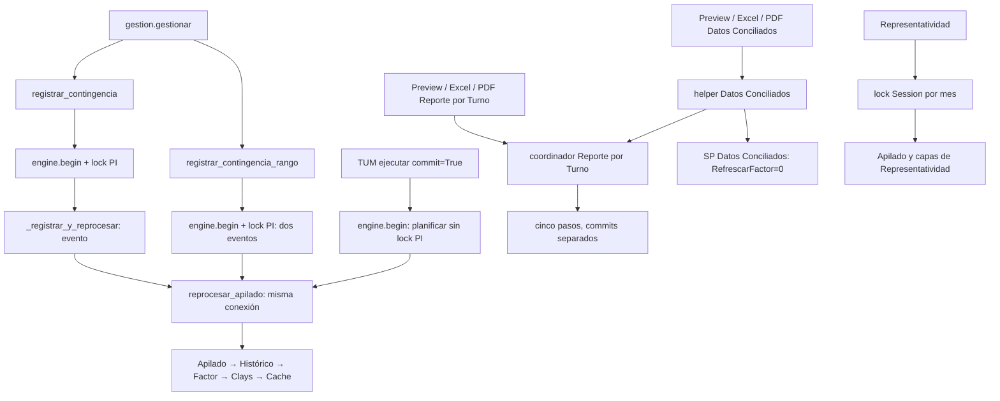

# FASE 4 — atomicidad, recuperación y concurrencia: diagnóstico DEV

**No se implementó ningún cambio.** Se inspeccionaron el repositorio actual y las definiciones SQL obtenidas de DEV en esta sesión. No se ejecutaron mantenedores, eventos PI/TUM, inyecciones de fallo ni pruebas concurrentes contra datos reales. No hubo cambios de código de aplicación, tests, definiciones SQL, fórmulas o reglas SRR; tampoco commits, push, borrado de objetos o promoción. PROD no se modificó.

## 1. Hallazgos principales

1. **FASE 3 conserva atomicidad para un caller que usa la transacción externa y propaga el error.** `reprocesar_apilado(conn, inicio, fin)` usa exclusivamente `conn` para los cinco pasos. No abre otra conexión ni confirma entre ellos. Alta/cierre/rango incluyen el registro dentro de esa transacción. El postproceso TUM incluye todos sus grupos de fechas en una transacción, pero la importación TUM ya confirmada queda fuera.
2. **No todo PI/TUM comparte el lock global.** Alta/cierre/rango adquieren `SIIR_CONTINGENCIA_PI_APILADO_DEV`; el postproceso TUM no lo adquiere y `reprocesar_apilado` tampoco. Por tanto la afirmación general «PI/TUM está serializado por ese lock» es incorrecta para TUM tardío.
3. **Reporte por Turno y Datos Conciliados no adquieren ese lock ni otro equivalente para toda la cadena.** Conservan commits por wrapper. Pueden entrelazarse con PI/TUM, TUM y entre sí, aunque ciertos DML se bloqueen por las tablas compartidas.
4. **Clays y Cache pueden revertir toda la transacción externa.** Ambos tienen `IF @@TRANCOUNT > 0 ROLLBACK TRANSACTION; THROW;`. Esto no deja un commit parcial dentro de la operación PI/TUM: aborta la unidad completa. Sí impide continuar en esa transacción o recuperar únicamente el paso mediante savepoint.
5. **Clays tiene lock propio, pero lo toma después de calcular `#fuente`, `#destino` y `#acciones`.** Serializa la escritura, no todo el cálculo previo. Dos llamadas pueden preparar decisiones sobre el mismo estado anterior y escribirlas sucesivamente; una inserción calculada como faltante puede resultar obsoleta. No se afirma que ya haya ocurrido un duplicado: eso también depende de claves/constraints y de los datos.
6. **Hay otro writer relevante: Representatividad.** Refresca Control de apilado bajo un lock de sesión por mes, diferente del lock PI/TUM. No mantiene Histórico/Factor/Cache en esa ruta. Serializar únicamente PI y los dos reportes dejaría este acceso fuera de la protección y tampoco resolvería por sí solo una invalidación downstream posterior.
7. **La segunda llamada al factor de Datos Conciliados está desactivada en su coordinador actual**, tal como describe el estado cerrado de FASE 2: `refrescar_factor=False`. En DEV el SP tiene `@RefrescarFactor bit=1` e `IF @RefrescarFactor=1`. Otros callers que omitan el parámetro conservan el comportamiento por defecto. No se debe rehacer la solución anterior ni eliminar esa llamada.
8. **DEV usa READ COMMITTED sin RCSI.** La conexión de inspección registró isolation level 2; `is_read_committed_snapshot_on=false` y snapshot isolation OFF. Una transacción evita commits parciales, pero no congela todas las fuentes durante múltiples SELECT bajo ese aislamiento.

## 2. Alcance y evidencia

Se capturaron 297 módulos SQL visibles en [catalogo_dev.json](catalogo_dev.json), las ocho definiciones relevantes separadas, [dependencias.json](dependencias.json), [triggers.json](triggers.json), [jobs.json](jobs.json), [sesion.json](sesion.json) y [aislamiento.json](aislamiento.json). La conexión se comprobó mediante `_engine_dev()` y `_assert_dev_connection()` antes de las consultas. La lectura de msdb solo inventarió jobs del servidor DEV: apareció `syspolicy_purge_history`, sin job de esta cadena. No aparecieron triggers de tabla en el catálogo visible.

El inventario cubre código visible y módulos accesibles con esa conexión; no certifica ausencia de aplicaciones externas, scripts ad hoc o SQL dinámico construido fuera del repositorio. Las referencias textuales incluyen comentarios, declaraciones y scripts diagnósticos: **no se cuentan todos los matches como callers ejecutables**. Las dos dependencias SQL ejecutables directas encontradas para los cinco mantenedores son el wrapper diario de Histórico y el mantenedor de Datos Conciliados hacia factor.

[callers_python.json](callers_python.json) enumera 52 callsites con archivo/función/línea, incluidos tests y validadores. [referencias_python.txt](referencias_python.txt) conserva referencias a nombres SQL y applocks; [referencias_sql.json](referencias_sql.json) y [locks_sql.json](locks_sql.json) conservan el inventario del catálogo. Las líneas SQL citadas son aproximadas: algunas definiciones traen líneas vacías y CR duplicados; se identifica además el fragmento literal para evitar ambigüedad.

## 3. Call graph actual



### PI/TUM

|Archivo / función|Líneas aproximadas|Conexión, operación y propagación|
|---|---|---|
|`monitor_pi_tum/gestion.py::gestionar`|575; llamadas 632,637,649; errores 665–682|UI llama alta/rango/cierre; presenta error después de propagarse desde DB|
|`monitor_pi_tum/db.py::registrar_contingencia`|496–502|`with _engine_dev().begin()` → `_registrar_y_reprocesar`|
|`db.py::_registrar_y_reprocesar`|460–494|Guard DEV, validación, lock 468, lectura estado/version esperada, EXEC registro 486, reproceso 491, preview antes de salir|
|`db.py::registrar_contingencia_rango`|159–191|Una transacción en 165; guard, lock 170, validación de solapamiento con `UPDLOCK,HOLDLOCK`, registro de activación/cierre y reproceso 187|
|`db.py::reprocesar_apilado`|302–443|Guard misma conexión; EXEC Apilado 327, Histórico 349, Factor 371, Clays 404, Cache 430; no lock global aquí|
|`monitor_pi_tum/postprocesar_tum_contingencia.py::ejecutar`|116–136|`engine.begin()` 122, guard, `planificar`, grupos y reproceso 127, verificación final; excepción se relanza; dry-run solo consulta|
|`postprocesar_tum_contingencia.py::planificar`|51–96|Lee batch/history DEV y contingencia para determinar fechas; no toma lock PI antes de planificar|

Son **tres callsites de aplicación** de `reprocesar_apilado`: rango, acción puntual y postproceso TUM. Tests reemplazan frecuentemente esa función por mocks; no son callers productivos de los cinco SP.

### Reportes y otros accesos

|Archivo / función|Líneas|Llamadas / transacciones|
|---|---|---|
|`report_export/report_export.py::refrescar_dependencias_reporte_turno_emision`|2084; 2112,2137,2139,2141|Apilado → Histórico por rangos materializados → Factor → wrapper Clays/Cache; conexiones independientes; validación final|
|`report_export.py::actualizar_apilado_tmh_v2_report`|2156; EXEC 2174; begin 2180|Mantenedor Apilado|
|`report_export.py::refrescar_historico_apilado_report`|684; EXEC 697; begin 704|Mantenedor Histórico, parámetros explícitos|
|`report_export.py::actualizar_factor_ajuste_camiones_v2_report`|2191; EXEC 2200; begin 2206|Mantenedor Factor V2|
|`report_export.py::actualizar_reporte_turno_cache_emision`|2217; EXEC 2241/2265; begin 2247/2270|Primero Clays y commit; luego Cache en otra transacción|
|`callbacks/reportabilidad_cb.py::generar_reporte`|7383; RT 7483; DC 7557|Preview: coordinador RT o helper DC, luego lecturas|
|`callbacks/reportabilidad_cb.py::exportar_excel`|7712; RT 7814; DC 7917|Excel: mismos coordinadores, luego lecturas y render|
|`callbacks/reportabilidad_cb.py::generar_pdf`|8180; RT 8253; DC 8324|PDF: mismos coordinadores, luego lecturas y render|
|`callbacks/reportabilidad_cb.py::_refrescar_dependencias_datos_conciliados`|124; 141,154,158|Coordinador RT → wrapper DC con `refrescar_factor=False`; mantiene período solicitado completo para DC y corte operacional de RT|
|`report_export.py::actualizar_datos_conciliados_emision_report`|776–814|Propia transacción; `@RefrescarFactor` enviado explícitamente; por defecto Python=True|
|`report_export.py::refrescar_representatividad_para_exportacion`|1463; 1504; 1540–1575|Apilado → resumen → representatividad → BD Ton; misma sesión, transacciones por paso, lock mensual Session|
|`report_export.py::armar_paquete_reporte_torre_oficial`|2822|Llama al refresco Representatividad|
|`callbacks/reportabilidad_cb.py::_cargar_detalle_representatividad_periodo`|864|También llama al refresco Representatividad|
|`callbacks/report_cb.py::generar_y_descargar`|25; Histórico 32|Ruta antigua: Histórico → mantenedor Datos Conciliados antiguo. Existe en código; no encontré referencia de importación de `report_cb` en los módulos Python inspeccionados de `report_export`, por lo que no certifico que esté activa|
|SQL `sp_refrescar_historico_apilado_diario`|EXEC ~8, catálogo|Caller SQL de Histórico; no job ejecutor de esa ruta identificado en msdb|
|SQL `sp_mantiene_datos_conciliados_emision_test`|EXEC ~95|Caller condicional de Factor V2; predeterminado 1, coordinador actual envía 0|

Los validadores/inspectores y pruebas que mencionan estos SP están en los anexos, separados de los accesos de aplicación. Ejecutar esos scripts manualmente puede saltarse la coordinación; no se ejecutaron en esta fase.

La búsqueda adicional en todo el repositorio, sin depender de `.gitignore`, está en [referencias_repo_completo.txt](referencias_repo_completo.txt). Identificó además estos callers manuales:

|Archivo / función|Línea aproximada|Acción|
|---|---|---|
|`scripts/validate_trazabilidad_analitos_dev.py::main`|28|EXEC Cache por cursor; commit explícito; salvo `TRAZ_READ_ONLY=1`|
|`docs/migrations/dev_clays_cufe_fuente_conciliacion/refresh_and_validate_dev.py::main`|88,104|EXEC Clays con escritura y después Cache; herramienta manual, no coordinador de UI|
|`docs/migrations/dev_clays_cufe_fuente_conciliacion/audit_preview_dev.py::main`|46|EXEC Clays en modo preview; no equivale al camino de escritura protegido|

`db_startup_check.py` solo enumera requisitos de objetos; `build_sql_diff.py` y `apply_dev.py` de esa migración construyen/instalan definiciones, no son llamadas de refresco de la aplicación. No se ejecutaron ni modificaron. El cargador `cargar_informes_tum.py` no aparece como archivo del workspace inspeccionado; no se presume que la importación y el postproceso compartan una transacción. El postprocesador presente exige que el batch ya esté `committed`.

## 4. Matriz SQL real

Leyenda: «No» significa que la cláusula no aparece en el cuerpo inspeccionado, no que el SP ejecute fuera de una transacción heredada. [matriz_sql.json](matriz_sql.json) cuenta las cláusulas tras excluir comentarios.

|SP|XACT_ABORT|BEGIN/COMMIT/ROLLBACK|TRY/CATCH|@@TRANCOUNT|XACT_STATE|applock / owner|Isolation explícito|MERGE HOLDLOCK|
|---|---|---|---|---|---|---|---|---|
|`sp_mantiene_apilado_tmh_v2_test`|ON ~10|No/No/No|No|No|No|No|No|Sí ~1043–1045|
|`sp_refrescar_historico_apilado_test`|ON ~14|No/No/No|No|No|No|No|No|No|
|`sp_mantiene_factor_ajuste_camiones_v2_test`|ON ~11|No/No/No|No|No|No|No|No|Sí ~382–384|
|`sp_refrescar_clays_cufe`|ON ~21|Sí 958 / Sí 1592 / Sí 1602|Sí 956/1598|Sí 1600|No|Sí 966; Transaction|No|No|
|`sp_actualizar_reporte_turno_cache_emision_test`|ON ~12|Sí 21 / Sí 77 / Sí 81|Sí 20/79|Sí 80|No|No|No|No|
|`sp_reporte_turno_emision_test`|No explícito|No/No/No|No|No|No|No|No|No|
|`sp_registrar_contingencia_pi_test` (complemento)|ON|No/No/No|No|No|No|No|No|No|
|`sp_mantiene_datos_conciliados_emision_test` (complemento)|ON|No/No/No|Sí, limpia SESSION_CONTEXT y relanza|No|No|No|No|MERGE sin HOLDLOCK|

El SP del reporte hereda el contexto del llamador: Cache lo llama bajo XACT_ABORT ON. Invocarlo directamente no equivale a ejecutar un SELECT inocuo.

|SP|Tablas persistentes modificadas y evidencia|
|---|---|
|Registro|`contingencia_pi_accion_test`: INSERT; no lock propio ni transacción propia|
|Apilado|`Control_Apilado_TMH_v2_test`: MERGE HOLDLOCK; el resto del cálculo usa temporales|
|Histórico|`Historico_Apilado_Diario`: DELETE ~24 + INSERT ~27, sin transacción propia|
|Factor V2|`Control_Factor_Ajuste_Camiones_v2_test`: MERGE HOLDLOCK; calculador insertado en temporal|
|Clays|`Clays_CuFe`: UPDATE c ~1002, INSERT ~1304; `Clays_CuFe_trazabilidad`: INSERT ~1372|
|Cache|`reporte_turno_cache_emision_test`: DELETE ~23 + INSERT EXEC reporte ~27/73; escritura indirecta de trazabilidad mediante reporte|
|Reporte|`trazabilidad_analitos_tm_emision_test`: DELETE ~2044 + INSERT ~2047; los numerosos UPDATE anteriores son sobre tablas temporales/aliases temporales|
|Datos Conciliados|`Datos_conciliados_of`: MERGE ~582; factor solo si `@RefrescarFactor=1`; SESSION_CONTEXT se limpia tanto al terminar como en CATCH|

Sin transacción externa, Histórico podría confirmar DELETE e INSERT por separado en autocommit. Los wrappers inspeccionados sí lo envuelven. HOLDLOCK en los dos MERGE protege sus destinos durante la transacción; **no serializa por sí mismo el cálculo completo ni coordina los cinco mantenedores**.

## 5. Rollback anidado y estado final

Clays y Cache tienen literalmente:

```sql
BEGIN TRY
    BEGIN TRANSACTION;
    -- trabajo
    COMMIT TRANSACTION;
END TRY
BEGIN CATCH
    IF @@TRANCOUNT > 0
        ROLLBACK TRANSACTION;
    THROW;
END CATCH;
```

|Momento|@@TRANCOUNT|Estado y efecto|
|---|---|---|
|Entrada desde `engine.begin()` con transacción activa|1|Trabajo previo aún no confirmado|
|BEGIN interno|2|Misma transacción, contador incrementado|
|Éxito: COMMIT interno|1|No confirma el trabajo externo; locks Transaction siguen hasta su final|
|Error antes del rollback|1/2 o 0, según error|Puede estar activa, no confirmable (`XACT_STATE=-1`) o ya abortada|
|CATCH con rollback sin savepoint|0|Revierte toda la transacción, incluidos eventos y pasos anteriores; XACT_STATE=0 después del rollback completo|
|THROW y salida Python|0 en servidor si ya se abortó|Excepción sube; contexto externo debe abandonarse, sin pasos posteriores|

SQL Server no ofrece commits independientes para transacciones anidadas. Un rollback sin savepoint afecta a la externa y pone el contador a cero; el commit interno solo decrementa el contador. Esto explica tanto la prueba exitosa de FASE 3 comunicada por el usuario como el fallo conceptual analizado aquí. Fuentes: [BEGIN TRANSACTION](https://learn.microsoft.com/en-us/sql/t-sql/language-elements/begin-transaction-transact-sql?view=sql-server-ver17), [@@TRANCOUNT](https://learn.microsoft.com/en-us/sql/t-sql/functions/trancount-transact-sql?view=sql-server-ver16).

El `THROW` preserva el error; puede acompañarse de un diagnóstico SQL de desbalance de transacciones al retornar de un SP. El código Python no debe interpretar el contexto del objeto SQLAlchemy como prueba de que la transacción SQL sigue viva ni continuar escribiendo. Los callers actuales dejan escapar el error del contexto `begin`; la UI lo transforma en mensaje **después** de esa salida.

Los errores de validación o de preparación de Clays ocurridos antes de su TRY también suben al caller; no pasan por ese CATCH interno, pero el contexto externo hace rollback al salir con excepción. Un fallo de comunicación durante COMMIT es distinto: el cliente puede desconocer si se confirmó; no es seguro asumir rollback.

**No se necesita corregir los SP para conseguir rollback completo de PI/TUM.** El rollback global actual es compatible con abortar la unidad completa. Solo habría que cambiar ese contrato si se quisiera recuperación parcial dentro de la misma transacción, objetivo que no se recomienda para esta cadena.

## 6. AppLocks y concurrencia

|Proceso / código|Resource|Mode|Owner|Timeout|Duración y cobertura|
|---|---|---|---|---|---|
|Alta/cierre/rango, `db.py:170,468`|`SIIR_CONTINGENCIA_PI_APILADO_DEV`|Exclusive|Transaction|10000 ms|Desde adquisición hasta commit/rollback externo; protege registro y cinco pasos, no las validaciones previas a adquirirlo|
|TUM tardío / reprocesar directo|Ninguno global|—|—|—|Solo adquiere después el lock interno de Clays|
|Reporte por Turno / Datos Conciliados|Ninguno global|—|—|—|Comparten únicamente el lock interno de Clays mientras ese paso está activo|
|Clays, SQL ~966|`inventar_SpcHidr.sp_refrescar_clays_cufe`|Exclusive|Transaction|10000 ms|Desde después de construir #acciones hasta commit/rollback externo si anidado; resultado negativo → THROW 50008|
|Cache|Sin applock|—|—|—|Transacción y locks DML, no mutex de aplicación|
|Representatividad, `report_export.py:1438–1575`|`rep_torres_refresco:YYYY-MM`|Exclusive|Session|180000 ms|Misma sesión entre commits por paso; release explícito en finally; recursos distintos para meses distintos|

Los recursos de applock se identifican también por base y principal; deben adquirirse en la misma base/principal para coordinarse. El nombre común por sí solo en otra base no bastaría. Un lock Session sobrevive a un commit; uno Transaction termina con la transacción. [Contrato oficial de sp_getapplock](https://learn.microsoft.com/en-us/sql/relational-databases/system-stored-procedures/sp-getapplock-transact-sql?view=sql-server-ver17).

|Proceso A|Proceso B|¿Pueden solaparse?|Riesgo real derivado del código|
|---|---|---|---|
|PI alta/cierre/rango|PI alta/cierre/rango|No en sección protegida; sí antes del lock|Segundo espera o timeout; estado se revalida dentro del lock; rango además usa UPDLOCK/HOLDLOCK|
|PI alta/cierre/rango|TUM tardío|Sí|TUM planifica sin lock y puede usar estado anterior; después espera por filas y recalcula con otra fotografía|
|TUM tardío|TUM tardío|Sí|No mutex de batch ni global; cálculo simultáneo, contención/deadlock, timestamps/auditoría duplicados|
|PI/TUM|Reporte por Turno|Sí|Reporte puede confirmar algunos pasos antes/después del commit PI, mezclando generaciones; locks de fila no cubren la cadena|
|PI/TUM|Datos Conciliados|Sí|Mismo riesgo y posibilidad de consumir cache/factor de diferentes generaciones entre coordinación y DC|
|Reporte por Turno|Datos Conciliados|Sí|Dos coordinadores con commits intermedios; DC envía factor=False, pero otro proceso todavía puede cambiarlo|
|Clays|Clays|Preparación sí; escritura protegida no|#acciones puede haberse calculado antes de que otra llamada escriba; lock tardío no invalida ni recalcula esa preparación|
|Cache|Cache|Sí en ejecución; DML puede bloquearse|DELETE/INSERT se protegen en cada transacción; no hay serialización de fuentes, ni garantía de misma versión para ambos cálculos|
|Representatividad|PI/TUM o reportes|Sí|Otro recurso de lock; cambia Control sin mantener downstream de Reporte por Turno|
|Representatividad mes M|Representatividad mes N|Sí cuando M≠N|Si los rangos reales se solapan, los recursos por mes final no representan ese solapamiento|

Ejemplo permitido: RT confirma factor n; PI confirma nuevo apilado/factor/cache; RT continúa su siguiente paso o realiza una lectura de otra tabla fuera de su coordinación. Puede obtener una combinación distinta de la que preparó inicialmente. No se afirma que toda intercalación produzca error, sino que no hay una garantía de exclusión/consistencia entre operaciones.

Un segundo ejemplo más directo: dos Clays construyen `#acciones` antes del lock; la primera confirma; la segunda obtiene el lock y aplica decisiones preparadas contra el destino anterior. No existe una segunda validación general del destino al adquirirlo.

La serialización de escritores tampoco resuelve lectores que consulten varias tablas tras liberar el lock. Para garantizar una exportación coherente hay que capturar todos sus datos bajo la misma protección, o validar una generación común y reintentar. El render de Excel/PDF puede ocurrir después de liberar el lock usando esos datos ya leídos.

## 7. Recuperación por punto de fallo

Escenarios conceptuales sustentados en los cuerpos reales; no se indujeron errores en DEV.

|Falla|PI alta/cierre/rango|Postproceso TUM|Reporte por Turno / preparación DC|
|---|---|---|---|
|A. después de Apilado|Rollback evento y Apilado|Rollback apilado y grupos previos; importación TUM permanece|Apilado ya confirmado; Histórico/factor/cache anteriores|
|B. después de Histórico|Rollback evento, Apilado e Histórico|Rollback conjunto del postproceso; batch importado permanece|Apilado e Histórico confirmados; factor/cache anteriores|
|C. después de Factor|Rollback todo lo anterior|Rollback todo el postproceso|Apilado/Histórico/Factor confirmados; cache anterior|
|D. dentro de Clays|Su CATCH puede revertir toda la externa; no persisten evento ni capas previas de esta operación|Igual para todos los grupos; no revierte la importación externa|Revierte transacción Clays; pasos anteriores siguen confirmados|
|E. dentro de Cache|Rollback total, incluido Clays y sus trazas de esta operación|Rollback total del postproceso, incluidos grupos anteriores|Revierte cache y traza del reporte en esa transacción; Clays y pasos anteriores quedan confirmados|
|Después de coordinación, dentro de DC|No aplica a FASE 3: DC no forma parte del evento PI|No aplica|Su propia transacción revierte DC; las cinco capas anteriores permanecen confirmadas|

Callers de excepción: `reprocesar_apilado` → `_registrar_y_reprocesar`/`registrar_contingencia_rango` → `registrar_contingencia` cuando corresponde → `gestion.gestionar`; o `reprocesar_apilado` → `postprocesar.ejecutar` → CLI/caller. En reportes: wrapper (algunos envuelven RuntimeError) → coordinador → helper DC si aplica → callback Preview/Excel/PDF. Ninguno de esos coordinadores compensa commits anteriores ni implementa retry automático.

El `except` del postproceso informa que TUM permanece cargado y puede reintentarse. La frase «no aplicado» es correcta ante rollback confirmado; no basta ante pérdida de respuesta de COMMIT: primero hay que reconciliar estado.

### Reintento seguro

- Tras un rollback confirmado por error transaccional, se puede repetir **la unidad completa**, con conexión/transacción nueva, guard DEV, lock y relectura/planificación. Nunca continuar desde Factor/Clays sobre un contexto abortado.
- TUM admite repetir batch y no añade eventos; aun así recalcula timestamps y puede cambiar trazabilidad: no es idempotencia byte a byte ni una garantía de exactamente una ejecución.
- Alta/cierre validan el estado y versión esperada. Una repetición después de un éxito puede rechazarse como transición inválida, no devolver el mismo resultado. No hay identificador durable de solicitud que demuestre exactamente una vez ante respuesta perdida.
- Timeout de applock y deadlock son candidatos a reintento acotado después de abortar y releer. Errores de negocio, rango, estado o datos pendientes no deben reintentarse ciegamente.
- Tras COMMIT de resultado ambiguo, consultar bitácora y capas antes de decidir. Sin identidad de solicitud, no automatizar una nueva alta como si se supiera que la anterior falló.

## 8. Tests existentes: qué prueban y qué no

No se reejecutaron las validaciones cerradas de FASES 1–3 ni se modificaron tests. Esta fase inventaría cobertura; **no presenta un nuevo resultado PASS de concurrencia**.

|Archivo y ejemplos|Cobertura actual|Brecha|
|---|---|---|
|`monitor_pi_tum/test_gestion.py:171,195,207`|Un contexto transaccional, cierre desde activación, rechazo de transición/versión obsoleta|`reprocesar_apilado` está mockeado: no ejecuta cinco SP ni rollback anidado real|
|`monitor_pi_tum/test_rango.py:88`|Dos eventos, un reproceso, excepción en activar/cerrar/reproceso; salida de contexto con error|Mocks; no bloqueo entre dos sesiones SQL ni recuperación después de Clays/cache|
|`monitor_pi_tum/test_postprocesar_tum_contingencia.py:101,121`|Repetir batch sin nuevos eventos, agrupación, guard, propagación del fallo y contexto rollback|Reproceso mockeado; no lock global TUM, no plan obsoleto por cierre concurrente|
|`monitor_pi_tum/test_guard_dev.py`|Identidad efectiva y bloqueo antes de escribir|No prueba coordinación de reportes ni sesiones concurrentes|
|`monitor_pi_tum/validate_atomicity_dev.py:62–98`|Validador empírico de bitácora rollback con reproceso reemplazado por excepción|No ejecuta fallos internos de los cinco pasos; compara apilado/eventos, no todas las capas|
|`report_export/tests/test_orquestacion_reporte_turno.py:12,50,72,151,163`|Orden/rango/corte, faltantes, commits previos simulados, Clays antes de cache y consumidores comunes|No prueba exclusión real, aislamiento, deadlocks o atomicidad SQL de cadena|
|`report_export/tests/test_refresco_representatividad.py:213,245,267`|Adquirir/liberar lock de sesión, timeout y finally en mocks|No coordina con PI/reportes; no demuestra seguridad entre meses con rango solapado|
|`report_export/tests/test_error_modal_exportacion.py:16`|Expectativa antigua de Histórico → Cache → DC, mocks de wrappers y exportación|**Desalineado con FASE 2 actual:** no mockea el coordinador RT que ahora se llama; puede escapar a conexión real. No certifica el flujo nuevo|
|`report_export/tests/test_datos_conciliados_excel.py`|Plantilla, columnas, resumen y cálculos de presentación|No atomicidad ni exclusión con PI/TUM|

La prueba de FASE 3 comunicada por el usuario (`@@TRANCOUNT 1→1`, rollback manual restaura estado) y el batch 20453 se aceptan como antecedentes cerrados. Demuestran éxito/rollback exterior y selección de fechas de ese caso; no demuestran serialización de TUM con reportes ni rollback por error interno de los SP.

## 9. Propuesta mínima, sin implementar

**Primero conservar lo correcto:** firma de `reprocesar_apilado`, misma conexión PI/TUM, orden de cinco pasos, rangos y parámetros validados, factor=False de DC, guard DEV y propagación de errores. No cambiar fórmulas, selección SRR, SP oficiales ni nombres. No hace falta tocar los CATCH SQL actuales para abortar la unidad completa.

### Exclusión común y planificación

Usar un único recurso DEV para todos los escritores de esta fotografía, reutilizando `SIIR_CONTINGENCIA_PI_APILADO_DEV`, adquirido en la base/principal iguales. Evitar locks por rango/mes como primera solución: rangos que se solapan pueden obtener nombres distintos.

En PI alta/cierre/rango, mantener adquisición antes de validar estado y escribir. En TUM, adquirirlo **antes de `planificar`**, no solo dentro del reproceso después de que el plan pueda estar obsoleto. Proteger también las invocaciones directas del helper, con adquisición reentrante bajo la misma transacción si fuera necesaria. Todas las rutas deben seguir orden uniforme: lock global → locks de tablas/Clays; nunca obtener global después de poseer un lock más específico.

### Reportes sin fotografías parcialmente confirmadas

Solo añadir un lock de sesión alrededor de los wrappers independientes reduce intercalación, pero **no** evita que una falla deje Factor nuevo y Cache anterior. Por eso no alcanza para garantizar que otro reporte no consuma un estado parcial tras liberar el lock.

La propuesta suficiente es permitir una conexión/transacción externa en los wrappers de Reporte por Turno, y ejecutar la unidad normal completa bajo ella y el lock común. Para Datos Conciliados, incluir su mantenedor posterior con `refrescar_factor=False` en la unidad que publica esa fotografía. Mantener los contratos de fechas y la selección operacional de FASES 1–2; no modificar la firma pública PI/TUM. Leer los datasets necesarios antes de liberar la protección; renderizar fuera de la transacción.

Esto modifica la frontera transaccional de reportes, no sus resultados ni fórmulas. Es una propuesta de FASE 4, **no un cambio realizado**. Si se decide conservar los commits independientes de reportes, hará falta un protocolo adicional de estado válido/inválido o generación publicada; ya no sería la corrección mínima y no debe prometerse atomicidad.

### Writers adicionales

Representatividad debe entrar en la misma exclusión **antes** de leer/calcular apilado. Su lock mensual no basta. Además, si cambia apilado debe completar o invalidar de forma controlada las capas downstream antes de permitir que se consuman: un lock solo serializa la inconsistencia si la ruta termina tras actualizar únicamente Control. Esto exige coordinar su refresco de apilado con el núcleo común sin alterar las reglas de Representatividad. El callback antiguo, ejecuciones directas de SP y wrapper diario de Histórico deben quedar cubiertos o declararse fuera de operación concurrente; una solución Python no puede impedir escrituras ad hoc que ignoran el contrato.

### Recuperación

Reintentar una operación completa en conexión nueva solo para fallas transitorias identificadas y con rollback confirmado. Guard DEV y lock se toman en cada intento; se recalculan plan y estado. Registrar paso fallido y resultado transaccional; no ocultar el error original con una falla secundaria de cleanup. Ante commit ambiguo, reconciliar antes de repetir eventos. Una garantía exactamente-una-vez exigiría identidad durable de solicitud: no se incluye una nueva tabla/regla en esta propuesta mínima.

No introducir savepoints para sobrevivir a los ROLLBACK globales de Clays/cache. No agregar convergencia SRR ni cambiar la metodología para resolver un problema de coordinación.

## 10. Pruebas que deberían agregarse

1. Contrato PI de cinco EXEC con misma conexión, sin commits intermedios, y parámetros inclusivos/exclusivos; complementar mocks actuales que reemplazan todo el reproceso.
2. Fallo controlado después de Apilado, Histórico y Factor: verificar desde otra conexión que evento, Control, Histórico, Factor, Clays, ambas trazas y Cache conservan baseline tras rollback.
3. Fallos dentro de Clays/cache: comprobar `@@TRANCOUNT`, `XACT_STATE`, propagación de error y ausencia de escrituras posteriores. Usar fixtures aisladas o mecanismos de inyección previamente autorizados; no alterar SP reales para simular aquí.
4. Dos sesiones reales para cada par de la matriz: espera/timeout esperado, ninguna escritura antes del lock, liberación tras commit/rollback y orden uniforme sin inversión de locks.
5. Cierre PI concurrente con TUM: planificar solo después de obtener lock, releer contingencia y probar fechas disjuntas y solapadas.
6. Dos Clays preparados sobre mismo destino: demostrar riesgo actual y verificar que la coordinación externa comienza antes de la preparación.
7. Reporte y DC con failure entre pasos: ninguna fotografía parcial publicable; lecturas del reporte y factores pertenecen a la misma unidad capturada.
8. Deadlock/timeout/cancelación/desconexión: política de retry acotado; distinguir rollback confirmado de commit ambiguo; sin duplicar evento por respuesta perdida.
9. Reutilización de conexiones del pool: ningún lock Session ni `SESSION_CONTEXT` residual; tests de error durante liberación.
10. Mantener regresiones FASES 1–3, `@RefrescarFactor=0`, corte operacional, TUM solo fechas impactadas, guard PROD y reglas PENDIENTE_TUM. Actualizar mocks antiguos de Datos Conciliados para que no accedan accidentalmente a SQL.

## 11. Archivos exactos propuestos si se autoriza

|Archivo|Cambio funcional propuesto|
|---|---|
|`monitor_pi_tum/db.py`|Centralizar/usar adquisición común DEV; conservar firma y transacción de reproceso; cubrir llamadas directas sin debilitar validación previa al evento|
|`monitor_pi_tum/postprocesar_tum_contingencia.py`|Adquirir lock antes del plan y mantenerlo hasta commit; retry solo de unidad completa y casos identificados|
|`report_export/report_export.py`|Conexión externa opcional en wrappers/coordinador; unidad transaccional y lock de reportes; coordinación del writer Representatividad; lectura de datasets coherente|
|`report_export/callbacks/reportabilidad_cb.py`|Mantener unidad del coordinador hasta DC/lecturas necesarias; preservar factor=False y renderizar fuera del lock|
|`downstream_dev.py` (nuevo, propuesto)|Helper pequeño compartido de guard/lock/contexto para evitar dependencias circulares entre monitor y exportador; sin fórmulas SQL|
|`report_export/callbacks/report_cb.py` (condicional)|Solo si se confirma activación/importación de la ruta antigua: dirigirla a coordinación común o impedir ejecución simultánea fuera del contrato|
|`monitor_pi_tum/test_gestion.py`, `test_rango.py`, `test_postprocesar_tum_contingencia.py`|Ampliar contratos a cadena real simulada y adquisición antes de planificar|
|`report_export/tests/test_orquestacion_reporte_turno.py`, `test_refresco_representatividad.py`, `test_error_modal_exportacion.py`|Actualizar cobertura de transacción común y locks, conservando reglas funcionales|
|`monitor_pi_tum/test_downstream_concurrencia_dev.py` (nuevo, propuesto)|Pruebas opt-in de integración con dos sesiones y fixtures DEV aisladas|

**Definiciones SQL a modificar en la propuesta inicial: ninguna.** Si se exige protección incluso contra clientes que ejecutan SP directamente, habrá que autorizar en otra decisión un contrato SQL común o restringir esos accesos; no lo resuelve un mutex Python.

## 12. Decisión técnica

PI de FASE 3 ya tiene la frontera transaccional necesaria para rollback completo. Lo pendiente es **extender la coordinación a TUM y a los otros escritores/lectores de la fotografía**, y resolver los commits parciales de reportes si se exige consistencia tras fallos. No es necesario ni conveniente comenzar cambiando fórmulas, reglas SRR o reemplazando el rollback global de Clays/cache.

Se entregan únicamente este informe y evidencias de lectura. Las limitaciones de concurrencia son conclusiones del código y de la configuración observada, no resultados de carreras ejecutadas. No se implementó FASE 4 ni se repitió FASE 1, 2 o 3.
