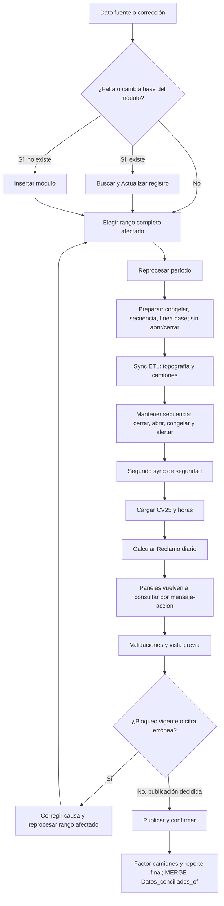

# Flujo real de botones y datos

`Refrescar vista` es una rama de consulta manual desde cualquier estado: repite `SELECT` de paneles. No reemplaza ninguna etapa de `Reprocesar`.

`Actualizar secuencia de módulos` invoca solo la etapa de mantención, fuera del flujo habitual. Puede generar cambios y alertas, pero no sincroniza el rango ni recalcula `calculo_diario`.

El `MERGE` de Publicar consume `v_reclamo_para_conciliados`, derivada de `calculo_diario`. El SP final tiene lógica propia del reporte y factor de camiones; no repite la cadena de preparación de Reclamo.
